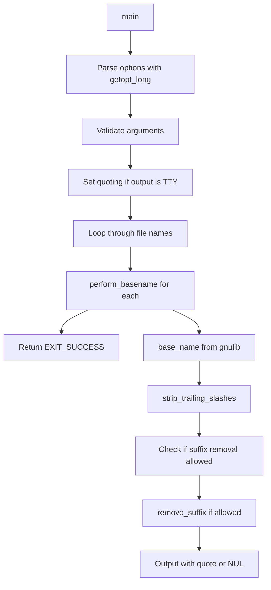

# `basename`: strip directory and suffix from file names

Source: `src/basename.c` · Tests: `tests/misc/basename.pl` · Manual: `info '(coreutils) basename invocation'`

`basename` removes leading directory components from file names, and optionally removes a trailing suffix. It supports multiple file names with `-a` and NUL-terminated output with `-z`. The implementation handles POSIX edge cases like `//` and Windows drive letters, and automatically quotes output when writing to a terminal.

## Options

| Option | Description |
|--------|-------------|
| `-a, --multiple` | Support multiple arguments and treat each as a NAME |
| `-s, --suffix=SUFFIX` | Remove a trailing SUFFIX; implies `-a` |
| `-z, --zero` | End each output line with NUL, not newline |
| `--help` | Display help and exit |
| `--version` | Output version information |

## Code map

| Function | Location | Role |
|----------|----------|------|
| `remove_suffix` | `src/basename.c:93-104` | Remove suffix from name if present, unless name is entirely suffix |
| `perform_basename` | `src/basename.c:110-130` | Strip directory and suffix from one name and output it |
| `main` | `src/basename.c:132-215` | Parse options, validate arguments, process all names |
| `usage` | `src/basename.c:43-88` | Print usage message |

## How it works

The main function parses options, validates arguments, and processes each file name.



### Suffix removal

`remove_suffix` compares the end of the name with the suffix character by character, walking backwards from both strings. If a mismatch is found, it returns without modification. If the entire suffix matches but there are characters before it in the name, it truncates the name at that point (`src/basename.c:99-103`). This prevents removing a suffix when the name consists entirely of the suffix.

### POSIX edge cases

Per POSIX, `basename // /` must return `//` on platforms with distinct `//`. The code handles this by skipping suffix stripping if `base_name` returned an absolute path or a drive letter, which only occurs for file-system roots (`src/basename.c:123-125`). The check uses `IS_RELATIVE_FILE_NAME` and `FILE_SYSTEM_PREFIX_LEN` macros.

### Output quoting

When output is not NUL-terminated and stdout is a terminal, the program detects the quoting style from the environment with `getenv_quoting_style` (`src/basename.c:196`). If the style is not `literal_quoting_style`, it sets the quoting style and enables `quote_output`. Output then uses `quoteN` instead of the raw string (`src/basename.c:127`).

## Platform notes

- The program uses gnulib's `base_name` function for portability across different path semantics
- `FILE_SYSTEM_PREFIX_LEN` handles Windows drive letters like `C:`
- `IS_RELATIVE_FILE_NAME` checks for absolute paths in a platform-independent way
- No conditional compilation for specific platforms; all logic is runtime

## Errors and exit status

| Error | Exit status |
|-------|-------------|
| Missing operand | EXIT_FAILURE (usage called) |
| Extra operand in single-name mode | EXIT_FAILURE (usage called) |
| Success | EXIT_SUCCESS |

Errors are reported with `error()` and include a message before calling `usage(EXIT_FAILURE)`.

## Tests

| Test file | Coverage |
|-----------|----------|
| `tests/misc/basename.pl` | Comprehensive Perl tests for basename functionality |

## See also

- [`dirname`](dirname.md) - Complementary command that strips the last component
- [`pathchk`](pathchk.md) - Check portability of file names

## Source code

`src/basename.c:1`

```c
/* basename -- strip directory and suffix from file names
   Copyright (C) 1990-2026 Free Software Foundation, Inc.

   This program is free software: you can redistribute it and/or modify
   it under the terms of the GNU General Public License as published by
   the Free Software Foundation, either version 3 of the License, or
   (at your option) any later version.

   This program is distributed in the hope that it will be useful,
   but WITHOUT ANY WARRANTY; without even the implied warranty of
   MERCHANTABILITY or FITNESS FOR A PARTICULAR PURPOSE.  See the
   GNU General Public License for more details.

   You should have received a copy of the GNU General Public License
   along with this program.  If not, see <https://www.gnu.org/licenses/>.  */

#include <config.h>
#include <getopt.h>
#include <stdio.h>
#include <sys/types.h>

#include "argmatch.h"  /* argmatch($QUOTING_STYLE).  */
#include "system.h"
#include "quote.h"

/* The official name of this program (e.g., no 'g' prefix).  */
#define PROGRAM_NAME "basename"

#define AUTHORS proper_name ("David MacKenzie")

static bool quote_output;

static struct option const longopts[] =
{
  {"multiple", no_argument, NULL, 'a'},
  {"suffix", required_argument, NULL, 's'},
  {"zero", no_argument, NULL, 'z'},
  {GETOPT_HELP_OPTION_DECL},
  {GETOPT_VERSION_OPTION_DECL},
  {NULL, 0, NULL, 0}
};

void
usage (int status)
{
  if (status != EXIT_SUCCESS)
    emit_try_help ();
  else
    {
      printf (_("\
Usage: %s NAME [SUFFIX]\n\
  or:  %s OPTION... NAME...\n\
"),
              program_name, program_name);
      fputs (_("\
Print NAME with any leading directory components removed.\n\
If specified, also remove a trailing SUFFIX.\n\
"), stdout);

      emit_mandatory_arg_note ();

      oputs (_("\
  -a, --multiple\n\
         support multiple arguments and treat each as a NAME\n\
"));
      oputs (_("\
  -s, --suffix=SUFFIX\n\
         remove a trailing SUFFIX; implies -a\n\
"));
      oputs (_("\
  -z, --zero\n\
         end each output line with NUL, not newline\n\
"));
      oputs (HELP_OPTION_DESCRIPTION);
      oputs (VERSION_OPTION_DESCRIPTION);
      printf (_("\
\n\
Examples:\n\
  %s /usr/bin/sort          -> \"sort\"\n\
  %s include/stdio.h .h     -> \"stdio\"\n\
  %s -s .h include/stdio.h  -> \"stdio\"\n\
  %s -a any/str1 any/str2   -> \"str1\" followed by \"str2\"\n\
"),
              program_name, program_name, program_name, program_name);
      emit_ancillary_info (PROGRAM_NAME);
    }
  exit (status);
}

/* Remove SUFFIX from the end of NAME if it is there, unless NAME
   consists entirely of SUFFIX.  */

static void
remove_suffix (char *name, char const *suffix, idx_t suffix_len)
{
  char *np = name + strlen (name);
  char const *sp = suffix + suffix_len;

  while (np > name && sp > suffix)
    if (*--np != *--sp)
      return;
  if (np > name)
    *np = '\0';
}

/* Perform the basename operation on STRING.  If SUFFIX has a positive
   length of SUFFIX_LEN bytes, remove the trailing SUFFIX.
   Finally, output the result string.  */

static void
perform_basename (char const *string, char const *suffix, idx_t suffix_len,
                  bool use_nuls)
{
  char *name = base_name (string);
  strip_trailing_slashes (name);

  /* Per POSIX, 'basename // /' must return '//' on platforms with
     distinct //.  On platforms with drive letters, this generalizes
     to making 'basename c: :' return 'c:'.  This rule is captured by
     skipping suffix stripping if base_name returned an absolute path
     or a drive letter (only possible if name is a file-system
     root).  */
  if (0 < suffix_len && IS_RELATIVE_FILE_NAME (name)
      && ! FILE_SYSTEM_PREFIX_LEN (name))
    remove_suffix (name, suffix, suffix_len);

  fputs (quote_output ? quoteN (name) : name, stdout);
  putchar (use_nuls ? '\0' : '\n');
  free (name);
}

int
main (int argc, char **argv)
{
  bool multiple_names = false;
  bool use_nuls = false;
  char const *suffix = NULL;

  initialize_main (&argc, &argv);
  set_program_name (argv[0]);
  setlocale (LC_ALL, "");
  bindtextdomain (PACKAGE, LOCALEDIR);
  textdomain (PACKAGE);

  atexit (close_stdout);

  while (true)
    {
      int c = getopt_long (argc, argv, "+as:z", longopts, NULL);

      if (c == -1)
        break;

      switch (c)
        {
        case 's':
          suffix = optarg;
          /* -s implies -a, so...  */
          FALLTHROUGH;

        case 'a':
          multiple_names = true;
          break;

        case 'z':
          use_nuls = true;
          break;

        case_GETOPT_HELP_CHAR;
        case_GETOPT_VERSION_CHAR (PROGRAM_NAME, AUTHORS);

        default:
          usage (EXIT_FAILURE);
        }
    }

  if (argc < optind + 1)
    {
      error (0, 0, _("missing operand"));
      usage (EXIT_FAILURE);
    }

  if (! multiple_names)
    {
      if (optind + 2 == argc)
        suffix = argv[optind + 1];
      else if (optind + 2 < argc)
        {
          error (0, 0, _("extra operand %s"), quote (argv[optind + 2]));
          usage (EXIT_FAILURE);
        }
    }

  if (!use_nuls && isatty (STDOUT_FILENO))
    {
      int qs = getenv_quoting_style ();
      if (qs < 0)
        qs = shell_escape_quoting_style;
      if (qs != literal_quoting_style)
        {
          set_quoting_style (NULL, qs);
          quote_output = true;
        }
    }

  idx_t suffix_len = suffix ? strlen (suffix) : 0;

  char **file = argv + optind;
  int n_files = multiple_names ? argc - optind : 1;

  for (int i = 0; i < n_files; ++i)
    perform_basename (file[i], suffix, suffix_len, use_nuls);

  return EXIT_SUCCESS;
}
```
