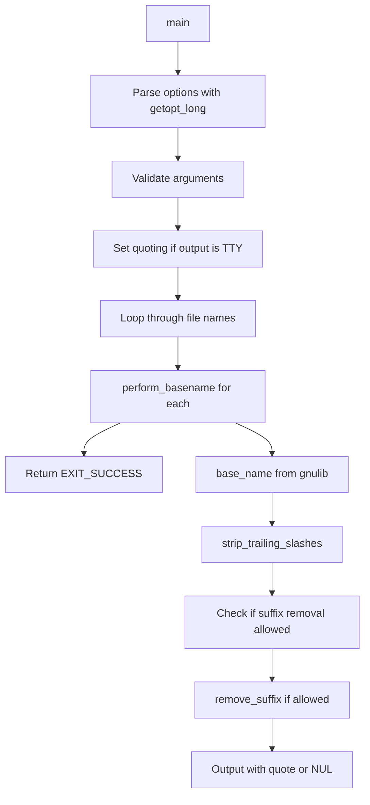

# `basename`: strip directory and suffix from file names

Source: `src/basename.c` · Tests: `tests/misc/basename.pl` · Manual: `info '(coreutils) basename invocation'`

`basename` removes leading directory components from file names, and optionally removes a trailing suffix. It supports multiple file names with `-a` and NUL-terminated output with `-z`. The implementation handles POSIX edge cases like `//` and Windows drive letters, and automatically quotes output when writing to a terminal.

## Options

| Option | Description |
|--------|-------------|
| `-a, --multiple` | Support multiple arguments and treat each as a NAME |
| `-s, --suffix=SUFFIX` | Remove a trailing SUFFIX; implies `-a` |
| `-z, --zero` | End each output line with NUL, not newline |
| `--help` | Display help and exit |
| `--version` | Output version information |

## Code map

| Function | Location | Role |
|----------|----------|------|
| `remove_suffix` | `src/basename.c:93-104` | Remove suffix from name if present, unless name is entirely suffix |
| `perform_basename` | `src/basename.c:110-130` | Strip directory and suffix from one name and output it |
| `main` | `src/basename.c:132-215` | Parse options, validate arguments, process all names |
| `usage` | `src/basename.c:43-88` | Print usage message |

## How it works

The main function parses options, validates arguments, and processes each file name.

### Suffix removal

`remove_suffix` compares the end of the name with the suffix character by character, walking backwards from both strings. If a mismatch is found, it returns without modification. If the entire suffix matches but there are characters before it in the name, it truncates the name at that point (`src/basename.c:99-103`). This prevents removing a suffix when the name consists entirely of the suffix.

### POSIX edge cases

Per POSIX, `basename // /` must return `//` on platforms with distinct `//`. The code handles this by skipping suffix stripping if `base_name` returned an absolute path or a drive letter, which only occurs for file-system roots (`src/basename.c:123-125`). The check uses `IS_RELATIVE_FILE_NAME` and `FILE_SYSTEM_PREFIX_LEN` macros.

### Output quoting

When output is not NUL-terminated and stdout is a terminal, the program detects the quoting style from the environment with `getenv_quoting_style` (`src/basename.c:196`). If the style is not `literal_quoting_style`, it sets the quoting style and enables `quote_output`. Output then uses `quoteN` instead of the raw string (`src/basename.c:127`).

## Platform notes

- The program uses gnulib's `base_name` function for portability across different path semantics
- `FILE_SYSTEM_PREFIX_LEN` handles Windows drive letters like `C:`
- `IS_RELATIVE_FILE_NAME` checks for absolute paths in a platform-independent way
- No conditional compilation for specific platforms; all logic is runtime

## Errors and exit status

| Error | Exit status |
|-------|-------------|
| Missing operand | EXIT_FAILURE (usage called) |
| Extra operand in single-name mode | EXIT_FAILURE (usage called) |
| Success | EXIT_SUCCESS |

Errors are reported with `error()` and include a message before calling `usage(EXIT_FAILURE)`.

## Tests

| Test file | Coverage |
|-----------|----------|
| `tests/misc/basename.pl` | Comprehensive Perl tests for basename functionality |

## See also

- [`dirname`](dirname.md) - Complementary command that strips the last component
- [`pathchk`](pathchk.md) - Check portability of file names
