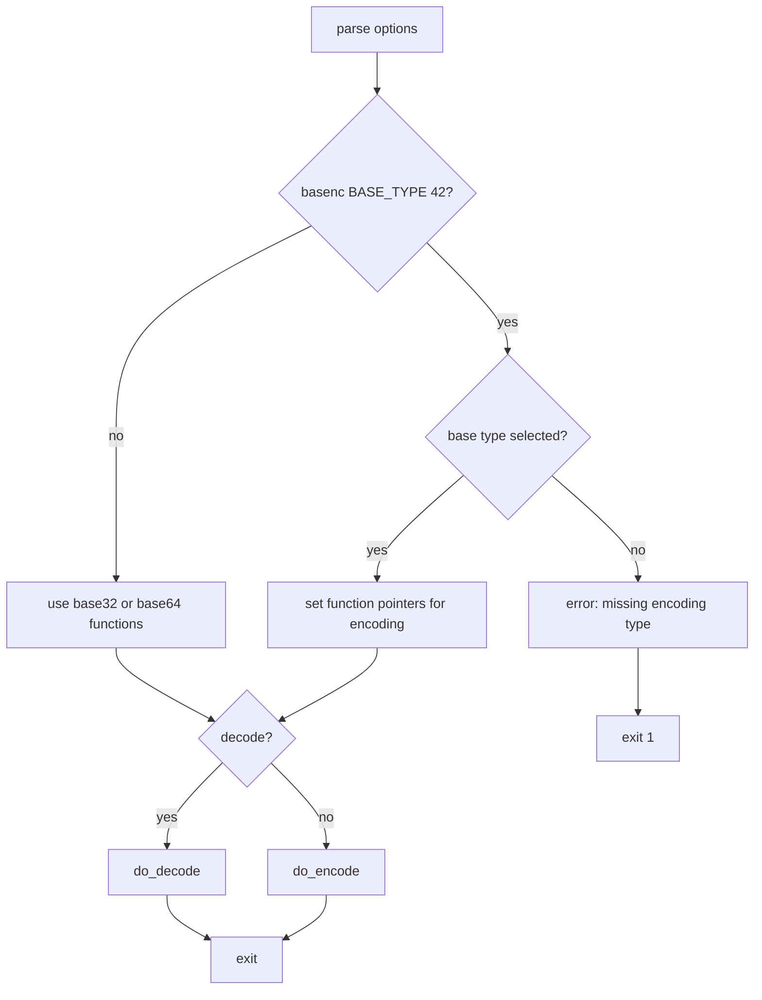

# `basenc`, `base64`, `base32`: encode/decode data in various bases

Source: `src/basenc.c` (1838 lines, compiled as base64, base32, basenc) ·
Tests: `tests/basenc/` ·
Manual: `info '(coreutils) base64 invocation'`

`basenc` (and `base64`, `base32`) encodes or decodes binary data using various
base encodings. The source is compiled with different `BASE_TYPE` values:
32 for `base32`, 64 for `base64`, and 42 for `basenc`. `basenc` supports
multiple encodings selected at runtime: base64, base64url, base32, base32hex,
base16 (hex), base2msbf, base2lsbf, base58, and z85. It uses gnulib's
base encoding functions and GMP for base58.

## Options

The table lists `long_options[]` (`src/basenc.c:74-93`) and the short-option
string `"diw:"`.

|| Option | Variables |
||---|---|
|| `-d`, `--decode` | `decode`: decode instead of encode |
|| `-i`, `--ignore-garbage` | `ignore_garbage`: skip non-alphabet bytes when decoding |
|| `-w COLS`, `--wrap=COLS` | `wrap_column`: wrap encoded lines (default 76, 0 to disable) |
|| `--base64` (basenc only) | Select base64 encoding |
|| `--base64url` (basenc only) | Select URL-safe base64 |
|| `--base32` (basenc only) | Select base32 encoding |
|| `--base32hex` (basenc only) | Select base32hex encoding |
|| `--base16` (basenc only) | Select hex encoding |
|| `--base2msbf` (basenc only) | Select bit string MSB first |
|| `--base2lsbf` (basenc only) | Select bit string LSB first |
|| `--base58` (basenc only) | Select base58 encoding |
|| `--z85` (basenc only) | Select Z85 encoding |

## Code map

|| Function | Location | Role |
||---|---|---|
|| `main` | `src/basenc.c:1634` | Option parsing, select encoding functions (basenc), open input, call `do_encode` or `do_decode` |
|| `do_encode` | `:1444` | Read input, encode with `base_encode`, wrap output |
|| `do_decode` | `:1566` | Read input, filter garbage, decode with `base_decode_ctx` |
|| `wrap_write` | `:1433` | Write output with line wrapping |
|| `decode_ctx_finalize` | `:413` | Auto-pad and flush decode context |
|| `base64url_encode` | `:482` | Encode base64 with URL-safe alphabet |
|| `base32hex_encode` | `:614` | Encode base32 with hex alphabet |
|| `usage` | `:96` | Help message |

## How it works

### Encoding selection

For `basenc` (BASE_TYPE 42), `main` sets function pointers based on the
selected encoding (`src/basenc.c:1710-1807`):

- **base64/base64url/base32/base32hex/base16:** Use gnulib's base encode/decode
  functions with alphabet translation where needed.
- **base2msbf/base2lsbf:** Direct bit manipulation functions.
- **z85:** ZeroMQ's ASCII85-like encoding.
- **base58:** Uses GMP for big integer arithmetic, with context-based encoding.

Each encoding sets `base_length`, `required_padding`, `isubase` (alphabet check),
`base_encode`, and decode context functions.

### Encoding

`do_encode` reads input in `ENC_BLOCKSIZE` chunks (30 KiB) and encodes them
(`src/basenc.c:1444-1563`). For most encodings, it calls `base_encode` directly.
For base58 (which needs context), it calls `base_encode_ctx` and
`base_encode_ctx_finalize`. The output is wrapped with `wrap_write` at the
specified column. `ENC_BLOCKSIZE` is chosen so padding characters only appear
in the last block.

### Decoding

`do_decode` reads encoded input, filters garbage bytes if `-i` is set, and
decodes with `base_decode_ctx` (`src/basenc.c:1566-1631`). With
`--ignore-garbage`, it removes non-alphabet bytes with `memmove` before
decoding. It calls `base_decode_ctx_finalize` at end-of-file to handle
implicit padding. Invalid input causes an error and exit.

### Alphabet variants

**base64url** translates `+` to `-` and `/` to `_` on encoding, and reverses
this on decoding while rejecting standard base64 characters
(`src/basenc.c:482-540`).

**base32hex** translates between the standard base32 alphabet (A-Z2-7) and the
hex alphabet (0-9A-V) using lookup tables (`src/basenc.c:567-658`).

**base16** (hex) uses a 256-byte lookup table `base16_to_int` for decoding
(`src/basenc.c:687-727`).

## Platform notes

The file is compiled multiple times with different `BASE_TYPE` values.
`base64` and `base32` are single-encoding programs; `basenc` supports all
encodings. base58 requires GMP. Binary mode is set on stdin with
`xset_binary_mode` for portability (`src/basenc.c:1822`).

## Errors and exit status

- **Missing encoding type (basenc):** "missing encoding type"
- **Extra operand:** "extra operand FILE"
- **Invalid wrap size:** "invalid wrap size COLS"
- **File open failure:** Error from `quotef(FILE)`
- **Invalid input:** "invalid input" (decoding error)
- **Read error:** "read error"

Exit status is 0 on success, 1 on failure.

## Tests

|| File | Covers |
||---|---|
|| `tests/basenc/base64.pl` | Base64 encoding/decoding |
|| `tests/basenc/basenc.pl` | Various encoding types |
|| `tests/basenc/bounded-memory.sh` | Memory limits |
|| `tests/basenc/large-input.sh` | Large file handling |

## See also

- [Shared infrastructure](../overview/shared-infrastructure.md) for gnulib base encoding modules
