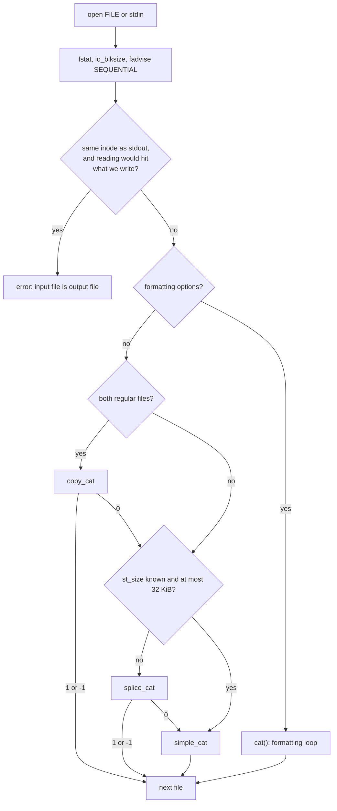

# `cat`: concatenate files

Source: `src/cat.c` (998 lines), `src/splice.h` · Tests: `tests/cat/` ·
Manual: `info '(coreutils) cat invocation'`

`cat` copies each FILE to standard output. It does not use stdio for the
data. It uses `read` and `write` on descriptors, and `atexit (close_stdout)`
only matters for `--help` and `--version`. There are two kinds of path:

- **No formatting options:** the fastest method that works, in this order:
  `copy_file_range` (file to file), then `splice` through a pipe (Linux),
  then a plain `read`/`write` loop.
- **Any of `-b -e -E -n -s -t -T -v -A`:** the `cat()` function, a
  hand-optimised loop that changes bytes as it copies them.

## Options

The table lists `long_options[]` (`src/cat.c:719-731`) and the short-option
string `"benstuvAET"`.

| Option | Variables |
|---|---|
| `-A`, `--show-all` | `show_nonprinting`, `show_ends`, `show_tabs` (same as `-vET`) |
| `-b`, `--number-nonblank` | `number`, `number_nonblank` (overrides `-n`) |
| `-e` | `show_ends`, `show_nonprinting` |
| `-E`, `--show-ends` | `show_ends`: `$` at end of line, or `^M$` for CRLF |
| `-n`, `--number` | `number` |
| `-s`, `--squeeze-blank` | `squeeze_blank` |
| `-t` | `show_tabs`, `show_nonprinting` |
| `-T`, `--show-tabs` | `show_tabs`: TAB as `^I` |
| `-u` | Ignored. Output is never buffered by `cat`. |
| `-v`, `--show-nonprinting` | `show_nonprinting`: `^X` and `M-X` notation |

## Code map

| Function | Location | Role |
|---|---|---|
| `main` | `src/cat.c:703` | Options, `fstat` of stdout, a loop over files, the input-is-output check, choosing a copy method. |
| `copy_cat` | `:522` | `copy_file_range` loop. Returns 1 (done), 0 (try something else) or -1 (error). |
| `splice_cat` | `:589` | `splice` input into a private pipe, then from the pipe to stdout. Same return values. |
| `simple_cat` | `:174` | `read`/`full_write` loop. |
| `cat` | `:230` | The formatting loop. |
| `next_line_num` | `:150` | Add one to the line number, stored as ASCII digits in `line_buf`. |
| `write_pending` | `:206` | Write out buffered output. |
| `ensure_buf_size` | `:688` | Keep one page-aligned buffer for all files, and grow it only when needed. |

## How it works

The diagram shows how `main` chooses a method for each file.

### Input is output

`cat f >> f` would never end. `main` refuses only when it is sure the
loop cannot end (`src/cat.c:875-899`). Both descriptors must be the same
inode, and the input must not be a FIFO, socket or shared-memory object.
The current input position must also be before the output position (for
`O_APPEND` output, the output position is the end of the file). If the
input position is at or after the output position, `cat` carries on,
because it reads ahead of what it writes. For example `cat f 1<>f` rewrites
the file in place. `tests/cat/cat-self.sh` covers these cases.

### `copy_file_range` and `splice`

- `copy_cat` asks for very large chunks (`MIN (SSIZE_MAX, SIZE_MAX) >> 30
  << 30`). It falls back to the next method on `ENOSYS`, `ENOTSUP`,
  `EINVAL`, `EBADF`, `EXDEV`, `ETXTBSY`, `EPERM` or `EFBIG`. A return of 0
  on the first call also means "try something else", because Linux
  `/proc` files report size 0 (comment at `:529-533`).
- `splice_cat` always uses an extra pipe, even when both ends are already
  pipes, "so that read and write errors can be distinguished". The pipe
  size is raised to `SPLICE_PIPE_SIZE` (512 KiB) with `F_SETPIPE_SZ`. If
  stdout is a pipe, its size is raised too. If the very first splice fails,
  `cat` moves to `read`/`write`. After data has been spliced, any error is
  fatal. If output splicing fails before anything was written, the data
  already in the extra pipe is read out and written normally, so nothing is
  lost.
- Files with a known size of at most 32 KiB skip `splice`. A comment says
  this is the size where splice starts to be faster, and that it also
  avoids zero-length files.

### The formatting loop

`cat()` (`src/cat.c:230-515`) works on two buffers:

- `inbuf` of `insize + 1` bytes. After each read, a `'\n'` **sentinel** is
  stored after the data (`*eob = '\n'`). So the inner loops only test for
  newline, never for "end of buffer". When the loop meets a newline,
  `bpin > eob` tells it whether this is the sentinel (read more) or a real
  line end.
- `outbuf` of `insize * 4 + outsize + LINE_COUNTER_BUF_LEN - 1` bytes. A
  comment at `:938-957` explains the size: each input byte can become up to
  four output bytes (`M-^X`), plus a line number, plus up to `outsize - 1`
  bytes not yet written.

Other details:

- **Line numbers** are kept as text in `line_buf`, right-aligned to six
  columns followed by a TAB. `next_line_num()` adds one by changing the
  digits from the right, so no `printf` is needed for each line.
- **`newlines`** counts newlines in a row. It is limited to 2, so `-s`
  works and the counter cannot overflow. It is saved in `newlines2` between
  files, so `-s` and `-n` continue across file boundaries.
- **`FIONREAD`**: before a `read` that might block, `cat` asks how much
  input is ready. If none is, it writes out what it has first. This is why
  `cat -n` on a slow pipe shows each line at once (`tests/cat/cat-buf.sh`).
- **CRLF with `-E`**: `\r\n` becomes `^M$`. If the `\r` is the last byte of
  a buffer, `pending_cr` keeps it until the next byte is known
  (`tests/cat/cat-E.sh`).

## Errors and exit status

Each file is handled separately. An open, read or close failure gives
`cat: FILE: <error>`, and the exit status is 1. A write failure calls
`write_error()` and exits at once. `tests/cat/cat-distinct-err.sh` checks
that read errors and write errors give different messages.

## Tests

| File | Covers |
|---|---|
| `tests/cat/cat-buf.sh` | Formatted output appears at once, not buffered. |
| `tests/cat/cat-E.sh` | `-E` with CRLF, including CR at a buffer boundary. |
| `tests/cat/cat-proc.sh` | `cat -E` on `/proc` files gives the same data as plain `cat`. |
| `tests/cat/cat-self.sh` | Input-is-output detection. |
| `tests/cat/cat-distinct-err.sh` | Separate read and write error messages. |
| `tests/cat/splice.sh` | The `splice` path. |

## See also

- [Shared infrastructure](../overview/shared-infrastructure.md) for
  `io_blksize` and `copy_file_data` (`cp` has a similar `copy_file_range`
  fallback list).
- [tee](tee.md) and [stdbuf](stdbuf.md).
