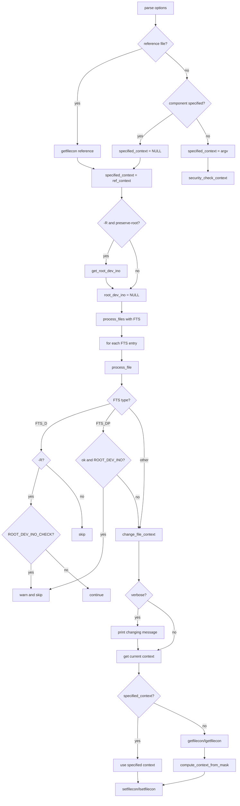

# `chcon`: change SELinux security context

Source: `src/chcon.c` (650 lines) · Tests: `tests/chcon/` ·
Manual: `info '(coreutils) chcon invocation'`

`chcon` changes the SELinux security context of files. It uses the libselinux
API (`getfilecon`, `setfilecon`, `lgetfilecon`, `lsetfilecon`) to read and write
contexts. With `-R`, it walks the file tree with `fts`. Contexts can be set
directly, copied from a reference file, or modified by component (user, role,
type, range).

## Options

The table lists `long_options[]` (`src/chcon.c:73-89`) and the short-option
string `"HLPRhvu:r:t:l:"`.

|| Option | Variables |
||---|---|
|| `-R`, `--recursive` | `recurse`: walk directories recursively |
|| `-h`, `--no-dereference` | `dereference = 0`: affect symlinks themselves |
|| `--dereference` | `dereference = 1`: affect symlink referents (default) |
|| `-u USER`, `--user=USER` | `specified_user` |
|| `-r ROLE`, `--role=ROLE` | `specified_role` |
|| `-t TYPE`, `--type=TYPE` | `specified_type` |
|| `-l RANGE`, `--range=RANGE` | `specified_range` |
|| `--reference=RFILE` | `reference_file`: copy context from RFILE |
|| `-v`, `--verbose` | `verbose`: print each file changed |
|| `--preserve-root` | `preserve_root`: fail on `/` with `-R` |
|| `--no-preserve-root` | Default: do not treat `/` specially |
|| `-H` | `bit_flags = FTS_COMFOLLOW | FTS_PHYSICAL`: follow command-line symlinks to dirs |
|| `-L` | `bit_flags = FTS_LOGICAL`: follow all symlinks to dirs |
|| `-P` | `bit_flags = FTS_PHYSICAL`: follow no symlinks to dirs (default) |
|| `-f` | Ignored (kept for compatibility) |

## Code map

|| Function | Location | Role |
||---|---|---|
|| `main` | `src/chcon.c:472` | Option parsing, context validation, FTS setup, `process_files` |
|| `process_files` | `:364` | Open FTS, loop over entries, `process_file` each |
|| `process_file` | `:257` | FTS entry dispatch, root-dev-ino check, `change_file_context` |
|| `change_file_context` | `:142` | Get current context, compute new context, apply it |
|| `compute_context_from_mask` | `:95` | Modify context components from `specified_*` globals |
|| `usage` | `:399` | Help message |

## How it works



### Context resolution

`main` resolves the target context in three ways (`src/chcon.c:604-632`):

1. **Reference file:** `getfilecon` reads the context from `--reference=RFILE`.
2. **Component specification:** `specified_context` stays `NULL`. Each file's
   current context is read, then `compute_context_from_mask` modifies the
   selected components (`src/chcon.c:95-135`).
3. **Direct context:** The context string is taken from the first argument.
   If SELinux is enabled, `security_check_context` validates it.

Reference file and component specification are mutually exclusive.

### Partial context modification

When setting individual components (`-u`, `-r`, `-t`, `-l`), `change_file_context`
reads the file's current context first (`src/chcon.c:151-213`). It tries
`fgetfilecon` with `O_PATH` to pin the file (avoiding races), falling back to
`lgetfileconat` or `getfileconat` on older libselinux. If the file has no
context (`ENODATA`), partial modification fails with "can't apply partial
context to unlabeled file". The new context is built with `context_new`,
modified with `context_user_set`, `context_role_set`, etc., then converted back
to a string with `context_str`.

### Recursive traversal

With `-R`, `process_files` walks the tree with FTS (`src/chcon.c:364-396`).
`process_file` handles the FTS entry types (`src/chcon.c:257-357`):

- **`FTS_D`:** Pre-order directory visit. If `-R` is set, check for root
  directory cycles with `ROOT_DEV_INO_CHECK`. If the directory is `/` with
  `--preserve-root`, warn and skip.
- **`FTS_DP`:** Post-order directory visit. Apply the context after children
  are processed.
- **`FTS_NS`:** Initial stat failed. At the root level, retry with `FTS_AGAIN`
  in case a concurrent operation fixed it.
- **`FTS_ERR`, `FTS_DNR`:** Report errors and continue.
- **`FTS_DC`:** Directory cycle. Emit a warning and skip the cycle.

The symlink dereference logic combines `-R` with `-h/-H/-L` (`src/chcon.c:573-593`).
`-R -P -h` (affect symlinks, no dereference) is allowed. `-R -H` or `-R -L`
requires `--dereference`. `-R --dereference` requires `-H` or `-L`.

## Platform notes

`chcon` is built only when SELinux development headers are available. The code
uses `#ifdef O_PATH` for the race-resistant `fgetfilecon` path (`src/chcon.c:154`).
`is_selinux_enabled` checks whether SELinux is active before validating contexts
(`src/chcon.c:622`).

## Errors and exit status

- **Context retrieval failure:** "failed to get security context of FILE"
- **Context set failure:** "failed to change context of FILE to CONTEXT"
- **Invalid context:** "invalid context: CONTEXT" (only when SELinux enabled)
- **Partial context on unlabeled file:** "can't apply partial context to unlabeled file"
- **Conflicting specifiers:** "conflicting security context specifiers given"
- **Root directory with `--preserve-root`:** "it is dangerous to operate recursively on /"
- **Option conflicts:** `-R --dereference` without `-H`/`-L`, or `-R -h` without `-P`

Exit status is 0 on success, 1 on any error.

## Tests

|| File | Covers |
||---|---|
|| `tests/chcon/chcon.sh` | Basic context changes, recursive mode |
|| `tests/chcon/chcon-fail.sh` | Error cases and invalid options |
|| `tests/chcon/traversal-missing.sh` | Missing files during traversal |

## See also

- [chown](chown.md) for the similar chown/chgrp pattern
- [Shared infrastructure](../overview/shared-infrastructure.md) for FTS traversal

## Source code

`src/chcon.c:1`

```c
/* chcon -- change security context of files
   Copyright (C) 2005-2026 Free Software Foundation, Inc.

   This program is free software: you can redistribute it and/or modify
   it under the terms of the GNU General Public License as published by
   the Free Software Foundation, either version 3 of the License, or
   (at your option) any later version.

   This program is distributed in the hope that it will be useful,
   but WITHOUT ANY WARRANTY; without even the implied warranty of
   MERCHANTABILITY or FITNESS FOR A PARTICULAR PURPOSE.  See the
   GNU General Public License for more details.

   You should have received a copy of the GNU General Public License
   along with this program.  If not, see <https://www.gnu.org/licenses/>.  */

#include <config.h>
#include <stdio.h>
#include <sys/types.h>
#include <getopt.h>
#include <selinux/selinux.h>

#include "system.h"
#include "dev-ino.h"
#include "fcntl--.h"
#include "fts-missing.h"
#include "ignore-value.h"
#include "quote.h"
#include "root-dev-ino.h"
#include "selinux-at.h"
#include "xfts.h"

/* The official name of this program (e.g., no 'g' prefix).  */
#define PROGRAM_NAME "chcon"

#define AUTHORS \
  proper_name ("Russell Coker"), \
  proper_name ("Jim Meyering")

/* If nonzero, and the systems has support for it, change the context
   of symbolic links rather than any files they point to.  */
static bool affect_symlink_referent;

/* If true, change the modes of directories recursively. */
static bool recurse;

/* Level of verbosity. */
static bool verbose;

/* Pointer to the device and inode numbers of '/', when --recursive.
   Otherwise NULL.  */
static struct dev_ino *root_dev_ino;

/* The name of the context file is being given. */
static char const *specified_context;

/* Specific components of the context */
static char const *specified_user;
static char const *specified_role;
static char const *specified_range;
static char const *specified_type;

/* For long options that have no equivalent short option, use a
   non-character as a pseudo short option, starting with CHAR_MAX + 1.  */
enum
{
  DEREFERENCE_OPTION = CHAR_MAX + 1,
  NO_PRESERVE_ROOT,
  PRESERVE_ROOT,
  REFERENCE_FILE_OPTION
};

static struct option const long_options[] =
{
  {"recursive", no_argument, NULL, 'R'},
  {"dereference", no_argument, NULL, DEREFERENCE_OPTION},
  {"no-dereference", no_argument, NULL, 'h'},
  {"no-preserve-root", no_argument, NULL, NO_PRESERVE_ROOT},
  {"preserve-root", no_argument, NULL, PRESERVE_ROOT},
  {"reference", required_argument, NULL, REFERENCE_FILE_OPTION},
  {"user", required_argument, NULL, 'u'},
  {"role", required_argument, NULL, 'r'},
  {"type", required_argument, NULL, 't'},
  {"range", required_argument, NULL, 'l'},
  {"verbose", no_argument, NULL, 'v'},
  {GETOPT_HELP_OPTION_DECL},
  {GETOPT_VERSION_OPTION_DECL},
  {NULL, 0, NULL, 0}
};

/* Given a security context, CONTEXT, derive a context_t (*RET),
   setting any portions selected via the global variables, specified_user,
   specified_role, etc.  */
static int
compute_context_from_mask (char const *context, context_t *ret)
{
  bool ok = true;
  context_t new_context = context_new (context);
  if (!new_context)
    {
      error (0, errno, _("failed to create security context: %s"),
             quote (context));
      return 1;
    }

#define SET_COMPONENT(C, comp)						\
   do									\
     {									\
       if (specified_ ## comp						\
           && context_ ## comp ## _set ((C), specified_ ## comp))	\
         {								\
            error (0, errno,						\
                   _("failed to set %s security context component to %s"), \
                   #comp, quote (specified_ ## comp));			\
           ok = false;							\
         }								\
     }									\
   while (0)

  SET_COMPONENT (new_context, user);
  SET_COMPONENT (new_context, range);
  SET_COMPONENT (new_context, role);
  SET_COMPONENT (new_context, type);

  if (!ok)
    {
      int saved_errno = errno;
      context_free (new_context);
      errno = saved_errno;
      return 1;
    }

  *ret = new_context;
  return 0;
}

/* Change the context of FILE relative to DIRFD, using specified components.
   If it is a directory and -R is given, recurse.
   Return 0 if successful, 1 if errors occurred. */

static int
change_file_context (char const *file_full_name, int const dirfd,
                     char const *file, bool ignore_missing)
{
  char *file_context = NULL;
  context_t context IF_LINT (= NULL);
  char const * context_string;
  int errors = 0;
  int file_fd = -1;

  if (specified_context == NULL)
    {
      int status;
#ifdef O_PATH
      /* Pin the file while deriving and applying a partial context.
         O_PATH also works for symlinks and unreadable files.  */
      file_fd = openat (dirfd, file,
                        (O_PATH | (affect_symlink_referent ? 0 : O_NOFOLLOW)));
      if (file_fd < 0)
        {
          if (ignore_missing && ignorable_traversal_errno (errno))
            return 0;
          error (0, errno, _("failed to open %s"), quoteaf (file_full_name));
          return 1;
        }

      status = fgetfilecon (file_fd, &file_context);
      if (status < 0 && errno == EBADF)
        {
          /* libselinux before 3.4, or an unavailable /proc/self/fd,
             cannot handle O_PATH descriptors, so fall back to
             potentially racy behavior with partial contexts.  */
          close (file_fd);
          file_fd = -1;
        }
#endif
      if (file_fd < 0)
        status = (affect_symlink_referent
                  ? getfileconat (dirfd, file, &file_context)
                  : lgetfileconat (dirfd, file, &file_context));

      if (status < 0 && errno != ENODATA)
        {
          if (! (file_fd < 0 && ignore_missing
                 && ignorable_traversal_errno (errno)))
            {
              error (0, errno, _("failed to get security context of %s"),
                     quoteaf (file_full_name));
              errors = 1;
            }
          goto done;
        }

      /* If the file doesn't have a context, and we're not setting all of
         the context components, there isn't really an obvious default.
         Thus, we just give up. */
      if (file_context == NULL)
        {
          error (0, 0, _("can't apply partial context to unlabeled file %s"),
                 quoteaf (file_full_name));
          errors = 1;
          goto done;
        }

      if (compute_context_from_mask (file_context, &context))
        {
          freecon (file_context);
          errors = 1;
          goto done;
        }

      context_string = context_str (context);
    }
  else
    {
      context_string = specified_context;
    }

  if (file_context == NULL || ! streq (context_string, file_context))
    {
      int fail = (0 <= file_fd
                  ? fsetfilecon (file_fd, context_string)
                  : affect_symlink_referent
                  ? setfileconat (dirfd, file, context_string)
                  : lsetfileconat (dirfd, file, context_string));

      if (fail)
        {
          if (! (file_fd < 0 && ignore_missing
                 && ignorable_traversal_errno (errno)))
            {
              errors = 1;
              error (0, errno, _("failed to change context of %s to %s"),
                     quoteaf_n (0, file_full_name),
                     quote_n (1, context_string));
            }
        }
    }

  if (specified_context == NULL)
    {
      context_free (context);
      freecon (file_context);
    }

 done:
  if (0 <= file_fd)
    close (file_fd);
  return errors;
}

/* Change the context of FILE.
   Return true if successful.  This function is called
   once for every file system object that fts encounters.  */

static bool
process_file (FTS *fts, FTSENT *ent)
{
  char const *file_full_name = ent->fts_path;
  char const *file = ent->fts_accpath;
  const struct stat *file_stats = ent->fts_statp;
  bool ok = true;
  bool ignore_missing = ignore_missing_fts_entry (ent);

  if (ignore_missing && ignorable_fts_error (ent))
    return true;

  switch (ent->fts_info)
    {
    case FTS_D:
      if (recurse)
        {
          if (ROOT_DEV_INO_CHECK (root_dev_ino, ent->fts_statp))
            {
              /* This happens e.g., with "chcon -R --preserve-root ... /"
                 and with "chcon -RH --preserve-root ... symlink-to-root".  */
              ROOT_DEV_INO_WARN (file_full_name);
              /* Tell fts not to traverse into this hierarchy.  */
              fts_set (fts, ent, FTS_SKIP);
              /* Ensure that we do not process "/" on the second visit.  */
              ignore_value (fts_read (fts));
              return false;
            }
          return true;
        }
      break;

    case FTS_DP:
      if (! recurse)
        return true;
      break;

    case FTS_NS:
      /* For a top-level file or directory, this FTS_NS (stat failed)
         indicator is determined at the time of the initial fts_open call.
         With programs like chmod, chown, and chgrp, that modify
         permissions, it is possible that the file in question is
         accessible when control reaches this point.  So, if this is
         the first time we've seen the FTS_NS for this file, tell
         fts_read to stat it "again".  */
      if (ent->fts_level == FTS_ROOTLEVEL && ent->fts_number == 0)
        {
          ent->fts_number = 1;
          fts_set (fts, ent, FTS_AGAIN);
          return true;
        }
      error (0, ent->fts_errno, _("cannot access %s"),
             quoteaf (file_full_name));
      ok = false;
      break;

    case FTS_ERR:
      error (0, ent->fts_errno, "%s", quotef (file_full_name));
      ok = false;
      break;

    case FTS_DNR:
      error (0, ent->fts_errno, _("cannot read directory %s"),
             quoteaf (file_full_name));
      ok = false;
      break;

    case FTS_DC:		/* directory that causes cycles */
      if (cycle_warning_required (fts, ent))
        {
          emit_cycle_warning (file_full_name);
          return false;
        }
      break;

    default:
      break;
    }

  if (ent->fts_info == FTS_DP
      && ok && ROOT_DEV_INO_CHECK (root_dev_ino, file_stats))
    {
      ROOT_DEV_INO_WARN (file_full_name);
      ok = false;
    }

  if (ok)
    {
      if (verbose)
        printf (_("changing security context of %s\n"),
                quoteaf (file_full_name));

      if (change_file_context (file_full_name, fts->fts_cwd_fd, file,
                               ignore_missing) != 0)
        ok = false;
    }

  if ( ! recurse)
    fts_set (fts, ent, FTS_SKIP);

  return ok;
}

/* Recursively operate on the specified FILES (the last entry
   of which is null).  BIT_FLAGS controls how fts works.
   Return true if successful.  */

static bool
process_files (char **files, int bit_flags)
{
  bool ok = true;

  FTS *fts = xfts_open (files, bit_flags, NULL);

  while (true)
    {
      FTSENT *ent;

      ent = fts_read (fts);
      if (ent == NULL)
        {
          if (errno != 0)
            {
              /* FIXME: try to give a better message  */
              error (0, errno, _("fts_read failed"));
              ok = false;
            }
          break;
        }

      ok &= process_file (fts, ent);
    }

  if (fts_close (fts) != 0)
    {
      error (0, errno, _("fts_close failed"));
      ok = false;
    }

  return ok;
}

void
usage (int status)
{
  if (status != EXIT_SUCCESS)
    emit_try_help ();
  else
    {
      printf (_("\
Usage: %s [OPTION]... CONTEXT FILE...\n\
  or:  %s [OPTION]... [-u USER] [-r ROLE] [-l RANGE] [-t TYPE] FILE...\n\
  or:  %s [OPTION]... --reference=RFILE FILE...\n\
"),
        program_name, program_name, program_name);
      fputs (_("\
Change the SELinux security context of each FILE to CONTEXT.\n\
With --reference, change the security context of each FILE to that of RFILE.\n\
"), stdout);

      emit_mandatory_arg_note ();

      oputs (_("\
      --dereference\n\
         affect the referent of each symbolic link (this is\n\
         the default), rather than the symbolic link itself\n\
"));
      oputs (_("\
  -h, --no-dereference\n\
         affect symbolic links instead of any referenced file\n\
"));
      oputs (_("\
  -u, --user=USER\n\
         set user USER in the target security context\n\
"));
      oputs (_("\
  -r, --role=ROLE\n\
         set role ROLE in the target security context\n\
"));
      oputs (_("\
  -t, --type=TYPE\n\
         set type TYPE in the target security context\n\
"));
      oputs (_("\
  -l, --range=RANGE\n\
         set range RANGE in the target security context\n\
"));
      oputs (_("\
      --no-preserve-root\n\
         do not treat '/' specially (the default)\n\
"));
      oputs (_("\
      --preserve-root\n\
         fail to operate recursively on '/'\n\
"));
      oputs (_("\
      --reference=RFILE\n\
         use RFILE's security context rather than specifying a CONTEXT value\n\
"));
      oputs (_("\
  -R, --recursive\n\
         operate on files and directories recursively\n\
"));
      oputs (_("\
  -v, --verbose\n\
         output a diagnostic for every file processed\n\
"));
      emit_symlink_recurse_options ("-P");
      oputs (HELP_OPTION_DESCRIPTION);
      oputs (VERSION_OPTION_DESCRIPTION);
      emit_ancillary_info (PROGRAM_NAME);
    }
  exit (status);
}

int
main (int argc, char **argv)
{
  /* Bit flags that control how fts works.  */
  int bit_flags = FTS_PHYSICAL;

  /* 1 if --dereference, 0 if --no-dereference, -1 if neither has been
     specified.  */
  int dereference = -1;

  bool ok;
  bool preserve_root = false;
  bool component_specified = false;
  char *reference_file = NULL;
  int optc;

  initialize_main (&argc, &argv);
  set_program_name (argv[0]);
  setlocale (LC_ALL, "");
  bindtextdomain (PACKAGE, LOCALEDIR);
  textdomain (PACKAGE);

  atexit (close_stdout);

  while ((optc = getopt_long (argc, argv, "HLPRhvu:r:t:l:",
                              long_options, NULL))
         != -1)
    {
      switch (optc)
        {
        case 'H': /* Traverse command-line symlinks-to-directories.  */
          bit_flags = FTS_COMFOLLOW | FTS_PHYSICAL;
          break;

        case 'L': /* Traverse all symlinks-to-directories.  */
          bit_flags = FTS_LOGICAL;
          break;

        case 'P': /* Traverse no symlinks-to-directories.  */
          bit_flags = FTS_PHYSICAL;
          break;

        case 'h': /* --no-dereference: affect symlinks */
          dereference = 0;
          break;

        case DEREFERENCE_OPTION: /* --dereference: affect the referent
                                    of each symlink */
          dereference = 1;
          break;

        case NO_PRESERVE_ROOT:
          preserve_root = false;
          break;

        case PRESERVE_ROOT:
          preserve_root = true;
          break;

        case REFERENCE_FILE_OPTION:
          reference_file = optarg;
          break;

        case 'R':
          recurse = true;
          break;

        case 'f':
          /* ignore */
          break;

        case 'v':
          verbose = true;
          break;

        case 'u':
          specified_user = optarg;
          component_specified = true;
          break;

        case 'r':
          specified_role = optarg;
          component_specified = true;
          break;

        case 't':
          specified_type = optarg;
          component_specified = true;
          break;

        case 'l':
          specified_range = optarg;
          component_specified = true;
          break;

        case_GETOPT_HELP_CHAR;
        case_GETOPT_VERSION_CHAR (PROGRAM_NAME, AUTHORS);
        default:
          usage (EXIT_FAILURE);
        }
    }

  if (recurse)
    {
      if (bit_flags == FTS_PHYSICAL)
        {
          if (dereference == 1)
            error (EXIT_FAILURE, 0,
                   _("-R --dereference requires either -H or -L"));
          affect_symlink_referent = false;
        }
      else
        {
          if (dereference == 0)
            error (EXIT_FAILURE, 0, _("-R -h requires -P"));
          affect_symlink_referent = true;
        }
    }
  else
    {
      bit_flags = FTS_PHYSICAL;
      affect_symlink_referent = (dereference != 0);
    }

  if (argc - optind < (reference_file || component_specified ? 1 : 2))
    {
      if (argc <= optind)
        error (0, 0, _("missing operand"));
      else
        error (0, 0, _("missing operand after %s"), quote (argv[argc - 1]));
      usage (EXIT_FAILURE);
    }

  if (reference_file)
    {
      char *ref_context = NULL;

      if (getfilecon (reference_file, &ref_context) < 0)
        error (EXIT_FAILURE, errno, _("failed to get security context of %s"),
               quoteaf (reference_file));

      specified_context = ref_context;
    }
  else if (component_specified)
    {
      /* FIXME: it's already null, so this is a no-op. */
      specified_context = NULL;
    }
  else
    {
      specified_context = argv[optind++];
      if (0 < is_selinux_enabled ()
          && security_check_context (specified_context) < 0)
        error (EXIT_FAILURE, errno, _("invalid context: %s"),
               quote (specified_context));
    }

  if (reference_file && component_specified)
    {
      error (0, 0, _("conflicting security context specifiers given"));
      usage (EXIT_FAILURE);
    }

  if (recurse && preserve_root)
    {
      static struct dev_ino dev_ino_buf;
      root_dev_ino = get_root_dev_ino (&dev_ino_buf);
      if (root_dev_ino == NULL)
        error (EXIT_FAILURE, errno, _("failed to get attributes of %s"),
               quoteaf ("/"));
    }
  else
    {
      root_dev_ino = NULL;
    }

  ok = process_files (argv + optind, bit_flags | FTS_NOSTAT);

  return ok ? EXIT_SUCCESS : EXIT_FAILURE;
}
```
