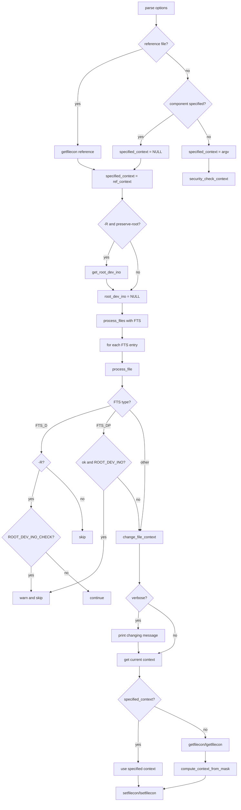

# `chcon`: change SELinux security context

Source: `src/chcon.c` (650 lines) · Tests: `tests/chcon/` ·
Manual: `info '(coreutils) chcon invocation'`

`chcon` changes the SELinux security context of files. It uses the libselinux
API (`getfilecon`, `setfilecon`, `lgetfilecon`, `lsetfilecon`) to read and write
contexts. With `-R`, it walks the file tree with `fts`. Contexts can be set
directly, copied from a reference file, or modified by component (user, role,
type, range).

## Options

The table lists `long_options[]` (`src/chcon.c:73-89`) and the short-option
string `"HLPRhvu:r:t:l:"`.

|| Option | Variables |
||---|---|
|| `-R`, `--recursive` | `recurse`: walk directories recursively |
|| `-h`, `--no-dereference` | `dereference = 0`: affect symlinks themselves |
|| `--dereference` | `dereference = 1`: affect symlink referents (default) |
|| `-u USER`, `--user=USER` | `specified_user` |
|| `-r ROLE`, `--role=ROLE` | `specified_role` |
|| `-t TYPE`, `--type=TYPE` | `specified_type` |
|| `-l RANGE`, `--range=RANGE` | `specified_range` |
|| `--reference=RFILE` | `reference_file`: copy context from RFILE |
|| `-v`, `--verbose` | `verbose`: print each file changed |
|| `--preserve-root` | `preserve_root`: fail on `/` with `-R` |
|| `--no-preserve-root` | Default: do not treat `/` specially |
|| `-H` | `bit_flags = FTS_COMFOLLOW | FTS_PHYSICAL`: follow command-line symlinks to dirs |
|| `-L` | `bit_flags = FTS_LOGICAL`: follow all symlinks to dirs |
|| `-P` | `bit_flags = FTS_PHYSICAL`: follow no symlinks to dirs (default) |
|| `-f` | Ignored (kept for compatibility) |

## Code map

|| Function | Location | Role |
||---|---|---|
|| `main` | `src/chcon.c:472` | Option parsing, context validation, FTS setup, `process_files` |
|| `process_files` | `:364` | Open FTS, loop over entries, `process_file` each |
|| `process_file` | `:257` | FTS entry dispatch, root-dev-ino check, `change_file_context` |
|| `change_file_context` | `:142` | Get current context, compute new context, apply it |
|| `compute_context_from_mask` | `:95` | Modify context components from `specified_*` globals |
|| `usage` | `:399` | Help message |

## How it works

### Context resolution

`main` resolves the target context in three ways (`src/chcon.c:604-632`):

1. **Reference file:** `getfilecon` reads the context from `--reference=RFILE`.
2. **Component specification:** `specified_context` stays `NULL`. Each file's
   current context is read, then `compute_context_from_mask` modifies the
   selected components (`src/chcon.c:95-135`).
3. **Direct context:** The context string is taken from the first argument.
   If SELinux is enabled, `security_check_context` validates it.

Reference file and component specification are mutually exclusive.

### Partial context modification

When setting individual components (`-u`, `-r`, `-t`, `-l`), `change_file_context`
reads the file's current context first (`src/chcon.c:151-213`). It tries
`fgetfilecon` with `O_PATH` to pin the file (avoiding races), falling back to
`lgetfileconat` or `getfileconat` on older libselinux. If the file has no
context (`ENODATA`), partial modification fails with "can't apply partial
context to unlabeled file". The new context is built with `context_new`,
modified with `context_user_set`, `context_role_set`, etc., then converted back
to a string with `context_str`.

### Recursive traversal

With `-R`, `process_files` walks the tree with FTS (`src/chcon.c:364-396`).
`process_file` handles the FTS entry types (`src/chcon.c:257-357`):

- **`FTS_D`:** Pre-order directory visit. If `-R` is set, check for root
  directory cycles with `ROOT_DEV_INO_CHECK`. If the directory is `/` with
  `--preserve-root`, warn and skip.
- **`FTS_DP`:** Post-order directory visit. Apply the context after children
  are processed.
- **`FTS_NS`:** Initial stat failed. At the root level, retry with `FTS_AGAIN`
  in case a concurrent operation fixed it.
- **`FTS_ERR`, `FTS_DNR`:** Report errors and continue.
- **`FTS_DC`:** Directory cycle. Emit a warning and skip the cycle.

The symlink dereference logic combines `-R` with `-h/-H/-L` (`src/chcon.c:573-593`).
`-R -P -h` (affect symlinks, no dereference) is allowed. `-R -H` or `-R -L`
requires `--dereference`. `-R --dereference` requires `-H` or `-L`.

## Platform notes

`chcon` is built only when SELinux development headers are available. The code
uses `#ifdef O_PATH` for the race-resistant `fgetfilecon` path (`src/chcon.c:154`).
`is_selinux_enabled` checks whether SELinux is active before validating contexts
(`src/chcon.c:622`).

## Errors and exit status

- **Context retrieval failure:** "failed to get security context of FILE"
- **Context set failure:** "failed to change context of FILE to CONTEXT"
- **Invalid context:** "invalid context: CONTEXT" (only when SELinux enabled)
- **Partial context on unlabeled file:** "can't apply partial context to unlabeled file"
- **Conflicting specifiers:** "conflicting security context specifiers given"
- **Root directory with `--preserve-root`:** "it is dangerous to operate recursively on /"
- **Option conflicts:** `-R --dereference` without `-H`/`-L`, or `-R -h` without `-P`

Exit status is 0 on success, 1 on any error.

## Tests

|| File | Covers |
||---|---|
|| `tests/chcon/chcon.sh` | Basic context changes, recursive mode |
|| `tests/chcon/chcon-fail.sh` | Error cases and invalid options |
|| `tests/chcon/traversal-missing.sh` | Missing files during traversal |

## See also

- [chown](chown.md) for the similar chown/chgrp pattern
- [Shared infrastructure](../overview/shared-infrastructure.md) for FTS traversal
