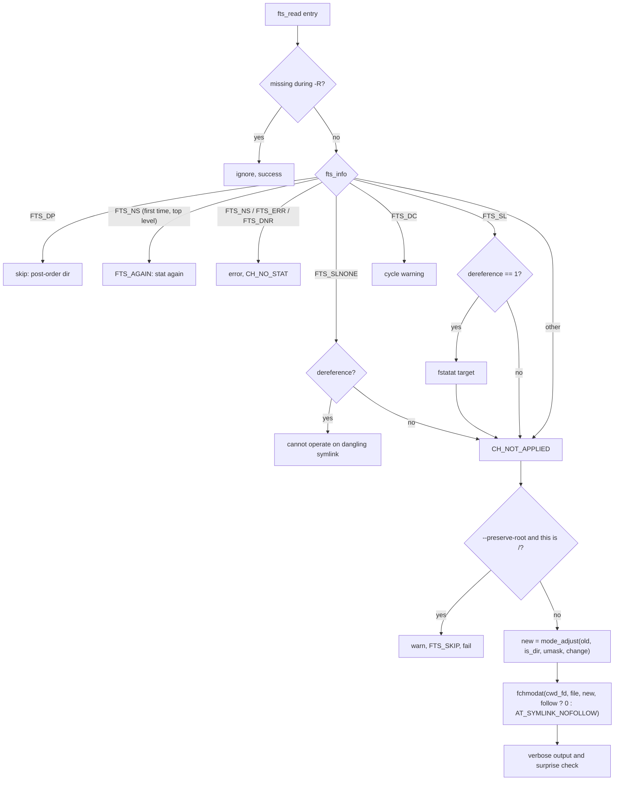

# `chmod`: change file mode bits

Source: `src/chmod.c` (688 lines) · Tests: `tests/chmod/` · Manual:
`info '(coreutils) chmod invocation'`

`chmod` compiles a mode string (such as `u+x,go-w` or `0755`) once, with
gnulib's `modechange` module. Then it walks the operands with gnulib `fts`,
and for each file computes the new mode from the old one with
`mode_adjust()`. The interesting parts are the option parser, which lets
`chmod -w file` work, the handling of symbolic links, and the "surprise"
check that warns when the umask stops a change from taking full effect.

## Options

The table lists `long_options[]` (`src/chmod.c:107-122`).

| Option | Effect |
|---|---|
| `-R`, `--recursive` | `recurse = true`. Without it, `process_file` calls `fts_set (FTS_SKIP)` on every entry. |
| `-H` (default), `-L`, `-P` | Choose the `fts` flags: `FTS_COMFOLLOW \| FTS_PHYSICAL`, `FTS_LOGICAL` or `FTS_PHYSICAL`. With `-R`, these decide which symlinks to directories are followed. |
| `-h`, `--no-dereference` | `dereference = 0`: change the symlink itself (`AT_SYMLINK_NOFOLLOW`) where the system supports it. |
| `--dereference` | `dereference = 1`: change the file the symlink points to. |
| `-c`, `--changes` | `verbosity = V_changes_only`. |
| `-v`, `--verbose` | `verbosity = V_high`. |
| `-f`, `--silent`, `--quiet` | `force_silent`: hide most error messages. |
| `--reference=RFILE` | Copy RFILE's mode with `mode_create_from_ref`. Cannot be combined with a MODE. |
| `--preserve-root` / `--no-preserve-root` | With `-R`, refuse to work on `/` (the default is not to check). |

`-h`, `-H`, `-L`, `-P` and `--dereference` were added in 9.5 (`NEWS`).

### Modes that look like options

The short-option string is unusual (`src/chmod.c:518-520`):

```c
"HLPRcfhvr::w::x::X::s::t::u::g::o::a::,::+::=::"
"0::1::2::3::4::5::6::7::"
```

Every character that can start a mode is listed as an option with an
optional argument. When `getopt_long` returns one of these characters, the
code takes the whole `argv` word (`argv[optind - 1]`, for example `-w` or
`-rwx`) and appends it to the `mode` string, adding a comma if needed. So
`chmod -w -x file` becomes the mode `-w,-x`. A mode found this way also
sets `diagnose_surprises` (see below). There is no case for `-`, because
`getopt` keeps `--` for long options. A comment notes that `--r` is a valid
mode that cannot be given this way.

## Code map

| Function | Location | Role |
|---|---|---|
| `main` | `src/chmod.c:499` | Options, compile the mode, read the umask, set up root protection, call `process_files`. |
| `process_files` | `:392` | `xfts_open`, loop over `fts_read`, `fts_close`. |
| `process_file` | `:215` | Handle one `FTSENT`: errors, symlinks, root check, `fchmodat`, verbose output, surprise check. |
| `mode_changed` | `:128` | For `-c` and `-v`: did the mode really change? If set-UID, set-GID or sticky bits were asked for, it calls `fstatat` again, because the kernel may have cleared them without an error. |
| `describe_change` | `:160` | Print `mode of 'f' changed from 0644 (rw-r--r--) to 0755 (rwxr-xr-x)` and similar messages. |
| `struct change_status` | `:42` | `CH_NO_STAT`, `CH_FAILED`, `CH_NOT_APPLIED`, `CH_NO_CHANGE_REQUESTED`, `CH_SUCCEEDED`, with the old and new mode. |

## How it works

The diagram shows what `process_file` does with each `fts` entry.



### Following symlinks

`dereference` starts at -1, which means "not given". `main` fixes it:

- With `-R -P`, a symlink is never followed. `--dereference` with that
  combination is an error: `-R --dereference requires either -H or -L`.
- With `-L`, symlinks are followed (`dereference = 1`).
- With -1 still set (the default `-H`, or `-P` without `-R`), only
  operands given on the command line are followed:
  `follow_symlink = ent->fts_level == FTS_ROOTLEVEL` (`:322-323`).

If `fchmodat (..., AT_SYMLINK_NOFOLLOW)` fails with `ENOTSUP` (Linux cannot
change a symlink's mode), the result is "not applied" and is not an error.

### The umask and "surprises"

If the mode has no `u`, `g`, `o` or `a` (for example `+x`), `mode_adjust`
applies the umask. So `chmod +w file` with umask 022 adds only `u+w`. When
the mode came in through the option path (`chmod -w`), `diagnose_surprises`
is set. Then `process_file` works out what the mode would be with no umask.
If the actual result has bits that the user might not expect, it prints an
error and fails (`src/chmod.c:361-379`).

`tests/chmod/umask-x.sh` checks this case. It runs `chmod 755 file`, then
`chmod -x file` with umask 077. The umask hides the group and other bits,
so only `u-x` is applied. The new mode `rw-r-xr-x` still has bits that
`rw-r--r--` would not have. So `chmod` reports `file: new permissions are
rw-r-xr-x, not rw-r--r--` and exits with status 1.

### Files removed during a walk

`fts-missing.h` gives `ignore_missing_fts_entry()` and
`ignorable_fts_error()`. A file below the top level that disappears
(`ENOENT`) during `-R` is skipped quietly. This changed in 9.12 (`NEWS`:
programs that walk trees "no longer fail merely because files may be being
removed in parallel").

### Root protection

With `-R --preserve-root`, `get_root_dev_ino()` (`gl/lib/root-dev-ino.c`)
saves the device and inode of `/`. `ROOT_DEV_INO_CHECK` compares each
entry with it. On a match, `chmod` prints `it is dangerous to operate
recursively on '/'`, skips that tree and fails.

## Errors and exit status

`process_file` returns `CH_NOT_APPLIED <= ch.status`. A file that could not
be read (`CH_NO_STAT`) or changed (`CH_FAILED`), or that hit the surprise
check, makes the exit status 1. A symlink that was not changed is not an
error.

## Tests

| File | Covers |
|---|---|
| `tests/chmod/c-option.sh` | `-c` output. |
| `tests/chmod/equal-x.sh`, `equals.sh` | `=x`, and forms such as `g=u` that copy bits from another class. |
| `tests/chmod/octal.sh`, `mode-whitespace.sh` | Rejecting bad mode strings. |
| `tests/chmod/setgid.sh` | Keeping the set-GID bit on directories, as Solaris, HP-UX and AIX do. |
| `tests/chmod/umask-x.sh`, `no-x.sh` | The surprise check, and the message for a directory that can be read but not searched. |
| `tests/chmod/symlinks.sh`, `ignore-symlink.sh`, `thru-dangling.sh` | `-h`, `-H`, `-L`, `-P`, and dangling links. |
| `tests/chmod/partial-fail.sh` | Exit status 1 when only some files change. |
| `tests/chmod/only-op.sh` | `chmod(2)` is still called when the bits would not change. |
| `tests/chmod/silent.sh` | `-f` hides messages (also for `chown` and `chgrp`). |
| `tests/chmod/usage.sh` | Odd mixes of options and mode-like arguments. |
| `tests/chmod/inaccessible.sh`, `reference-order.sh` | Older bug fixes, and `--reference` order. |

## See also

- [chown](chown.md): the same `fts` walk and root protection in
  `chown-core.c`.
- [mkdir](mkdir.md) also uses `mode_compile` and `mode_adjust`.
