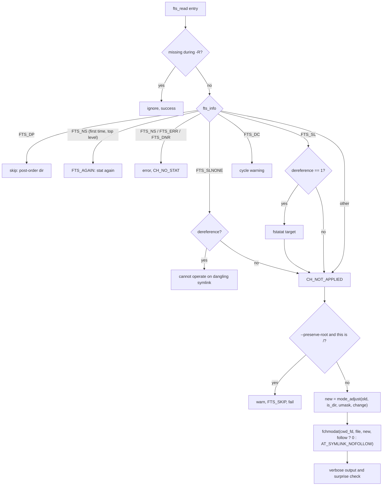

# `chmod`: change file mode bits

Source: `src/chmod.c` (688 lines) · Tests: `tests/chmod/` · Manual:
`info '(coreutils) chmod invocation'`

`chmod` compiles a mode string (such as `u+x,go-w` or `0755`) once, with
gnulib's `modechange` module. Then it walks the operands with gnulib `fts`,
and for each file computes the new mode from the old one with
`mode_adjust()`. The interesting parts are the option parser, which lets
`chmod -w file` work, the handling of symbolic links, and the "surprise"
check that warns when the umask stops a change from taking full effect.

## Options

The table lists `long_options[]` (`src/chmod.c:107-122`).

| Option | Effect |
|---|---|
| `-R`, `--recursive` | `recurse = true`. Without it, `process_file` calls `fts_set (FTS_SKIP)` on every entry. |
| `-H` (default), `-L`, `-P` | Choose the `fts` flags: `FTS_COMFOLLOW \| FTS_PHYSICAL`, `FTS_LOGICAL` or `FTS_PHYSICAL`. With `-R`, these decide which symlinks to directories are followed. |
| `-h`, `--no-dereference` | `dereference = 0`: change the symlink itself (`AT_SYMLINK_NOFOLLOW`) where the system supports it. |
| `--dereference` | `dereference = 1`: change the file the symlink points to. |
| `-c`, `--changes` | `verbosity = V_changes_only`. |
| `-v`, `--verbose` | `verbosity = V_high`. |
| `-f`, `--silent`, `--quiet` | `force_silent`: hide most error messages. |
| `--reference=RFILE` | Copy RFILE's mode with `mode_create_from_ref`. Cannot be combined with a MODE. |
| `--preserve-root` / `--no-preserve-root` | With `-R`, refuse to work on `/` (the default is not to check). |

`-h`, `-H`, `-L`, `-P` and `--dereference` were added in 9.5 (`NEWS`).

### Modes that look like options

The short-option string is unusual (`src/chmod.c:518-520`):

```c
"HLPRcfhvr::w::x::X::s::t::u::g::o::a::,::+::=::"
"0::1::2::3::4::5::6::7::"
```

Every character that can start a mode is listed as an option with an
optional argument. When `getopt_long` returns one of these characters, the
code takes the whole `argv` word (`argv[optind - 1]`, for example `-w` or
`-rwx`) and appends it to the `mode` string, adding a comma if needed. So
`chmod -w -x file` becomes the mode `-w,-x`. A mode found this way also
sets `diagnose_surprises` (see below). There is no case for `-`, because
`getopt` keeps `--` for long options. A comment notes that `--r` is a valid
mode that cannot be given this way.

## Code map

| Function | Location | Role |
|---|---|---|
| `main` | `src/chmod.c:499` | Options, compile the mode, read the umask, set up root protection, call `process_files`. |
| `process_files` | `:392` | `xfts_open`, loop over `fts_read`, `fts_close`. |
| `process_file` | `:215` | Handle one `FTSENT`: errors, symlinks, root check, `fchmodat`, verbose output, surprise check. |
| `mode_changed` | `:128` | For `-c` and `-v`: did the mode really change? If set-UID, set-GID or sticky bits were asked for, it calls `fstatat` again, because the kernel may have cleared them without an error. |
| `describe_change` | `:160` | Print `mode of 'f' changed from 0644 (rw-r--r--) to 0755 (rwxr-xr-x)` and similar messages. |
| `struct change_status` | `:42` | `CH_NO_STAT`, `CH_FAILED`, `CH_NOT_APPLIED`, `CH_NO_CHANGE_REQUESTED`, `CH_SUCCEEDED`, with the old and new mode. |

## How it works

The diagram shows what `process_file` does with each `fts` entry.



### Following symlinks

`dereference` starts at -1, which means "not given". `main` fixes it:

- With `-R -P`, a symlink is never followed. `--dereference` with that
  combination is an error: `-R --dereference requires either -H or -L`.
- With `-L`, symlinks are followed (`dereference = 1`).
- With -1 still set (the default `-H`, or `-P` without `-R`), only
  operands given on the command line are followed:
  `follow_symlink = ent->fts_level == FTS_ROOTLEVEL` (`:322-323`).

If `fchmodat (..., AT_SYMLINK_NOFOLLOW)` fails with `ENOTSUP` (Linux cannot
change a symlink's mode), the result is "not applied" and is not an error.

### The umask and "surprises"

If the mode has no `u`, `g`, `o` or `a` (for example `+x`), `mode_adjust`
applies the umask. So `chmod +w file` with umask 022 adds only `u+w`. When
the mode came in through the option path (`chmod -w`), `diagnose_surprises`
is set. Then `process_file` works out what the mode would be with no umask.
If the actual result has bits that the user might not expect, it prints an
error and fails (`src/chmod.c:361-379`).

`tests/chmod/umask-x.sh` checks this case. It runs `chmod 755 file`, then
`chmod -x file` with umask 077. The umask hides the group and other bits,
so only `u-x` is applied. The new mode `rw-r-xr-x` still has bits that
`rw-r--r--` would not have. So `chmod` reports `file: new permissions are
rw-r-xr-x, not rw-r--r--` and exits with status 1.

### Files removed during a walk

`fts-missing.h` gives `ignore_missing_fts_entry()` and
`ignorable_fts_error()`. A file below the top level that disappears
(`ENOENT`) during `-R` is skipped quietly. This changed in 9.12 (`NEWS`:
programs that walk trees "no longer fail merely because files may be being
removed in parallel").

### Root protection

With `-R --preserve-root`, `get_root_dev_ino()` (`gl/lib/root-dev-ino.c`)
saves the device and inode of `/`. `ROOT_DEV_INO_CHECK` compares each
entry with it. On a match, `chmod` prints `it is dangerous to operate
recursively on '/'`, skips that tree and fails.

## Errors and exit status

`process_file` returns `CH_NOT_APPLIED <= ch.status`. A file that could not
be read (`CH_NO_STAT`) or changed (`CH_FAILED`), or that hit the surprise
check, makes the exit status 1. A symlink that was not changed is not an
error.

## Tests

| File | Covers |
|---|---|
| `tests/chmod/c-option.sh` | `-c` output. |
| `tests/chmod/equal-x.sh`, `equals.sh` | `=x`, and forms such as `g=u` that copy bits from another class. |
| `tests/chmod/octal.sh`, `mode-whitespace.sh` | Rejecting bad mode strings. |
| `tests/chmod/setgid.sh` | Keeping the set-GID bit on directories, as Solaris, HP-UX and AIX do. |
| `tests/chmod/umask-x.sh`, `no-x.sh` | The surprise check, and the message for a directory that can be read but not searched. |
| `tests/chmod/symlinks.sh`, `ignore-symlink.sh`, `thru-dangling.sh` | `-h`, `-H`, `-L`, `-P`, and dangling links. |
| `tests/chmod/partial-fail.sh` | Exit status 1 when only some files change. |
| `tests/chmod/only-op.sh` | `chmod(2)` is still called when the bits would not change. |
| `tests/chmod/silent.sh` | `-f` hides messages (also for `chown` and `chgrp`). |
| `tests/chmod/usage.sh` | Odd mixes of options and mode-like arguments. |
| `tests/chmod/inaccessible.sh`, `reference-order.sh` | Older bug fixes, and `--reference` order. |

## See also

- [chown](chown.md): the same `fts` walk and root protection in
  `chown-core.c`.
- [mkdir](mkdir.md) also uses `mode_compile` and `mode_adjust`.

## Source code

`src/chmod.c:1`

```c
/* chmod -- change permission modes of files
   Copyright (C) 1989-2026 Free Software Foundation, Inc.

   This program is free software: you can redistribute it and/or modify
   it under the terms of the GNU General Public License as published by
   the Free Software Foundation, either version 3 of the License, or
   (at your option) any later version.

   This program is distributed in the hope that it will be useful,
   but WITHOUT ANY WARRANTY; without even the implied warranty of
   MERCHANTABILITY or FITNESS FOR A PARTICULAR PURPOSE.  See the
   GNU General Public License for more details.

   You should have received a copy of the GNU General Public License
   along with this program.  If not, see <https://www.gnu.org/licenses/>.  */

/* Written by David MacKenzie <djm@gnu.ai.mit.edu> */

#include <config.h>
#include <stdio.h>
#include <getopt.h>
#include <sys/types.h>

#include "system.h"
#include "assure.h"
#include "dev-ino.h"
#include "filemode.h"
#include "fts-missing.h"
#include "ignore-value.h"
#include "modechange.h"
#include "quote.h"
#include "root-dev-ino.h"
#include "xfts.h"

/* The official name of this program (e.g., no 'g' prefix).  */
#define PROGRAM_NAME "chmod"

#define AUTHORS \
  proper_name ("David MacKenzie"), \
  proper_name ("Jim Meyering")

struct change_status
{
  enum
    {
      CH_NO_STAT,
      CH_FAILED,
      CH_NOT_APPLIED,
      CH_NO_CHANGE_REQUESTED,
      CH_SUCCEEDED
    }
    status;
  mode_t old_mode;
  mode_t new_mode;
};

enum Verbosity
{
  /* Print a message for each file that is processed.  */
  V_high,

  /* Print a message for each file whose attributes we change.  */
  V_changes_only,

  /* Do not be verbose.  This is the default. */
  V_off
};

/* The desired change to the mode.  */
static struct mode_change *change;

/* The initial umask value, if it might be needed.  */
static mode_t umask_value;

/* If true, change the modes of directories recursively. */
static bool recurse;

/* 1 if --dereference, 0 if --no-dereference, -1 if neither has been
   specified.  */
static int dereference = -1;

/* If true, force silence (suppress most of error messages). */
static bool force_silent;

/* If true, diagnose surprises from naive misuses like "chmod -r file".
   POSIX allows diagnostics here, as portable code is supposed to use
   "chmod -- -r file".  */
static bool diagnose_surprises;

/* Level of verbosity.  */
static enum Verbosity verbosity = V_off;

/* Pointer to the device and inode numbers of '/', when --recursive.
   Otherwise NULL.  */
static struct dev_ino *root_dev_ino;

/* For long options that have no equivalent short option, use a
   non-character as a pseudo short option, starting with CHAR_MAX + 1.  */
enum
{
  DEREFERENCE_OPTION = CHAR_MAX + 1,
  NO_PRESERVE_ROOT,
  PRESERVE_ROOT,
  REFERENCE_FILE_OPTION
};

static struct option const long_options[] =
{
  {"changes", no_argument, NULL, 'c'},
  {"dereference", no_argument, NULL, DEREFERENCE_OPTION},
  {"recursive", no_argument, NULL, 'R'},
  {"no-dereference", no_argument, NULL, 'h'},
  {"no-preserve-root", no_argument, NULL, NO_PRESERVE_ROOT},
  {"preserve-root", no_argument, NULL, PRESERVE_ROOT},
  {"quiet", no_argument, NULL, 'f'},
  {"reference", required_argument, NULL, REFERENCE_FILE_OPTION},
  {"silent", no_argument, NULL, 'f'},
  {"verbose", no_argument, NULL, 'v'},
  {GETOPT_HELP_OPTION_DECL},
  {GETOPT_VERSION_OPTION_DECL},
  {NULL, 0, NULL, 0}
};

/* Return true if the chmodable permission bits of FILE changed.
   The old mode was OLD_MODE, but it was changed to NEW_MODE.  */

static bool
mode_changed (int dir_fd, char const *file, char const *file_full_name,
              mode_t old_mode, mode_t new_mode, bool ignore_missing,
              bool *file_missing)
{
  *file_missing = false;
  if (new_mode & (S_ISUID | S_ISGID | S_ISVTX))
    {
      /* The new mode contains unusual bits that the call to chmod may
         have silently cleared.  Check whether they actually changed.  */

      struct stat new_stats;

      if (fstatat (dir_fd, file, &new_stats, 0) != 0)
        {
          *file_missing = (ignore_missing
                           && ignorable_traversal_errno (errno));
          if (! *file_missing && ! force_silent)
            error (0, errno, _("getting new attributes of %s"),
                   quoteaf (file_full_name));
          return false;
        }

      new_mode = new_stats.st_mode;
    }

  return ((old_mode ^ new_mode) & CHMOD_MODE_BITS) != 0;
}

/* Tell the user how/if the MODE of FILE has been changed.
   CH describes what (if anything) has happened. */

static void
describe_change (char const *file, struct change_status const *ch)
{
  char perms[12];		/* "-rwxrwxrwx" ls-style modes. */
  char old_perms[12];
  char const *fmt;
  char const *quoted_file = quoteaf (file);

  switch (ch->status)
    {
    case CH_NOT_APPLIED:
      printf (_("neither symbolic link %s nor referent has been changed\n"),
              quoted_file);
      return;

    case CH_NO_STAT:
      printf (_("%s could not be accessed\n"), quoted_file);
      return;

    case CH_FAILED: case CH_NO_CHANGE_REQUESTED: case CH_SUCCEEDED:
      break;
  }

  unsigned long int
    old_m = ch->old_mode & CHMOD_MODE_BITS,
    m = ch->new_mode & CHMOD_MODE_BITS;

  strmode (ch->new_mode, perms);
  perms[10] = '\0';		/* Remove trailing space.  */

  strmode (ch->old_mode, old_perms);
  old_perms[10] = '\0';		/* Remove trailing space.  */

  switch (ch->status)
    {
    case CH_SUCCEEDED:
      fmt = _("mode of %s changed from %04lo (%s) to %04lo (%s)\n");
      break;
    case CH_FAILED:
      fmt = _("failed to change mode of %s from %04lo (%s) to %04lo (%s)\n");
      break;
    case CH_NO_CHANGE_REQUESTED:
      fmt = _("mode of %s retained as %04lo (%s)\n");
      printf (fmt, quoted_file, m, &perms[1]);
      return;
    case CH_NO_STAT: case CH_NOT_APPLIED: default:
      affirm (false);
    }
  printf (fmt, quoted_file, old_m, &old_perms[1], m, &perms[1]);
}

/* Change the mode of FILE.
   Return true if successful.  This function is called
   once for every file system object that fts encounters.  */

static bool
process_file (FTS *fts, FTSENT *ent)
{
  char const *file_full_name = ent->fts_path;
  char const *file = ent->fts_accpath;
  const struct stat *file_stats = ent->fts_statp;
  struct change_status ch = {0};
  ch.status = CH_NO_STAT;
  struct stat stat_buf;
  bool ignore_missing = ignore_missing_fts_entry (ent);

  if (ignore_missing && ignorable_fts_error (ent))
    return true;

  switch (ent->fts_info)
    {
    case FTS_DP:
      return true;

    case FTS_NS:
      /* For a top-level file or directory, this FTS_NS (stat failed)
         indicator is determined at the time of the initial fts_open call.
         With programs like chmod, chown, and chgrp, that modify
         permissions, it is possible that the file in question is
         accessible when control reaches this point.  So, if this is
         the first time we've seen the FTS_NS for this file, tell
         fts_read to stat it "again".  */
      if (ent->fts_level == FTS_ROOTLEVEL && ent->fts_number == 0)
        {
          ent->fts_number = 1;
          fts_set (fts, ent, FTS_AGAIN);
          return true;
        }
      if (! force_silent)
        error (0, ent->fts_errno, _("cannot access %s"),
               quoteaf (file_full_name));
      break;

    case FTS_ERR:
      if (! force_silent)
        error (0, ent->fts_errno, "%s", quotef (file_full_name));
      break;

    case FTS_DNR:
      if (! force_silent)
        error (0, ent->fts_errno, _("cannot read directory %s"),
               quoteaf (file_full_name));
      break;

    case FTS_SLNONE:
      if (dereference)
        {
          if (! force_silent)
            error (0, 0, _("cannot operate on dangling symlink %s"),
                   quoteaf (file_full_name));
          break;
        }
      ch.status = CH_NOT_APPLIED;
      break;

    case FTS_SL:
      if (dereference == 1)
        {
          if (fstatat (fts->fts_cwd_fd, file, &stat_buf, 0) != 0)
            {
              if (ignore_missing
                  && ignorable_traversal_errno (errno))
                return true;
              if (! force_silent)
                error (0, errno, _("cannot dereference %s"),
                       quoteaf (file_full_name));
              break;
            }

          file_stats = &stat_buf;
        }
      ch.status = CH_NOT_APPLIED;
      break;

    case FTS_DC:		/* directory that causes cycles */
      if (cycle_warning_required (fts, ent))
        {
          emit_cycle_warning (file_full_name);
          return false;
        }
      FALLTHROUGH;
    default:
      ch.status = CH_NOT_APPLIED;
      break;
    }

  if (ch.status == CH_NOT_APPLIED
      && ROOT_DEV_INO_CHECK (root_dev_ino, file_stats))
    {
      ROOT_DEV_INO_WARN (file_full_name);
      /* Tell fts not to traverse into this hierarchy.  */
      fts_set (fts, ent, FTS_SKIP);
      /* Ensure that we do not process "/" on the second visit.  */
      ignore_value (fts_read (fts));
      return false;
    }

  if (ch.status == CH_NOT_APPLIED)
    {
      ch.old_mode = file_stats->st_mode;
      ch.new_mode = mode_adjust (ch.old_mode, S_ISDIR (ch.old_mode) != 0,
                                 umask_value, change, NULL);
      bool follow_symlink = !!dereference;
      if (dereference == -1) /* -H with/without -R, -P without -R.  */
        follow_symlink = ent->fts_level == FTS_ROOTLEVEL;
      if (fchmodat (fts->fts_cwd_fd, file, ch.new_mode,
                    follow_symlink ? 0 : AT_SYMLINK_NOFOLLOW) == 0)
        ch.status = CH_SUCCEEDED;
      else
        {
          if (ignore_missing
              && ignorable_traversal_errno (errno))
            return true;
          if (! is_ENOTSUP (errno))
            {
              if (! force_silent)
                error (0, errno, _("changing permissions of %s"),
                       quoteaf (file_full_name));

              ch.status = CH_FAILED;
            }
          /* else treat not supported as not applied.  */
        }
    }

  if (verbosity != V_off)
    {
      bool file_missing;
      if (ch.status == CH_SUCCEEDED
          && !mode_changed (fts->fts_cwd_fd, file, file_full_name,
                            ch.old_mode, ch.new_mode, ignore_missing,
                            &file_missing))
        {
          if (file_missing)
            return true;
          ch.status = CH_NO_CHANGE_REQUESTED;
        }

      if (ch.status == CH_SUCCEEDED || verbosity == V_high)
        describe_change (file_full_name, &ch);
    }

  if (CH_NO_CHANGE_REQUESTED <= ch.status && diagnose_surprises)
    {
      mode_t naively_expected_mode =
        mode_adjust (ch.old_mode, S_ISDIR (ch.old_mode) != 0,
                     0, change, NULL);
      if (ch.new_mode & ~naively_expected_mode)
        {
          char new_perms[12];
          char naively_expected_perms[12];
          strmode (ch.new_mode, new_perms);
          strmode (naively_expected_mode, naively_expected_perms);
          new_perms[10] = naively_expected_perms[10] = '\0';
          error (0, 0,
                 _("%s: new permissions are %s, not %s"),
                 quotef (file_full_name),
                 new_perms + 1, naively_expected_perms + 1);
          ch.status = CH_FAILED;
        }
    }

  if ( ! recurse)
    fts_set (fts, ent, FTS_SKIP);

  return CH_NOT_APPLIED <= ch.status;
}

/* Recursively change the modes of the specified FILES (the last entry
   of which is null).  BIT_FLAGS controls how fts works.
   Return true if successful.  */

static bool
process_files (char **files, int bit_flags)
{
  bool ok = true;

  FTS *fts = xfts_open (files, bit_flags, NULL);

  while (true)
    {
      FTSENT *ent;

      ent = fts_read (fts);
      if (ent == NULL)
        {
          if (errno != 0)
            {
              /* FIXME: try to give a better message  */
              if (! force_silent)
                error (0, errno, _("fts_read failed"));
              ok = false;
            }
          break;
        }

      ok &= process_file (fts, ent);
    }

  if (fts_close (fts) != 0)
    {
      error (0, errno, _("fts_close failed"));
      ok = false;
    }

  return ok;
}

void
usage (int status)
{
  if (status != EXIT_SUCCESS)
    emit_try_help ();
  else
    {
      printf (_("\
Usage: %s [OPTION]... MODE[,MODE]... FILE...\n\
  or:  %s [OPTION]... OCTAL-MODE FILE...\n\
  or:  %s [OPTION]... --reference=RFILE FILE...\n\
"),
              program_name, program_name, program_name);
      fputs (_("\
Change the mode of each FILE to MODE.\n\
With --reference, change the mode of each FILE to that of RFILE.\n\
\n\
"), stdout);
      oputs (_("\
  -c, --changes\n\
         like verbose but report only when a change is made\n\
"));
      oputs (_("\
  -f, --silent, --quiet\n\
         suppress most error messages\n\
"));
      oputs (_("\
  -v, --verbose\n\
         output a diagnostic for every file processed\n\
"));
      oputs (_("\
      --dereference\n\
         affect the referent of each symbolic link,\n\
         rather than the symbolic link itself\n\
"));
      oputs (_("\
  -h, --no-dereference\n\
         affect each symbolic link, rather than the referent\n\
"));
      oputs (_("\
      --no-preserve-root\n\
         do not treat '/' specially (the default)\n\
"));
      oputs (_("\
      --preserve-root\n\
         fail to operate recursively on '/'\n\
"));
      oputs (_("\
      --reference=RFILE\n\
         use RFILE's mode instead of specifying MODE values.\n\
         RFILE is always dereferenced if a symbolic link.\n\
"));
      oputs (_("\
  -R, --recursive\n\
         change files and directories recursively\n\
"));
      emit_symlink_recurse_options ("-H");
      oputs (HELP_OPTION_DESCRIPTION);
      oputs (VERSION_OPTION_DESCRIPTION);
      fputs (_("\
\n\
Each MODE is of the form '[ugoa]*([-+=]([rwxXst]*|[ugo]))+|[-+=][0-7]+'.\n\
"), stdout);
      emit_ancillary_info (PROGRAM_NAME);
    }
  exit (status);
}

/* Parse the ASCII mode given on the command line into a linked list
   of 'struct mode_change' and apply that to each file argument. */

int
main (int argc, char **argv)
{
  char *mode = NULL;
  idx_t mode_len = 0;
  idx_t mode_alloc = 0;
  bool ok;
  bool preserve_root = false;
  char const *reference_file = NULL;
  int c;
  int bit_flags = FTS_COMFOLLOW | FTS_PHYSICAL;

  initialize_main (&argc, &argv);
  set_program_name (argv[0]);
  setlocale (LC_ALL, "");
  bindtextdomain (PACKAGE, LOCALEDIR);
  textdomain (PACKAGE);

  atexit (close_stdout);

  while ((c = getopt_long (argc, argv,
                           ("HLPRcfhvr::w::x::X::s::t::u::g::o::a::,::+::=::"
                            "0::1::2::3::4::5::6::7::"),
                           long_options, NULL))
         != -1)
    {
      switch (c)
        {

        case 'H': /* Traverse command-line symlinks-to-directories.  */
          bit_flags = FTS_COMFOLLOW | FTS_PHYSICAL;
          break;

        case 'L': /* Traverse all symlinks-to-directories.  */
          bit_flags = FTS_LOGICAL;
          break;

        case 'P': /* Traverse no symlinks-to-directories.  */
          bit_flags = FTS_PHYSICAL;
          break;

        case 'h': /* --no-dereference: affect symlinks */
          dereference = 0;
          break;

        case DEREFERENCE_OPTION: /* --dereference: affect the referent
                                    of each symlink */
          dereference = 1;
          break;

        case 'r':
        case 'w':
        case 'x':
        case 'X':
        case 's':
        case 't':
        case 'u':
        case 'g':
        case 'o':
        case 'a':
        case ',':
        case '+':
        case '=':
        case '0': case '1': case '2': case '3':
        case '4': case '5': case '6': case '7':
          /* Support non-portable uses like "chmod -w", but diagnose
             surprises due to umask confusion.  Even though "--", "--r",
             etc., are valid modes, there is no "case '-'" here since
             getopt_long reserves leading "--" for long options.  */
          {
            /* Allocate a mode string (e.g., "-rwx") by concatenating
               the argument containing this option.  If a previous mode
               string was given, concatenate the previous string, a
               comma, and the new string (e.g., "-s,-rwx").  */

            char const *arg = argv[optind - 1];
            idx_t arg_len = strlen (arg);
            idx_t mode_comma_len = mode_len + !!mode_len;
            idx_t new_mode_len = mode_comma_len + arg_len;
            assume (0 <= new_mode_len);  /* Pacify GCC bug #109613.  */
            if (mode_alloc <= new_mode_len)
              mode = xpalloc (mode, &mode_alloc,
                              new_mode_len + 1 - mode_alloc, -1, 1);
            mode[mode_len] = ',';
            memcpy (mode + mode_comma_len, arg, arg_len + 1);
            mode_len = new_mode_len;

            diagnose_surprises = true;
          }
          break;
        case NO_PRESERVE_ROOT:
          preserve_root = false;
          break;
        case PRESERVE_ROOT:
          preserve_root = true;
          break;
        case REFERENCE_FILE_OPTION:
          reference_file = optarg;
          break;
        case 'R':
          recurse = true;
          break;
        case 'c':
          verbosity = V_changes_only;
          break;
        case 'f':
          force_silent = true;
          break;
        case 'v':
          verbosity = V_high;
          break;
        case_GETOPT_HELP_CHAR;
        case_GETOPT_VERSION_CHAR (PROGRAM_NAME, AUTHORS);
        default:
          usage (EXIT_FAILURE);
        }
    }

  if (recurse)
    {
      if (bit_flags == FTS_PHYSICAL)
        {
          if (dereference == 1)
            error (EXIT_FAILURE, 0,
                   _("-R --dereference requires either -H or -L"));
          dereference = 0;
        }
    }

  if (dereference == -1 && bit_flags == FTS_LOGICAL)
    dereference = 1;

  if (reference_file)
    {
      if (mode)
        {
          error (0, 0, _("cannot combine mode and --reference options"));
          usage (EXIT_FAILURE);
        }
    }
  else
    {
      if (!mode)
        mode = argv[optind++];
    }

  if (optind >= argc)
    {
      if (!mode || mode != argv[optind - 1])
        error (0, 0, _("missing operand"));
      else
        error (0, 0, _("missing operand after %s"), quote (argv[argc - 1]));
      usage (EXIT_FAILURE);
    }

  if (reference_file)
    {
      change = mode_create_from_ref (reference_file);
      if (!change)
        error (EXIT_FAILURE, errno, _("failed to get attributes of %s"),
               quoteaf (reference_file));
    }
  else
    {
      change = mode_compile (mode);
      if (!change)
        {
          error (0, 0, _("invalid mode: %s"), quote (mode));
          usage (EXIT_FAILURE);
        }
      umask_value = umask (0);
    }

  if (recurse && preserve_root)
    {
      static struct dev_ino dev_ino_buf;
      root_dev_ino = get_root_dev_ino (&dev_ino_buf);
      if (root_dev_ino == NULL)
        error (EXIT_FAILURE, errno, _("failed to get attributes of %s"),
               quoteaf ("/"));
    }
  else
    {
      root_dev_ino = NULL;
    }

  bit_flags |= FTS_DEFER_STAT;
  ok = process_files (argv + optind, bit_flags);

  main_exit (ok ? EXIT_SUCCESS : EXIT_FAILURE);
}
```
