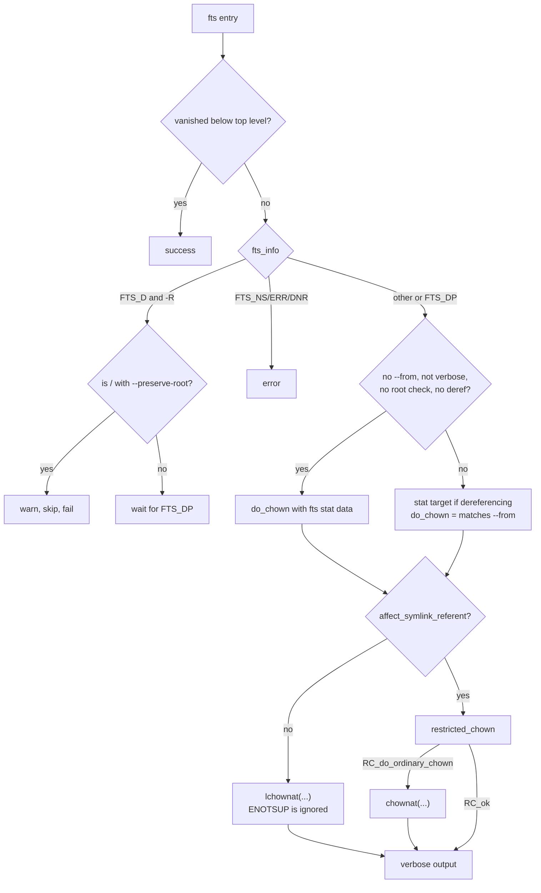

# `chown` and `chgrp`: change file owner and group

Source: `src/chown.c` (366 lines), `src/chown-core.c` (589 lines),
`src/chown-chown.c` or `src/chown-chgrp.c` · Tests: `tests/chown/`,
`tests/chgrp/` · Manual: `info '(coreutils) chown invocation'`

`chown` and `chgrp` are one program built twice (`src/local.mk:410-411`).
`chown-chgrp.c` sets `chown_mode = CHOWN_CHGRP`. `main` then puts a `:`
before the GROUP operand and parses it in the same way as `chown :GROUP`.
`chown.c` parses the options and the owner spec. `chown-core.c` walks the
files with gnulib `fts` and changes them. It contains a careful method,
`restricted_chown`, that avoids a race when `--from` is used.

## Options

The table lists `long_options[]` (`src/chown.c:54-70`) and the short-option
string `"HLPRcfhv"`.

| Option | Effect |
|---|---|
| `-R`, `--recursive` | `chopt.recurse`. |
| `-H`, `-L`, `-P` (default) | `fts` flags. **The default here is `-P`** (`bit_flags = FTS_PHYSICAL`), but `chmod`'s default is `-H`. Without `-R` these options are ignored, and `bit_flags` is set back to `FTS_PHYSICAL`. |
| `-h`, `--no-dereference` | Change symlinks themselves (`lchownat`). |
| `--dereference` | Change what symlinks point to. This is the default unless `-R -P` is in effect. |
| `--from=OWNER:GROUP` | Change only files whose current owner or group matches (`required_uid`, `required_gid`). |
| `--reference=RFILE` | Use RFILE's owner and group (`chgrp` uses only the group). |
| `-c`, `-v`, `-f` | Verbosity and silence, as in [chmod](chmod.md). |
| `--preserve-root` / `--no-preserve-root` | Root protection for `-R`. |

`main` sets `chopt.affect_symlink_referent = (dereference != 0)`. So
`chown user link` changes the target, and `chown -h user link` changes the
link. With `-R` and `-P`, `dereference` is forced to 0. `--dereference`
there is an error.

### Owner spec

`parse_user_spec_warn()` (gnulib `userspec`) accepts `USER`, `USER:GROUP`,
`USER:`, `:GROUP` and numeric IDs. It also accepts the old `.` separator,
with a warning. If it returns a warning rather than an error, `main` prints
the message and carries on (`error (warn ? 0 : EXIT_FAILURE, ...)`). For a
`:GROUP` spec, `user_name` is set to `""` so that messages say "ownership
:GROUP" (`src/chown.c:342-346`).

`USER:` with no group means "and the user's login group". A numeric user
has no login group, so a spec such as `1000:` is an error.
`tests/chown/separator.sh` checks this.

## Code map

| Function | Location | Role |
|---|---|---|
| `main` | `src/chown.c:178` | Options, the spec or `--reference`, root protection, `chown_files`. |
| `chown_files` | `src/chown-core.c:546` | `xfts_open`, loop, `fts_close`. Uses `FTS_NOSTAT` when no stat data is needed. |
| `change_file_owner` | `:280` | One `FTSENT`: errors, root check, `--from` filter, the chown call, verbose output. |
| `restricted_chown` | `:228` | Open, `fstat`, check the inode, then `fchown`, to avoid races with `--from`. |
| `describe_change` | `:153` | `changed ownership of 'f' from a:b to c:d` and similar messages. |
| `uid_to_name`, `gid_to_name`, `user_group_str` | `:81-150` | Format names for messages. |
| `struct Chown_option` | `src/chown-core.h` | Settings shared by `chown.c` and `chown-core.c`. |

## How it works

The diagram shows how `change_file_owner` decides what to do with each
entry.



### Directories are changed after their contents

With `-R`, `FTS_D` (before the contents) only does the root check, and the
work happens at `FTS_DP` (after the contents). So a directory's owner
changes after everything inside it.

### Avoiding the `--from` race

Suppose `--from` is used and symlinks are followed. A plain `chown()` after
`fts`'s `stat` would leave a gap. An attacker could swap the file for a
symlink to something else, and `chown` would then change the wrong file.
`restricted_chown` closes that gap for regular files and directories
(`src/chown-core.c:236-265`):

```c
int fd = openat (cwd_fd, file, O_RDONLY | open_flags);
...
if (fstat (fd, &st) != 0)
  status = RC_error;
else if (! psame_inode (orig_st, &st))
  status = RC_inode_changed;
else if ((required_uid == (uid_t) -1 || required_uid == st.st_uid)
         && (required_gid == (gid_t) -1 || required_gid == st.st_gid))
  {
#if HAVE_FCHOWN
    if (fchown (fd, uid, gid) == 0)
      return close (fd) < 0 ? RC_error : RC_ok;
#endif
```

`open_flags` is `O_NONBLOCK | O_NOCTTY`, plus `O_DIRECTORY` for
directories. Other file types, such as FIFOs and devices, return
`RC_do_ordinary_chown`, because opening them could have side effects. If
read access is denied, it tries `O_WRONLY` for regular files. If that also
fails, it falls back to `chownat`.

### Special bits are not restored

A comment at `src/chown-core.c:474-479` explains that some kernels clear
the set-UID and set-GID bits on `chown`. The code does **not** set them
again, because that would open a window that another user could exploit.

### Speed

When no stat data is needed (no `--from`, not verbose, no root check, and
symlinks are not followed: `-h`, or `-R` with `-P`), `chown_files` passes
`FTS_NOSTAT` and `change_file_owner` changes
each file without another `stat`.

## Errors and exit status

Each file is handled separately. Any failure makes the exit status 1.
`lchownat` failing with `ENOTSUP` is not an error, because POSIX requires
that for symlinks. A file skipped because it does not match `--from` is not
an error. A file whose inode changed inside `restricted_chown`
(`RC_inode_changed`) makes the exit status 1 without a message. A `FIXME`
there asks whether a message should be added.

## Tests

| File | Covers |
|---|---|
| `tests/chown/basic.sh`, `tests/chgrp/from.sh` | `--from`. |
| `tests/chown/separator.sh` | `USER:GROUP`, `USER:`, `:GROUP`, and the old `.` separator. |
| `tests/chown/deref.sh`, `tests/chgrp/deref.sh` | `--dereference` and `-h`. |
| `tests/chgrp/default-no-deref.sh`, `posix-H.sh`, `recurse.sh` | `-R` with `-H`, `-L` and `-P`. |
| `tests/chown/preserve-root.sh` | `--preserve-root`, including through a symlink to `/`. |
| `tests/chown/cannot-access.sh` | `cannot access` and `cannot dereference` messages. |
| `tests/chown/verbose-dangling-symlink.sh`, `tests/chgrp/verbose-dangling-symlink.sh` | `-v` on dangling links. |
| `tests/chgrp/basic.sh`, `no-x.sh` | Basic use, and a directory that can be read but not searched. |

## See also

- [chmod](chmod.md): the same `fts` structure.
- [id](id.md) uses the same `parse_user_spec`.

## Source code

`src/chown.c:1`

```c
/* chown, chgrp -- change user and group ownership of files
   Copyright (C) 1989-2026 Free Software Foundation, Inc.

   This program is free software: you can redistribute it and/or modify
   it under the terms of the GNU General Public License as published by
   the Free Software Foundation, either version 3 of the License, or
   (at your option) any later version.

   This program is distributed in the hope that it will be useful,
   but WITHOUT ANY WARRANTY; without even the implied warranty of
   MERCHANTABILITY or FITNESS FOR A PARTICULAR PURPOSE.  See the
   GNU General Public License for more details.

   You should have received a copy of the GNU General Public License
   along with this program.  If not, see <https://www.gnu.org/licenses/>.  */

/* Written by David MacKenzie <djm@gnu.ai.mit.edu>. */

#include <config.h>
#include <stdio.h>
#include <sys/types.h>
#include <getopt.h>

#include "system.h"
#include "chown.h"
#include "chown-core.h"
#include "fts_.h"
#include "quote.h"
#include "root-dev-ino.h"
#include "userspec.h"

/* The official name of this program (e.g., no 'g' prefix).  */
#define PROGRAM_NAME (chown_mode == CHOWN_CHOWN ? "chown" : "chgrp")

#define AUTHORS \
  proper_name ("David MacKenzie"), \
  proper_name ("Jim Meyering")

/* The argument to the --reference option.  Use the owner and group IDs
   of this file.  This file must exist.  */
static char *reference_file;

/* For long options that have no equivalent short option, use a
   non-character as a pseudo short option, starting with CHAR_MAX + 1.  */
enum
{
  DEREFERENCE_OPTION = CHAR_MAX + 1,
  FROM_OPTION,
  NO_PRESERVE_ROOT,
  PRESERVE_ROOT,
  REFERENCE_FILE_OPTION
};

static struct option const long_options[] =
{
  {"recursive", no_argument, NULL, 'R'},
  {"changes", no_argument, NULL, 'c'},
  {"dereference", no_argument, NULL, DEREFERENCE_OPTION},
  {"from", required_argument, NULL, FROM_OPTION},
  {"no-dereference", no_argument, NULL, 'h'},
  {"no-preserve-root", no_argument, NULL, NO_PRESERVE_ROOT},
  {"preserve-root", no_argument, NULL, PRESERVE_ROOT},
  {"quiet", no_argument, NULL, 'f'},
  {"silent", no_argument, NULL, 'f'},
  {"reference", required_argument, NULL, REFERENCE_FILE_OPTION},
  {"verbose", no_argument, NULL, 'v'},
  {GETOPT_HELP_OPTION_DECL},
  {GETOPT_VERSION_OPTION_DECL},
  {NULL, 0, NULL, 0}
};

void
usage (int status)
{
  if (status != EXIT_SUCCESS)
    emit_try_help ();
  else
    {
      printf (_("\
Usage: %s [OPTION]... %s FILE...\n\
  or:  %s [OPTION]... --reference=RFILE FILE...\n\
"),
              program_name,
              chown_mode == CHOWN_CHOWN ? _("[OWNER][:[GROUP]]") : _("GROUP"),
              program_name);
      if (chown_mode == CHOWN_CHOWN)
        fputs (_("\
Change the owner and/or group of each FILE to OWNER and/or GROUP.\n\
With --reference, change the owner and group of each FILE to those of RFILE.\n\
\n\
"), stdout);
      else
        fputs (_("\
Change the group of each FILE to GROUP.\n\
With --reference, change the group of each FILE to that of RFILE.\n\
\n\
"), stdout);
      oputs (_("\
  -c, --changes\n\
         like verbose but report only when a change is made\n\
"));
      oputs (_("\
  -f, --silent, --quiet\n\
         suppress most error messages\n\
"));
      oputs (_("\
  -v, --verbose\n\
         output a diagnostic for every file processed\n\
"));
      oputs (_("\
      --dereference\n\
         affect the referent of each symbolic link (this is\n\
         the default), rather than the symbolic link itself\n\
"));
      oputs (_("\
  -h, --no-dereference\n\
         affect symbolic links instead of any referenced file;\n\
         useful only on systems that can change the ownership of a symlink\n\
"));
      oputs (_("\
      --from=CURRENT_OWNER:CURRENT_GROUP\n\
         change the ownership of each file only if its\n\
         current owner and/or group match those specified here.\n\
         Either may be omitted, in which case a match\n\
         is not required for the omitted attribute\n\
"));
      oputs (_("\
      --no-preserve-root\n\
         do not treat '/' specially (the default)\n\
"));
      oputs (_("\
      --preserve-root\n\
         fail to operate recursively on '/'\n\
"));
      oputs (_("\
      --reference=RFILE\n\
         use RFILE's ownership rather than specifying values.\n\
         RFILE is always dereferenced if a symbolic link.\n\
"));
      oputs (_("\
  -R, --recursive\n\
         operate on files and directories recursively\n\
"));
      emit_symlink_recurse_options ("-P");
      oputs (HELP_OPTION_DESCRIPTION);
      oputs (VERSION_OPTION_DESCRIPTION);
      if (chown_mode == CHOWN_CHOWN)
        fputs (_("\
\n\
Owner is unchanged if missing.  Group is unchanged if missing, but changed\n\
to login group if implied by a ':' following a symbolic OWNER.\n\
OWNER and GROUP may be numeric as well as symbolic.\n\
"), stdout);

      if (chown_mode == CHOWN_CHOWN)
        printf (_("\
\n\
Examples:\n\
  %s root /u        Change the owner of /u to \"root\".\n\
  %s root:staff /u  Likewise, but also change its group to \"staff\".\n\
  %s -hR root /u    Change the owner of /u and subfiles to \"root\".\n\
"),
              program_name, program_name, program_name);
      else
        printf (_("\
\n\
Examples:\n\
  %s staff /u      Change the group of /u to \"staff\".\n\
  %s -hR staff /u  Change the group of /u and subfiles to \"staff\".\n\
"),
              program_name, program_name);
      emit_ancillary_info (PROGRAM_NAME);
    }
  exit (status);
}

int
main (int argc, char **argv)
{
  bool preserve_root = false;

  /* Change the owner (group) of a file only if it has this uid (gid).
     -1 means there's no restriction.  */
  uid_t required_uid = -1;
  gid_t required_gid = -1;

  /* Bit flags that control how fts works.  */
  int bit_flags = FTS_PHYSICAL;

  /* 1 if --dereference, 0 if --no-dereference, -1 if neither has been
     specified.  */
  int dereference = -1;

  struct Chown_option chopt;

  initialize_main (&argc, &argv);
  set_program_name (argv[0]);
  setlocale (LC_ALL, "");
  bindtextdomain (PACKAGE, LOCALEDIR);
  textdomain (PACKAGE);

  atexit (close_stdout);

  chopt_init (&chopt);

  int optc;
  while ((optc = getopt_long (argc, argv, "HLPRcfhv", long_options, NULL))
         != -1)
    {
      switch (optc)
        {
        case 'H': /* Traverse command-line symlinks-to-directories.  */
          bit_flags = FTS_COMFOLLOW | FTS_PHYSICAL;
          break;

        case 'L': /* Traverse all symlinks-to-directories.  */
          bit_flags = FTS_LOGICAL;
          break;

        case 'P': /* Traverse no symlinks-to-directories.  */
          bit_flags = FTS_PHYSICAL;
          break;

        case 'h': /* --no-dereference: affect symlinks */
          dereference = 0;
          break;

        case DEREFERENCE_OPTION: /* --dereference: affect the referent
                                    of each symlink */
          dereference = 1;
          break;

        case NO_PRESERVE_ROOT:
          preserve_root = false;
          break;

        case PRESERVE_ROOT:
          preserve_root = true;
          break;

        case REFERENCE_FILE_OPTION:
          reference_file = optarg;
          break;

        case FROM_OPTION:
          {
            bool warn;
            char const *e = parse_user_spec_warn (optarg,
                                                  &required_uid, &required_gid,
                                                  NULL, NULL, &warn);
            if (e)
              error (warn ? 0 : EXIT_FAILURE, 0, "%s: %s", e, quote (optarg));
            break;
          }

        case 'R':
          chopt.recurse = true;
          break;

        case 'c':
          chopt.verbosity = V_changes_only;
          break;

        case 'f':
          chopt.force_silent = true;
          break;

        case 'v':
          chopt.verbosity = V_high;
          break;

        case_GETOPT_HELP_CHAR;
        case_GETOPT_VERSION_CHAR (PROGRAM_NAME, AUTHORS);
        default:
          usage (EXIT_FAILURE);
        }
    }

  if (chopt.recurse)
    {
      if (bit_flags == FTS_PHYSICAL)
        {
          if (dereference == 1)
            error (EXIT_FAILURE, 0,
                   _("-R --dereference requires either -H or -L"));
          dereference = 0;
        }
    }
  else
    {
      bit_flags = FTS_PHYSICAL;
    }
  chopt.affect_symlink_referent = (dereference != 0);

  if (argc - optind < (reference_file ? 1 : 2))
    {
      if (argc <= optind)
        error (0, 0, _("missing operand"));
      else
        error (0, 0, _("missing operand after %s"), quote (argv[argc - 1]));
      usage (EXIT_FAILURE);
    }

  uid_t uid = -1;	/* Specified uid; -1 if not to be changed.  */
  gid_t gid = -1;	/* Specified gid; -1 if not to be changed.  */

  if (reference_file)
    {
      struct stat ref_stats;
      if (stat (reference_file, &ref_stats))
        error (EXIT_FAILURE, errno, _("failed to get attributes of %s"),
               quoteaf (reference_file));

      if (chown_mode == CHOWN_CHOWN)
        {
          uid = ref_stats.st_uid;
          chopt.user_name = uid_to_name (ref_stats.st_uid);
        }
      gid = ref_stats.st_gid;
      chopt.group_name = gid_to_name (ref_stats.st_gid);
    }
  else
    {
      char *ug = argv[optind];
      if (chown_mode == CHOWN_CHGRP)
        {
          ug = xmalloc (1 + strlen (argv[optind]) + 1);
          stpcpy (stpcpy (ug, ":"), argv[optind]);
        }

      bool warn;
      char const *e = parse_user_spec_warn (ug, &uid, &gid,
                                            &chopt.user_name,
                                            &chopt.group_name, &warn);

      if (ug != argv[optind])
        free (ug);

      if (e)
        error (warn ? 0 : EXIT_FAILURE, 0, "%s: %s", e, quote (argv[optind]));

      /* If a group is specified but no user, set the user name to the
         empty string so that diagnostics say "ownership :GROUP"
         rather than "group GROUP".  */
      if (chown_mode == CHOWN_CHOWN && !chopt.user_name && chopt.group_name)
        chopt.user_name = xstrdup ("");

      optind++;
    }

  if (chopt.recurse && preserve_root)
    {
      static struct dev_ino dev_ino_buf;
      chopt.root_dev_ino = get_root_dev_ino (&dev_ino_buf);
      if (chopt.root_dev_ino == NULL)
        error (EXIT_FAILURE, errno, _("failed to get attributes of %s"),
               quoteaf ("/"));
    }

  bit_flags |= FTS_DEFER_STAT;
  bool ok = chown_files (argv + optind, bit_flags,
                         uid, gid,
                         required_uid, required_gid, &chopt);

  main_exit (ok ? EXIT_SUCCESS : EXIT_FAILURE);
}
```
