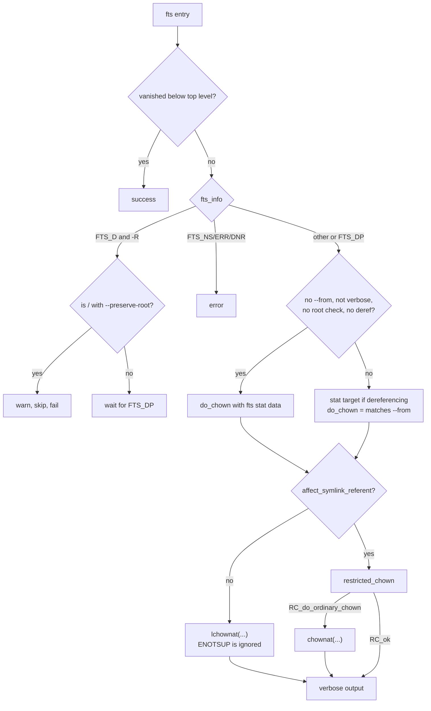

# `chown` and `chgrp`: change file owner and group

Source: `src/chown.c` (366 lines), `src/chown-core.c` (589 lines),
`src/chown-chown.c` or `src/chown-chgrp.c` · Tests: `tests/chown/`,
`tests/chgrp/` · Manual: `info '(coreutils) chown invocation'`

`chown` and `chgrp` are one program built twice (`src/local.mk:410-411`).
`chown-chgrp.c` sets `chown_mode = CHOWN_CHGRP`. `main` then puts a `:`
before the GROUP operand and parses it in the same way as `chown :GROUP`.
`chown.c` parses the options and the owner spec. `chown-core.c` walks the
files with gnulib `fts` and changes them. It contains a careful method,
`restricted_chown`, that avoids a race when `--from` is used.

## Options

The table lists `long_options[]` (`src/chown.c:54-70`) and the short-option
string `"HLPRcfhv"`.

| Option | Effect |
|---|---|
| `-R`, `--recursive` | `chopt.recurse`. |
| `-H`, `-L`, `-P` (default) | `fts` flags. **The default here is `-P`** (`bit_flags = FTS_PHYSICAL`), but `chmod`'s default is `-H`. Without `-R` these options are ignored, and `bit_flags` is set back to `FTS_PHYSICAL`. |
| `-h`, `--no-dereference` | Change symlinks themselves (`lchownat`). |
| `--dereference` | Change what symlinks point to. This is the default unless `-R -P` is in effect. |
| `--from=OWNER:GROUP` | Change only files whose current owner or group matches (`required_uid`, `required_gid`). |
| `--reference=RFILE` | Use RFILE's owner and group (`chgrp` uses only the group). |
| `-c`, `-v`, `-f` | Verbosity and silence, as in [chmod](chmod.md). |
| `--preserve-root` / `--no-preserve-root` | Root protection for `-R`. |

`main` sets `chopt.affect_symlink_referent = (dereference != 0)`. So
`chown user link` changes the target, and `chown -h user link` changes the
link. With `-R` and `-P`, `dereference` is forced to 0. `--dereference`
there is an error.

### Owner spec

`parse_user_spec_warn()` (gnulib `userspec`) accepts `USER`, `USER:GROUP`,
`USER:`, `:GROUP` and numeric IDs. It also accepts the old `.` separator,
with a warning. If it returns a warning rather than an error, `main` prints
the message and carries on (`error (warn ? 0 : EXIT_FAILURE, ...)`). For a
`:GROUP` spec, `user_name` is set to `""` so that messages say "ownership
:GROUP" (`src/chown.c:342-346`).

`USER:` with no group means "and the user's login group". A numeric user
has no login group, so a spec such as `1000:` is an error.
`tests/chown/separator.sh` checks this.

## Code map

| Function | Location | Role |
|---|---|---|
| `main` | `src/chown.c:178` | Options, the spec or `--reference`, root protection, `chown_files`. |
| `chown_files` | `src/chown-core.c:546` | `xfts_open`, loop, `fts_close`. Uses `FTS_NOSTAT` when no stat data is needed. |
| `change_file_owner` | `:280` | One `FTSENT`: errors, root check, `--from` filter, the chown call, verbose output. |
| `restricted_chown` | `:228` | Open, `fstat`, check the inode, then `fchown`, to avoid races with `--from`. |
| `describe_change` | `:153` | `changed ownership of 'f' from a:b to c:d` and similar messages. |
| `uid_to_name`, `gid_to_name`, `user_group_str` | `:81-150` | Format names for messages. |
| `struct Chown_option` | `src/chown-core.h` | Settings shared by `chown.c` and `chown-core.c`. |

## How it works

The diagram shows how `change_file_owner` decides what to do with each
entry.



### Directories are changed after their contents

With `-R`, `FTS_D` (before the contents) only does the root check, and the
work happens at `FTS_DP` (after the contents). So a directory's owner
changes after everything inside it.

### Avoiding the `--from` race

Suppose `--from` is used and symlinks are followed. A plain `chown()` after
`fts`'s `stat` would leave a gap. An attacker could swap the file for a
symlink to something else, and `chown` would then change the wrong file.
`restricted_chown` closes that gap for regular files and directories
(`src/chown-core.c:236-265`):

```c
int fd = openat (cwd_fd, file, O_RDONLY | open_flags);
...
if (fstat (fd, &st) != 0)
  status = RC_error;
else if (! psame_inode (orig_st, &st))
  status = RC_inode_changed;
else if ((required_uid == (uid_t) -1 || required_uid == st.st_uid)
         && (required_gid == (gid_t) -1 || required_gid == st.st_gid))
  {
#if HAVE_FCHOWN
    if (fchown (fd, uid, gid) == 0)
      return close (fd) < 0 ? RC_error : RC_ok;
#endif
```

`open_flags` is `O_NONBLOCK | O_NOCTTY`, plus `O_DIRECTORY` for
directories. Other file types, such as FIFOs and devices, return
`RC_do_ordinary_chown`, because opening them could have side effects. If
read access is denied, it tries `O_WRONLY` for regular files. If that also
fails, it falls back to `chownat`.

### Special bits are not restored

A comment at `src/chown-core.c:474-479` explains that some kernels clear
the set-UID and set-GID bits on `chown`. The code does **not** set them
again, because that would open a window that another user could exploit.

### Speed

When no stat data is needed (no `--from`, not verbose, no root check, and
symlinks are not followed: `-h`, or `-R` with `-P`), `chown_files` passes
`FTS_NOSTAT` and `change_file_owner` changes
each file without another `stat`.

## Errors and exit status

Each file is handled separately. Any failure makes the exit status 1.
`lchownat` failing with `ENOTSUP` is not an error, because POSIX requires
that for symlinks. A file skipped because it does not match `--from` is not
an error. A file whose inode changed inside `restricted_chown`
(`RC_inode_changed`) makes the exit status 1 without a message. A `FIXME`
there asks whether a message should be added.

## Tests

| File | Covers |
|---|---|
| `tests/chown/basic.sh`, `tests/chgrp/from.sh` | `--from`. |
| `tests/chown/separator.sh` | `USER:GROUP`, `USER:`, `:GROUP`, and the old `.` separator. |
| `tests/chown/deref.sh`, `tests/chgrp/deref.sh` | `--dereference` and `-h`. |
| `tests/chgrp/default-no-deref.sh`, `posix-H.sh`, `recurse.sh` | `-R` with `-H`, `-L` and `-P`. |
| `tests/chown/preserve-root.sh` | `--preserve-root`, including through a symlink to `/`. |
| `tests/chown/cannot-access.sh` | `cannot access` and `cannot dereference` messages. |
| `tests/chown/verbose-dangling-symlink.sh`, `tests/chgrp/verbose-dangling-symlink.sh` | `-v` on dangling links. |
| `tests/chgrp/basic.sh`, `no-x.sh` | Basic use, and a directory that can be read but not searched. |

## See also

- [chmod](chmod.md): the same `fts` structure.
- [id](id.md) uses the same `parse_user_spec`.
