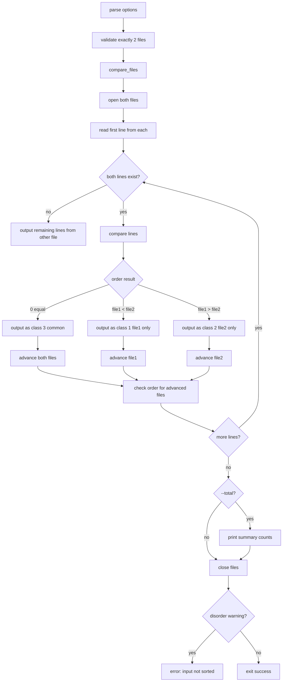

# `comm`: compare two sorted files line by line

Source: `src/comm.c` (504 lines) · Tests: `tests/comm/` ·
Manual: `info '(coreutils) comm invocation'`

`comm` compares two sorted files line by line. It outputs three columns by
default: lines unique to file 1, lines unique to file 2, and lines common to
both. It uses a merge algorithm similar to `join`, reading lines from both
files and comparing them. With `-1`, `-2`, or `-3`, columns can be suppressed.
With `--check-order`, it verifies that inputs are sorted.

## Options

The table lists `long_options[]` (`src/comm.c:86-96`) and the short-option
string `"123z"`.

|| Option | Variables |
||---|---|
|| `-1` | `only_file_1 = false`: suppress column 1 (unique to file 1) |
|| `-2` | `only_file_2 = false`: suppress column 2 (unique to file 2) |
|| `-3` | `both = false`: suppress column 3 (common to both) |
|| `-z`, `--zero-terminated` | `delim = '\0'`: use NUL line delimiter |
|| `--check-order` | `check_input_order = CHECK_ORDER_ENABLED`: fatal if unsorted |
|| `--nocheck-order` | `check_input_order = CHECK_ORDER_DISABLED`: don't check order |
|| `--output-delimiter=STR` | `col_sep = STR`: column separator string |
|| `--total` | `total_option = true`: print summary counts |

## Code map

|| Function | Location | Role |
||---|---|---|
|| `main` | `src/comm.c:426` | Option parsing, validate arguments, call `compare_files` |
|| `compare_files` | `:261` | Open files, read lines with linebuffer rotation, compare and output, print summary |
|| `writeline` | `:177` | Output a line with column separators based on class |
|| `check_order` | `:221` | Verify that input lines are sorted |
|| `usage` | `:100` | Help message |

## How it works

### Line buffer rotation

`compare_files` maintains 4 linebuffers per file in a rotating pattern
(`src/comm.c:263-305`). The `alt[i]` array tracks which buffer is current,
previous, and two-back. This allows checking the order of the last two lines
when reaching end-of-file, in case an unpairable line was discovered after the
initial order check. Buffers are rotated with `(alt[i][0] + 1) & 0x03` to cycle
through 0-3.

### Comparison loop

The main loop compares the current lines from both files
(`src/comm.c:307-389`):

- If one file is exhausted, the other file's lines are output as unique.
- If both have lines, they are compared with `xmemcoll` (hard locale) or
  `memcmp` (simple locale). Equal lines are output as class 3 (common).
- The lesser line is output as unique to its file (class 1 or 2).
- The file that produced the output advances to the next line.

### Order checking

`check_order` verifies that successive lines are in non-decreasing order
(`src/comm.c:221-252`). With hard locales, it uses `xmemcoll`; otherwise,
`memcmp2`. The check is performed:

- Always when `--check-order` is set (fatal error if unsorted).
- After the first unpairable line is seen, by default (warning only, once per file).
- Never when `--nocheck-order` is set.

At end-of-file, it re-checks the last two lines in case an unpairable match
was discovered after the initial check (`src/comm.c:380-382`).

### Column output

`writeline` outputs a line with column separators based on the line's class
(`src/comm.c:177-207`):

- **Class 1 (file 1 only):** Output if `only_file_1` is true.
- **Class 2 (file 2 only):** Output if `only_file_2` is true. Prepend separator
  if `only_file_1` is also true.
- **Class 3 (both):** Output if `both` is true. Prepend separator for each
  enabled column before it.

The separator string is `col_sep` (tab by default, or set with
`--output-delimiter`).

### Summary

With `--total`, `compare_files` counts lines in each category
(`src/comm.c:397-416`). The summary is printed with the same column separator
and line delimiter as the main output.

## Platform notes

`comm` uses `hard_locale(LC_COLLATE)` to determine whether to use
`xmemcoll` or `memcmp` for comparisons. Line reading uses `linebuffer` from
gnulib. Binary mode is not used; the files are opened as text with the
specified delimiter.

## Errors and exit status

- **Missing operand:** "missing operand"
- **Extra operand:** "extra operand FILE"
- **Multiple output delimiters:** "multiple output delimiters specified"
- **File open failure:** Error from `quotef(FILE)`
- **Read error:** Error from `quotef(FILE)`
- **Unsorted input with `--check-order`:** "file N is not in sorted order" (exit 1)
- **Unsorted input warning:** "file N is not in sorted order" (warning, continues)
- **Unsorted input at end:** "input is not in sorted order" (exit 1, if any warning was issued)

Exit status is 0 on success, 1 on errors or unsorted input.

## Tests

|| File | Covers |
||---|---|
|| `tests/comm/comm.pl` | Various comparison scenarios |
|| `tests/comm/dash-dash.sh` | Handling of `-` as stdin |

## See also

- [join](join.md) for a similar merge operation on keyed fields
- [sort](sort.md) for sorting files before comparison
