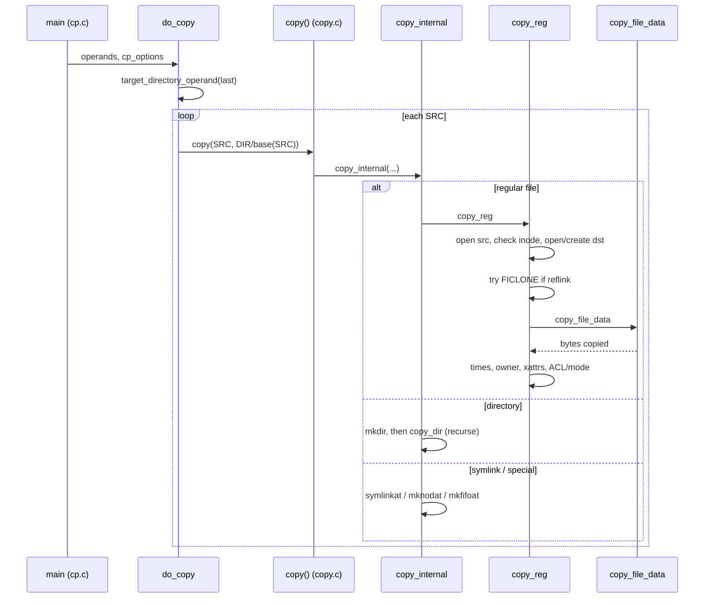

# `cp`: copy files and directories

Source: `src/cp.c` (1337 lines), plus `src/copy.c` (2901),
`src/copy-file-data.c` (647), `src/cp-hash.c`, `src/force-link.c`,
`src/selinux.c` · Tests: `tests/cp/` (about 90 scripts) · Manual:
`info '(coreutils) cp invocation'`

`cp.c` deals with the command line. It parses the options into a
`struct cp_options`, decides whether the last operand is a target
directory, and handles `--parents`. Each source is then passed to `copy()`
in `copy.c`. `mv` and `install` use the same engine, with different
`cp_options`. Read this page with
[Shared infrastructure](../overview/shared-infrastructure.md#copyc-the-copy-engine),
which describes `copy.c` in detail.

## Options

The table lists `long_opts[]` (`src/cp.c:115-150`) and the short-option
string `"abdfHilLnprst:uvxPRS:TZ"`. The **Field** column names the
`struct cp_options` member that each option sets.

| Option | Field(s) | Notes |
|---|---|---|
| `-a`, `--archive` | `dereference = DEREF_NEVER`, all `preserve_*`, `require_preserve`, `reduce_diagnostics`, `recursive` | Like `-dR --preserve=all`. Context is preserved only if SELinux is on. |
| `-d` | `preserve_links`, `DEREF_NEVER` | |
| `-R`, `-r`, `--recursive` | `recursive` | |
| `-H`, `-L`, `-P` | `dereference` | `DEREF_COMMAND_LINE_ARGUMENTS`, `DEREF_ALWAYS` or `DEREF_NEVER`. |
| `-p`, `--preserve[=LIST]` | `preserve_mode`, `preserve_ownership`, `preserve_timestamps`, `require_preserve` | LIST is any of `mode,timestamps,ownership,links,context,xattr,all`. |
| `--no-preserve=LIST` | Turns the same fields off | `--no-preserve=mode` sets `explicit_no_preserve_mode`. |
| `-f`, `--force` | `unlink_dest_after_failed_open` | If the destination cannot be opened, remove it and try again. |
| `--remove-destination` | `unlink_dest_before_opening` | Remove the destination first. |
| `-i` | `interactive = I_ASK_USER` | |
| `-n` (deprecated) | `interactive = I_ALWAYS_SKIP`, so `update = UPDATE_NONE` | |
| `-u`, `--update[=all\|none\|none-fail\|older]` | `update` | `-u` with no value means `older`. |
| `-b`, `--backup[=CONTROL]`, `-S SUFFIX` | `backup_type` | Cannot be combined with `-n` or `--update=none-fail`. |
| `-l`, `--link` / `-s`, `--symbolic-link` | `hard_link` / `symbolic_link` | Make links in place of copies. They cannot be combined. |
| `--reflink[=always\|auto\|never]` | `reflink_mode` | The default is `auto`. `--reflink` with no value means `always`. |
| `--sparse=always\|auto\|never` | `sparse_mode` | `never` also turns `reflink=auto` into `never`. |
| `--attributes-only` | `data_copy_required = false` | |
| `--copy-contents` | `copy_as_regular` | With `-R`, read special files as if they were regular files. |
| `-x`, `--one-file-system` | `one_file_system` | |
| `--parents` | `parents_option` (in `cp.c`) | Build the source path under the target directory. |
| `-t DIR`, `-T` | | Target-directory handling. |
| `--keep-directory-symlink` | `keep_directory_symlink` | |
| `--strip-trailing-slashes` | `remove_trailing_slashes` | |
| `-Z`, `--context[=CTX]` | `set_security_context` | |
| `-v`, `--debug` | `verbose`, `debug` | `--debug` also sets `verbose`. It prints how the copy was done (see below). |

### Defaults worked out after parsing

`main` (`src/cp.c:1249-1301`) changes some settings after the option loop:

- If no `-H`, `-L` or `-P` was given, `cp -R` (without `-l`) does not
  follow symlinks. Other uses follow them. The comment says this matches
  FreeBSD.
- With `-R`, `copy_as_regular` is set from `--copy-contents`. Without it,
  FIFOs and devices are created as FIFOs and devices, not read.
- `--reflink=always` requires `--sparse=auto`.
- `open_dangling_dest_symlink` is `true` only when `POSIXLY_CORRECT` is
  set (`cp_option_init`, `:925-929`).

## Code map (`cp.c`)

| Function | Location | Role |
|---|---|---|
| `main` | `src/cp.c:1030` | Options, defaults, `hash_init()`, `do_copy()`. |
| `do_copy` | `:671` | Decide the target directory and call `copy()` for each source. |
| `make_dir_parents_private` | `:465` | For `--parents`: create the missing directories under the target, and record their source attributes. |
| `re_protect` | `:371` | For `--parents`: copy the mode, owner and times from the source directories to the new directories after the copy. |
| `decode_preserve_arg` | `:938` | Parse `--preserve=` and `--no-preserve=` lists. |
| `cp_option_init` | `:884` | Defaults for `cp`. |

## How it works

The sequence diagram shows the main calls for `cp -r SRC... DIR`.

### Choosing the target

`do_copy` follows these rules (`src/cp.c:689-739`):

1. With `-T`, there must be exactly two operands, and the second is the
   destination file.
2. With `-t DIR`, DIR is opened as a directory (`target_directory_operand`)
   and every operand is a source.
3. Otherwise `do_copy` tries to open the last operand as a directory. If
   that works, it is the target directory. If it fails and there are more
   than two operands, that is an error. If it fails with `ENOENT`, the
   destination is new.

All later work uses `target_dirfd` and a relative name (`dst_relname`) with
`*at()` functions, so the target cannot be changed by a rename during the
copy.

Two special cases:

- `cp -R src/.. dest` does not copy into `dest/..`. `arg_base` skips a final
  `..` (`:800-801`).
- `cp --force --backup file file` becomes a copy to the backup name
  (`:849-874`).

### How the data is copied

`copy_reg()` (`src/copy.c:724`) opens the source with `O_NOFOLLOW` when it
should not follow links. It then checks that the descriptor's device and
inode match the earlier `stat`. If they do not, it prints `skipping file
..., as it was replaced while being copied`. A new destination is created
with `O_EXCL`, so `cp` never writes through a dangling symlink unless
`POSIXLY_CORRECT` is set. Then it tries these methods in order:

| Method | Function | When |
|---|---|---|
| `fclonefileat` (macOS) | `copy_reg` | New file, reflink on, and the clone would not give more permissions than wanted. |
| `ioctl (FICLONE)` | `clone_file` | Reflink on. Shares extents on Btrfs, XFS and others. |
| `copy_file_range` | `sparse_copy` | Not looking for holes, and reflink is not `never`. The kernel may copy without moving data through user space. |
| `SEEK_DATA` / `SEEK_HOLE` | `lseek_copy` | The source looks sparse (`st_blocks` is less than `st_size` suggests). Holes become holes. |
| `read` / `write`, scanning for zeros | `sparse_copy` | `--sparse=always`, or no other method applies. |

[Shared infrastructure](../overview/shared-infrastructure.md#copy-file-datac-moving-the-bytes)
explains `copy_file_data()` in more detail.

`--debug` prints the method that was used for each file:
`copy offload: yes/no/avoided/unknown, reflink: ..., sparse detection:
...` (`emit_debug`, `src/copy.c:173`).

### Hard links and `-a`

When `preserve_links` is set, `copy_internal` records the source inode in
a hash table, keyed on device and inode (`src/cp-hash.c`:
`remember_copied`, `src_to_dest_lookup`). It does this when the inode has
more than one link, or when `-H` or `-L` is in effect, because then two
operands can reach the same file through symlinks (`src/copy.c:2068-2077`).
When it sees the same inode again, it creates a hard link to the first copy
and does not copy the data again.

With `-R`, each directory given on the command line is recorded too. This
is how `cp -R dir dir` and copying a directory into itself are detected.

### Directories

For a directory, `copy_internal` checks `is_ancestor()` to catch loops
through symlinks. It calls `mkdirat` with some permission bits left out, so
that other users cannot get in before the copy is finished. Then
`copy_dir()` reads the entries with `savedir` and calls `copy_internal` for
each one. Finally it sets the real mode. Copying a directory into itself is
reported as `cannot copy a directory, 'a', into itself, 'a/b'`.

## Errors and exit status

`cp` continues after an error with one file. The exit status is 1 if any
file failed. With `-a`, `reduce_diagnostics` hides some messages about
attributes that could not be preserved. The copy itself still fails if
`require_preserve` is set.

## Tests

The table lists some of the tests.

| File | Covers |
|---|---|
| `tests/cp/debug.sh` | `--debug` output. |
| `tests/cp/reflink-auto.sh`, `reflink-perm.sh` | `--reflink` modes, and permissions on cloned files. |
| `tests/cp/sparse.sh`, `sparse-2.sh`, `sparse-extents.sh`, `sparse-to-pipe.sh`, `fail-create-hole.sh` | Sparse files and holes. |
| `tests/cp/proc-zero-len.sh`, `proc-short-read.sh` | `/proc` files that report size 0, or give short reads. |
| `tests/cp/same-file.sh` | A large table of "same file" cases with `-b`, `-f`, `-l` and `-s`. |
| `tests/cp/into-self.sh` | Copying a directory into itself. |
| `tests/cp/abuse.sh`, `thru-dangling.sh` | Never write through a symlink that was just copied, or one that dangles. |
| `tests/cp/cp-parents.sh`, `parent-perm.sh`, `parent-perm-race.sh` | `--parents`. |
| `tests/cp/link-heap.sh`, `link-preserve.sh`, `preserve-link.sh` | Hard-link handling. |
| `tests/cp/acl.sh`, `xattr.sh`, `capability.sh`, `cp-a-selinux.sh` | Extended attributes and security labels. |
| `tests/cp/backup-1.sh`, `backup-dir.sh`, `backup-is-src.sh` | Backups. |

## See also

- [mv](mv.md) and [install](install.md): the same engine with different
  options.
- [ln](ln.md): `cp -l` and `cp -s` make links in a similar way.
- [Shared infrastructure](../overview/shared-infrastructure.md).
