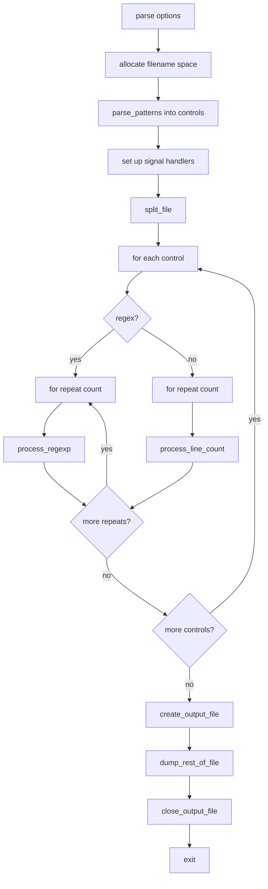

# `csplit`: split files into sections based on context

Source: `src/csplit.c` (1460 lines) · Tests: `tests/csplit/` ·
Manual: `info '(coreutils) csplit invocation'`

`csplit` splits a file into sections based on line numbers or regular
expression patterns. It reads stdin, buffers lines, and creates output files
when split conditions are met. Each split condition can repeat a specified
number of times or indefinitely with `*`. Output files are named with a
prefix (default `xx`) and a numeric suffix. On error, it can delete all
created files.

## Options

The table lists `longopts[]` (`src/csplit.c:187-200`) and the short-option
string `"f:b:kn:sqz"`.

|| Option | Variables |
||---|---|
|| `-f PREFIX`, `--prefix=PREFIX` | `prefix`: output file name prefix |
|| `-b SUFFIX`, `--suffix-format=SUFFIX` | `suffix`: printf format for suffix |
|| `-n DIGITS`, `--digits=DIGITS` | `digits`: number of digits in suffix |
|| `-s`, `-q`, `--silent`, `--quiet` | `suppress_count`: don't print byte counts |
|| `-k`, `--keep-files` | `remove_files = false`: keep files on error |
|| `-z`, `--elide-empty-files` | `elide_empty_files`: remove zero-length files |
|| `--suppress-matched` | `suppress_matched`: don't output matching lines |

## Code map

|| Function | Location | Role |
||---|---|---|
|| `main` | `src/csplit.c:1282` | Option parsing, allocate filename space, set up signal handlers, call `split_file` |
|| `split_file` | `:850` | Loop through control patterns, call `process_regexp` or `process_line_count`, dump remaining lines |
|| `process_regexp` | `:664` | Read lines, match regex, split when match found with offset |
|| `process_line_count` | `:611` | Read lines, split after line count |
|| `create_output_file` | `:894` | Create next output file with signal blocking |
|| `close_output_file` | `:950` | Close file, optionally delete if empty, print byte count |
|| `delete_all_files` | `:931` | Delete all created files (signal-safe) |
|| `make_filename` | `:881` | Generate filename from prefix and suffix |
|| `parse_patterns` | `:1074` | Parse pattern arguments into control records |
|| `new_control_record` | `:1010` | Allocate and initialize a control record |
|| `check_for_offset` | `:1032` | Parse numeric offset after regex |
|| `parse_repeat_count` | `:1045` | Parse repeat count in `{}` |
|| `usage` | `:1395` | Help message |

## How it works

### Control patterns

`parse_patterns` converts command-line arguments into `control` records
(`src/csplit.c:1074-1197`). Each pattern is:

- **Line number:** `/N/` splits after N lines.
- **Regular expression:** `/PATTERN/` splits at lines matching PATTERN.
- **Offset:** `{N}` repeats the pattern N times, or `*` repeats forever.
- **Numeric offset:** `PATTERN/OFFSET` splits OFFSET lines after the match.

The `control` struct stores the compiled regex, offset, repeat count, and
whether to repeat forever.

### Splitting by line count

`process_line_count` reads lines until the specified line count is reached
(`src/csplit.c:611-662`). It uses a buffer management system with
`buffer_record` and `line` structures to store lines efficiently. When the
count is reached, it closes the current output file and creates a new one.

### Splitting by regex

`process_regexp` reads lines and matches them against the compiled regex
(`src/csplit.c:664-846`). When a match is found, it applies the offset (skipping
additional lines), then splits. The line containing the match can be suppressed
with `--suppress-matched`.

### Buffer management

Lines are stored in a linked list of `buffer_record` structures
(`src/csplit.c:95-106`). Each record contains a data buffer and a list of
`line` structures pointing to line start positions. This allows efficient
retrieval of lines for offset calculations without re-reading.

### Signal handling

`main` sets up signal handlers for termination signals
(`src/csplit.c:1361-1381`). The `interrupt_handler` deletes all created files
and re-raises the signal. File creation and deletion are done with signal
blocking to avoid races (`src/csplit.c:910-916`, `:972-977`).

### File naming

`make_filename` generates filenames by concatenating the prefix with a suffix
(`src/csplit.c:881-889`). If `-b` is given, the suffix is a printf format
string; otherwise, it's zero-padded decimal with `-n` digits (default 2).

## Platform notes

`csplit` uses POSIX regex functions. Signal handling uses `sigaction` and
`sigprocmask`. The buffer management is custom-built for efficient line
storage and retrieval.

## Errors and exit status

- **Missing operand:** "missing operand"
- **Invalid digits:** "invalid number"
- **Invalid suffix format:** Various format errors
- **Invalid repeat count:** Errors from `xstrtoimax`
- **Line number too large:** Error from `xdectoimax`
- **File creation failure:** Error from `quotef(FILENAME)`
- **Write error:** "write error for FILENAME"
- **Read error:** "read error"

Exit status is 0 on success, 1 on failure.

## Tests

|| File | Covers |
||---|---|
|| `tests/csplit/csplit.sh` | Basic splitting patterns |
|| `tests/csplit/csplit-1000.sh` | Large number of splits |
|| `tests/csplit/csplit-heap.sh` | Memory management |
|| `tests/csplit/csplit-io-err.sh` | I/O error handling |
|| `tests/csplit/csplit-suppress-matched.pl` | `--suppress-matched` option |

## See also

- [split](split.md) for splitting by byte count or line count
