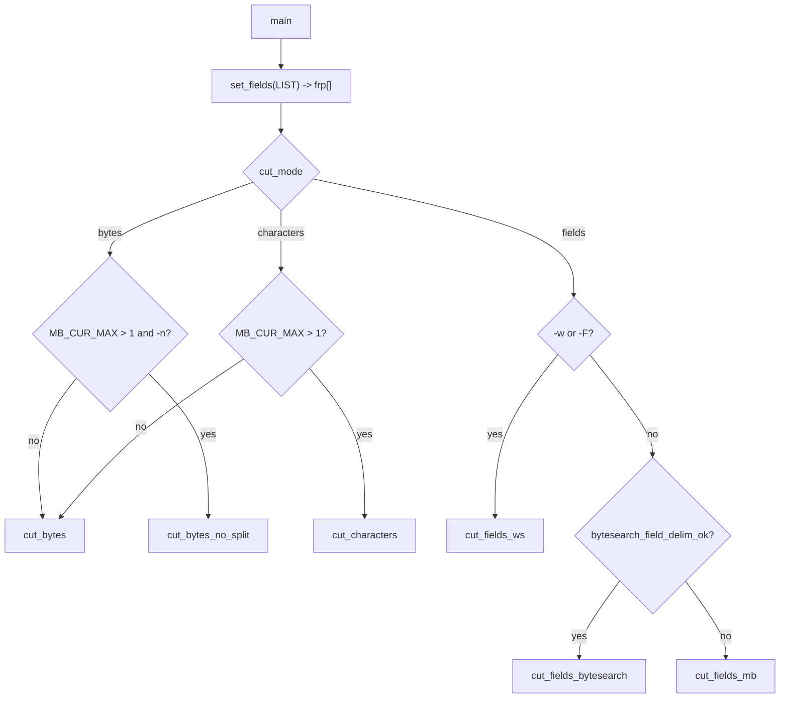

# `cut`: select parts of lines

Source: `src/cut.c` (1524 lines), `src/set-fields.c` (308 lines) · Tests:
`tests/cut/` · Manual: `info '(coreutils) cut invocation'`

`cut` prints selected bytes (`-b`), characters (`-c`) or fields (`-f`) of
each line. `set-fields.c` parses the list (`1,3-5,7-`) into a sorted array
of ranges, which `numfmt` also uses. `cut.c` then picks one of several
loops, depending on the mode, the delimiter and the locale.

!!! note "Recent changes"
    Release 9.11 added multibyte support (`-c` and `-n` now do something
    other than `-b`, and `-d` accepts a multibyte character). It also added
    `-w`/`--whitespace-delimited`, `-O` (short for `--output-delimiter`) and
    `-F` (same as `-f LIST -w -O ' '`). The unreleased section of `NEWS`
    says `cut -c` and `cut -f -w` are now up to ten times faster.

## Options

The table lists `longopts[]` (`src/cut.c:158-173`) and the short-option
string `"b:c:d:f:F:nO:szw"`.

| Option | Effect |
|---|---|
| `-b`, `--bytes=LIST` | `cut_mode = CUT_MODE_BYTES`. |
| `-c`, `--characters=LIST` | `CUT_MODE_CHARACTERS`. In a single-byte locale this is the same as `-b`. |
| `-f`, `--fields=LIST` | `CUT_MODE_FIELDS`. |
| `-F LIST` | Fields, plus `whitespace_delimited`, with a space as the default output delimiter. No long form. |
| `-d`, `--delimiter=DELIM` | One character, which may be multibyte. `-d ''` means NUL. The default is TAB. |
| `-w`, `--whitespace-delimited[=trimmed]` | A run of blanks is one delimiter. With `trimmed`, leading and trailing blanks are ignored. Cannot be combined with `-d`. |
| `-O`, `--output-delimiter=STRING` | The default is the input delimiter. `''` means NUL. |
| `-n`, `--no-partial` | With `-b` in a multibyte locale, do not print part of a character. |
| `-s`, `--only-delimited` | With fields, skip lines that have no delimiter. |
| `--complement` | Select everything not in LIST (`SETFLD_COMPLEMENT`). |
| `-z`, `--zero-terminated` | Lines end with NUL. |

Only one of `-b`, `-c`, `-f` and `-F` may be given. `-d`, `-w` and `-s` are
errors with `-b` or `-c`.

## Code map

| Function | Location | Role |
|---|---|---|
| `main` | `src/cut.c:1344` | Options, `set_fields`, choose `cut_stream`, a loop over files. |
| `cut_file` | `:1304` | Open (or use stdin), call `cut_stream`, close. |
| `cut_bytes` | `:851` | `-b` (and `-c` in single-byte locales). `read` into a static `IO_BUFSIZE` buffer. Skip or write whole runs of bytes. |
| `cut_bytes_no_split`, `cut_characters` | `:1005`, `:1011` | `-b -n` and `-c` in multibyte locales. Both call `cut_characters_mode`. |
| `cut_fields_bytesearch` | `:1096` | Fields when the delimiter can be found with a plain byte search. |
| `cut_fields_mb` | `:1087` | Fields with a multibyte delimiter that needs decoding. |
| `cut_fields_ws` | `:1292` | `-w` and `-F`. |
| `bytesearch_field_delim_ok` | `:308` | Decide whether a byte search is safe for this delimiter and locale. |
| `next_item`, `print_kth`, `is_range_start_index` | `:266-288` | Move through the sorted range array with `current_rp`. |
| `set_fields` | `src/set-fields.c:136` | Parse LIST into `frp[]` (`struct field_range_pair { lo, hi }`), sort and merge it, and optionally take the complement. |

## How it works

The diagram shows how `main` chooses the processing loop
(`src/cut.c:1488-1508`).

### The range list

`set_fields` turns `LIST` into a sorted array of `{lo, hi}` pairs with no
overlaps (`qsort`, then merge, `src/set-fields.c:280-297`). A sentinel
pair with `lo = hi = UINTMAX_MAX` ends the array, so the loops never run
past the end. Error messages say "byte/character positions" or "fields",
depending on `SETFLD_ERRMSG_USE_POS`. Because ranges are merged, output is
always in input order, and each item is printed once, however LIST is
written. `tests/cut/cut-huge-range.sh` checks, under `ulimit -v`, that a
range ending just below the sentinel value does not make `cut` allocate
memory in proportion to the range.

While processing, `current_rp` points into `frp[]`. `next_item()` moves to
the next pair when the index passes `hi`. So the cost of checking whether
an item is selected does not depend on the number of ranges.

### Bytes

`cut_bytes` does not use stdio for input. It `read`s into a static buffer,
finds each line end with `search_bytes` (`memchr`), and for each line jumps
straight to `current_rp->lo` or writes up to `current_rp->hi` in one call
(`src/cut.c:870-910`). For very short runs (`SMALL_BYTE_THRESHOLD`, 3
bytes) it avoids `fwrite` and `memchr` calls.

### Fields and `-s`

When the selected fields include field 1, or when `-s` is not given, `cut`
cannot print field 1 until it knows whether the line has a delimiter at
all. A line with no delimiter is printed whole (or skipped with `-s`). The
comment for `field_1_buffer` (`:69-76`) explains that field 1 is held in
that buffer until this is known. `tests/cut/bounded-memory.sh` checks that
memory stays bounded when that is possible.

### Choosing a field delimiter search

`bytesearch_field_delim_ok()` (`:308-318`) returns `true` when searching
for the delimiter's bytes cannot give a false match in the middle of
another character:

- A single-byte delimiter in a single-byte locale.
- In UTF-8, an ASCII delimiter or a byte that cannot appear in valid UTF-8
  (`> 0xF4`).
- In other multibyte locales, a byte below `0x30`. The source gives no
  reason. A likely one is that such bytes do not appear as trailing bytes
  in the common multibyte encodings.
- A valid multibyte delimiter in UTF-8.

Otherwise `cut_fields_mb` decodes each character with gnulib `mcel`.
`tests/cut/mb-non-utf8.sh` covers locales that are not UTF-8.

## Errors and exit status

Option errors use `FATAL_ERROR`, which prints the message and the usage
hint, and exits with status 1. Errors in LIST come from `set_fields`. A
file that cannot be opened or read is reported, and the exit status is 1.

## Tests

| File | Covers |
|---|---|
| `tests/cut/cut.pl` | The main table of cases: ranges, `-s`, `--complement`, delimiters, output delimiters, whitespace mode and error messages. |
| `tests/cut/bounded-memory.sh` | Memory use with long lines. |
| `tests/cut/cut-huge-range.sh` | Very large range values. |
| `tests/cut/mb-non-utf8.sh` | Multibyte locales that are not UTF-8. |

## See also

- [Shared infrastructure](../overview/shared-infrastructure.md#other-small-modules)
  for `set-fields.c`.
- [tr](tr.md) and [wc](wc.md) for other multibyte-aware text tools.
