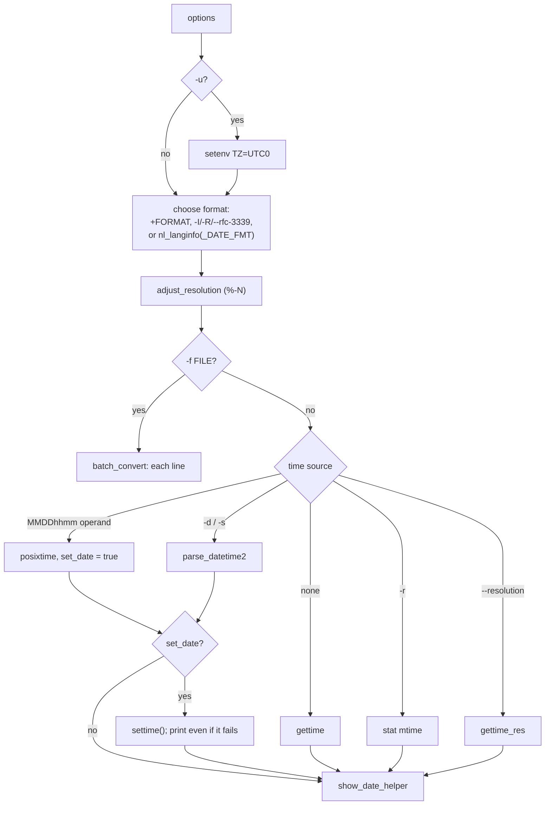

# `date`: print or set the system date and time

Source: `src/date.c` (820 lines), `src/show-date.c` · Tests: `tests/date/`
· Manual: `info '(coreutils) date invocation'`

`date` is mostly a front end to two gnulib modules:

- `parse-datetime` (`parse_datetime2`) turns free-form strings such as
  `"next tuesday 3pm"` or `"@1700000000"` into a `struct timespec`. It is
  the same parser that `touch -d` uses.
- `fprintftime` (through `show_date()` in `src/show-date.c`) formats the
  time with `strftime`-style directives plus GNU extensions such as `%N`
  (nanoseconds) and `%:z`.

`date.c` decides which time to show (now, `-d`, `-r FILE`, each line of
`-f FILE`, or `--resolution`), which format to use, and whether to set the
clock.

## Options

The table lists `long_options[]` (`src/date.c:86-105`) and the short-option
string `"d:f:I::r:Rs:u"`.

| Option | Effect |
|---|---|
| `-d`, `--date=STRING` | Show the time in STRING. If given more than once, the last one wins (with `--debug`, a warning). |
| `-f`, `--file=FILE` | Like `-d` for each line of FILE (`-` means stdin). `batch_convert()`. |
| `-r`, `--reference=FILE` | Show FILE's modification time. |
| `--resolution` | Show the clock resolution (`gettime_res`), formatted `%s.%N`. |
| `-s`, `--set=STRING` | Set the clock to STRING (`settime`), then print it. |
| `-u`, `--utc`, `--universal` | `setenv ("TZ", "UTC0")`. A comment says POSIX defines `-u` as just this. |
| `-I`, `--iso-8601[=date\|hours\|minutes\|seconds\|ns]` | ISO 8601 format, always in the C locale. |
| `--rfc-3339=date\|seconds\|ns` | RFC 3339 format (a space in place of `T`). |
| `-R`, `--rfc-email` | `"%a, %d %b %Y %H:%M:%S %z"` in the C locale. `--rfc-822` and `--rfc-2822` are old names for it. |
| `--debug` | Sets `PARSE_DATETIME_DEBUG`: show how the date string was parsed and which format was used. |
| `+FORMAT` | Output format. Cannot be combined with `-I`, `-R` or `--rfc-3339`. |
| `MMDDhhmm[[CC]YY][.ss]` | The POSIX way to set the clock (parsed with `posixtime`). Only when no other date option is given. |

`-d`, `-f`, `-r` and `--resolution` are mutually exclusive. None of them
may be combined with `-s`.

## Code map

| Function | Location | Role |
|---|---|---|
| `main` | `src/date.c:567` | Options, checks, choose the format, get the time, set it if asked, print. |
| `batch_convert` | `:508` | `-f`: `getline`, `parse_datetime2`, `show_date_helper` for each line. |
| `show_date_helper` | `:480` | Switch `LC_TIME` to `C` when the format must not be localized, call `show_date`, add a newline. |
| `set_LC_TIME` | `:442` | Change `LC_TIME` through the **environment**, not just `setlocale`. |
| `adjust_resolution` | `:416` | Replace `%-N` with `%9N`, `%6N` and so on, to match the clock resolution. |
| `show_date` | `src/show-date.c:20` | `localtime_rz` then `fprintftime`. Reports a time out of range. |

## How it works

The diagram shows how `main` gets the time to print.

### Choosing the format

With no format option, `date` uses `nl_langinfo (_DATE_FMT)` through
`DATE_FMT_LANGINFO()`. If that is empty, it uses the built-in
`"%a %b %e %H:%M:%S %Z %Y"`. A comment (`src/date.c:730-736`) explains why
that string is **not** marked for translation. POSIX says `LC_TIME`
decides the output format, so a translated format chosen by `LANG` would
be wrong when `LC_TIME=POSIX`.

`-I`, `-R` and `--rfc-3339` set `format_in_c_locale`. Then
`show_date_helper` runs `show_date` with `LC_TIME=C`, so names such as
`Mon` are not translated. `set_LC_TIME` changes the **environment** as
well as calling `setlocale`. A comment explains that `fprintftime` uses
gnulib `localename-unsafe`, which reads the environment variables. If
`LC_ALL` is set, it has to be unset and copied to the other categories.

### `%-N`

`%N` normally prints nine digits. `%-N` is changed by `adjust_resolution`
into `%9N`, `%6N`, `%3N` and so on, to match `gettime_res()`, so only
meaningful digits are printed. `tests/date/resolution.sh` covers this.

### Setting the clock

With `-s` or a `MMDDhhmm` operand, `date` calls gnulib `settime()`, which
uses `clock_settime`, `settimeofday` or `stime`. It then prints the time
**whether or not** setting it worked. If setting failed, the exit status
is 1.

## Errors and exit status

`invalid date 'X'` is fatal for `-d` and `-s`. With `-f`, it is reported
for each bad line, processing continues, and the exit status is 1. A time
that `localtime_rz` cannot represent gives `time X is out of range`.

## Tests

| File | Covers |
|---|---|
| `tests/date/date.pl` | The main table of `-d` strings and formats. |
| `tests/date/date-debug.sh` | `--debug` output. |
| `tests/date/date-next-dow.pl` | Relative weekday strings. |
| `tests/date/date-tz.sh`, `date-sec.sh`, `reference.sh` | Time zones, `--date="21:04 +0100" +%S` printing `00`, and `-r`. |
| `tests/date/date-ethiopia.sh`, `date-iran.sh`, `date-thailand.sh` | Locales with non-Gregorian calendars. |
| `tests/date/date-locale-hour.sh`, `percent-percent.sh` | The 12-hour or 24-hour clock chosen by the locale, and `%%`. |
| `tests/date/resolution.sh` | `--resolution` and `%-N`. |
| `tests/date/date-set.sh` | Setting the clock. It runs as a normal user under `strace`, which makes `clock_settime` and similar calls fail with `EPERM`. Then it checks that `date` still prints the right time and reports `cannot set date`. |

## See also

- [touch](touch.md) uses the same `parse_datetime` for `-d`.
- [du](du.md) uses `show_date` for `--time`.
