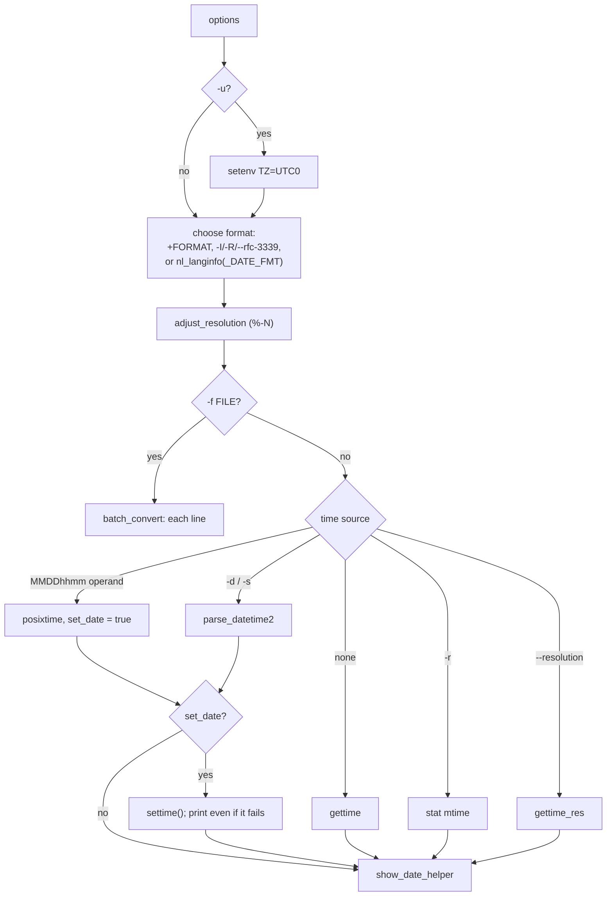

# `date`: print or set the system date and time

Source: `src/date.c` (820 lines), `src/show-date.c` · Tests: `tests/date/`
· Manual: `info '(coreutils) date invocation'`

`date` is mostly a front end to two gnulib modules:

- `parse-datetime` (`parse_datetime2`) turns free-form strings such as
  `"next tuesday 3pm"` or `"@1700000000"` into a `struct timespec`. It is
  the same parser that `touch -d` uses.
- `fprintftime` (through `show_date()` in `src/show-date.c`) formats the
  time with `strftime`-style directives plus GNU extensions such as `%N`
  (nanoseconds) and `%:z`.

`date.c` decides which time to show (now, `-d`, `-r FILE`, each line of
`-f FILE`, or `--resolution`), which format to use, and whether to set the
clock.

## Options

The table lists `long_options[]` (`src/date.c:86-105`) and the short-option
string `"d:f:I::r:Rs:u"`.

| Option | Effect |
|---|---|
| `-d`, `--date=STRING` | Show the time in STRING. If given more than once, the last one wins (with `--debug`, a warning). |
| `-f`, `--file=FILE` | Like `-d` for each line of FILE (`-` means stdin). `batch_convert()`. |
| `-r`, `--reference=FILE` | Show FILE's modification time. |
| `--resolution` | Show the clock resolution (`gettime_res`), formatted `%s.%N`. |
| `-s`, `--set=STRING` | Set the clock to STRING (`settime`), then print it. |
| `-u`, `--utc`, `--universal` | `setenv ("TZ", "UTC0")`. A comment says POSIX defines `-u` as just this. |
| `-I`, `--iso-8601[=date\|hours\|minutes\|seconds\|ns]` | ISO 8601 format, always in the C locale. |
| `--rfc-3339=date\|seconds\|ns` | RFC 3339 format (a space in place of `T`). |
| `-R`, `--rfc-email` | `"%a, %d %b %Y %H:%M:%S %z"` in the C locale. `--rfc-822` and `--rfc-2822` are old names for it. |
| `--debug` | Sets `PARSE_DATETIME_DEBUG`: show how the date string was parsed and which format was used. |
| `+FORMAT` | Output format. Cannot be combined with `-I`, `-R` or `--rfc-3339`. |
| `MMDDhhmm[[CC]YY][.ss]` | The POSIX way to set the clock (parsed with `posixtime`). Only when no other date option is given. |

`-d`, `-f`, `-r` and `--resolution` are mutually exclusive. None of them
may be combined with `-s`.

## Code map

| Function | Location | Role |
|---|---|---|
| `main` | `src/date.c:567` | Options, checks, choose the format, get the time, set it if asked, print. |
| `batch_convert` | `:508` | `-f`: `getline`, `parse_datetime2`, `show_date_helper` for each line. |
| `show_date_helper` | `:480` | Switch `LC_TIME` to `C` when the format must not be localized, call `show_date`, add a newline. |
| `set_LC_TIME` | `:442` | Change `LC_TIME` through the **environment**, not just `setlocale`. |
| `adjust_resolution` | `:416` | Replace `%-N` with `%9N`, `%6N` and so on, to match the clock resolution. |
| `show_date` | `src/show-date.c:20` | `localtime_rz` then `fprintftime`. Reports a time out of range. |

## How it works

The diagram shows how `main` gets the time to print.



### Choosing the format

With no format option, `date` uses `nl_langinfo (_DATE_FMT)` through
`DATE_FMT_LANGINFO()`. If that is empty, it uses the built-in
`"%a %b %e %H:%M:%S %Z %Y"`. A comment (`src/date.c:730-736`) explains why
that string is **not** marked for translation. POSIX says `LC_TIME`
decides the output format, so a translated format chosen by `LANG` would
be wrong when `LC_TIME=POSIX`.

`-I`, `-R` and `--rfc-3339` set `format_in_c_locale`. Then
`show_date_helper` runs `show_date` with `LC_TIME=C`, so names such as
`Mon` are not translated. `set_LC_TIME` changes the **environment** as
well as calling `setlocale`. A comment explains that `fprintftime` uses
gnulib `localename-unsafe`, which reads the environment variables. If
`LC_ALL` is set, it has to be unset and copied to the other categories.

### `%-N`

`%N` normally prints nine digits. `%-N` is changed by `adjust_resolution`
into `%9N`, `%6N`, `%3N` and so on, to match `gettime_res()`, so only
meaningful digits are printed. `tests/date/resolution.sh` covers this.

### Setting the clock

With `-s` or a `MMDDhhmm` operand, `date` calls gnulib `settime()`, which
uses `clock_settime`, `settimeofday` or `stime`. It then prints the time
**whether or not** setting it worked. If setting failed, the exit status
is 1.

## Errors and exit status

`invalid date 'X'` is fatal for `-d` and `-s`. With `-f`, it is reported
for each bad line, processing continues, and the exit status is 1. A time
that `localtime_rz` cannot represent gives `time X is out of range`.

## Tests

| File | Covers |
|---|---|
| `tests/date/date.pl` | The main table of `-d` strings and formats. |
| `tests/date/date-debug.sh` | `--debug` output. |
| `tests/date/date-next-dow.pl` | Relative weekday strings. |
| `tests/date/date-tz.sh`, `date-sec.sh`, `reference.sh` | Time zones, `--date="21:04 +0100" +%S` printing `00`, and `-r`. |
| `tests/date/date-ethiopia.sh`, `date-iran.sh`, `date-thailand.sh` | Locales with non-Gregorian calendars. |
| `tests/date/date-locale-hour.sh`, `percent-percent.sh` | The 12-hour or 24-hour clock chosen by the locale, and `%%`. |
| `tests/date/resolution.sh` | `--resolution` and `%-N`. |
| `tests/date/date-set.sh` | Setting the clock. It runs as a normal user under `strace`, which makes `clock_settime` and similar calls fail with `EPERM`. Then it checks that `date` still prints the right time and reports `cannot set date`. |

## See also

- [touch](touch.md) uses the same `parse_datetime` for `-d`.
- [du](du.md) uses `show_date` for `--time`.

## Source code

`src/date.c:1`

```c
/* date - print or set the system date and time
   Copyright (C) 1989-2026 Free Software Foundation, Inc.

   This program is free software: you can redistribute it and/or modify
   it under the terms of the GNU General Public License as published by
   the Free Software Foundation, either version 3 of the License, or
   (at your option) any later version.

   This program is distributed in the hope that it will be useful,
   but WITHOUT ANY WARRANTY; without even the implied warranty of
   MERCHANTABILITY or FITNESS FOR A PARTICULAR PURPOSE.  See the
   GNU General Public License for more details.

   You should have received a copy of the GNU General Public License
   along with this program.  If not, see <https://www.gnu.org/licenses/>.

   David MacKenzie <djm@gnu.ai.mit.edu> */

#include <config.h>
#include <stdio.h>
#include <getopt.h>
#include <sys/types.h>
#if HAVE_LANGINFO_CODESET
# include <langinfo.h>
#endif

#include "system.h"
#include "argmatch.h"
#include "parse-datetime.h"
#include "posixtm.h"
#include "quote.h"
#include "show-date.h"
#include "stat-time.h"
#include "xsetenv.h"

/* The official name of this program (e.g., no 'g' prefix).  */
#define PROGRAM_NAME "date"

#define AUTHORS proper_name ("David MacKenzie")

enum Time_spec
{
  /* Display only the date.  */
  TIME_SPEC_DATE,
  /* Display date, hours, minutes, and seconds.  */
  TIME_SPEC_SECONDS,
  /* Similar, but display nanoseconds. */
  TIME_SPEC_NS,

  /* Put these last, since they aren't valid for --rfc-3339.  */

  /* Display date and hour.  */
  TIME_SPEC_HOURS,
  /* Display date, hours, and minutes.  */
  TIME_SPEC_MINUTES
};

static char const *const time_spec_string[] =
{
  /* Put "hours" and "minutes" first, since they aren't valid for
     --rfc-3339.  */
  "hours", "minutes",
  "date", "seconds", "ns", NULL
};
static enum Time_spec const time_spec[] =
{
  TIME_SPEC_HOURS, TIME_SPEC_MINUTES,
  TIME_SPEC_DATE, TIME_SPEC_SECONDS, TIME_SPEC_NS
};
ARGMATCH_VERIFY (time_spec_string, time_spec);

/* A format suitable for Internet RFCs 5322, 2822, and 822.  */
static char const rfc_email_format[] = "%a, %d %b %Y %H:%M:%S %z";

/* For long options that have no equivalent short option, use a
   non-character as a pseudo short option, starting with CHAR_MAX + 1.  */
enum
{
  DEBUG_DATE_PARSING_OPTION = CHAR_MAX + 1,
  RESOLUTION_OPTION,
  RFC_3339_OPTION
};

static char const short_options[] = "d:f:I::r:Rs:u";

static struct option const long_options[] =
{
  {"date", required_argument, NULL, 'd'},
  {"debug", no_argument, NULL, DEBUG_DATE_PARSING_OPTION},
  {"file", required_argument, NULL, 'f'},
  {"iso-8601", optional_argument, NULL, 'I'},
  {"reference", required_argument, NULL, 'r'},
  {"resolution", no_argument, NULL, RESOLUTION_OPTION},
  {"rfc-email", no_argument, NULL, 'R'},
  {"rfc-822", no_argument, NULL, 'R'},  /* Deprecated.  */
  {"rfc-2822", no_argument, NULL, 'R'},  /* Deprecated.  */
  {"rfc-3339", required_argument, NULL, RFC_3339_OPTION},
  {"set", required_argument, NULL, 's'},
  {"uct", no_argument, NULL, 'u'},  /* Deprecated.  */
  {"utc", no_argument, NULL, 'u'},
  {"universal", no_argument, NULL, 'u'},
  {GETOPT_HELP_OPTION_DECL},
  {GETOPT_VERSION_OPTION_DECL},
  {NULL, 0, NULL, 0}
};

/* flags for parse_datetime2 */
static unsigned int parse_datetime_flags;

#if LOCALTIME_CACHE
# define TZSET tzset ()
#else
# define TZSET /* empty */
#endif

#ifdef _DATE_FMT
# define DATE_FMT_LANGINFO() nl_langinfo (_DATE_FMT)
#else
# define DATE_FMT_LANGINFO() ""
#endif

void
usage (int status)
{
  if (status != EXIT_SUCCESS)
    emit_try_help ();
  else
    {
      printf (_("\
Usage: %s [OPTION]... [+FORMAT]\n\
  or:  %s [OPTION]... MMDDhhmm[[CC]YY][.ss]\n\
"),
              program_name, program_name);
      fputs (_("\
Display date and time in the given FORMAT.\n\
With -s, or with MMDDhhmm[[CC]YY][.ss], set the date and time first.\n\
"), stdout);

      emit_mandatory_arg_note ();

      oputs (_("\
  -d, --date=STRING\n\
         display time described by STRING, not 'now'\n\
"));
      oputs (_("\
      --debug\n\
         annotate the parsed date,\n\
         and warn about questionable usage to standard error\n\
"));
      oputs (_("\
  -f, --file=DATEFILE\n\
         like --date; once for each line of DATEFILE;\n\
         if DATEFILE is -, read names from standard input\n\
"));
      oputs (_("\
  -I[FMT], --iso-8601[=FMT]\n\
         output date/time in ISO 8601 format.\n\
         FMT='date' (default), 'hours', 'minutes', 'seconds', or 'ns'\n\
         for date and time to the indicated precision.\n\
         Example: 2006-08-14T02:34:56-06:00\n\
"));
      oputs (_("\
      --resolution\n\
         output the available resolution of timestamps.\n\
         Example: 0.000000001\n\
"));
      oputs (_("\
  -R, --rfc-email\n\
         output date and time in RFC 5322 format.\n\
         Example: Mon, 14 Aug 2006 02:34:56 +0000\n\
"));
      oputs (_("\
      --rfc-3339=FMT\n\
         output date/time in RFC 3339 format.\n\
         FMT='date', 'seconds', or 'ns'\n\
         for date and time to the indicated precision.\n\
         Example: 2006-08-14 02:34:56-06:00\n\
"));
      oputs (_("\
  -r, --reference=FILE\n\
         display the last modification time of FILE\n\
"));
      oputs (_("\
  -s, --set=STRING\n\
         set time described by STRING\n\
"));
      oputs (_("\
  -u, --utc, --universal\n\
         print or set Coordinated Universal Time (UTC)\n\
"));
      oputs (HELP_OPTION_DESCRIPTION);
      oputs (VERSION_OPTION_DESCRIPTION);
      fputs (_("\
\n\
All options that specify the date to display are mutually exclusive.\n\
I.e.: --date, --file, --reference, --resolution.\n\
"), stdout);
      fputs (_("\
\n\
FORMAT controls the output.  Interpreted sequences are:\n\
\n\
"), stdout);
      fputs (_("\
FORMAT  Example    Description\n\
\n\
"), stdout);
      fputs (_("\
  %%    %           a literal %\n\
"), stdout);
      fputs (_("\
  %n    \\n          a newline\n\
"), stdout);
      fputs (_("\
  %t    \\t          a tab\n\
"), stdout);

      fputs ("\n", stdout);

      fputs (_("\
  %C    20          century; like %Y, except omit last two digits\n\
"), stdout);
      fputs (_("\
  %y    99          year (last two digits; 00..99)\n\
"), stdout);
      fputs (_("\
  %Y    1999        year\n\
"), stdout);
      fputs (_("\
  %g    99          year of ISO week number (last 2 digits; 00-99); see %G\n\
"), stdout);
      fputs (_("\
  %G    1999        year of ISO week number; normally useful only with %V\n\
"), stdout);

      fputs ("\n", stdout);

      fputs (_("\
  %a    Sun         locale's abbreviated weekday name\n\
"), stdout);
      fputs (_("\
  %A    Sunday      locale's full weekday name\n\
"), stdout);
      fputs (_("\
  %b    Mar         locale's abbreviated month name\n\
"), stdout);
      fputs (_("\
  %h    Mar         same as %b\n\
"), stdout);
      fputs (_("\
  %B    March       locale's full month name\n\
"), stdout);
      fputs (_("\
  %m    12          month (01..12)\n\
"), stdout);
      fputs (_("\
  %d    31          day of month (01..31)\n\
"), stdout);
      fputs (_("\
  %e     1          day of month, space padded; same as %_d\n\
"), stdout);
      fputs (_("\
  %D    12/31/99    date (ambiguous); same as %m/%d/%y\n\
"), stdout);
      fputs (_("\
  %F    1999-12-31  full date; like %+4Y-%m-%d\n\
"), stdout);
      fputs (_("\
  %x    12/31/99    locale's date (can be ambiguous)\n\
"), stdout);
      fputs (_("\
  %c    ...         locale's date and time (e.g., Thu Mar  3 23:05 2005)\n\
"), stdout);

      fputs ("\n", stdout);

      fputs (_("\
  %H    23          hour (00..23)\n\
"), stdout);
      fputs (_("\
  %I    01          hour (01..12)\n\
"), stdout);
      fputs (_("\
  %k     8          hour, space padded ( 0..23); same as %_H\n\
"), stdout);
      fputs (_("\
  %l     9          hour, space padded ( 1..12); same as %_I\n\
"), stdout);
      fputs (_("\
  %M    59          minute (00..59)\n\
"), stdout);
      fputs (_("\
  %S    60          second (00..60)\n\
"), stdout);
      fputs (_("\
  %N    123456789   nanoseconds (000000000..999999999)\n\
"), stdout);
      fputs (_("\
  %s    1970010100  seconds since the Epoch (1970-01-01 00:00 UTC)\n\
"), stdout);
      fputs (_("\
  %p    PM          locale's equivalent of AM or PM; blank if not known\n\
"), stdout);
      fputs (_("\
  %P    am          like %p, but lower case\n\
"), stdout);
      fputs (_("\
  %r    1:11:04 PM  locale's 12-hour clock time\n\
"), stdout);
      fputs (_("\
  %R    23:59       24-hour hour and minute; same as %H:%M\n\
"), stdout);
      fputs (_("\
  %T    23:59:59    time; same as %H:%M:%S\n\
"), stdout);
      fputs (_("\
  %X    23:59:59    locale's time representation\n\
"), stdout);

      fputs ("\n", stdout);

      fputs (_("\
  %j    365         day of year (001..366)\n\
"), stdout);
      fputs (_("\
  %q    4           quarter of year (1..4)\n\
"), stdout);
      fputs (_("\
  %u    7           day of week (1..7); 1 is Monday\n\
"), stdout);
      fputs (_("\
  %w    6           day of week (0..6); 0 is Sunday\n\
"), stdout);
      fputs (_("\
  %U    52          week of year; Sunday as first day of week (00..53)\n\
"), stdout);
      fputs (_("\
  %V    52          ISO week number; Monday as first day of week (01..53)\n\
"), stdout);
      fputs (_("\
  %W    52          week of year; Monday as first day of week (00..53)\n\
"), stdout);

      fputs ("\n", stdout);

      fputs (_("\
  %z     +0400      +hhmm numeric time zone\n\
"), stdout);
      fputs (_("\
  %:z    +04:00     +hh:mm numeric time zone\n\
"), stdout);
      fputs (_("\
  %::z   +04:00:00  +hh:mm:ss numeric time zone\n\
"), stdout);
      fputs (_("\
  %:::z  +04        numeric time zone to necessary precision; with :\n\
"), stdout);
      fputs (_("\
  %Z     EDT        alphabetic time zone abbreviation\n\
"), stdout);
      fputs (_("\
\n\
By default, date pads numeric fields with zeroes.\n\
"), stdout);
      fputs (_("\
The following optional flags may follow '%':\n\
\n\
  -  (hyphen) do not pad the field\n\
  _  (underscore) pad with spaces\n\
  0  (zero) pad with zeros\n\
  +  pad with zeros, and put '+' before future years with >4 digits\n\
  ^  use upper case if possible\n\
  #  use opposite case if possible\n\
"), stdout);
      fputs (_("\
\n\
After any flags comes an optional field width, as a decimal number;\n\
then an optional modifier, which is either\n\
E to use the locale's alternate representations if available, or\n\
O to use the locale's alternate numeric symbols if available.\n\
"), stdout);
      fputs (_("\
\n\
Examples:\n\
Convert seconds since the Epoch (1970-01-01 UTC) to a date\n\
  $ date --date='@2147483647'\n\
\n\
Show the time on the west coast of the US (use tzselect(1) to find TZ)\n\
  $ TZ='America/Los_Angeles' date\n\
\n\
Show the local time for 9AM next Friday on the west coast of the US\n\
  $ date --date='TZ=\"America/Los_Angeles\" 09:00 next Fri'\n\
"), stdout);
      emit_ancillary_info (PROGRAM_NAME);
    }
  exit (status);
}

/* Yield the number of decimal digits needed to output a time with the
   nanosecond resolution RES, without losing information.  */

ATTRIBUTE_CONST
static int
res_width (long int res)
{
  int i = 9;
  for (long long int r = 1; (r *= 10) <= res; )
    i--;
  return i;
}

/* Return a newly allocated copy of FORMAT with each "%-N" adjusted to
   be "%9N", "%6N", or whatever other resolution is appropriate for
   the current platform.  If no "%-N" appears, return NULL.  */

static char *
adjust_resolution (char const *format)
{
  char *copy = NULL;

  for (char const *f = format; *f; f++)
    if (f[0] == '%')
      {
        if (f[1] == '-' && f[2] == 'N')
          {
            if (!copy)
              copy = xstrdup (format);
            copy[f + 1 - format] = '0' + res_width (gettime_res ());
            f += 2;
          }
        else
          f += f[1] == '%';
      }

  return copy;
}

/* Set the LC_TIME category of the current locale.
   Return the previous value of the LC_TIME category, as a freshly allocated
   string or null.  */

static char *
set_LC_TIME (char const *locale)
{
  /* It is not sufficient to do
       setlocale (LC_TIME, locale);
     because show_date relies on fprintftime, that uses the Gnulib module
     'localename-unsafe', that looks at the values of the environment variables
     (in order to distinguish the default locale from the C locale on platforms
     like macOS).  */
  char const *all = getenv ("LC_ALL");
  if (all != NULL && *all != '\0')
    {
      /* Setting LC_TIME when LC_ALL is set would have no effect.  Therefore we
         have to unset LC_ALL and sets its value to all locale categories that
         are relevant for this program.  */
      xsetenv ("LC_CTYPE", all, 1);          /* definitely needed */
      xsetenv ("LC_TIME", all, 1);           /* definitely needed */
      xsetenv ("LC_MESSAGES", all, 1);       /* definitely needed */
      xsetenv ("LC_NUMERIC", all, 1);        /* possibly needed */
      /* xsetenv ("LC_COLLATE", all, 1); */  /* not needed */
      /* xsetenv ("LC_MONETARY", all, 1); */ /* not needed */
      unsetenv ("LC_ALL");
    }

  /* Set LC_TIME as an environment variable.  */
  char const *value = getenv ("LC_TIME");
  char *ret = (value == NULL || *value == '\0' ? NULL : xstrdup (value));
  if (locale != NULL)
    xsetenv ("LC_TIME", locale, 1);
  else
    unsetenv ("LC_TIME");

  /* Update the current locale accordingly.  */
  setlocale (LC_TIME, "");

  return ret;
}

static bool
show_date_helper (char const *format, bool use_c_locale,
                  struct timespec when, timezone_t tz)
{
  if (parse_datetime_flags & PARSE_DATETIME_DEBUG)
    error (0, 0, _("output format: %s"), quote (format));

  bool ok;
  if (use_c_locale)
    {
      char *old_locale_category = set_LC_TIME ("C");
      ok = show_date (format, when, tz);
      char *new_locale_category = set_LC_TIME (old_locale_category);
      free (new_locale_category);
      free (old_locale_category);
    }
  else
    ok = show_date (format, when, tz);

  putchar ('\n');
  return ok;
}

/* Parse each line in INPUT_FILENAME as with --date and display each
   resulting time and date.  If the file cannot be opened, tell why
   then exit.  Issue a diagnostic for any lines that cannot be parsed.
   Return true if successful.  */

static bool
batch_convert (char const *input_filename,
               char const *format, bool format_in_c_locale,
               timezone_t tz, char const *tzstring)
{
  FILE *in_stream;

  if (streq (input_filename, "-"))
    {
      input_filename = _("standard input");
      in_stream = stdin;
    }
  else
    {
      in_stream = fopen (input_filename, "r");
      if (in_stream == NULL)
        error (EXIT_FAILURE, errno, "%s", quotef (input_filename));
    }

  char *line = NULL;
  size_t buflen = 0;
  bool ok = true;
  while (true)
    {
      ssize_t line_length = getline (&line, &buflen, in_stream);
      if (line_length < 0)
        {
          if (ferror (in_stream))
            error (EXIT_FAILURE, errno, _("%s: read error"),
                   quotef (input_filename));
          break;
        }

      struct timespec when;
      if (! parse_datetime2 (&when, line, NULL,
                             parse_datetime_flags, tz, tzstring))
        {
          if (line[line_length - 1] == '\n')
            line[line_length - 1] = '\0';
          error (0, 0, _("invalid date %s"), quote (line));
          ok = false;
        }
      else
        {
          ok &= show_date_helper (format, format_in_c_locale, when, tz);
        }

      if (ferror (stdout))
        write_error ();
    }

  if (fclose (in_stream) == EOF)
    error (EXIT_FAILURE, errno, "%s", quotef (input_filename));

  free (line);

  return ok;
}

int
main (int argc, char **argv)
{
  char const *datestr = NULL;
  char const *set_datestr = NULL;
  bool set_date = false;
  char const *format = NULL;
  bool format_in_c_locale = false;
  bool get_resolution = false;
  char *batch_file = NULL;
  char *reference = NULL;
  bool discarded_datestr = false;
  bool discarded_set_datestr = false;
  bool utc = false;

  initialize_main (&argc, &argv);
  set_program_name (argv[0]);
  setlocale (LC_ALL, "");
  bindtextdomain (PACKAGE, LOCALEDIR);
  textdomain (PACKAGE);

  atexit (close_stdout);

  int optc;
  while ((optc = getopt_long (argc, argv, short_options, long_options, NULL))
         != -1)
    {
      switch (optc)
        {
        case 'd':
          if (datestr)
            discarded_datestr = true;
          datestr = optarg;
          break;
        case DEBUG_DATE_PARSING_OPTION:
          parse_datetime_flags |= PARSE_DATETIME_DEBUG;
          break;
        case 'f':
          batch_file = optarg;
          break;
        case RESOLUTION_OPTION:
          get_resolution = true;
          break;
        case RFC_3339_OPTION:
          {
            static char const rfc_3339_format[][32] =
              {
                "%Y-%m-%d",
                "%Y-%m-%d %H:%M:%S%:z",
                "%Y-%m-%d %H:%M:%S.%N%:z"
              };
            enum Time_spec i =
              XARGMATCH ("--rfc-3339", optarg,
                         time_spec_string + 2, time_spec + 2);
            format = rfc_3339_format[i];
            format_in_c_locale = true;
            break;
          }
        case 'I':
          {
            static char const iso_8601_format[][32] =
              {
                "%Y-%m-%d",
                "%Y-%m-%dT%H:%M:%S%:z",
                "%Y-%m-%dT%H:%M:%S,%N%:z",
                "%Y-%m-%dT%H%:z",
                "%Y-%m-%dT%H:%M%:z"
              };
            enum Time_spec i =
              (optarg
               ? XARGMATCH ("--iso-8601", optarg, time_spec_string, time_spec)
               : TIME_SPEC_DATE);
            format = iso_8601_format[i];
            format_in_c_locale = true;
            break;
          }
        case 'r':
          reference = optarg;
          break;
        case 'R':
          format = rfc_email_format;
          format_in_c_locale = true;
          break;
        case 's':
          if (set_datestr)
            discarded_set_datestr = true;
          set_datestr = optarg;
          set_date = true;
          break;
        case 'u':
          utc = true;
          break;
        case_GETOPT_HELP_CHAR;
        case_GETOPT_VERSION_CHAR (PROGRAM_NAME, AUTHORS);
        default:
          usage (EXIT_FAILURE);
        }
    }

  if (utc)
    {
      /* POSIX says that 'date -u' is equivalent to setting the TZ
         environment variable, so this option should do nothing other
         than setting TZ.  */
      xsetenv ("TZ", "UTC0", 1);
      TZSET;
    }

  int option_specified_date = (!!datestr + !!batch_file + !!reference
                               + get_resolution);

  if (option_specified_date > 1)
    {
      error (0, 0,
        _("the options to specify dates for printing are mutually exclusive"));
      usage (EXIT_FAILURE);
    }

  if (set_date && option_specified_date)
    {
      error (0, 0,
          _("the options to print and set the time may not be used together"));
      usage (EXIT_FAILURE);
    }

  if (discarded_datestr && (parse_datetime_flags & PARSE_DATETIME_DEBUG))
    error (0, 0, _("only using last of multiple -d options"));

  if (discarded_set_datestr && (parse_datetime_flags & PARSE_DATETIME_DEBUG))
    error (0, 0, _("only using last of multiple -s options"));

  if (optind < argc)
    {
      if (optind + 1 < argc)
        {
          error (0, 0, _("extra operand %s"), quote (argv[optind + 1]));
          usage (EXIT_FAILURE);
        }

      if (argv[optind][0] == '+')
        {
          if (format)
            error (EXIT_FAILURE, 0, _("multiple output formats specified"));
          format = argv[optind++] + 1;
        }
      else if (set_date || option_specified_date)
        {
          error (0, 0,
                 _("the argument %s lacks a leading '+';\n"
                   "when using an option to specify date(s), any non-option\n"
                   "argument must be a format string beginning with '+'"),
                 quote (argv[optind]));
          usage (EXIT_FAILURE);
        }
    }

  if (!format)
    {
      if (get_resolution)
        format = "%s.%N";
      else
        {
          format = DATE_FMT_LANGINFO ();

          /* Do not wrap the following literal format string with _(...).
             For example, suppose LC_ALL is unset, LC_TIME=POSIX,
             and LANG="ko_KR".  In that case, POSIX says that LC_TIME
             determines the format and contents of date and time strings
             written by date, which means "date" must generate output
             using the POSIX locale; but adding _() would cause "date"
             to use a Korean translation of the format.  */
          if (! *format)
            format = "%a %b %e %H:%M:%S %Z %Y";
        }
    }

  char *format_copy = adjust_resolution (format);
  char const *format_res = format_copy ? format_copy : format;
  char const *tzstring = getenv ("TZ");
  timezone_t tz = tzalloc (tzstring);

  bool ok = true;
  if (batch_file != NULL)
    ok = batch_convert (batch_file, format_res, format_in_c_locale,
                        tz, tzstring);
  else
    {
      bool valid_date = true;
      struct timespec when;

      if (!option_specified_date && !set_date)
        {
          if (optind < argc)
            {
              /* Prepare to set system clock to the specified date/time
                 given in the POSIX-format.  */
              set_date = true;
              datestr = argv[optind];
              valid_date = posixtime (&when.tv_sec,
                                      datestr,
                                      (PDS_TRAILING_YEAR
                                       | PDS_CENTURY | PDS_SECONDS));
              when.tv_nsec = 0; /* FIXME: posixtime should set this.  */
            }
          else
            {
              /* Prepare to print the current date/time.  */
              gettime (&when);
            }
        }
      else
        {
          /* (option_specified_date || set_date) */
          if (reference != NULL)
            {
              struct stat refstats;
              if (stat (reference, &refstats) != 0)
                error (EXIT_FAILURE, errno, "%s", quotef (reference));
              when = get_stat_mtime (&refstats);
            }
          else if (get_resolution)
            {
              long int res = gettime_res ();
              when.tv_sec = res / TIMESPEC_HZ;
              when.tv_nsec = res % TIMESPEC_HZ;
            }
          else
            {
              if (set_datestr)
                datestr = set_datestr;
              valid_date = parse_datetime2 (&when, datestr, NULL,
                                            parse_datetime_flags,
                                            tz, tzstring);
            }
        }

      if (! valid_date)
        error (EXIT_FAILURE, 0, _("invalid date %s"), quote (datestr));

      if (set_date)
        {
          /* Set the system clock to the specified date, then regardless of
             the success of that operation, format and print that date.  */
          if (settime (&when) != 0)
            {
              error (0, errno, _("cannot set date"));
              ok = false;
            }
        }

      ok &= show_date_helper (format_res, format_in_c_locale, when, tz);
    }

  main_exit (ok ? EXIT_SUCCESS : EXIT_FAILURE);
}
```
