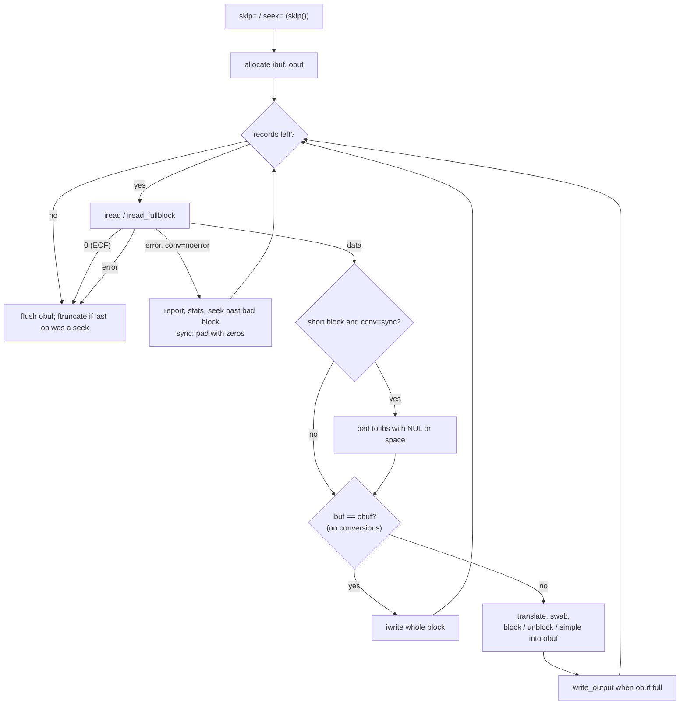

# `dd`: convert and copy a file

Source: `src/dd.c` (2574 lines) · Tests: `tests/dd/` · Manual:
`info '(coreutils) dd invocation'`

`dd` copies data block by block, with control over block sizes, offsets,
counts and conversions. Unlike most programs it takes `NAME=VALUE`
operands (`if=`, `of=`, `bs=`, ...), not `-x` options. Standard input and
output are always the file descriptors it works on: `if=` and `of=` are
opened **onto** descriptors 0 and 1 with `fd_reopen`.

## Operands

`scanargs()` (`src/dd.c:1501`) parses these operands:

| Operand | Variable | Notes |
|---|---|---|
| `if=FILE`, `of=FILE` | `input_file`, `output_file` | Opened onto stdin and stdout. |
| `bs=N`, `ibs=N`, `obs=N` | `input_blocksize`, `output_blocksize` | Default 512 (`DEFAULT_BLOCKSIZE`). `bs=` sets both and, with no conversions, lets `dd` use one buffer. |
| `cbs=N` | `conversion_blocksize` | Record size for `conv=block`/`unblock`. |
| `count=N`, `skip=N`/`iseek=N`, `seek=N`/`oseek=N` | `max_records`/`max_bytes`, `skip_records`/`skip_bytes`, `seek_records`/`seek_bytes` | In blocks, or in bytes with a `B` suffix or `iflag=count_bytes,skip_bytes` / `oflag=seek_bytes`. |
| `conv=LIST` | `conversions_mask` | `ascii ebcdic ibm block unblock lcase ucase sparse swab noerror nocreat excl notrunc sync fdatasync fsync` (`conversions[]`, `src/dd.c:253-272`). |
| `iflag=LIST`, `oflag=LIST` | `input_flags`, `output_flags` | `open()` flags (`append direct directory dsync sync noatime noctty nofollow nonblock binary text`) plus private flags: `fullblock`, `nocache`, `count_bytes`, `skip_bytes`, `seek_bytes`. |
| `status=none\|noxfer\|progress` | `status_level` | |

Numbers accept `parse_integer` syntax, including products such as
`bs=2x512` and size suffixes (`K`, `M`, `KiB`, `kB`, ...).

### Private open flags

`dd` needs a few flags of its own (`fullblock`, `nocache`, `count_bytes`,
`skip_bytes`, `seek_bytes`) in the same `int` as the real `O_*` flags. It
computes their values at compile time from bits that no real `O_*` flag
uses (`src/dd.c:274-310`):

```c
v = ~(0 | O_APPEND | O_BINARY | O_CIO | O_DIRECT | ... | O_TEXT),
O_FULLBLOCK = FFS_MASK (v),
v2 = v ^ O_FULLBLOCK,
O_NOCACHE = FFS_MASK (v2),
...
```

`static_assert`s check that each one is non-zero and is a single bit.

## Code map

| Function | Location | Role |
|---|---|---|
| `main` | `src/dd.c:2429` | Signals, `scanargs`, open `if=`/`of=` onto 0/1, truncate the output for `seek=`, `dd_copy`, sync, stats. |
| `scanargs` | `:1501` | Parse operands and check combinations. |
| `dd_copy` | `:2110` | Skip and seek, then the read, convert, write loop. |
| `skip` | `:1810` | `lseek` if possible, otherwise read and throw away (input) or write zeros (output). |
| `iread`, `iread_fullblock` | `:1099`, `:1146` | `read` with `EINTR` retry and a warning for partial reads. `fullblock` keeps reading until the block is full. |
| `iwrite` | `:1171` | `write` loop. `conv=sparse` turns a block of zeros into `lseek`. For `O_DIRECT`, the flag is turned off for a short final block. |
| `copy_simple`, `copy_with_block`, `copy_with_unblock` | `:1976`, `:2000`, `:2029` | Fill `obuf` from `ibuf`, with or without record conversion. |
| `translate_buffer`, `swab_buffer`, `apply_translations` | `:1746`, `:1761`, `:1710` | Character conversions using a 256-byte table. |
| `invalidate_cache`, `cache_round` | `:1028`, `:1000` | `nocache`: `posix_fadvise (POSIX_FADV_DONTNEED)` on whole pages. |
| `print_stats`, `print_xfer_stats` | `:823`, `:746` | The `records in/out` and bytes/speed lines. |
| `install_signal_handlers`, `process_signals` | `:873`, `:950` | Handle `SIGINT` and `SIGINFO`/`SIGUSR1`. |

## How it works

The diagram shows the copy loop in `dd_copy`.



### One buffer or two

If no conversion needs a separate output buffer, and `ibs` equals `obs`,
`ibuf` and `obuf` are the same buffer and each block read is written at
once (`src/dd.c:2284-2300`). Conversions marked `C_TWOBUFS` (`ascii`,
`ebcdic`, `block`, `swab`, `lcase`, ...) or different `ibs`/`obs` use two
buffers. Output is then collected in `obuf` and written in `obs`-sized
pieces.

### Partial reads

A `read` from a pipe or terminal can return less than `ibs`. `dd` counts
these as partial records (`r_partial`). `warn_partial_read` is set when
there is one buffer, no `iflag=fullblock`, and `skip=`, `count=` or
`O_DIRECT` is used, because then a short read changes the result
(`src/dd.c:1666-1674`). In that case `iread` warns once, after a short
read is followed by more data: `warning: partial read (N bytes); suggest
iflag=fullblock`. With `iflag=fullblock`, `iread_fullblock` keeps reading
until the block is full or the input ends.

### Skipping and seeking

`skip()` tries `lseek` first. For input it then checks the file size and
reports `cannot skip to specified offset` if the target is past the end.
If `lseek` does not work (pipes, some devices), it reads and throws away
the data for input, and writes zero blocks for output. With `seek=` and
without `conv=notrunc`, `main` truncates the output at the seek offset
before copying.

### Sparse output and `O_DIRECT`

- With `conv=sparse`, `iwrite` uses `lseek` past any block that is all
  zeros (`is_nul`). If the last operation was such a seek,
  `final_op_was_seek` makes `dd_copy` call `ftruncate`, so the file has
  the right length.
- With `oflag=direct`, a final block shorter than `obs` cannot be written
  with `O_DIRECT`. `iwrite` turns `O_DIRECT` off for that write, and turns
  on `fsync` and cache dropping to keep most of the effect.

### Signals and progress

`SIGINFO` (or `SIGUSR1` where there is no `SIGINFO`) prints the current
statistics. If `POSIXLY_CORRECT` is set and `SIGINFO` is `SIGUSR1`, the
signal is not caught. `SIGINT` (if it was not already ignored when `dd`
started) prints statistics and then stops `dd` with the signal. The handlers only set flags. `process_signals()` acts on them
between I/O calls. `status=progress` prints a progress line about once a
second.

## Errors and exit status

Read errors stop the copy (exit status 1) unless `conv=noerror` is given.
In that case `dd` reports the error, prints the statistics, tries to seek
past the bad block and carries on. Write errors are always fatal. At the
end, `dd` prints `N+M records in`, `N+M records out` and a bytes/speed line
on stderr (unless `status=none` or `noxfer`).

## Tests

| File | Covers |
|---|---|
| `tests/dd/misc.sh`, `bytes.sh`, `reblock.sh` | Basic use, byte counts, different `ibs`/`obs`. |
| `tests/dd/skip-seek.pl`, `skip-seek2.sh`, `skip-seek-past-file.sh`, `skip-seek-past-dev.sh` | `skip=` and `seek=`, including past the end. |
| `tests/dd/ascii.sh`, `conv-case.sh`, `unblock.pl`, `unblock-sync.sh` | Conversions. |
| `tests/dd/sparse.sh` | `conv=sparse`. |
| `tests/dd/direct.sh` | `oflag=direct` with a short final block. |
| `tests/dd/nocache.sh`, `nocache_eof.sh`, `nocache_fail.sh` | `nocache`. |
| `tests/dd/partial-write.sh`, `not-rewound.sh`, `no-allocate.sh` | Short writes, offset handling, buffer allocation. |
| `tests/dd/stats.sh`, `stderr.sh` | Statistics output, including on a signal. |

## See also

- [cp](cp.md) for normal file copies (with copy offload and sparse
  handling in `copy-file-data.c`).
- [split](split.md), which also uses `fd_reopen`.
