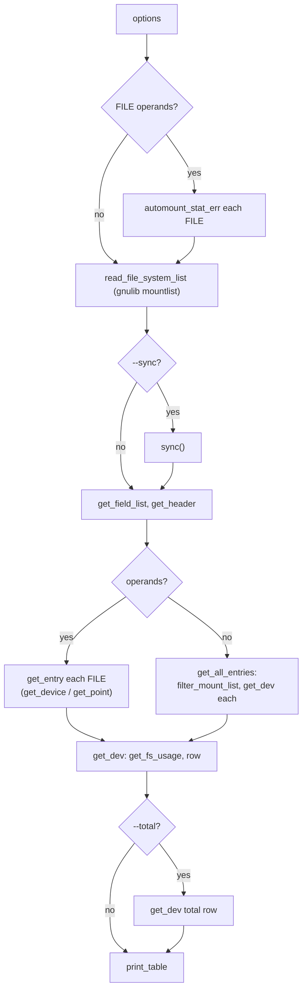

# `df`: report file system space usage

Source: `src/df.c` (1860 lines), `src/find-mount-point.c` · Tests:
`tests/df/` · Manual: `info '(coreutils) df invocation'`

`df` gets the list of mounted file systems from gnulib's `mountlist`
module (`read_file_system_list`) and the usage numbers from `fsusage`
(`get_fs_usage`, which wraps `statvfs` or `statfs`). Most of `df.c` deals
with three problems: choosing which mount entries to show (duplicates, bind
mounts, pseudo file systems), finding the file system for a file operand,
and laying out the table. `df` is in `build_if_possible_progs`, because it
needs a way to read the mount table.

## Options

The table lists `long_options[]` (`src/df.c:263-282`).

| Option | Effect |
|---|---|
| `-a`, `--all` | `show_all_fs`: include pseudo, duplicate and inaccessible file systems. |
| `-l`, `--local` | `show_local_fs`: leave out remote file systems. |
| `-t`, `--type=TYPE`, `-x`, `--exclude-type=TYPE` | `fs_select_list`, `fs_exclude_list`. |
| `-i`, `--inodes` | `INODES_MODE`. |
| `-h`, `-H` (`--si`), `-k`, `-B SIZE` | `HUMAN_MODE` or block size. `DF_BLOCK_SIZE` is read by `human_options`. |
| `-P`, `--portability` | `POSIX_MODE`: the POSIX column set, one line per file system. |
| `--output[=FIELD,...]` | `OUTPUT_MODE`: choose the columns. Field names: `source fstype itotal iused iavail ipcent size used avail pcent file target`. With no list, all fields. |
| `-T`, `--print-type` | Add the type column. |
| `--total` | Add a `total` row (`grand_fsu`). |
| `--sync`, `--no-sync` | Call `sync()` before reading usage (`require_sync`). |

## Code map

| Function | Location | Role |
|---|---|---|
| `main` | `src/df.c:1603` | Options, `stat` the operands (which can trigger automount), read the mount list, header, rows, total, `print_table`. |
| `filter_mount_list` | `:718` | Remove duplicate entries for the same device. |
| `get_all_entries` | `:1469` | No operands: filter, then call `get_dev` for each mount. |
| `get_entry` | `:1456` | One operand: a device node goes to `get_device`, anything else to `get_point`. |
| `get_point` | `:1358` | Find the mount entry for a file: longest `me_mountdir` prefix of the canonical name, checked with `st_dev`. Else match by device number. Else `find_mount_point`. |
| `get_device` | `:1278` | Find the mount entry for a block or character device operand. |
| `get_dev` | `:1014` | `get_fs_usage`, fill `struct field_values_t`, add a table row, add to the total. |
| `get_field_values`, `add_to_grand_total` | `:942`, `:980` | Convert `struct fs_usage` into block and inode values. |
| `decode_output_arg`, `get_field_list`, `get_header` | `:442`, `:515`, `:580` | Choose columns and captions for each mode. |
| `print_table` | `:389` | Print the rows with column widths, using `mbswidth`. |
| `replace_problematic_chars` | `:362` | Replace control characters and invalid multibyte sequences in cells with `?`. |
| `automount_stat_err` | `:289` | `open` and then `fstat`, so that an automount point is mounted before `stat`. |

## How it works

The diagram shows the path through `main`.

### Removing duplicate mounts

With no operands and without `-a`, `filter_mount_list()` keeps one entry
for each device number (`src/df.c:710-845`). When two entries share a
device, the one kept is chosen like this:

1. A "real" device name containing `/` beats a pseudo name such as
   `tmpfs`.
2. Otherwise the mount point nearer the root (shorter `me_mountdir`) wins,
   unless the other entry's bind-mount source (`me_mntroot`) is nearer the
   root of the device.
3. An entry mounted over an existing mount point on a new device wins.
4. Remote entries with different source names are both kept, unless
   `--total` is given (to avoid counting the same space twice).

Remote file systems are not `stat`ed when `-l` would leave them out
anyway, because a `stat` on a dead NFS server can hang. The comment at
`src/df.c:739-741` explains this. `tests/df/skip-duplicates.sh` and
`skip-rootfs.sh` cover these rules.

### File operands

`get_point()` first looks for the longest mount point that is a prefix of
the operand's canonical name. It then checks that mount point's `st_dev`
against the operand. This avoids calling `stat` on every mount point,
which could hang on a dead network mount (comment at `src/df.c:1363-1365`).
If that fails, it compares device numbers. If nothing matches, it uses
`find_mount_point()` from `src/find-mount-point.c` and prints what it can.

### Percentages

`Use%` is `used / (used + available)`, rounded **up**, where `available`
is the space for normal users. So the percentage can reach 100% while root
still has reserved space. Integer arithmetic is used when it cannot
overflow. Otherwise `double` is used, with a hand-written round-up so that
`libm` is not needed (`src/df.c:1174-1214`). An unknown value prints as
`-`. `available` can be negative (`fsu_bavail_top_bit_set`) when root has
used the reserved space.

## Errors and exit status

- If the mount table cannot be read, `df` fails when there are no operands,
  or when `-a`, `-l`, `-t` or `-x` is given. Otherwise it warns and
  carries on (`src/df.c:1806-1824`).
- An operand that cannot be accessed is reported, and the exit status is
  1.
- If nothing was printed (for example, every file system was excluded),
  `df` reports `no file systems processed` and fails.

## Tests

| File | Covers |
|---|---|
| `tests/df/df-P.sh`, `header.sh`, `df-output.sh` | Column sets and headers for `-P`, `-i`, `-h` and `--output`. |
| `tests/df/skip-duplicates.sh`, `skip-rootfs.sh`, `over-mount-device.sh` | Removing duplicate mounts. A preloaded library fakes the mount table. |
| `tests/df/no-mtab-status.sh`, `no-mtab-status-masked-proc.sh` | Exit status when the mount table cannot be read. |
| `tests/df/total-verify.sh`, `total-unprocessed.sh` | `--total`. |
| `tests/df/problematic-chars.sh` | Control characters in mount point names. |
| `tests/df/df-symlink.sh`, `unreadable.sh`, `sync.sh` | Symlink operands, unreadable mount points, `--sync`. |

## See also

- [du](du.md) for space used by a directory tree.
- [stat](stat.md): `stat -f` shows file system information for one file.
