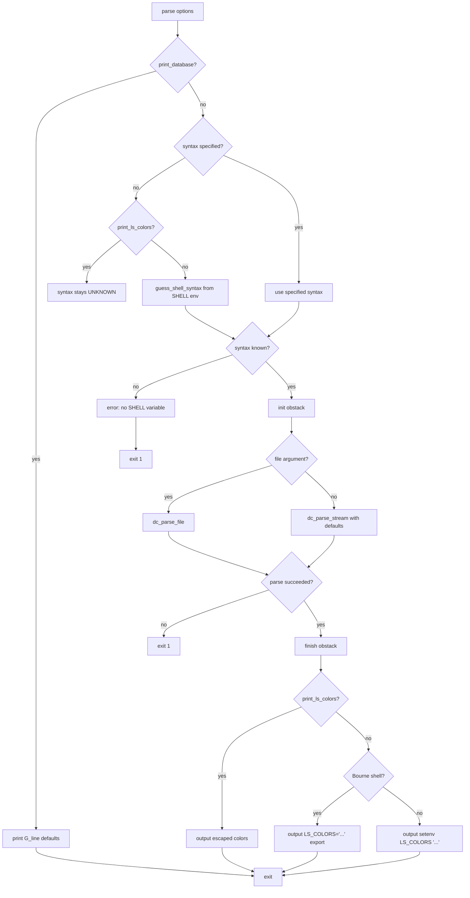

# `dircolors`: output commands to set LS_COLORS

Source: `src/dircolors.c` (571 lines) · Tests: (none) ·
Manual: `info '(coreutils) dircolors invocation'`

`dircolors` outputs shell commands to set the `LS_COLORS` environment variable,
which controls how `ls` displays file colors. It reads a configuration file
(or uses built-in defaults) and translates color codes to shell syntax. With
`-p`, it prints the default database. With `--print-ls-colors`, it outputs
fully escaped colors for display.

## Options

The table lists `long_options[]` (`src/dircolors.c:85-96`) and the short-option
string `"bcp"`.

|| Option | Variables |
||---|---|
|| `-b`, `--sh`, `--bourne-shell` | `syntax = SHELL_SYNTAX_BOURNE`: output Bourne shell code |
|| `-c`, `--csh`, `--c-shell` | `syntax = SHELL_SYNTAX_C`: output C shell code |
|| `-p`, `--print-database` | `print_database = true`: output default color database |
|| `--print-ls-colors` | `print_ls_colors = true`: output escaped colors for display |

## Code map

|| Function | Location | Role |
||---|---|---|
|| `main` | `src/dircolors.c:445` | Option parsing, validate options, guess shell syntax, parse file/stream, output LS_COLORS |
|| `dc_parse_file` | `:423` | Open and parse a configuration file |
|| `dc_parse_stream` | `:294` | Parse stream, find TERM directive, translate to LS_COLORS |
|| `parse_line` | `:168` | Parse a line into keyword and argument |
|| `append_entry` | `:268` | Add a color entry to the obstack |
|| `append_quoted` | `:220` | Append string with shell escaping |
|| `guess_shell_syntax` | `:151` | Guess shell from `$SHELL` environment variable |
|| `usage` | `:99` | Help message |

## How it works

### Configuration parsing

`dc_parse_stream` reads the configuration line by line
(`src/dircolors.c:294-419`). It looks for a `TERM` directive matching the
current terminal type (`$TERM`). Once found, it processes subsequent
directives. Each line is parsed with `parse_line` into a keyword and argument.
Keywords are translated from Slack-style codes (e.g., `NORMAL`, `DIR`) to
`ls` codes (e.g., `no`, `di`) using lookup tables (`src/dircolors.c:56-72`).

### Shell escaping

`append_quoted` escapes strings for shell output (`src/dircolors.c:220-262`):

- For Bourne shell: escape `'`, `\`, `^`, `:`, and `=` with backslash.
- For C shell: additionally escape `!` to prevent history substitution.
- For `--print-ls-colors`: no escaping, wrap ANSI codes in `\x1B[` and `\x1B[0m`.

### Output format

The final LS_COLORS string is built on an obstack
(`src/dircolors.c:539-567`). Each entry is formatted as `key=value:` or
`key=value:` with appropriate escaping. The output is wrapped in shell
commands:

- **Bourne shell:** `LS_COLORS='...';\nexport LS_COLORS\n`
- **C shell:** `setenv LS_COLORS '...'\n`
- **`--print-ls-colors`:** Tab-separated with ANSI escape codes for display

### Default database

The built-in default database is stored in `G_line` as a series of
NUL-terminated strings (`src/dircolors.c:519-526`). With `-p`, these are
printed directly.

## Platform notes

`dircolors` uses an obstack for efficient string accumulation. Shell syntax
guessing checks `$SHELL` for `csh` or `tcsh` to select C shell syntax.

## Errors and exit status

- **Option conflict:** "options to output non shell syntax, and to select a shell syntax are mutually exclusive"
- **Database/print-ls-colors conflict:** "options --print-database and --print-ls-colors are mutually exclusive"
- **Extra operand with `-p`:** "file operands cannot be combined with --print-database"
- **No SHELL variable:** "no SHELL environment variable, and no shell type option given"
- **File open failure:** Error from `quotef(FILE)`
- **Unrecognized keyword:** Error during parsing

Exit status is 0 on success, 1 on failure.

## Tests

No dedicated test files exist for `dircolors`.

## See also

- [ls](ls.md) for the program that uses LS_COLORS
