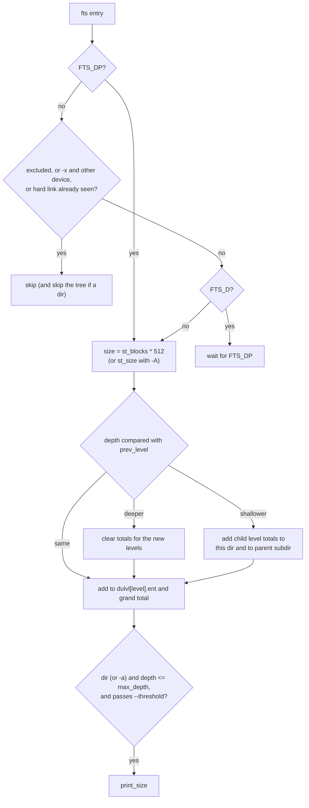

# `du`: estimate file space usage

Source: `src/du.c` (1214 lines), `src/show-date.c` · Tests: `tests/du/`
(about 30 scripts) · Manual: `info '(coreutils) du invocation'`

`du` walks each operand with gnulib `fts` and adds up the space used by
each directory tree. Most of the logic is in `process_file()`. It keeps an
array of totals, one for each depth, and moves sums up to the parent when
the depth goes down. Hard links are counted once, using a set of (device,
inode) pairs (gnulib `di-set`).

## Options

The table lists the main entries in `long_options[]`
(`src/du.c:213-244`) and the short-option string
`"0aAbd:chHklmst:xB:DLPSX:"`.

| Option | Variable | Notes |
|---|---|---|
| `-a`, `--all` | `opt_all` | Print files as well as directories. |
| `-s`, `--summarize` | `max_depth = 0` | Only the total for each operand. Cannot be combined with `-a`. |
| `-d`, `--max-depth=N` | `max_depth` | Print only down to depth N (the operand is depth 0). |
| `-c`, `--total` | `print_grand_total` | Print a `total` line at the end. |
| `-S`, `--separate-dirs` | `opt_separate_dirs` | Do not add subdirectory sizes to their parent. |
| `-A`, `--apparent-size` | `apparent_size` | Use `st_size`, not `st_blocks`. |
| `-b`, `--bytes` | `apparent_size`, block size 1 | |
| `-h`, `--si`, `-k`, `-m`, `-B SIZE` | `human_output_opts`, `output_block_size` | `DU_BLOCK_SIZE`, `BLOCK_SIZE` and `BLOCKSIZE` are read by `human_options`. |
| `--inodes` | `opt_inodes` | Count inodes instead of space. |
| `-l`, `--count-links` | `opt_count_all` | Count each hard link separately. |
| `-L`, `-P` (default), `-H`/`-D` | `symlink_deref_bits` | `FTS_LOGICAL`, `FTS_PHYSICAL`, or `FTS_COMFOLLOW \| FTS_PHYSICAL`. |
| `-x`, `--one-file-system` | `FTS_XDEV` | |
| `--exclude=PATTERN`, `-X FILE` | `exclude` | gnulib `exclude` with `EXCLUDE_WILDCARDS`. |
| `-t`, `--threshold=SIZE` | `opt_threshold` | Print only entries of at least SIZE, or at most `-SIZE`. `-0` is rejected. |
| `--time[=atime\|ctime]`, `--time-style=STYLE` | `opt_time`, `time_type`, `time_format` | Show the newest time in each tree. The default style is `long-iso`. `TIME_STYLE` is used if set. |
| `-0`, `--null` | `opt_nul_terminate_output` | |
| `--files0-from=F` | | Operands are read from F with `argv_iter`. |

## Code map

| Function | Location | Role |
|---|---|---|
| `main` | `src/du.c:785` | Options, time style, quoting, the operand iterator, a `du_files` call for each operand, the grand total. |
| `du_files` | `:737` | `xfts_open` on **one** operand, loop over `fts_read`, `fts_close`. |
| `process_file` | `:543` | Handle one entry: errors, exclusion, hard links, add to the level totals, print. |
| `print_size` | `:455` | Size (or inode count), optional time, name, newline or NUL. Calls `fflush` after each line. |
| `mount_point_in_fts_cycle` | `:510` | When `fts` reports a cycle, check whether it comes from a bind mount. If so, do not warn. |
| `fill_mount_table` | `:482` | Fill `di_mnt` with the (device, inode) of each local mount point. |
| `struct duinfo`, `struct dulevel` | `:69`, `:113` | Size, inode count and newest time; totals for the entries in one directory and for its subdirectories. |

## How it works

The diagram shows what `process_file` does with each entry.

### Totals by depth

`fts` visits entries depth first and gives directories twice: before the
contents (`FTS_D`) and after them (`FTS_DP`). `du` ignores `FTS_D` and
does the work at `FTS_DP`, so a directory's total is complete when it is
printed. The `dulvl[]` array (`src/du.c:557`) holds, for each depth:

- `ent`: the total for entries directly in that directory;
- `subdir`: the total for everything in its subdirectories.

When the depth goes down by one (`src/du.c:688-702`), the totals of the
level being left are added to the directory now being printed and to the
parent's `subdir`. With `-S`, the subdirectory part is not added to what is
printed.

### Hard links

By default, a file with `st_nlink > 1` is added to `di_files`. If it is
already there, it is skipped. `hash_all` puts **every** file in the set
when a file could be seen twice anyway: when there is more than one
operand, when following all symlinks (`-L`), or when reading operands from
`--files0-from` (`src/du.c:1107-1117`). With `-l` nothing is put in the
set.

When not every file is in the set, `du` cannot find directory cycles by
itself, so it asks `fts` to check carefully (`FTS_TIGHT_CYCLE_CHECK`).

### Sizes

The size of an entry is `STP_NBLOCKS (sb) * ST_NBLOCKSIZE` (allocated
blocks), or with `-A`, `st_size` when `usable_st_size` is true and 0
otherwise. `duinfo_add` saturates at `UINTMAX_MAX`, and such a value is
printed as `Infinity`.

### `FTS_NOSTAT`

`du` opens `fts` with `FTS_NOSTAT`. When `fts` returns `FTS_NSOK` (no stat
data yet), `process_file` calls `fts_set (FTS_AGAIN)` and `fts_read` again
to get the stat data. So the `stat` is done only for entries that are not
excluded.

### Output

Each operand gets its own `fts_open` call (`temp_argv` in `main`).
`print_size` flushes stdout after each line, so output appears while the
walk is still going. When stdout is a terminal, names are quoted with
`shell_escape_quoting_style` (or `QUOTING_STYLE`).

## Errors and exit status

`du` keeps going after errors. `cannot read directory`, `cannot access`,
`fts_read failed` and a directory cycle each make the exit status 1. An
unreadable directory still counts towards the total.

## Tests

The table lists some of the tests.

| File | Covers |
|---|---|
| `tests/du/basic.sh`, `two-args.sh`, `slash.sh`, `trailing-slash.sh` | Basic totals and operand forms. |
| `tests/du/hard-link.sh`, `inodes.sh` | Hard links counted once, and `--inodes`. |
| `tests/du/max-depth.sh`, `threshold.sh`, `exclude.sh`, `apparent.sh`, `block-size.sh` | Options. |
| `tests/du/bind-mount-dir-cycle.sh`, `bind-mount-dir-cycle-v2.sh` | No cycle warning for bind mounts. |
| `tests/du/deref.sh`, `deref-args.sh`, `no-deref.sh`, `long-sloop.sh` | Symlink options. |
| `tests/du/move-dir-while-traversing.sh` | A directory moved during the walk. |
| `tests/du/inacc-dir.sh`, `inaccessible-cwd.sh`, `no-x.sh` | Permission problems. |
| `tests/du/files0-from.pl`, `files0-from-dir.sh` | `--files0-from`. |
| `tests/du/2g.sh`, `8gb.sh`, `bigtime.sh` | Large sizes and times. |

## See also

- [df](df.md) for space per file system.
- [Shared infrastructure](../overview/shared-infrastructure.md) for `fts`,
  `di-set` and `show-date.c`.
