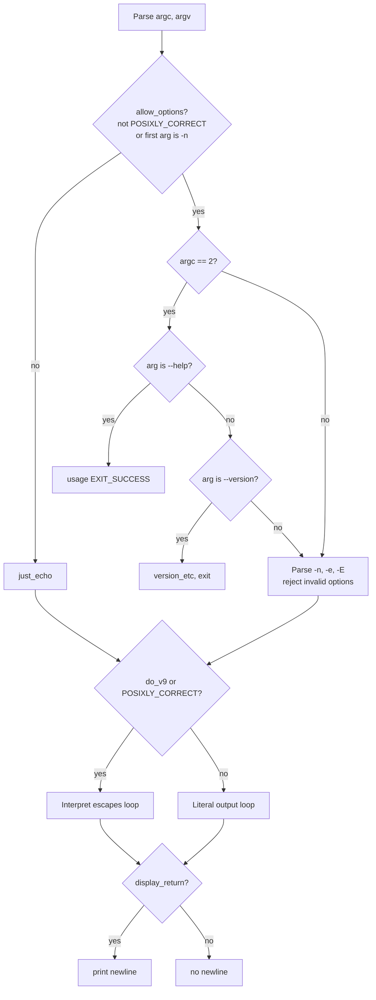

# `echo`: display a line of text

Source: `src/echo.c` (286 lines) · Tests: `tests/misc/echo.sh` ·
Manual: `info '(coreutils) echo invocation'`

`echo` prints its arguments to standard output, separated by spaces. It can
interpret backslash escapes like `\n` and `\t` when the `-e` option is used.
The behavior varies by platform: some systems interpret escapes by default,
others do not. `echo` does not use getopt for option parsing to avoid
accepting abbreviations.

## Options

The table lists the short options parsed directly in `main` (`src/echo.c:161-202`).

|| Option | Variable |
||---|---|
|| `-n` | `display_return = false` (no trailing newline) |
|| `-e` | `do_v9 = true` (interpret backslash escapes) |
|| `-E` | `do_v9 = false` (literal backslashes) |

## Code map

|| Function | Location | Role |
||---|---|---|
|| `main` | `src/echo.c:121` | Direct option parsing (no getopt), escape interpretation loop, output with spaces. |
|| `hextobin` | `:101` | Convert hex character to integer (0-15). |
|| `usage` | `:36` | Help text, including escape sequence list. |

## How it works

The diagram shows the option parsing and output logic.



### Option parsing

`echo` parses options directly without getopt (`src/echo.c:144-202`) to avoid
accepting abbreviations. Options are only recognized if `allow_options` is true,
which requires either that `POSIXLY_CORRECT` is not set, or that the first
argument is `-n` (when `DEFAULT_ECHO_TO_XPG` is false). If an argument starts
with `-` but contains characters other than `e`, `E`, or `n`, it is treated as
a string to echo, not as options (`src/echo.c:170-177`).

### Escape interpretation

When `do_v9` is true (via `-e` or `DEFAULT_ECHO_TO_XPG`), backslash escapes are
interpreted (`src/echo.c:206-270`). The supported escapes are:

- `\\`, `\a`, `\b`, `\c`, `\e`, `\f`, `\n`, `\r`, `\t`, `\v`
- `\xHH` for 1-2 hex digits
- `\0NNN` for 1-3 octal digits

The `\c` escape stops all further output and exits immediately
(`src/echo.c:221`). Invalid escapes print a literal backslash followed by the
character (`src/echo.c:260`).

### Platform notes

`DEFAULT_ECHO_TO_XPG` is a compile-time flag. When true, escapes are interpreted
by default and `-e` is the default behavior. When false, escapes are not
interpreted by default and `-E` is the default. The `POSIXLY_CORRECT` environment
variable also affects behavior (`src/echo.c:124`).

## Errors and exit status

`echo` always exits with status 0. It does not report errors for write failures
(because `atexit (close_stdout)` handles them, but the program has already
returned).

## Tests

|| File | Covers |
||---|---|
|| `tests/misc/echo.sh` | Escape sequences, `-n`, `-e`, `-E`, platform differences. |

## See also

- [printf](printf.md) (recommended alternative for portable output)

## Source code

`src/echo.c:1`

```c
/* echo.c, derived from code echo.c in Bash.
   Copyright (C) 1987-2026 Free Software Foundation, Inc.

   This program is free software: you can redistribute it and/or modify
   it under the terms of the GNU General Public License as published by
   the Free Software Foundation, either version 3 of the License, or
   (at your option) any later version.

   This program is distributed in the hope that it will be useful,
   but WITHOUT ANY WARRANTY; without even the implied warranty of
   MERCHANTABILITY or FITNESS FOR A PARTICULAR PURPOSE.  See the
   GNU General Public License for more details.

   You should have received a copy of the GNU General Public License
   along with this program.  If not, see <https://www.gnu.org/licenses/>.  */

#include <config.h>
#include <stdio.h>
#include <sys/types.h>
#include "system.h"
#include "assure.h"
#include "c-ctype.h"

/* The official name of this program (e.g., no 'g' prefix).  */
#define PROGRAM_NAME "echo"

#define AUTHORS \
  proper_name ("Brian Fox"), \
  proper_name ("Chet Ramey")

/* If true, interpret backslash escapes by default.  */
#ifndef DEFAULT_ECHO_TO_XPG
enum { DEFAULT_ECHO_TO_XPG = false };
#endif

void
usage (int status)
{
  /* STATUS should always be EXIT_SUCCESS (unlike in most other
     utilities which would call emit_try_help otherwise).  */
  affirm (status == EXIT_SUCCESS);

  printf (_("\
Usage: %s [SHORT-OPTION]... [STRING]...\n\
  or:  %s LONG-OPTION\n\
"), program_name, program_name);
  fputs (_("\
Echo the STRING(s) to standard output.\n\
\n\
"), stdout);
  oputs (_("\
  -n     do not output the trailing newline\n\
"));
  oputs (_(DEFAULT_ECHO_TO_XPG
           ? N_("\
  -e     enable interpretation of backslash escapes (default)\n\
")
           : N_("\
  -e     enable interpretation of backslash escapes\n\
")));
  oputs (_(DEFAULT_ECHO_TO_XPG
           ? N_("\
  -E     disable interpretation of backslash escapes\n\
")
           : N_("\
  -E     disable interpretation of backslash escapes (default)\n\
")));
  oputs (HELP_OPTION_DESCRIPTION);
  oputs (VERSION_OPTION_DESCRIPTION);
  fputs (_("\
\n\
If -e is in effect, the following sequences are recognized:\n\
\n\
"), stdout);
  fputs (_("\
  \\\\      backslash\n\
  \\a      alert (bell)\n\
  \\b      backspace\n\
  \\c      produce no further output\n\
  \\e      escape\n\
  \\f      form feed\n\
  \\n      new line\n\
  \\r      carriage return\n\
  \\t      horizontal tab\n\
  \\v      vertical tab\n\
"), stdout);
  fputs (_("\
  \\0NNN   byte with octal value NNN (1 to 3 digits)\n\
  \\xHH    byte with hexadecimal value HH (1 to 2 digits)\n\
"), stdout);
  printf (USAGE_BUILTIN_WARNING, PROGRAM_NAME);
  fputs (_("\n\
Consider using the printf(1) command instead,\n\
as it avoids problems when outputting option-like strings.\n\
"), stdout);
  emit_ancillary_info (PROGRAM_NAME);
  exit (status);
}

/* Convert C from hexadecimal character to integer.  */
static int
hextobin (unsigned char c)
{
  switch (c)
    {
    default: return c - '0';
    case 'a': case 'A': return 10;
    case 'b': case 'B': return 11;
    case 'c': case 'C': return 12;
    case 'd': case 'D': return 13;
    case 'e': case 'E': return 14;
    case 'f': case 'F': return 15;
    }
}

/* Print the words in LIST to standard output.  If the first word is
   '-n', then don't print a trailing newline.  We also support the
   echo syntax from Version 9 unix systems. */

int
main (int argc, char **argv)
{
  bool display_return = true;
  bool posixly_correct = !!getenv ("POSIXLY_CORRECT");
  bool allow_options =
    (! posixly_correct
     || (! DEFAULT_ECHO_TO_XPG && 1 < argc && streq (argv[1], "-n")));

  /* System V machines already have a /bin/sh with a v9 behavior.
     Use the identical behavior for these machines so that the
     existing system shell scripts won't barf.  */
  bool do_v9 = DEFAULT_ECHO_TO_XPG;

  initialize_main (&argc, &argv);
  set_program_name (argv[0]);
  setlocale (LC_ALL, "");
  bindtextdomain (PACKAGE, LOCALEDIR);
  textdomain (PACKAGE);

  atexit (close_stdout);

  /* We directly parse options, rather than use parse_long_options, in
     order to avoid accepting abbreviations.  */
  if (allow_options && argc == 2)
    {
      if (streq (argv[1], "--help"))
        usage (EXIT_SUCCESS);

      if (streq (argv[1], "--version"))
        {
          version_etc (stdout, PROGRAM_NAME, PACKAGE_NAME, Version, AUTHORS,
                       (char *) NULL);
          return EXIT_SUCCESS;
        }
    }

  --argc;
  ++argv;

  if (allow_options)
    while (argc > 0 && *argv[0] == '-')
      {
        char const *temp = argv[0] + 1;
        size_t i;

        /* If it appears that we are handling options, then make sure that
           all of the options specified are actually valid.  Otherwise, the
           string should just be echoed.  */

        for (i = 0; temp[i]; i++)
          switch (temp[i])
            {
            case 'e': case 'E': case 'n':
              break;
            default:
              goto just_echo;
            }

        if (i == 0)
          goto just_echo;

        /* All of the options in TEMP are valid options to ECHO.
           Handle them. */
        while (*temp)
          switch (*temp++)
            {
            case 'e':
              do_v9 = true;
              break;

            case 'E':
              do_v9 = false;
              break;

            case 'n':
              display_return = false;
              break;
            }

        argc--;
        argv++;
      }

just_echo:

  if (do_v9 || posixly_correct)
    {
      while (argc > 0)
        {
          char const *s = argv[0];
          unsigned char c;

          while ((c = *s++))
            {
              if (c == '\\' && *s)
                {
                  switch (c = *s++)
                    {
                    case 'a': c = '\a'; break;
                    case 'b': c = '\b'; break;
                    case 'c': return EXIT_SUCCESS;
                    case 'e': c = '\x1B'; break;
                    case 'f': c = '\f'; break;
                    case 'n': c = '\n'; break;
                    case 'r': c = '\r'; break;
                    case 't': c = '\t'; break;
                    case 'v': c = '\v'; break;
                    case 'x':
                      {
                        unsigned char ch = *s;
                        if (! c_isxdigit (ch))
                          goto not_an_escape;
                        s++;
                        c = hextobin (ch);
                        ch = *s;
                        if (c_isxdigit (ch))
                          {
                            s++;
                            c = c * 16 + hextobin (ch);
                          }
                      }
                      break;
                    case '0':
                      c = 0;
                      if (! ('0' <= *s && *s <= '7'))
                        break;
                      c = *s++;
                      FALLTHROUGH;
                    case '1': case '2': case '3':
                    case '4': case '5': case '6': case '7':
                      c -= '0';
                      if ('0' <= *s && *s <= '7')
                        c = c * 8 + (*s++ - '0');
                      if ('0' <= *s && *s <= '7')
                        c = c * 8 + (*s++ - '0');
                      break;
                    case '\\': break;

                    not_an_escape:
                    default:  putchar ('\\'); break;
                    }
                }
              putchar (c);
            }
          argc--;
          argv++;
          if (argc > 0)
            putchar (' ');
        }
    }
  else
    {
      while (argc > 0)
        {
          fputs (argv[0], stdout);
          argc--;
          argv++;
          if (argc > 0)
            putchar (' ');
        }
    }

  if (display_return)
    putchar ('\n');
  return EXIT_SUCCESS;
}
```
