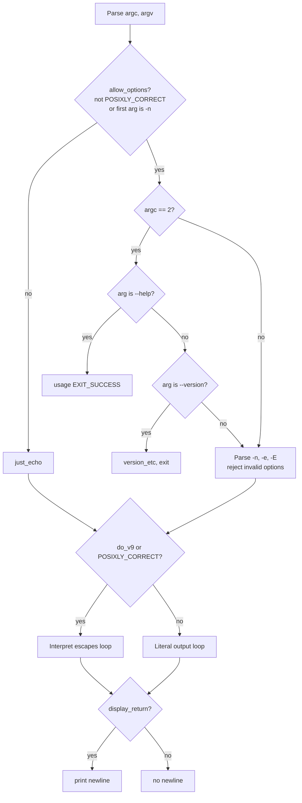

# `echo`: display a line of text

Source: `src/echo.c` (286 lines) · Tests: `tests/misc/echo.sh` ·
Manual: `info '(coreutils) echo invocation'`

`echo` prints its arguments to standard output, separated by spaces. It can
interpret backslash escapes like `\n` and `\t` when the `-e` option is used.
The behavior varies by platform: some systems interpret escapes by default,
others do not. `echo` does not use getopt for option parsing to avoid
accepting abbreviations.

## Options

The table lists the short options parsed directly in `main` (`src/echo.c:161-202`).

|| Option | Variable |
||---|---|
|| `-n` | `display_return = false` (no trailing newline) |
|| `-e` | `do_v9 = true` (interpret backslash escapes) |
|| `-E` | `do_v9 = false` (literal backslashes) |

## Code map

|| Function | Location | Role |
||---|---|---|
|| `main` | `src/echo.c:121` | Direct option parsing (no getopt), escape interpretation loop, output with spaces. |
|| `hextobin` | `:101` | Convert hex character to integer (0-15). |
|| `usage` | `:36` | Help text, including escape sequence list. |

## How it works

The diagram shows the option parsing and output logic.

### Option parsing

`echo` parses options directly without getopt (`src/echo.c:144-202`) to avoid
accepting abbreviations. Options are only recognized if `allow_options` is true,
which requires either that `POSIXLY_CORRECT` is not set, or that the first
argument is `-n` (when `DEFAULT_ECHO_TO_XPG` is false). If an argument starts
with `-` but contains characters other than `e`, `E`, or `n`, it is treated as
a string to echo, not as options (`src/echo.c:170-177`).

### Escape interpretation

When `do_v9` is true (via `-e` or `DEFAULT_ECHO_TO_XPG`), backslash escapes are
interpreted (`src/echo.c:206-270`). The supported escapes are:

- `\\`, `\a`, `\b`, `\c`, `\e`, `\f`, `\n`, `\r`, `\t`, `\v`
- `\xHH` for 1-2 hex digits
- `\0NNN` for 1-3 octal digits

The `\c` escape stops all further output and exits immediately
(`src/echo.c:221`). Invalid escapes print a literal backslash followed by the
character (`src/echo.c:260`).

### Platform notes

`DEFAULT_ECHO_TO_XPG` is a compile-time flag. When true, escapes are interpreted
by default and `-e` is the default behavior. When false, escapes are not
interpreted by default and `-E` is the default. The `POSIXLY_CORRECT` environment
variable also affects behavior (`src/echo.c:124`).

## Errors and exit status

`echo` always exits with status 0. It does not report errors for write failures
(because `atexit (close_stdout)` handles them, but the program has already
returned).

## Tests

|| File | Covers |
||---|---|
|| `tests/misc/echo.sh` | Escape sequences, `-n`, `-e`, `-E`, platform differences. |

## See also

- [printf](printf.md) (recommended alternative for portable output)
