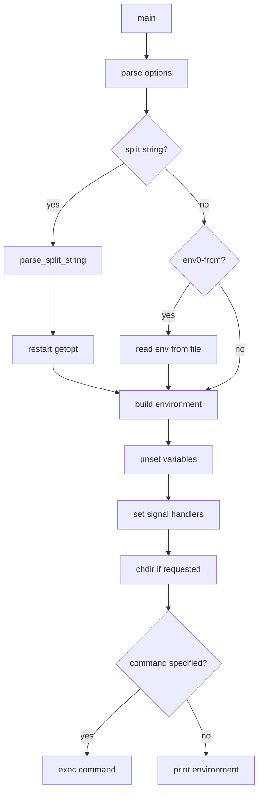

# `env`: run a program in a modified environment

Source: `src/env.c` (1268 lines) · Tests: `tests/env/` ·
Manual: `info '(coreutils) env invocation'`

`env` sets environment variables and runs a command. It can unset variables,
ignore the existing environment, change directories, modify signal handling,
and split arguments from a single string with `-S`. Without a command, it
prints the current environment.

## Options

The table lists `longopts[]` (`src/env.c:113-131`) and the short-option
string `"+a:C:iS:u:v0 \t\n\v\f\r"`.

|| Option | Variables |
||---|---|
|| `-a ARG`, `--argv0=ARG` | Set ARG as the program's `argv[0]` |
|| `-i`, `--ignore-environment` | `ignore_environment = true`: start with empty environment |
|| `-u VAR`, `--unset=VAR` | Add VAR to `usvars` to unset |
|| `-C DIR`, `--chdir=DIR` | Change to DIR before running command |
|| `-S STRING`, `--split-string=STRING` | Parse STRING into arguments |
|| `--env0-from=FILE` | Read NUL-terminated environment from FILE |
|| `--default-signal[=LIST]` | Set signals to default handler |
|| `--ignore-signal[=LIST]` | Set signals to ignore |
|| `--block-signal[=LIST]` | Block signals |
|| `--list-signal-handling` | `report_signal_handling = true`: list signal handling |
|| `-v`, `--debug` | `dev_debug = true`: debug output |
|| `-0`, `--null` | NUL-terminate output when printing environment |
|| `--quoting-style=STYLE` | Set quoting style for output |

## Code map

|| Function | Location | Role |
||---|---|---|
|| `main` | `src/env.c:1029` | Option parsing, modify environment, change directory, exec command |
|| `parse_split_string` | `:793` | Parse `-S` string into argv array |
|| `build_argv` | `:635` | Build argv from split string |
|| `parse_signal_action_params` | `:823` | Parse signal action parameters |
|| `reset_signal_handlers` | `:954` | Apply signal handler changes |
|| `set_signal_proc_mask` | `:970` | Apply signal mask changes |
|| `list_signal_handling` | `:990` | List current signal handling |
|| `usage` | `:134` | Help message |

## How it works

### Environment modification

`env` builds a new environment vector based on the current environment,
modifications, and unsets (`src/env.c:1029-1228`). The `env_vector` struct
stores variables directly to preserve raw entries.

### Split string parsing

`-S` parses a single string into multiple arguments using shell-like rules
(`src/env.c:793-820`). This is useful for passing arguments through restricted
environments. The parsing handles quotes, escapes, and variable expansion
(`${VAR}`).

### Signal handling

Signal handlers can be set to default, ignore, or blocked
(`src/env.c:823-1017`). The `SIGNAL_MODE` enum tracks the desired action for
each signal. `reset_signal_handlers` applies the changes using `sigaction`.

### Directory change

With `-C`, `env` changes to the specified directory before executing the
command (`src/env.c:1236-1243`).

## Platform notes

`env` uses `sigaction` for signal handling. Signal blocking uses `sigprocmask`.
Some signals (like `SIGKILL`, `SIGSTOP`) cannot be caught or ignored.

## Errors and exit status

- **Invalid signal:** "SIG: invalid signal"
- **Invalid quoting style:** Error from `argmatch`
- **Directory change failure:** "cannot change directory to DIR"
- **Command not found:** Error from `execvp`

Exit status is 0 on success, 125 for command invocation errors, 126 for command
not found, 127 for other errors.

## Tests

|| File | Covers |
||---|---|
|| `tests/env/env.sh` | Basic environment modification |
|| `tests/env/env-S.pl` | `-S` option parsing |
|| `tests/env/env-S-script.sh` | `-S` in scripts |
|| `tests/env/env-null.sh` | NUL-terminated output |
|| `tests/env/env-signal-handler.sh` | Signal handling |
|| `tests/env/env0-from.sh` | `--env0-from` option |
|| `tests/env/printenv.sh` | Environment printing |

## See also

- [printenv](printenv.md) for printing environment
