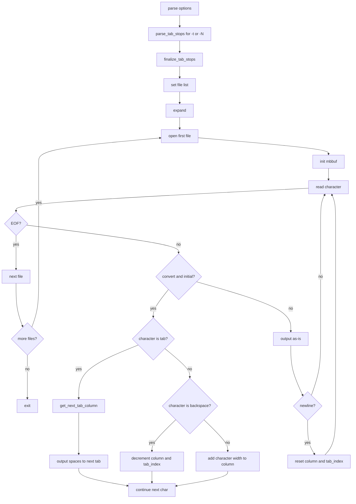

# `expand`: convert tabs to spaces

Source: `src/expand.c` (245 lines) · Tests: `tests/expand/` ·
Manual: `info '(coreutils) expand invocation'`

`expand` converts tabs to spaces, preserving backspace characters which decrement
the column count. It uses functions from `expand-common.c` for tab stop
management and multi-character handling. With `-i`, it only converts initial tabs
(tabs before non-blank characters). Tab stops can be specified as a single
interval or as a list of column positions.

## Options

The table lists `longopts[]` (`src/expand.c:54-61`) and the short-option
string `"it:0::1::2::3::4::5::6::7::8::9::"`.

|| Option | Variables |
||---|---|
|| `-i`, `--initial` | `convert_entire_line = false`: only convert initial tabs |
|| `-t LIST`, `--tabs=LIST` | Call `parse_tab_stops(LIST)` |
|| `-N` (single digit) | Call `parse_tab_stops("N")` |

## Code map

|| Function | Location | Role |
||---|---|---|
|| `main` | `src/expand.c:189` | Option parsing, `parse_tab_stops`, `finalize_tab_stops`, set file list, call `expand` |
|| `expand` | `:102` | Read input, convert tabs to spaces, write output |
|| `usage` | `:64` | Help message |

## How it works

### Tab conversion

`expand` reads characters with `mbbuf_get_char` for multi-byte support
(`src/expand.c:137-184`). When conversion is enabled (entire line, or initial
and still at leading blanks):

- **Tab:** Call `get_next_tab_column` from `expand-common.c` to find the next
  tab stop, output spaces up to that column.
- **Backspace:** Decrement column and tab index to recalculate tab stops.
- **Other:** Add the character's display width to the column.

The tab stop list is managed by `parse_tab_stops` and `finalize_tab_stops`
in `expand-common.c`.

### Initial tab mode

With `-i`, `convert_entire_line` is false. Conversion stops after the first
non-blank character on each line (`src/expand.c:143`). The check uses
`c32issep` to test for separator characters.

### Multi-byte support

`expand` uses `mbbuf` from gnulib for multi-byte character handling
(`src/expand.c:111-112`). Character widths are calculated with `c32width`.

## Platform notes

`expand` uses `expand-common.c` for shared tab stop logic with `unexpand`.
Multi-byte character handling uses gnulib functions.

## Errors and exit status

- **Invalid tab stop:** Error from `parse_tab_stops`
- **Input line too long:** "input line is too long" (column overflow)
- **Write error:** From `write_error`

Exit status is 0 on success, 1 on errors.

## Tests

|| File | Covers |
||---|---|
|| `tests/expand/expand.pl` | Various tab conversion scenarios |
|| `tests/expand/mb.sh` | Multi-byte character handling |
|| `tests/expand/bounded-memory.sh` | Memory limits |

## See also

- [unexpand](unexpand.md) for converting spaces to tabs
- [expand-common](../overview/shared-infrastructure.md) for shared tab stop logic
