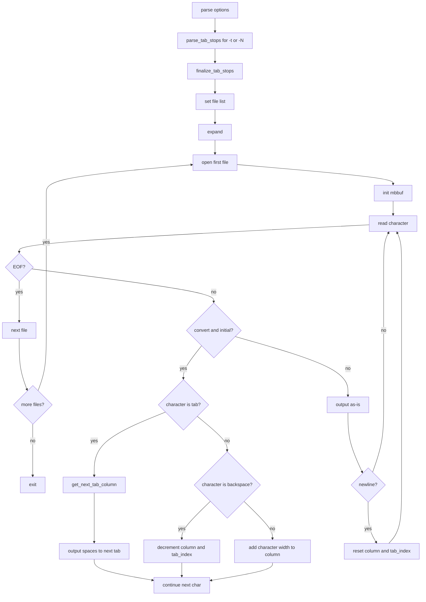

# `expand`: convert tabs to spaces

Source: `src/expand.c` (245 lines) · Tests: `tests/expand/` ·
Manual: `info '(coreutils) expand invocation'`

`expand` converts tabs to spaces, preserving backspace characters which decrement
the column count. It uses functions from `expand-common.c` for tab stop
management and multi-character handling. With `-i`, it only converts initial tabs
(tabs before non-blank characters). Tab stops can be specified as a single
interval or as a list of column positions.

## Options

The table lists `longopts[]` (`src/expand.c:54-61`) and the short-option
string `"it:0::1::2::3::4::5::6::7::8::9::"`.

|| Option | Variables |
||---|---|
|| `-i`, `--initial` | `convert_entire_line = false`: only convert initial tabs |
|| `-t LIST`, `--tabs=LIST` | Call `parse_tab_stops(LIST)` |
|| `-N` (single digit) | Call `parse_tab_stops("N")` |

## Code map

|| Function | Location | Role |
||---|---|---|
|| `main` | `src/expand.c:189` | Option parsing, `parse_tab_stops`, `finalize_tab_stops`, set file list, call `expand` |
|| `expand` | `:102` | Read input, convert tabs to spaces, write output |
|| `usage` | `:64` | Help message |

## How it works



### Tab conversion

`expand` reads characters with `mbbuf_get_char` for multi-byte support
(`src/expand.c:137-184`). When conversion is enabled (entire line, or initial
and still at leading blanks):

- **Tab:** Call `get_next_tab_column` from `expand-common.c` to find the next
  tab stop, output spaces up to that column.
- **Backspace:** Decrement column and tab index to recalculate tab stops.
- **Other:** Add the character's display width to the column.

The tab stop list is managed by `parse_tab_stops` and `finalize_tab_stops`
in `expand-common.c`.

### Initial tab mode

With `-i`, `convert_entire_line` is false. Conversion stops after the first
non-blank character on each line (`src/expand.c:143`). The check uses
`c32issep` to test for separator characters.

### Multi-byte support

`expand` uses `mbbuf` from gnulib for multi-byte character handling
(`src/expand.c:111-112`). Character widths are calculated with `c32width`.

## Platform notes

`expand` uses `expand-common.c` for shared tab stop logic with `unexpand`.
Multi-byte character handling uses gnulib functions.

## Errors and exit status

- **Invalid tab stop:** Error from `parse_tab_stops`
- **Input line too long:** "input line is too long" (column overflow)
- **Write error:** From `write_error`

Exit status is 0 on success, 1 on errors.

## Tests

|| File | Covers |
||---|---|
|| `tests/expand/expand.pl` | Various tab conversion scenarios |
|| `tests/expand/mb.sh` | Multi-byte character handling |
|| `tests/expand/bounded-memory.sh` | Memory limits |

## See also

- [unexpand](unexpand.md) for converting spaces to tabs
- [expand-common](../overview/shared-infrastructure.md) for shared tab stop logic

## Source code

`src/expand.c:1`

```c
/* expand - convert tabs to spaces
   Copyright (C) 1989-2026 Free Software Foundation, Inc.

   This program is free software: you can redistribute it and/or modify
   it under the terms of the GNU General Public License as published by
   the Free Software Foundation, either version 3 of the License, or
   (at your option) any later version.

   This program is distributed in the hope that it will be useful,
   but WITHOUT ANY WARRANTY; without even the implied warranty of
   MERCHANTABILITY or FITNESS FOR A PARTICULAR PURPOSE.  See the
   GNU General Public License for more details.

   You should have received a copy of the GNU General Public License
   along with this program.  If not, see <https://www.gnu.org/licenses/>.  */

/* By default, convert all tabs to spaces.
   Preserves backspace characters in the output; they decrement the
   column count for tab calculations.
   The default action is equivalent to -8.

   Options:
   --tabs=tab1[,tab2[,...]]
   -t tab1[,tab2[,...]]
   -tab1[,tab2[,...]]	If only one tab stop is given, set the tabs tab1
                        columns apart instead of the default 8.  Otherwise,
                        set the tabs at columns tab1, tab2, etc. (numbered from
                        0); replace any tabs beyond the tab stops given with
                        single spaces.
   --initial
   -i			Only convert initial tabs on each line to spaces.

   David MacKenzie <djm@gnu.ai.mit.edu> */

#include <config.h>

#include <stdio.h>
#include <getopt.h>
#include <sys/types.h>

#include "system.h"
#include "ioblksize.h"
#include "mcel.h"
#include "mbbuf.h"
#include "expand-common.h"

/* The official name of this program (e.g., no 'g' prefix).  */
#define PROGRAM_NAME "expand"

#define AUTHORS proper_name ("David MacKenzie")

static char const shortopts[] = "it:0::1::2::3::4::5::6::7::8::9::";

static struct option const longopts[] =
{
  {"tabs", required_argument, NULL, 't'},
  {"initial", no_argument, NULL, 'i'},
  {GETOPT_HELP_OPTION_DECL},
  {GETOPT_VERSION_OPTION_DECL},
  {NULL, 0, NULL, 0}
};

void
usage (int status)
{
  if (status != EXIT_SUCCESS)
    emit_try_help ();
  else
    {
      printf (_("\
Usage: %s [OPTION]... [FILE]...\n\
"),
              program_name);
      fputs (_("\
Convert tabs in each FILE to spaces, writing to standard output.\n\
"), stdout);

      emit_stdin_note ();
      emit_mandatory_arg_note ();

      oputs (_("\
  -i, --initial\n\
         do not convert tabs after non blanks\n\
"));
      oputs (_("\
  -t, --tabs=N\n\
         have tabs N characters apart, not 8\n\
"));
      emit_tab_list_info (PROGRAM_NAME);
      oputs (HELP_OPTION_DESCRIPTION);
      oputs (VERSION_OPTION_DESCRIPTION);
      emit_ancillary_info (PROGRAM_NAME);
    }
  exit (status);
}


/* Change tabs to spaces, writing to stdout.
   Read each file in 'file_list', in order.  */

static void
expand (void)
{
  /* Input stream.  */
  FILE *fp = next_file (NULL);

  if (!fp)
    return;

  static char line_in[IO_BUFSIZE];
  mbbuf_t mbbuf;
  mbbuf_init (&mbbuf, line_in, sizeof line_in, fp);

  while (true)
    {
      /* Input character, or EOF.  */
      mcel_t g;

      /* If true, perform translations.  */
      bool convert = true;


      /* The following variables have valid values only when CONVERT
         is true:  */

      /* Column of next input character.  */
      colno column = 0;

      /* Index in TAB_LIST of next tab stop to examine.  */
      idx_t tab_index = 0;


      /* Convert a line of text.  */

      do
        {
          while ((g = mbbuf_get_char (&mbbuf)).ch == MBBUF_EOF
                 && (fp = next_file (fp)))
            mbbuf_init (&mbbuf, line_in, sizeof line_in, fp);

          if (convert)
            {
              convert &= convert_entire_line || c32issep (g.ch);

              if (g.ch == '\t')
                {
                  /* Column the next input tab stop is on.  */
                  bool last_tab;
                  colno next_tab_column
                    = get_next_tab_column (column, &tab_index, &last_tab);

                  while (++column < next_tab_column)
                    if (putchar (' ') < 0)
                      write_error ();

                  if (putchar (' ') < 0)
                    write_error ();

                  continue;
                }
              else if (g.ch == '\b')
                {
                  /* Go back one column, and force recalculation of the
                     next tab stop.  */
                  column -= !!column;
                  tab_index -= !!tab_index;
                }
              else
                {
                  int width = c32width (g.ch);
                  if (ckd_add (&column, column, width < 0 ? 1 : width))
                    error (EXIT_FAILURE, 0, _("input line is too long"));
                }

            }

          if (g.ch == MBBUF_EOF)
            return;

          fwrite (mbbuf_char_offset (&mbbuf, g), sizeof (char), g.len, stdout);
          if (ferror (stdout))
            write_error ();
        }
      while (g.ch != '\n');
    }
}

int
main (int argc, char **argv)
{
  int c;

  initialize_main (&argc, &argv);
  set_program_name (argv[0]);
  setlocale (LC_ALL, "");
  bindtextdomain (PACKAGE, LOCALEDIR);
  textdomain (PACKAGE);

  atexit (close_stdout);
  convert_entire_line = true;

  while ((c = getopt_long (argc, argv, shortopts, longopts, NULL)) != -1)
    {
      switch (c)
        {
        case 'i':
          convert_entire_line = false;
          break;

        case 't':
          parse_tab_stops (optarg);
          break;

        case '0': case '1': case '2': case '3': case '4':
        case '5': case '6': case '7': case '8': case '9':
          if (optarg)
            parse_tab_stops (optarg - 1);
          else
            {
              char tab_stop[2];
              tab_stop[0] = c;
              tab_stop[1] = '\0';
              parse_tab_stops (tab_stop);
            }
          break;

        case_GETOPT_HELP_CHAR;

        case_GETOPT_VERSION_CHAR (PROGRAM_NAME, AUTHORS);

        default:
          usage (EXIT_FAILURE);
        }
    }

  finalize_tab_stops ();

  set_file_list (optind < argc ? &argv[optind] : NULL);

  expand ();

  cleanup_file_list_stdin ();

  return exit_status;
}
```
