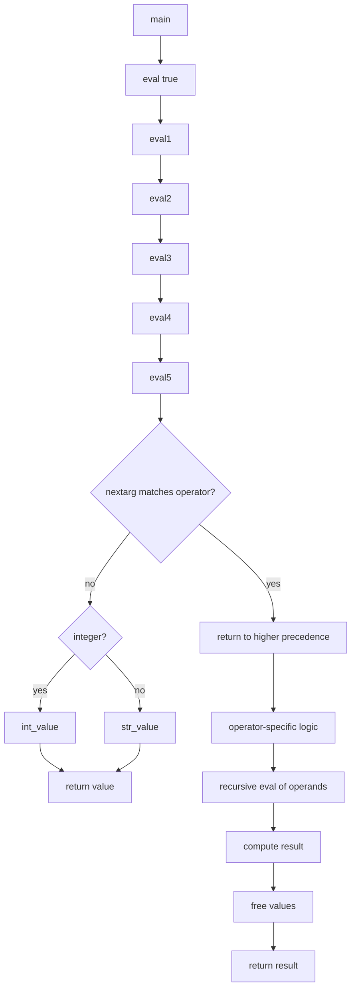

# `expr`: evaluate expressions

Source: `src/expr.c` (970 lines) · Tests: `tests/expr/` ·
Manual: `info '(coreutils) expr invocation'`

`expr` evaluates expressions given as command-line arguments. Each token must
be a separate argument. It supports arithmetic, string operations, comparisons,
regex matching, and logical operators. Values can be integers (using GMP for
arbitrary precision) or strings. The parser uses recursive descent with
operator precedence: `|` (lowest), `&`, comparisons, arithmetic, `:`, and
parentheses.

## Options

No options besides `--help` and `--version` (handled by `parse_long_options`).

## Code map

|| Function | Location | Role |
||---|---|---|
|| `main` | `src/expr.c:305` | Initialize, call `eval`, print result, exit with status based on null/zero |
|| `eval` | `:943` | Handle `|` operator (logical OR) |
|| `eval1` | `:915` | Handle `&` operator (logical AND) |
|| `eval2` | `:828` | Handle comparison operators |
|| `eval3` | `:758` | Handle arithmetic operators |
|| `eval4` | `:687` | Handle `:` operator (regex match), `match`, `index`, `length`, `substr` |
|| `eval5` | `:560` | Handle primary expressions: integers, strings, `+` prefix, parentheses |
|| `docolon` | `:565` | Implement regex matching |
|| `int_value` | `:348` | Create integer VALUE from unsigned long |
|| `str_value` | `:359` | Create string VALUE |
|| `tostring` | `:368` | Convert integer VALUE to string |
|| `printv` | `:386` | Print VALUE to stdout |
|| `null` | `:393` | Test if VALUE is null or zero |
|| `freev` | `:402` | Free VALUE resources |
|| `mbs_logical_cspn` | `:115` | Find character in string (logical character index) |
|| `mbs_logical_substr` | `:165` | Extract substring (logical character positions) |
|| `mbs_offset_to_chars` | `:215` | Count logical characters in byte offset |
|| `usage` | `:226` | Help message |

## How it works

### Expression evaluation

The parser is recursive descent with precedence levels
(`src/expr.c:943-969`):

- **`eval`:** Handles `|` (logical OR). Returns left operand if non-null,
  otherwise right operand.
- **`eval1`:** Handles `&` (logical AND). Returns left operand if both
  non-null, otherwise 0.
- **`eval2`:** Handles comparisons (`<`, `<=`, `=`, `!=`, `>=`, `>`).
  Compares as integers if both look like integers, else lexicographically
  with `strcoll` (`src/expr.c:876-892`).
- **`eval3`:** Handles arithmetic (`+`, `-`, `*`, `/`, `%`). Uses GMP for
  arbitrary-precision arithmetic.
- **`eval4`:** Handles regex match (`:`), `match`, `index`, `length`, `substr`.
- **`eval5`:** Handles primaries: integers, strings, `+` prefix (force string),
  parentheses.

### Regex matching

The `:` operator and `match` function call `docolon`
(`src/expr.c:565-628`). It compiles the regex and searches the string. If
the pattern contains `\(` and `\)`, it returns the matched substring; otherwise,
it returns the number of matched characters or 0.

### String operations

- **`substr STRING POS LENGTH`:** Extracts substring using
  `mbs_logical_substr` for multi-byte character positions
  (`src/expr.c:165-204`).
- **`index STRING CHARS`:** Finds first character from CHARS in STRING using
  `mbs_logical_cspn` (`src/expr.c:115-155`).
- **`length STRING`:** Returns string length in logical characters.

### Multi-byte support

String operations work on logical character positions, not byte offsets.
`mbs_logical_cspn`, `mbs_logical_substr`, and `mbs_offset_to_chars` handle
multi-byte character boundaries using `mcel_scanz` (`src/expr.c:115-221`).

### Exit status

`main` exits with 0 if the result is non-null and non-zero, 1 if null or zero,
2 for syntax errors, and 3 for internal errors (`src/expr.c:342`).

## Platform notes

`expr` uses GMP for arbitrary-precision arithmetic. Multi-byte character
handling uses gnulib functions. String comparisons use `strcoll` for locale
awareness, with a fallback suggestion to set `LC_ALL=C` on failure.

## Errors and exit status

- **Missing operand:** "missing operand" (exit 2)
- **Syntax error:** "syntax error: unexpected argument" (exit 2)
- **Missing argument:** "syntax error: missing argument after ARG" (exit 2)
- **String comparison failed:** "string comparison failed" with locale hint (exit 3)
- **Division by zero:** GMP error (exit 3)
- **Invalid regex:** Regex error (exit 2)

Exit status: 0 (true), 1 (false), 2 (syntax error), 3 (internal error).

## Tests

|| File | Covers |
||---|---|
|| `tests/expr/expr.pl` | Various expression evaluations |
|| `tests/expr/expr-multibyte.pl` | Multi-byte character operations |

## See also

- [test](test.md) for shell expression testing
