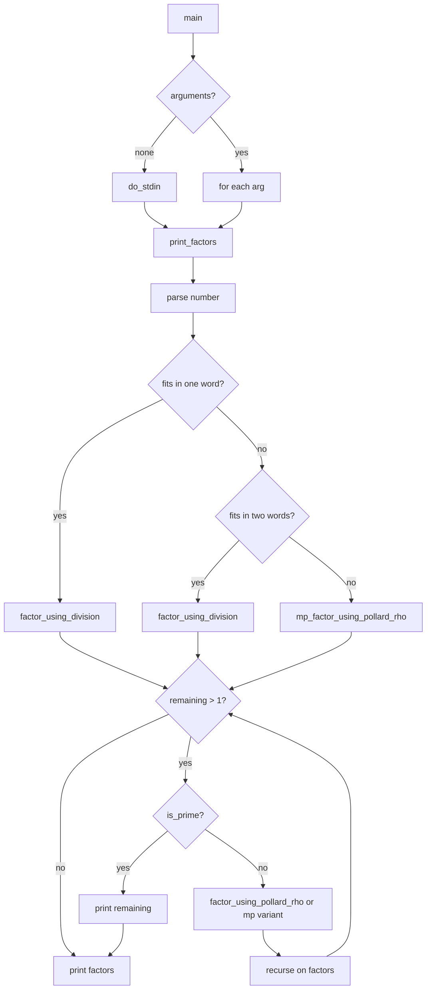

# `factor`: print prime factors

Source: `src/factor.c` (2057 lines) · Tests: `tests/factor/` ·
Manual: `info '(coreutils) factor invocation'`

`factor` prints the prime factors of integers. It uses a sophisticated algorithm:
trial division with a small primes table (using precomputed modular inverses),
Baillie-PSW primality testing, and Pollard-Brent rho for remaining composites.
It supports single-word, two-word, and arbitrary-precision numbers (with GMP).
The code uses Hensel norm for faster division and Montgomery multiplication for
the Pollard-Brent algorithm.

## Options

|| Option | Variables |
||---|---|
|| `--debug` | `dev_debug = true`: debug mode (undocumented) |

## Code map

|| Function | Location | Role |
||---|---|---|
|| `main` | `src/factor.c:2004` | Option parsing, call `do_stdin` or `print_factors` for each argument |
|| `print_factors` | `:1945` | Parse number, dispatch to appropriate factoring function, print result |
|| `do_stdin` | `:1985` | Read tokens from stdin, call `print_factors` for each |
|| `factor_using_division` | `:730` | Trial division using small primes table |
|| `factor_using_pollard_rho` | `:1160` | Pollard-Brent rho algorithm |
|| `mp_factor_using_pollard_rho` | `:1319` | GMP variant of Pollard-Brent rho |
|| `is_prime` | `:596` | Baillie-PSW primality test |
|| `mp_is_prime` | `:1419` | GMP variant of primality test |
|| `lbuf_flush` | `:1708` | Flush output buffer |
|| `lbuf_write` | `:1724` | Write to output buffer with atomic line writes |
|| `usage` | `:2016` | Help message |

## How it works

### Factoring algorithm

The algorithm has three main phases (`src/factor.c:40-48`):

1. **Trial division:** Uses a table of small primes with precomputed modular
   inverses for fast divisibility testing without hardware division
   (`factor_using_division`, `src/factor.c:730-896`).
2. **Baillie-PSW:** Checks if the remaining factor is prime using a
   combination of Miller-Rabin base 2 and Lucas tests (`is_prime`,
   `src/factor.c:596-727`).
3. **Pollard-Brent rho:** Factors remaining composites using the Pollard-Brent
   rho algorithm with Montgomery multiplication
   (`factor_using_pollard_rho`, `src/factor.c:1160-1306`).

### Word size variants

Functions have variants for different integer sizes:
- **Single word:** `factor_using_division`, `factor_using_pollard_rho`, `is_prime`
- **Two words:** `factor_using_division_2`, `factor_using_pollard_rho_2`
- **GMP arbitrary precision:** `mp_factor_using_pollard_rho`, `mp_is_prime`

The word size is `mp_limb_t` from GMP, typically 64 bits.

### Trial division

The small primes table stores primes with their modular inverses
(`src/factor.c:400-528`). Division uses these inverses to test divisibility
without hardware division: `if (n * inv < B)` indicates divisibility.

### Pollard-Brent rho

The Pollard-Brent rho algorithm uses Montgomery's trick: multiply all
residues by the word base to enable cheap Hensel reductions modulo n
(`src/factor.c:1160-1306`). The GMP variant is slower but handles arbitrary
precision.

### Output buffering

Output uses a line buffer (`lbuf_buf`) sized for atomic pipe writes
(`src/factor.c:1703-1802`). `lbuf_write` ensures complete lines are written
atomically when possible. This supports parallel operation.

## Platform notes

`factor` uses GMP for arbitrary-precision arithmetic. The word size is
`mp_limb_t` from GMP. The code includes a standalone `longlong.h` for
multi-word arithmetic on platforms without GMP's version.

## Errors and exit status

- **Invalid number:** "invalid number" (exit 1)
- **Overflow:** "overflow" (exit 1)

Exit status is 0 on success, 1 on any error.

## Tests

|| File | Covers |
||---|---|
|| `tests/factor/factor.pl` | Basic factoring |
|| `tests/factor/factor-parallel.sh` | Parallel operation |
|| `tests/factor/mulredc2-infloop.sh` | Edge case handling |
|| `tests/factor/create-test.sh` | Test generation |
|| `tests/factor/run.sh` | Test runner |

## See also

- [seq](seq.md) for generating number sequences
