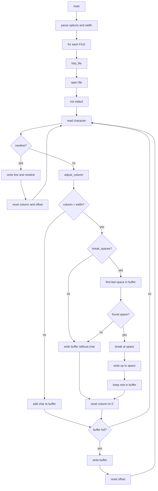

# `fold`: wrap input lines to fit width

Source: `src/fold.c` (349 lines) · Tests: `tests/fold/` ·
Manual: `info '(coreutils) fold invocation'`

`fold` wraps each input line to fit within a specified width. It counts columns
(default), bytes, or characters. Backspace decrements the column, carriage return
resets it, and tabs advance to the next tab stop. With `-s`, it breaks at
whitespace when possible. It uses `mbbuf` for multi-byte character handling.

## Options

The table lists `longopts[]` (`src/fold.c:55-64`) and the short-option
string `"bcsw:0::1::2::3::4::5::6::7::8::9::"`.

|| Option | Variables |
||---|---|
|| `-b`, `--bytes` | `counting_mode = COUNT_BYTES`: count bytes |
|| `-c`, `--characters` | `counting_mode = COUNT_CHARACTERS`: count characters (width 1 each) |
|| `-s`, `--spaces` | `break_spaces = true`: break at whitespace |
|| `-w WIDTH`, `--width=WIDTH` | Width for wrapping (default 80) |
|| `-N` (single digit) | Width = N |

## Code map

|| Function | Location | Role |
||---|---|---|
|| `main` | `src/fold.c:275` | Option parsing, validate width, call `fold_file` for each file |
|| `fold_file` | `:148` | Read input, wrap lines at width, write output |
|| `adjust_column` | `:112` | Calculate new column position for a character |
|| `write_out` | `:136` | Write buffer to stdout |
|| `usage` | `:67` | Help message |

## How it works

### Column calculation

`adjust_column` computes the column position for the next character
(`src/fold.c:112-133`):

- **Backspace:** Decrement column (if not zero).
- **Carriage return:** Reset column to 0.
- **Tab:** Advance to next tab stop (column + 8 - column % 8).
- **Other:** Add display width from `c32width` (default 1 for invalid/zero-width).

In byte mode, simply add the byte length.

### Line wrapping

`fold_file` reads characters and buffers them (`src/fold.c:148-272`).
When adding a character would exceed the width:

- **Without `-s`:** Write the buffer (excluding the character) and start a new line.
- **With `-s`:** Scan backward for the last space. If found, break at the space;
  otherwise, break at the width.

The buffer is flushed when full or when a newline is encountered.

### Multi-byte support

`fold` uses `mbbuf` from gnulib for multi-byte character reading
(`src/fold.c:156-173`). Character widths use `c32width`.

## Platform notes

`fold` uses `mbbuf` and `c32width` from gnulib for multi-byte support.
Tab width is fixed at 8.

## Errors and exit status

- **Invalid width:** Error from `xdectoint`
- **File open failure:** Error from `quotef(FILE)`
- **Write error:** From `write_error`

Exit status is 0 on success, 1 on any error.

## Tests

|| File | Covers |
||---|---|
|| `tests/fold/fold.pl` | Basic wrapping scenarios |
|| `tests/fold/fold-spaces.sh` | `-s` option |
|| `tests/fold/fold-characters.sh` | `-c` option |
|| `tests/fold/fold-nbsp.sh` | Non-breaking spaces |
|| `tests/fold/fold-zero-width.sh` | Zero width edge case |
|| `tests/fold/multiple-files.sh` | Multiple file handling |

## See also

- [fmt](fmt.md) for text formatting with word wrapping
