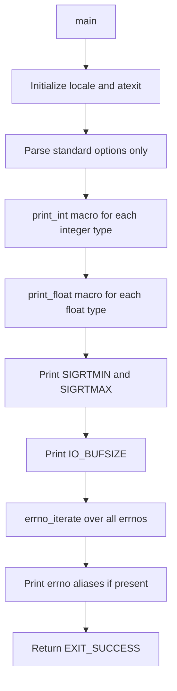

# `getlimits`: print platform-dependent limits

Source: `src/getlimits.c` · Manual: `info '(coreutils) getlimits invocation'`

`getlimits` outputs platform-dependent type limits in a format suitable for shell scripts. It prints minimum and maximum values for integer types, floating-point types, signal ranges, I/O buffer size, and all errno constants. This is primarily a test support tool: the `getlimits_` function in `init.cfg` runs it and evals its output to set environment variables like `$INT_MAX` and `$UINTMAX_OFLOW` for use in other tests.

## Options

| Option | Description |
|--------|-------------|
| `--help` | Display help and exit |
| `--version` | Output version information |

No other options are accepted.

## Code map

| Function | Location | Role |
|----------|----------|------|
| `main` | `src/getlimits.c:144-225` | Print all limits using macros |
| `print_FLT` | `src/getlimits.c:130-132` | Print float limits (generated by macro) |
| `print_DBL` | `src/getlimits.c:131-132` | Print double limits (generated by macro) |
| `print_LDBL` | `src/getlimits.c:132-133` | Print long double limits (generated by macro) |
| `print_errno` | `src/getlimits.c:134-142` | Print one errno constant |
| `decimal_absval_add_one` | `src/getlimits.c:105-119` | Add one to absolute value for overflow/underflow |
| `usage` | `src/getlimits.c:79-99` | Print usage message |

## How it works

The main function uses macros to iterate over all relevant types and print their limits.



### Integer limits

The `print_int` macro prints four values for each integer type: `_MAX`, `_OFLOW` (one more than max), `_MIN`, and `_UFLOW` (one less than min). For unsigned types, only `_MAX` and `_OFLOW` are printed. The macro uses `sprintf` with `uintmax_t` or `intmax_t` casts to handle all integer sizes uniformly (`src/getlimits.c:162-171`).

### Overflow/underflow calculation

`decimal_absval_add_one` takes the decimal string representation of a limit, adds one to its absolute value in-place, and returns the result. This handles both positive and negative numbers, and grows the string if needed (e.g., `99` becomes `100`) (`src/getlimits.c:105-119`).

### Floating-point limits

The `print_float` macro calls type-specific functions generated by the `PRINT_FLOATTYPE` macro, which uses gnulib's `ftoastr` functions to convert floating-point limits to strings (`src/getlimits.c:121-132`, `src/getlimits.c:173-175`).

### Errno constants

`errno_iterate` from gnulib iterates over all errno values, calling `print_errno` for each. `print_errno` uses `strerrorname_np` to get the errno name (e.g., `EINTR`) and `strerror` to get the description, then prints them in shell-escaped format (`src/getlimits.c:134-142`, `src/getlimits.c:209`). Aliases like `ENOTEMPTY` are printed conditionally if they equal another errno on the platform (`src/getlimits.c:211-222`).

## Platform notes

- Uses `TYPE_MAXIMUM` and `TYPE_MINIMUM` macros from gnulib for portability
- Defines fallbacks for types that may not have standard macros (`TIME_T_MIN`, `SSIZE_MIN`, `PID_T_MIN`, `OFF64_T_MIN/MAX`)
- Handles `SIGRTMIN`/`SIGRTMAX` with defaults if not defined
- Unsigned type minimums are defined as 0 and not printed
- The `configure` script sets `_FILE_OFFSET_BITS=64` via `config.h` for large file support

## Errors and exit status

| Error | Exit status |
|-------|-------------|
| Write error on stdout | EXIT_FAILURE (via close_stdout) |
| Success | EXIT_SUCCESS |

## Tests

`getlimits` has no dedicated test file. It is used extensively throughout the test suite via the `getlimits_` helper function in `init.cfg`, which runs it and evals its output to set environment variables. Tests that need to check limit behavior call `getlimits_` to populate variables like `$INT_MAX`, `$SSIZE_MAX`, `$UINTMAX_OFLOW`, etc.

## See also

- [`printf`](printf.md) - Format and print data (similar formatting concepts)
- [`expr`](expr.md) - Evaluate expressions (uses similar type handling)

## Source code

`src/getlimits.c:1`

```c
/* getlimits - print various platform dependent limits.
   Copyright (C) 2008-2026 Free Software Foundation, Inc.

   This program is free software: you can redistribute it and/or modify
   it under the terms of the GNU General Public License as published by
   the Free Software Foundation, either version 3 of the License, or
   (at your option) any later version.

   This program is distributed in the hope that it will be useful,
   but WITHOUT ANY WARRANTY; without even the implied warranty of
   MERCHANTABILITY or FITNESS FOR A PARTICULAR PURPOSE.  See the
   GNU General Public License for more details.

   You should have received a copy of the GNU General Public License
   along with this program.  If not, see <https://www.gnu.org/licenses/>.  */

/* Written by Pádraig Brady  */

#include <config.h>             /* sets _FILE_OFFSET_BITS=64 etc. */
#include <signal.h>
#include <stdio.h>
#include <sys/types.h>
#include <float.h>

#include "errno-iter.h"
#include "ftoastr.h"
#include "system.h"
#include "ioblksize.h"
#include "long-options.h"

#define PROGRAM_NAME "getlimits"

#define AUTHORS proper_name_lite ("Padraig Brady", "P\303\241draig Brady")

#ifndef TIME_T_MAX
# define TIME_T_MAX TYPE_MAXIMUM (time_t)
#endif

#ifndef TIME_T_MIN
# define TIME_T_MIN TYPE_MINIMUM (time_t)
#endif

#ifndef SSIZE_MIN
# define SSIZE_MIN TYPE_MINIMUM (ssize_t)
#endif

#ifndef PID_T_MIN
# define PID_T_MIN TYPE_MINIMUM (pid_t)
#endif

#ifndef OFF64_T_MAX
# define OFF64_T_MAX TYPE_MAXIMUM (off64_t)
#endif

#ifndef OFF64_T_MIN
# define OFF64_T_MIN TYPE_MINIMUM (off64_t)
#endif

#ifndef SIGRTMIN
# define SIGRTMIN 0
# undef SIGRTMAX
#endif
#ifndef SIGRTMAX
# define SIGRTMAX (SIGRTMIN - 1)
#endif

/* These are not interesting to print.
 * Instead of these defines it would be nice to be able to do
 * #ifdef (TYPE##_MIN) in function macro below.  */
#define SIZE_MIN 0
#define UCHAR_MIN 0
#define USHRT_MIN 0
#define UINT_MIN 0
#define ULONG_MIN 0
#define UINTMAX_MIN 0
#define UID_T_MIN 0
#define GID_T_MIN 0

void
usage (int status)
{
  if (status != EXIT_SUCCESS)
    emit_try_help ();
  else
    {
      printf (_("\
Usage: %s\n\
"), program_name);

      fputs (_("\
Output platform dependent limits in a format useful for shell scripts.\n\
\n\
"), stdout);
      fputs (HELP_OPTION_DESCRIPTION, stdout);
      fputs (VERSION_OPTION_DESCRIPTION, stdout);
      emit_ancillary_info (PROGRAM_NAME);
    }
  exit (status);
}

/* Add one to the absolute value of the number whose textual
   representation is BUF + 1.  Do this in-place, in the buffer.
   Return a pointer to the result, which is normally BUF + 1, but is
   BUF if the representation grew in size.  */
static char const *
decimal_absval_add_one (char *buf)
{
  bool negative = (buf[1] == '-');
  char *absnum = buf + 1 + negative;
  char *p = absnum + strlen (absnum);
  absnum[-1] = '0';
  while (*--p == '9')
    *p = '0';
  ++*p;
  char *result = MIN (absnum, p);
  if (negative)
    *--result = '-';
  return result;
}

#define PRINT_FLOATTYPE(N, T, FTOASTR, BUFSIZE)                         \
static void                                                             \
N (T x)                                                                 \
{                                                                       \
  char buf[BUFSIZE];                                                    \
  FTOASTR (buf, sizeof buf, FTOASTR_LEFT_JUSTIFY, 0, x);                \
  puts (buf);                                                           \
}

PRINT_FLOATTYPE (print_FLT, float, ftoastr, FLT_BUFSIZE_BOUND)
PRINT_FLOATTYPE (print_DBL, double, dtoastr, DBL_BUFSIZE_BOUND)
PRINT_FLOATTYPE (print_LDBL, long double, ldtoastr, LDBL_BUFSIZE_BOUND)

static int
print_errno (void *name, int e)
{
  char const *err_name = name ? name : strerrorname_np (e);
  if (err_name)
    printf ("%s=%s\n", err_name,
            quotearg_style (shell_escape_quoting_style, strerror (e)));
  return 0;
}

int
main (int argc, char **argv)
{
  char limit[1 + MAX (INT_BUFSIZE_BOUND (intmax_t),
                      INT_BUFSIZE_BOUND (uintmax_t))];

  initialize_main (&argc, &argv);
  set_program_name (argv[0]);
  setlocale (LC_ALL, "");
  bindtextdomain (PACKAGE, LOCALEDIR);
  textdomain (PACKAGE);

  atexit (close_stdout);

  parse_gnu_standard_options_only (argc, argv, PROGRAM_NAME, PACKAGE_NAME,
                                   VERSION, true, usage, AUTHORS,
                                   (char const *) NULL);

#define print_int(TYPE)                                                  \
  sprintf (limit + 1, "%ju", (uintmax_t) {TYPE##_MAX});                  \
  printf (#TYPE"_MAX=%s\n", limit + 1);                                  \
  printf (#TYPE"_OFLOW=%s\n", decimal_absval_add_one (limit));           \
  if (TYPE##_MIN)                                                        \
    {                                                                    \
      sprintf (limit + 1, "%jd", (intmax_t) {TYPE##_MIN});               \
      printf (#TYPE"_MIN=%s\n", limit + 1);                              \
      printf (#TYPE"_UFLOW=%s\n", decimal_absval_add_one (limit));       \
    }

#define print_float(TYPE)                                                \
  printf (#TYPE"_MIN="); print_##TYPE (TYPE##_MIN);                      \
  printf (#TYPE"_MAX="); print_##TYPE (TYPE##_MAX);

  /* Variable sized ints */
  print_int (CHAR);
  print_int (SCHAR);
  print_int (UCHAR);
  print_int (SHRT);
  print_int (USHRT);
  print_int (INT);
  print_int (UINT);
  print_int (LONG);
  print_int (ULONG);
  print_int (SIZE);
  print_int (SSIZE);
  print_int (TIME_T);
  print_int (UID_T);
  print_int (GID_T);
  print_int (PID_T);
  print_int (OFF_T);
  print_int (OFF64_T);
  print_int (INTMAX);
  print_int (UINTMAX);

  /* Variable sized floats */
  print_float (FLT);
  print_float (DBL);
  print_float (LDBL);

  /* Other useful constants */
  printf ("SIGRTMIN=%jd\n", (intmax_t) {SIGRTMIN});
  printf ("SIGRTMAX=%jd\n", (intmax_t) {SIGRTMAX});
  printf ("IO_BUFSIZE=%ju\n", (uintmax_t) {IO_BUFSIZE});

  /* Errnos */
  errno_iterate (print_errno, NULL);
  /* Common errno aliases */
#if defined ENOTEMPTY && ENOTEMPTY == EEXIST
  print_errno ((char*)"ENOTEMPTY", EEXIST);
#endif
#if defined ENOTSUP && ENOTSUP == EOPNOTSUPP
  print_errno ((char*)"ENOTSUP", EOPNOTSUPP);
#endif
#if defined EWOULDBLOCK && EWOULDBLOCK == EAGAIN
  print_errno ((char*)"EWOULDBLOCK", EAGAIN);
#endif
#if defined EDEADLOCK && EDEADLOCK == EDEADLK
  print_errno ((char*)"EDEADLOCK", EDEADLK);
#endif

  return EXIT_SUCCESS;
}
```
