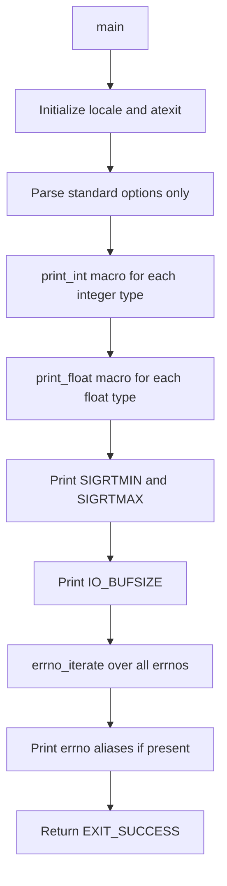

# `getlimits`: print platform-dependent limits

Source: `src/getlimits.c` · Manual: `info '(coreutils) getlimits invocation'`

`getlimits` outputs platform-dependent type limits in a format suitable for shell scripts. It prints minimum and maximum values for integer types, floating-point types, signal ranges, I/O buffer size, and all errno constants. This is primarily a test support tool: the `getlimits_` function in `init.cfg` runs it and evals its output to set environment variables like `$INT_MAX` and `$UINTMAX_OFLOW` for use in other tests.

## Options

| Option | Description |
|--------|-------------|
| `--help` | Display help and exit |
| `--version` | Output version information |

No other options are accepted.

## Code map

| Function | Location | Role |
|----------|----------|------|
| `main` | `src/getlimits.c:144-225` | Print all limits using macros |
| `print_FLT` | `src/getlimits.c:130-132` | Print float limits (generated by macro) |
| `print_DBL` | `src/getlimits.c:131-132` | Print double limits (generated by macro) |
| `print_LDBL` | `src/getlimits.c:132-133` | Print long double limits (generated by macro) |
| `print_errno` | `src/getlimits.c:134-142` | Print one errno constant |
| `decimal_absval_add_one` | `src/getlimits.c:105-119` | Add one to absolute value for overflow/underflow |
| `usage` | `src/getlimits.c:79-99` | Print usage message |

## How it works

The main function uses macros to iterate over all relevant types and print their limits.

### Integer limits

The `print_int` macro prints four values for each integer type: `_MAX`, `_OFLOW` (one more than max), `_MIN`, and `_UFLOW` (one less than min). For unsigned types, only `_MAX` and `_OFLOW` are printed. The macro uses `sprintf` with `uintmax_t` or `intmax_t` casts to handle all integer sizes uniformly (`src/getlimits.c:162-171`).

### Overflow/underflow calculation

`decimal_absval_add_one` takes the decimal string representation of a limit, adds one to its absolute value in-place, and returns the result. This handles both positive and negative numbers, and grows the string if needed (e.g., `99` becomes `100`) (`src/getlimits.c:105-119`).

### Floating-point limits

The `print_float` macro calls type-specific functions generated by the `PRINT_FLOATTYPE` macro, which uses gnulib's `ftoastr` functions to convert floating-point limits to strings (`src/getlimits.c:121-132`, `src/getlimits.c:173-175`).

### Errno constants

`errno_iterate` from gnulib iterates over all errno values, calling `print_errno` for each. `print_errno` uses `strerrorname_np` to get the errno name (e.g., `EINTR`) and `strerror` to get the description, then prints them in shell-escaped format (`src/getlimits.c:134-142`, `src/getlimits.c:209`). Aliases like `ENOTEMPTY` are printed conditionally if they equal another errno on the platform (`src/getlimits.c:211-222`).

## Platform notes

- Uses `TYPE_MAXIMUM` and `TYPE_MINIMUM` macros from gnulib for portability
- Defines fallbacks for types that may not have standard macros (`TIME_T_MIN`, `SSIZE_MIN`, `PID_T_MIN`, `OFF64_T_MIN/MAX`)
- Handles `SIGRTMIN`/`SIGRTMAX` with defaults if not defined
- Unsigned type minimums are defined as 0 and not printed
- The `configure` script sets `_FILE_OFFSET_BITS=64` via `config.h` for large file support

## Errors and exit status

| Error | Exit status |
|-------|-------------|
| Write error on stdout | EXIT_FAILURE (via close_stdout) |
| Success | EXIT_SUCCESS |

## Tests

`getlimits` has no dedicated test file. It is used extensively throughout the test suite via the `getlimits_` helper function in `init.cfg`, which runs it and evals its output to set environment variables. Tests that need to check limit behavior call `getlimits_` to populate variables like `$INT_MAX`, `$SSIZE_MAX`, `$UINTMAX_OFLOW`, etc.

## See also

- [`printf`](printf.md) - Format and print data (similar formatting concepts)
- [`expr`](expr.md) - Evaluate expressions (uses similar type handling)
