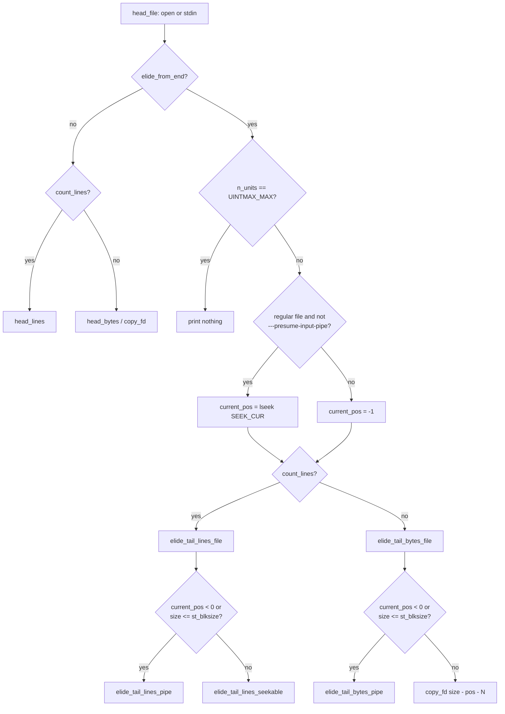

# `head`: print the first part of files

Source: `src/head.c` (1080 lines) · Tests: `tests/head/` · Manual:
`info '(coreutils) head invocation'`

`head` copies the first N lines or bytes of each file to standard output.
With a leading `-` (`-n -N`, `-c -N`) it does the opposite: it prints
everything **except** the last N lines or bytes. Most of the code is for
this "elide the tail" mode. It has separate methods for seekable files and
for pipes. Another important detail: after `head` stops, it leaves the
file offset just after the data it printed. This lets
`(head -n 1; cat) < file` work as expected.

## Options

The table lists the entries in `long_options[]` (`src/head.c:86-99`) and the
short-option string `"c:n:qvz0123456789"`.

| Option | Variable set | Notes |
|---|---|---|
| `-c`, `--bytes=[-]NUM` | `count_lines = false`, `elide_from_end` | `NUM` takes the suffixes `b kB K MB M ... Q`, and `KiB`, `MiB` and so on. |
| `-n`, `--lines=[-]NUM` | `count_lines = true`, `elide_from_end` | The default is `DEFAULT_NUMBER` (10). |
| `-q`, `--quiet`, `--silent` | `header_mode = never` | |
| `-v`, `--verbose` | `header_mode = always` | |
| `-z`, `--zero-terminated` | `line_end = '\0'` | |
| `---presume-input-pipe` | `presume_input_pipe = true` | Hidden. It is for tests only: it makes `head` use the pipe method on regular files too. |
| `-NUM[bcklmqvz]` (first argument only) | | Obsolete syntax, parsed by hand at `src/head.c:946-1012`. For example, `head -5c` means `head -c 5`. |

`string_to_integer()` (`src/head.c:905`) calls `xnumtoumax` with
`XTOINT_MAX_QUIET`. A number too large to store becomes `UINTMAX_MAX`
with no error, and that value means "no limit".

## Code map

| Function | Location | Role |
|---|---|---|
| `main` | `src/head.c:915` | Parse options, decide whether to print headers, call `head_file` for each operand. |
| `head_file` | `:864` | Open the file (or use stdin for `-`), call `head`, close. |
| `head` | `:826` | Print a header if needed. Choose between the four methods below. |
| `head_lines` | `:789` | First N lines. |
| `head_bytes` | `:778` | First N bytes (calls `copy_fd`). |
| `elide_tail_lines_file` | `:758` | All but the last N lines. Chooses the seekable or pipe method. |
| `elide_tail_lines_seekable` | `:651` | Scan backwards from the end of the file to find the cut point. |
| `elide_tail_lines_pipe` | `:501` | Keep a linked list of buffers until N lines are held back. |
| `elide_tail_bytes_file` | `:468` | All but the last N bytes, using `st_size` when it can be trusted. |
| `elide_tail_bytes_pipe` | `:265` | Ring buffer that holds back N bytes. |
| `copy_fd` | `:206` | Copy exactly N bytes from a descriptor to stdout. |
| `xwrite_stdout` | `:191` | `fwrite`, and exit at once if the write fails. |
| `elseek` | `:247` | `lseek` with a diagnostic. |

## How it works

The diagram shows how `head()` chooses one of the four methods.



### First N lines and the file offset

`head_lines` reads in `BUFSIZ` blocks and counts `line_end` bytes. When it
finds the last line it wants, it may already have read past it. So it seeks
back by the extra amount (`src/head.c:805-819`):

```c
while (bytes_to_write < bytes_read)
  if (buffer[bytes_to_write++] == line_end && --lines_to_write == 0)
    {
      off_t n_bytes_past_EOL = bytes_read - bytes_to_write;
      /* If we have read more data than that on the specified number
         of lines, try to seek back to the position we would have
         gotten to had we been reading one byte at a time.  */
      if (lseek (fd, -n_bytes_past_EOL, SEEK_CUR) < 0)
        {
          struct stat st;
          if (fstat (fd, &st) != 0 || S_ISREG (st.st_mode))
            elseek_diagnostic (-n_bytes_past_EOL, SEEK_CUR, filename);
        }
      break;
    }
```

The seek fails on a pipe, and the code ignores that failure. It reports the
failure only for a regular file, where the seek should work.
`tests/head/head-pos.sh` checks this behaviour.

### All but the last N lines, seekable input

When the input is a regular file larger than one block,
`elide_tail_lines_seekable` reads `BUFSIZ` blocks **backwards** from the
end. It uses `memrchr` to count newlines. The first read is the partial
block at the end, so later reads fall on `BUFSIZ` boundaries. When it has
found N newlines, it seeks back to the start position, copies everything
up to that point with `copy_fd`, and sets the offset just past the output.
A comment says this code is "very similar" to `file_lines()` in
`src/tail.c`.

### All but the last N lines, pipes

`elide_tail_lines_pipe` (`src/head.c:501-637`) keeps a singly linked list
of `struct linebuffer { char buffer[BUFSIZ + 1]; size_t nbytes, nlines;
... }`. When a new buffer is added and the list holds more than N lines
without the oldest buffer, it prints the oldest buffer and uses it again.
Small reads (common on pipes) are appended to the last buffer, so there are
fewer nodes. At end of file it counts a final line that has no newline,
prints the full buffers that are safe to print, and then prints part of
the next buffer.

### All but the last N bytes, pipes

`elide_tail_bytes_pipe` chooses one of two methods, depending on
`HEAD_TAIL_PIPE_BYTECOUNT_THRESHOLD` (1 MiB by default):

- **N ≤ 1 MiB:** it allocates two buffers of `READ_BUFSIZE + N` bytes and
  switches between them. In each round it prints the N held-back bytes from
  the previous buffer and all but the last N bytes of the current one.
- **N > 1 MiB:** a ring of `N / READ_BUFSIZE + 2` blocks of `READ_BUFSIZE`
  bytes each. Blocks are allocated only when needed. So a huge N on a small
  input does not use up memory (see the "CAUTION" comment at
  `src/head.c:296`).

`tests/head/head-elide-tail.pl` tests these paths. With
`RUN_EXPENSIVE_TESTS=yes` it tries every input size from 0 to 20 with every
N from 0 to 20, with and without `---presume-input-pipe`. A comment
suggests you rebuild `head` with `-DHEAD_TAIL_PIPE_READ_BUFSIZE=4
-DHEAD_TAIL_PIPE_BYTECOUNT_THRESHOLD=8` to test the large-N ring at these
small sizes.

### All but the last N bytes, regular files

When `st_size` can be trusted (a regular file larger than `st_blksize`),
`elide_tail_bytes_file` just copies `size - current_pos - N` bytes. If the
file shrinks during the copy, `copy_fd` returns `COPY_FD_UNEXPECTED_EOF`
and `head` prints "file has shrunk too much". Files no larger than
`st_blksize` take the pipe method. The source does not say why. A likely
reason is that small files in `/proc` and `/sys` often report a size of 0
or one page.

## Errors and exit status

- Any open, read, seek or close error on one file is reported. `head` goes
  on to the next file, and the final exit status is 1.
- A write error to stdout exits at once (`xwrite_stdout`). It calls
  `fpurge (stdout)` so that `close_stdout` does not report the error again.
- `-n 0` and `-c 0` still open each file. `tests/head/head-n0.sh` checks
  that a missing file gives an error.
- If stdin was read and cannot be closed, `head` exits with status 1.

## Tests

| File | Covers |
|---|---|
| `tests/head/head.pl` | Main option and output cases, including the obsolete `-NUM` forms. |
| `tests/head/head-elide-tail.pl` | `--bytes=-N` and `--lines=-N` across buffer sizes. It is long-running. |
| `tests/head/head-c.sh` | `-c` offset handling, and a huge `-c -N` under `ulimit -v`. |
| `tests/head/head-n0.sh` | `-n 0` and `-c 0` still open files. |
| `tests/head/head-pos.sh` | The file offset is left just after the output. |
| `tests/head/head-write-error.sh` | Stop at the first write error (`/dev/full`). |
| `tests/head/quote-headers.sh` | File names in `==> name <==` headers are quoted (changed in 9.12). |

## See also

- [tail](tail.md): the reverse operation. `file_lines()` has a similar
  backwards scan.
- [Program skeleton](../overview/program-skeleton.md) for the option-parsing
  pattern.
