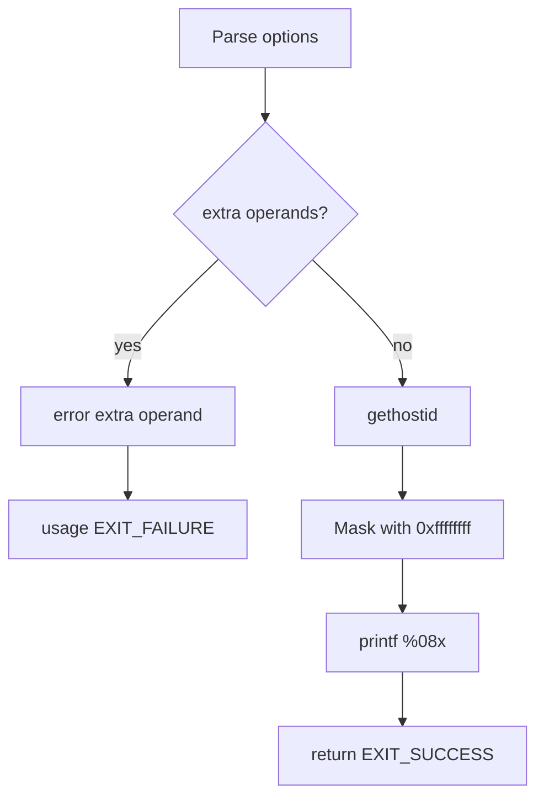

# `hostid`: print host identifier

Source: `src/hostid.c` (81 lines) · Tests: `tests/misc/hostid.sh` ·
Manual: `info '(coreutils) hostid invocation'`

`hostid` prints the numeric identifier of the current host in hexadecimal.
It calls `gethostid` to get the identifier, masks it to 32 bits, and formats it
as 8 hexadecimal digits.

## Options

No options other than `--help` and `--version`. Uses `parse_gnu_standard_options_only`
(`src/hostid.c:63-65`).

## Code map

|| Function | Location | Role |
||---|---|---|
|| `main` | `src/hostid.c:53` | Call `gethostid`, mask to 32 bits, print in hex. |
|| `usage` | `:33` | Help text. |

## How it works

The diagram shows the simple flow.



`main` calls `gethostid` to get the host identifier (`src/hostid.c:76`). It
masks the result with `0xffffffff` to ensure it's a 32-bit value (POSIX says
`gethostid` returns a 32-bit identifier but is silent on sign-extension). The
result is printed as 8 hexadecimal digits with leading zeros.

## Platform notes

- `gethostid` may return different values on different platforms
- On some systems, `gethostid` may return 0 if the host ID is not configured

## Errors and exit status

- Extra operand: `error (0, 0, ...)` then `usage (EXIT_FAILURE)`
- Write failure: handled by `atexit (close_stdout)`

## Tests

|| File | Covers |
||---|---|
|| `tests/misc/hostid.sh` | Basic functionality, output format. |

## See also

- [hostname](hostname.md) (print or set host name)
- [uname](uname.md) (print system information)

## Source code

`src/hostid.c:1`

```c
/* print the hexadecimal identifier for the current host

   Copyright (C) 1997-2026 Free Software Foundation, Inc.

   This program is free software: you can redistribute it and/or modify
   it under the terms of the GNU General Public License as published by
   the Free Software Foundation, either version 3 of the License, or
   (at your option) any later version.

   This program is distributed in the hope that it will be useful,
   but WITHOUT ANY WARRANTY; without even the implied warranty of
   MERCHANTABILITY or FITNESS FOR A PARTICULAR PURPOSE.  See the
   GNU General Public License for more details.

   You should have received a copy of the GNU General Public License
   along with this program.  If not, see <https://www.gnu.org/licenses/>.  */

/* Written by Jim Meyering.  */

#include <config.h>
#include <stdio.h>
#include <sys/types.h>

#include "system.h"
#include "long-options.h"
#include "quote.h"

/* The official name of this program (e.g., no 'g' prefix).  */
#define PROGRAM_NAME "hostid"

#define AUTHORS proper_name ("Jim Meyering")

void
usage (int status)
{
  if (status != EXIT_SUCCESS)
    emit_try_help ();
  else
    {
      printf (_("\
Usage: %s [OPTION]\n\
Print the numeric identifier (in hexadecimal) for the current host.\n\
\n\
"), program_name);
      oputs (HELP_OPTION_DESCRIPTION);
      oputs (VERSION_OPTION_DESCRIPTION);
      emit_ancillary_info (PROGRAM_NAME);
    }
  exit (status);
}

int
main (int argc, char **argv)
{
  initialize_main (&argc, &argv);
  set_program_name (argv[0]);
  setlocale (LC_ALL, "");
  bindtextdomain (PACKAGE, LOCALEDIR);
  textdomain (PACKAGE);

  atexit (close_stdout);

  parse_gnu_standard_options_only (argc, argv, PROGRAM_NAME, PACKAGE_NAME,
                                   Version, true, usage, AUTHORS,
                                   (char const *) NULL);

  if (optind < argc)
    {
      error (0, 0, _("extra operand %s"), quote (argv[optind]));
      usage (EXIT_FAILURE);
    }

  /* POSIX says gethostid returns a "32-bit identifier" but is silent
     whether it's sign-extended.  Turn off any sign-extension.  This
     is a no-op unless unsigned int is wider than 32 bits.  */
  unsigned int id = gethostid () & 0xffffffff;

  printf ("%08x\n", id);

  return EXIT_SUCCESS;
}
```
