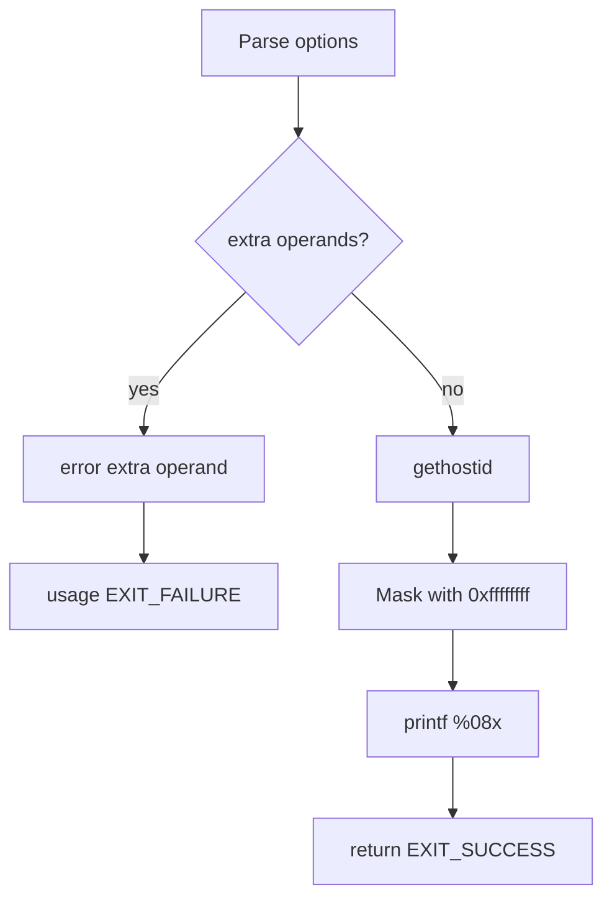

# `hostid`: print host identifier

Source: `src/hostid.c` (81 lines) · Tests: `tests/misc/hostid.sh` ·
Manual: `info '(coreutils) hostid invocation'`

`hostid` prints the numeric identifier of the current host in hexadecimal.
It calls `gethostid` to get the identifier, masks it to 32 bits, and formats it
as 8 hexadecimal digits.

## Options

No options other than `--help` and `--version`. Uses `parse_gnu_standard_options_only`
(`src/hostid.c:63-65`).

## Code map

|| Function | Location | Role |
||---|---|---|
|| `main` | `src/hostid.c:53` | Call `gethostid`, mask to 32 bits, print in hex. |
|| `usage` | `:33` | Help text. |

## How it works

The diagram shows the simple flow.

`main` calls `gethostid` to get the host identifier (`src/hostid.c:76`). It
masks the result with `0xffffffff` to ensure it's a 32-bit value (POSIX says
`gethostid` returns a 32-bit identifier but is silent on sign-extension). The
result is printed as 8 hexadecimal digits with leading zeros.

## Platform notes

- `gethostid` may return different values on different platforms
- On some systems, `gethostid` may return 0 if the host ID is not configured

## Errors and exit status

- Extra operand: `error (0, 0, ...)` then `usage (EXIT_FAILURE)`
- Write failure: handled by `atexit (close_stdout)`

## Tests

|| File | Covers |
||---|---|
|| `tests/misc/hostid.sh` | Basic functionality, output format. |

## See also

- [hostname](hostname.md) (print or set host name)
- [uname](uname.md) (print system information)
