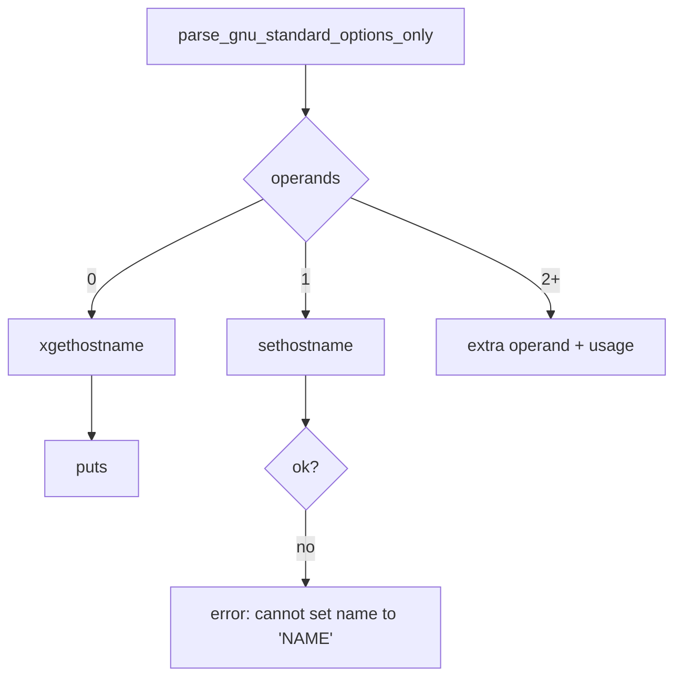

# `hostname`: print or set the system host name

Source: `src/hostname.c` (112 lines) · Tests: only the shared
`tests/help/help-version*.sh` · Manual: `info '(coreutils) hostname
invocation'`

`hostname` is one of the smallest programs in coreutils. With no operand it
prints the host name. With one operand it tries to set the host name. It is
in `disabled_by_default_progs` in `build-aux/gen-lists-of-programs.sh`, so
it is built only with `./configure --enable-install-program=hostname`.

!!! warning "Not the same as other `hostname` programs"
    GNU coreutils `hostname` has **no** options except `--help` and
    `--version`. Options such as `-f`/`--fqdn`, `-s`, `-d`, `-i` and `-F`
    come from other programs: the `net-tools` `hostname` on Linux, and the
    BSD and macOS `hostname`. Coreutils `hostname` does not check the
    format of the name and does not look anything up in DNS.

## Options

| Form | Action |
|---|---|
| `hostname` | Print the result of `xgethostname()` and a newline. |
| `hostname NAME` | Call `sethostname (NAME, strlen (NAME))`. |
| `hostname --help`, `--version` | Standard. Handled by `parse_gnu_standard_options_only`. |
| `hostname A B` | Error `extra operand 'B'`, then a usage hint. Exit status 1. |

## Code map

| Symbol | Location | Role |
|---|---|---|
| `sethostname` (fallback) | `src/hostname.c:38-48` | Defined only if `HAVE_SETHOSTNAME` is not set. It uses `sysinfo (SI_SET_HOSTNAME, ...)` on SVR4 or Solaris, or else fails with `ENOTSUP`. |
| `usage` | `:51` | `--help` text. |
| `main` | `:72` | The whole program. |

## How it works

The whole of `main` after the start-up code is shown here
(`src/hostname.c:89-111`):

```c
if (optind + 1 < argc)
   {
     error (0, 0, _("extra operand %s"), quote (argv[optind + 1]));
     usage (EXIT_FAILURE);
   }

if (optind + 1 == argc)
  {
    /* Set hostname to operand.  */
    char const *name = argv[optind];
    if (sethostname (name, strlen (name)) != 0)
      error (EXIT_FAILURE, errno, _("cannot set name to %s"),
             quote (name));
  }
else
  {
    hostname = xgethostname ();
    if (hostname == NULL)
      error (EXIT_FAILURE, errno, _("cannot determine hostname"));
    puts (hostname);
  }

main_exit (EXIT_SUCCESS);
```

The diagram shows the same flow.



Things to note:

- **Privilege checks are left to the kernel.** `hostname` does not call
  `geteuid()`. If the caller may not set the name, `sethostname` fails
  (usually with `EPERM`) and the program prints that error.
- **Getting the name.** `xgethostname()` is in gnulib
  (`lib/xgethostname.c`). It calls `gethostname()` with a buffer that it
  grows until the whole name fits. Memory exhaustion is fatal, as with all
  `x*` functions. If it returns `NULL`, `errno` holds the reason.
- **No validation.** The operand is passed to `sethostname` exactly as
  given. The kernel enforces limits such as `HOST_NAME_MAX` (64 on Linux)
  and reports `EINVAL` if the name is too long.
- Output goes through `puts` and stdio, so `close_stdout` (set with
  `atexit`) finds write errors.

## Platform notes

- `sethostname` is in the list of functions `configure` checks for
  (`m4/jm-macros.m4:71`). If the function is missing, the fallback above
  is used.
- `src/local.mk:339` links `$(GETHOSTNAME_LIB)`, which some systems need
  (for example `-lnsl`, or Winsock on Windows).

## Tests

There are no tests for this program alone. Setting the host name needs
root, and the result depends on the machine. `tests/help/help-version.sh`
and `help-version-getopt.sh` check `--help` and `--version` for every
program that was built.

## See also

- [uname](uname.md): `uname -n` prints the same node name, from
  `uname(2)`.
- [Program skeleton](../overview/program-skeleton.md).

## Source code

`src/hostname.c:1`

```c
/* hostname - set or print the name of current host system
   Copyright (C) 1994-2026 Free Software Foundation, Inc.

   This program is free software: you can redistribute it and/or modify
   it under the terms of the GNU General Public License as published by
   the Free Software Foundation, either version 3 of the License, or
   (at your option) any later version.

   This program is distributed in the hope that it will be useful,
   but WITHOUT ANY WARRANTY; without even the implied warranty of
   MERCHANTABILITY or FITNESS FOR A PARTICULAR PURPOSE.  See the
   GNU General Public License for more details.

   You should have received a copy of the GNU General Public License
   along with this program.  If not, see <https://www.gnu.org/licenses/>.  */

/* Written by Jim Meyering.  */

#include <config.h>
#include <stdio.h>
#include <sys/types.h>

#include "system.h"
#include "long-options.h"
#include "quote.h"
#include "xgethostname.h"

/* The official name of this program (e.g., no 'g' prefix).  */
#define PROGRAM_NAME "hostname"

#define AUTHORS proper_name ("Jim Meyering")

#ifndef HAVE_SETHOSTNAME
# if defined HAVE_SYSINFO && defined HAVE_SYS_SYSTEMINFO_H
#  include <sys/systeminfo.h>
# endif

static int
sethostname (char const *name, size_t namelen)
{
# if defined HAVE_SYSINFO && defined HAVE_SYS_SYSTEMINFO_H
  /* Using sysinfo() is the SVR4 mechanism to set a hostname. */
  return (sysinfo (SI_SET_HOSTNAME, name, namelen) < 0 ? -1 : 0);
# else
  errno = ENOTSUP;
  return -1;
# endif
}
#endif

void
usage (int status)
{
  if (status != EXIT_SUCCESS)
    emit_try_help ();
  else
    {
      printf (_("\
Usage: %s [NAME]\n\
  or:  %s OPTION\n\
Print or set the hostname of the current system.\n\
\n\
"),
             program_name, program_name);
      oputs (HELP_OPTION_DESCRIPTION);
      oputs (VERSION_OPTION_DESCRIPTION);
      emit_ancillary_info (PROGRAM_NAME);
    }
  exit (status);
}

int
main (int argc, char **argv)
{
  char *hostname;

  initialize_main (&argc, &argv);
  set_program_name (argv[0]);
  setlocale (LC_ALL, "");
  bindtextdomain (PACKAGE, LOCALEDIR);
  textdomain (PACKAGE);

  atexit (close_stdout);

  parse_gnu_standard_options_only (argc, argv, PROGRAM_NAME, PACKAGE_NAME,
                                   Version, true, usage, AUTHORS,
                                   (char const *) NULL);

  if (optind + 1 < argc)
     {
       error (0, 0, _("extra operand %s"), quote (argv[optind + 1]));
       usage (EXIT_FAILURE);
     }

  if (optind + 1 == argc)
    {
      /* Set hostname to operand.  */
      char const *name = argv[optind];
      if (sethostname (name, strlen (name)) != 0)
        error (EXIT_FAILURE, errno, _("cannot set name to %s"),
               quote (name));
    }
  else
    {
      hostname = xgethostname ();
      if (hostname == NULL)
        error (EXIT_FAILURE, errno, _("cannot determine hostname"));
      puts (hostname);
    }

  main_exit (EXIT_SUCCESS);
}
```
