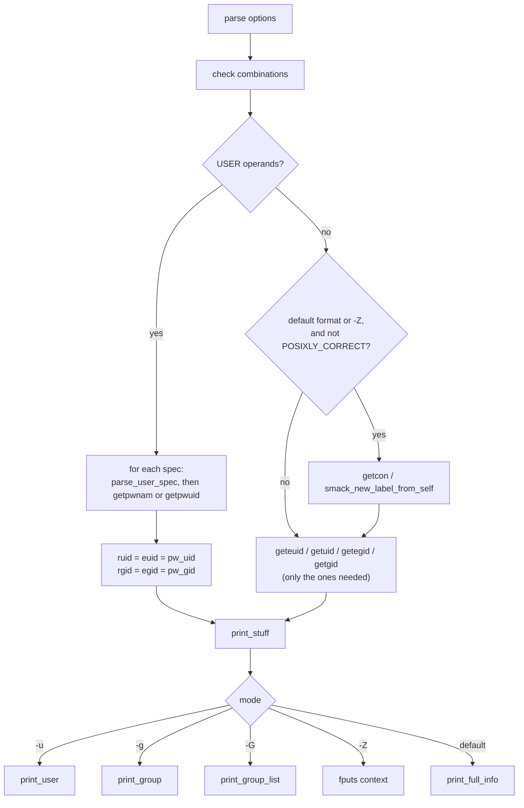

# `id`: print user and group IDs

Source: `src/id.c` (464 lines), `src/group-list.c` · Tests: `tests/id/` ·
Manual: `info '(coreutils) id invocation'`

`id` prints the user ID, group IDs and supplementary groups of the current
process, or of each USER given. It can also print one item only (`-u`,
`-g`, `-G`) or the security context (`-Z`). The printing of group lists is
in `src/group-list.c`, which `groups` also uses.

## Options

The table lists `longopts[]` (`src/id.c:73-85`) and the short-option string
`"agnruzGZ"`.

| Option | Variable | Notes |
|---|---|---|
| `-a` | none | Ignored, for SVR4 compatibility. |
| `-u`, `--user` | `just_user` | Effective UID only. |
| `-g`, `--group` | `just_group` | Effective GID only. |
| `-G`, `--groups` | `just_group_list` | All group IDs. |
| `-Z`, `--context` | `just_context` | Security context of the process only. Fails at once if neither SELinux nor SMACK is enabled. |
| `-n`, `--name` | `use_name` | Print names in place of numbers. Needs `-u`, `-g` or `-G`. |
| `-r`, `--real` | `use_real` | Real ID in place of effective. Needs `-u`, `-g` or `-G`. |
| `-z`, `--zero` | `opt_zero` | NUL as the separator. Not allowed in the default format. |

`main` checks these combinations (`src/id.c:210-228`):

| Condition | Error |
|---|---|
| USER operands with `-Z` | `cannot print security context when user specified` |
| More than one of `-u`, `-g`, `-G`, `-Z` | `cannot print "only" of more than one choice` |
| `-n` or `-r` without `-u`, `-g` or `-G` | `printing only names or real IDs requires -u, -g, or -G` |
| `-z` in the default format | `option --zero not permitted in default format` |

## Code map

| Function | Location | Role |
|---|---|---|
| `main` | `src/id.c:145` | Options, checks, then either the loop over USER operands or the current process. |
| `print_stuff` | `:432` | Choose the output mode for one user and print the end-of-record byte. |
| `print_full_info` | `:357` | The default `uid=... gid=... groups=... context=...` line. |
| `print_user` | `:334` | Print a UID or user name. |
| `print_group_list` | `src/group-list.c:35` | `-G`: the real GID, the effective GID if it differs, then the supplementary groups without duplicates. |
| `print_group` | `src/group-list.c:91` | Print a GID or group name. |

## How it works

The diagram shows how `main` decides what to print.



### User operands

Each operand goes through gnulib's `parse_user_spec` (`userspec.h`), the
same parser `chown` uses. So `id 0`, `id root` and `id +0` all work. A
name is looked up with `getpwnam`, and a number with `getpwuid`. An empty
operand is rejected on purpose, because `parse_user_spec` accepts it
(`src/id.c:261-268`). For a named user, the real and effective IDs are both
set from the passwd entry. `id` cannot show set-UID effects for another
user.

### The current process

`id` calls only the ID functions the selected mode needs. Each call sets
`errno = 0` first and treats `-1` with a non-zero `errno` as a failure
(`src/id.c:289-325`). A comment explains that POSIX says these calls cannot
fail, but they can on GNU/Hurd (see `tests/id/gnu-zero-uids.sh`).

### Supplementary groups

`print_full_info` and `print_group_list` call gnulib's `xgetgroups
(username, primary_gid, &groups)`. With a user name it uses
`getgrouplist` or a scan of the group database. With no user name it uses
`getgroups()` for the current process. In the default format each group is
printed as `gid(name)` and the groups are separated by commas.
`print_group_list` (`-G`) prints `rgid`, then `egid` if it differs, then
every other group. It skips groups equal to either of them, so the same
GID is not printed twice.

### NUL output with several users

With `-z -G` and more than one USER, each record ends with two NUL bytes,
so a program reading the output can tell where one user's list ends
(`src/id.c:452-463`).

### Security context

The `context=` part is added only when no USER is given and
`POSIXLY_CORRECT` is not set, because POSIX fixes the output format. The
context comes from `getcon()` (SELinux) or `smack_new_label_from_self()`
(SMACK). A failure there is an error only when `-Z` was given.

## Errors and exit status

- An unknown user gives `'NAME': no such user`. `id` goes on to the next
  operand, and the final exit status is 1.
- With `-n`, a UID or GID that has no name gives `cannot find name for
  user ID N` (or group ID). The number is printed instead and the exit
  status is 1.
- A write error after a user's record calls `write_error()` (exit status
  1).

## Tests

| File | Covers |
|---|---|
| `tests/id/uid.sh` | Numeric user operands. |
| `tests/id/zero.sh` | `--zero` with one and several users, and the double-NUL end of record. |
| `tests/id/setgid.sh` | When run set-GID, `id` and `id -G` show the right effective group. |
| `tests/id/context.sh` | `-Z` output on SELinux. |
| `tests/id/no-context.sh` | `POSIXLY_CORRECT` leaves out `context=`. |
| `tests/id/smack.sh` | The SMACK label. |
| `tests/id/gnu-zero-uids.sh` | On GNU/Hurd, fail for processes with no UIDs. |

## See also

- `groups` (`src/groups.c`) shares `print_group_list`.
- [chown](chown.md) uses the same `parse_user_spec` parser.

## Source code

`src/id.c:1`

```c
/* id -- print real and effective UIDs and GIDs
   Copyright (C) 1989-2026 Free Software Foundation, Inc.

   This program is free software: you can redistribute it and/or modify
   it under the terms of the GNU General Public License as published by
   the Free Software Foundation, either version 3 of the License, or
   (at your option) any later version.

   This program is distributed in the hope that it will be useful,
   but WITHOUT ANY WARRANTY; without even the implied warranty of
   MERCHANTABILITY or FITNESS FOR A PARTICULAR PURPOSE.  See the
   GNU General Public License for more details.

   You should have received a copy of the GNU General Public License
   along with this program.  If not, see <https://www.gnu.org/licenses/>.  */

/* Written by Arnold Robbins.
   Major rewrite by David MacKenzie, djm@gnu.ai.mit.edu. */

#include <config.h>
#include <stdio.h>
#include <sys/types.h>
#include <pwd.h>
#include <grp.h>
#include <getopt.h>
#include <selinux/selinux.h>

#include "system.h"
#include "mgetgroups.h"
#include "quote.h"
#include "group-list.h"
#include "smack.h"
#include "userspec.h"

/* The official name of this program (e.g., no 'g' prefix).  */
#define PROGRAM_NAME "id"

#define AUTHORS \
  proper_name ("Arnold Robbins"), \
  proper_name ("David MacKenzie")

/* If nonzero, output only the SELinux context.  */
static bool just_context = 0;
/* If true, delimit entries with NUL characters, not whitespace */
static bool opt_zero = false;
/* If true, output the list of all group IDs. -G */
static bool just_group_list = false;
/* If true, output only the group ID(s). -g */
static bool just_group = false;
/* If true, output real UID/GID instead of default effective UID/GID. -r */
static bool use_real = false;
/* If true, output only the user ID(s). -u */
static bool just_user = false;
/* True unless errors have been encountered.  */
static bool ok = true;
/* If true, we are using multiple users. Terminate -G with double NUL. */
static bool multiple_users = false;
/* If true, output user/group name instead of ID number. -n */
static bool use_name = false;

/* The real and effective IDs of the user to print. */
static uid_t ruid, euid;
static gid_t rgid, egid;

/* The SELinux context.  Start with a known invalid value so print_full_info
   knows when 'context' has not been set to a meaningful value.  */
static char *context = NULL;

static void print_user (uid_t uid);
static void print_full_info (char const *username);
static void print_stuff (char const *pw_name);

static struct option const longopts[] =
{
  {"context", no_argument, NULL, 'Z'},
  {"group", no_argument, NULL, 'g'},
  {"groups", no_argument, NULL, 'G'},
  {"name", no_argument, NULL, 'n'},
  {"real", no_argument, NULL, 'r'},
  {"user", no_argument, NULL, 'u'},
  {"zero", no_argument, NULL, 'z'},
  {GETOPT_HELP_OPTION_DECL},
  {GETOPT_VERSION_OPTION_DECL},
  {NULL, 0, NULL, 0}
};

void
usage (int status)
{
  if (status != EXIT_SUCCESS)
    emit_try_help ();
  else
    {
      printf (_("Usage: %s [OPTION]... [USER]...\n"), program_name);
      fputs (_("\
Print user and group information for each specified USER,\n\
or (when USER omitted) for the current process.\n\
\n"),
             stdout);
      oputs (_("\
  -a\n\
         ignore, for compatibility with other versions\n\
"));
      oputs (_("\
  -Z, --context\n\
         print only the security context of the process\n\
"));
      oputs (_("\
  -g, --group\n\
         print only the effective group ID\n\
"));
      oputs (_("\
  -G, --groups\n\
         print all group IDs\n\
"));
      oputs (_("\
  -n, --name\n\
         print a name instead of a number, for -u, -g, -G\n\
"));
      oputs (_("\
  -r, --real\n\
         print the real ID instead of the effective ID, with -u, -g, -G\n\
"));
      oputs (_("\
  -u, --user\n\
         print only the effective user ID\n\
"));
      oputs (_("\
  -z, --zero\n\
         delimit entries with NUL characters, not whitespace;\n\
         not permitted in default format\n\
"));
      oputs (HELP_OPTION_DESCRIPTION);
      oputs (VERSION_OPTION_DESCRIPTION);
      fputs (_("\
\n\
Without any OPTION, print some useful set of identified information.\n\
"), stdout);
      emit_ancillary_info (PROGRAM_NAME);
    }
  exit (status);
}

int
main (int argc, char **argv)
{
  int optc;
  int selinux_enabled = (is_selinux_enabled () > 0);
  bool smack_enabled = is_smack_enabled ();

  initialize_main (&argc, &argv);
  set_program_name (argv[0]);
  setlocale (LC_ALL, "");
  bindtextdomain (PACKAGE, LOCALEDIR);
  textdomain (PACKAGE);

  atexit (close_stdout);

  while ((optc = getopt_long (argc, argv, "agnruzGZ", longopts, NULL)) != -1)
    {
      switch (optc)
        {
        case 'a':
          /* Ignore -a, for compatibility with SVR4.  */
          break;

        case 'Z':
          /* politely decline if we're not on a SELinux/SMACK-enabled kernel.
             Keep require_selinux_ in tests in sync with these messages.  */
#ifdef HAVE_SMACK
          if (!selinux_enabled && !smack_enabled)
            error (EXIT_FAILURE, 0,
                   _("--context (-Z) works only on "
                     "an SELinux/SMACK-enabled kernel"));
#else
          if (!selinux_enabled)
            error (EXIT_FAILURE, 0,
                   _("--context (-Z) works only on an SELinux-enabled kernel"));
#endif
          just_context = true;
          break;

        case 'g':
          just_group = true;
          break;
        case 'n':
          use_name = true;
          break;
        case 'r':
          use_real = true;
          break;
        case 'u':
          just_user = true;
          break;
        case 'z':
          opt_zero = true;
          break;
        case 'G':
          just_group_list = true;
          break;
        case_GETOPT_HELP_CHAR;
        case_GETOPT_VERSION_CHAR (PROGRAM_NAME, AUTHORS);
        default:
          usage (EXIT_FAILURE);
        }
    }

  size_t n_ids = argc - optind;

  if (n_ids && just_context)
    error (EXIT_FAILURE, 0,
           _("cannot print security context when user specified"));

  if (just_user + just_group + just_group_list + just_context > 1)
    error (EXIT_FAILURE, 0, _("cannot print \"only\" of more than one choice"));

  bool default_format = ! (just_user
                           || just_group
                           || just_group_list
                           || just_context);

  if (default_format && (use_real || use_name))
    error (EXIT_FAILURE, 0,
           _("printing only names or real IDs requires -u, -g, or -G"));

  if (default_format && opt_zero)
    error (EXIT_FAILURE, 0,
           _("option --zero not permitted in default format"));

  /* If we are on a SELinux/SMACK-enabled kernel, no user is specified, and
     either --context is specified or none of (-u,-g,-G) is specified,
     and we're not in POSIXLY_CORRECT mode, get our context.  Otherwise,
     leave the context variable alone - it has been initialized to an
     invalid value that will be not displayed in print_full_info().  */
  if (n_ids == 0
      && (just_context
          || (default_format && ! getenv ("POSIXLY_CORRECT"))))
    {
      /* Report failure only if --context (-Z) was explicitly requested.  */
      if ((selinux_enabled && getcon (&context) && just_context)
          || (smack_enabled
              && smack_new_label_from_self (&context) < 0
              && just_context))
        error (EXIT_FAILURE, 0, _("can't get process context"));
    }

  if (n_ids >= 1)
    {
      multiple_users = n_ids > 1 ? true : false;
      /* Changing the value of n_ids to the last index in the array where we
         have the last possible user id. This helps us because we don't have
         to declare a different variable to keep a track of where the
         last username lies in argv[].  */
      n_ids += optind;
      /* For each username/userid to get its pw_name field */
      for (; optind < n_ids; optind++)
        {
          char *pw_name = NULL;
          struct passwd *pwd = NULL;
          char const *spec = argv[optind];
          /* Disallow an empty spec here as parse_user_spec() doesn't
             give an error for that as it seems it's a valid way to
             specify a noop or "reset special bits" depending on the system.  */
          if (*spec)
            {
              if (! parse_user_spec (spec, &euid, NULL, &pw_name, NULL))
                pwd = pw_name ? getpwnam (pw_name) : getpwuid (euid);
            }
          if (pwd == NULL)
            {
              error (0, errno, _("%s: no such user"), quote (spec));
              ok &= false;
            }
          else
            {
              if (!pw_name)
                pw_name = xstrdup (pwd->pw_name);
              ruid = euid = pwd->pw_uid;
              rgid = egid = pwd->pw_gid;
              print_stuff (pw_name);
              if (ferror (stdout))
                write_error ();
            }
          free (pw_name);
        }
    }
  else
    {
      /* POSIX says identification functions (getuid, getgid, and
         others) cannot fail, but they can fail under GNU/Hurd and a
         few other systems.  Test for failure by checking errno.  */
      uid_t NO_UID = -1;
      gid_t NO_GID = -1;

      if (just_user ? !use_real
          : !just_group && !just_group_list && !just_context)
        {
          errno = 0;
          euid = geteuid ();
          if (euid == NO_UID && errno)
            error (EXIT_FAILURE, errno, _("cannot get effective UID"));
        }

      if (just_user ? use_real
          : !just_group && (just_group_list || !just_context))
        {
          errno = 0;
          ruid = getuid ();
          if (ruid == NO_UID && errno)
            error (EXIT_FAILURE, errno, _("cannot get real UID"));
        }

      if (!just_user && (just_group || just_group_list || !just_context))
        {
          errno = 0;
          egid = getegid ();
          if (egid == NO_GID && errno)
            error (EXIT_FAILURE, errno, _("cannot get effective GID"));

          errno = 0;
          rgid = getgid ();
          if (rgid == NO_GID && errno)
            error (EXIT_FAILURE, errno, _("cannot get real GID"));
        }
        print_stuff (NULL);
    }

  return ok ? EXIT_SUCCESS : EXIT_FAILURE;
}

/* Print the name or value of user ID UID. */

static void
print_user (uid_t uid)
{
  struct passwd *pwd = NULL;

  if (use_name)
    {
      pwd = getpwuid (uid);
      if (pwd == NULL)
        {
          error (0, 0, _("cannot find name for user ID %ju"), (uintmax_t) uid);
          ok &= false;
        }
    }

  if (pwd)
    printf ("%s", pwd->pw_name);
  else
    printf ("%ju", (uintmax_t) uid);
}

/* Print all of the info about the user's user and group IDs. */

static void
print_full_info (char const *username)
{
  struct passwd *pwd;
  struct group *grp;

  printf (_("uid=%ju"), (uintmax_t) ruid);
  pwd = getpwuid (ruid);
  if (pwd)
    printf ("(%s)", pwd->pw_name);

  printf (_(" gid=%ju"), (uintmax_t) rgid);
  grp = getgrgid (rgid);
  if (grp)
    printf ("(%s)", grp->gr_name);

  if (euid != ruid)
    {
      printf (_(" euid=%ju"), (uintmax_t) euid);
      pwd = getpwuid (euid);
      if (pwd)
        printf ("(%s)", pwd->pw_name);
    }

  if (egid != rgid)
    {
      printf (_(" egid=%ju"), (uintmax_t) egid);
      grp = getgrgid (egid);
      if (grp)
        printf ("(%s)", grp->gr_name);
    }

  {
    gid_t *groups;

    gid_t primary_group;
    if (username)
      primary_group = pwd ? pwd->pw_gid : -1;
    else
      primary_group = egid;

    int n_groups = xgetgroups (username, primary_group, &groups);
    if (n_groups < 0)
      {
        if (username)
          error (0, errno, _("failed to get groups for user %s"),
                 quote (username));
        else
          error (0, errno, _("failed to get groups for the current process"));
        ok &= false;
        return;
      }

    if (n_groups > 0)
      fputs (_(" groups="), stdout);
    for (int i = 0; i < n_groups; i++)
      {
        if (i > 0)
          putchar (',');
        printf ("%ju", (uintmax_t) groups[i]);
        grp = getgrgid (groups[i]);
        if (grp)
          printf ("(%s)", grp->gr_name);
      }
    free (groups);
  }

  /* POSIX mandates the precise output format, and that it not include
     any context=... part, so skip that if POSIXLY_CORRECT is set.  */
  if (context)
    printf (_(" context=%s"), context);
}

/* Print information about the user based on the arguments passed. */

static void
print_stuff (char const *pw_name)
{
  if (just_user)
      print_user (use_real ? ruid : euid);

  /* print_group and print_group_list return true on successful
     execution but false if something goes wrong. We then AND this value with
     the current value of 'ok' because we want to know if one of the previous
     users faced a problem in these functions. This value of 'ok' is later used
     to understand what status program should exit with. */
  else if (just_group)
    ok &= print_group (use_real ? rgid : egid, use_name);
  else if (just_group_list)
    ok &= print_group_list (pw_name, ruid, rgid, egid,
                            use_name, opt_zero ? '\0' : ' ');
  else if (just_context)
    fputs (context, stdout);
  else
    print_full_info (pw_name);

  /* When printing records for more than 1 user, at the end of groups
     of each user terminate the record with two consequent NUL characters
     to make parsing and distinguishing between two records possible. */
  if (opt_zero && just_group_list && multiple_users)
    {
      putchar ('\0');
      putchar ('\0');
    }
  else
    {
      putchar (opt_zero ? '\0' : '\n');
    }
}
```
