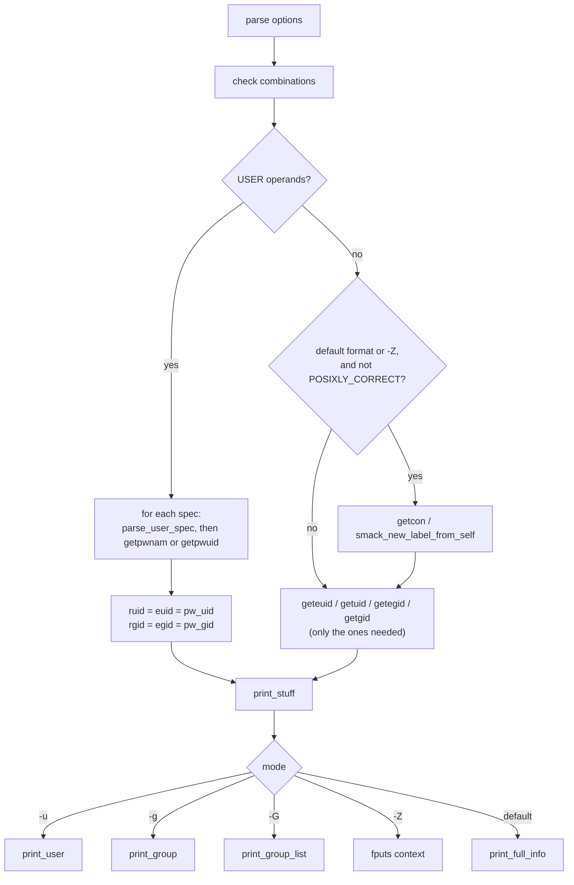

# `id`: print user and group IDs

Source: `src/id.c` (464 lines), `src/group-list.c` · Tests: `tests/id/` ·
Manual: `info '(coreutils) id invocation'`

`id` prints the user ID, group IDs and supplementary groups of the current
process, or of each USER given. It can also print one item only (`-u`,
`-g`, `-G`) or the security context (`-Z`). The printing of group lists is
in `src/group-list.c`, which `groups` also uses.

## Options

The table lists `longopts[]` (`src/id.c:73-85`) and the short-option string
`"agnruzGZ"`.

| Option | Variable | Notes |
|---|---|---|
| `-a` | none | Ignored, for SVR4 compatibility. |
| `-u`, `--user` | `just_user` | Effective UID only. |
| `-g`, `--group` | `just_group` | Effective GID only. |
| `-G`, `--groups` | `just_group_list` | All group IDs. |
| `-Z`, `--context` | `just_context` | Security context of the process only. Fails at once if neither SELinux nor SMACK is enabled. |
| `-n`, `--name` | `use_name` | Print names in place of numbers. Needs `-u`, `-g` or `-G`. |
| `-r`, `--real` | `use_real` | Real ID in place of effective. Needs `-u`, `-g` or `-G`. |
| `-z`, `--zero` | `opt_zero` | NUL as the separator. Not allowed in the default format. |

`main` checks these combinations (`src/id.c:210-228`):

| Condition | Error |
|---|---|
| USER operands with `-Z` | `cannot print security context when user specified` |
| More than one of `-u`, `-g`, `-G`, `-Z` | `cannot print "only" of more than one choice` |
| `-n` or `-r` without `-u`, `-g` or `-G` | `printing only names or real IDs requires -u, -g, or -G` |
| `-z` in the default format | `option --zero not permitted in default format` |

## Code map

| Function | Location | Role |
|---|---|---|
| `main` | `src/id.c:145` | Options, checks, then either the loop over USER operands or the current process. |
| `print_stuff` | `:432` | Choose the output mode for one user and print the end-of-record byte. |
| `print_full_info` | `:357` | The default `uid=... gid=... groups=... context=...` line. |
| `print_user` | `:334` | Print a UID or user name. |
| `print_group_list` | `src/group-list.c:35` | `-G`: the real GID, the effective GID if it differs, then the supplementary groups without duplicates. |
| `print_group` | `src/group-list.c:91` | Print a GID or group name. |

## How it works

The diagram shows how `main` decides what to print.

### User operands

Each operand goes through gnulib's `parse_user_spec` (`userspec.h`), the
same parser `chown` uses. So `id 0`, `id root` and `id +0` all work. A
name is looked up with `getpwnam`, and a number with `getpwuid`. An empty
operand is rejected on purpose, because `parse_user_spec` accepts it
(`src/id.c:261-268`). For a named user, the real and effective IDs are both
set from the passwd entry. `id` cannot show set-UID effects for another
user.

### The current process

`id` calls only the ID functions the selected mode needs. Each call sets
`errno = 0` first and treats `-1` with a non-zero `errno` as a failure
(`src/id.c:289-325`). A comment explains that POSIX says these calls cannot
fail, but they can on GNU/Hurd (see `tests/id/gnu-zero-uids.sh`).

### Supplementary groups

`print_full_info` and `print_group_list` call gnulib's `xgetgroups
(username, primary_gid, &groups)`. With a user name it uses
`getgrouplist` or a scan of the group database. With no user name it uses
`getgroups()` for the current process. In the default format each group is
printed as `gid(name)` and the groups are separated by commas.
`print_group_list` (`-G`) prints `rgid`, then `egid` if it differs, then
every other group. It skips groups equal to either of them, so the same
GID is not printed twice.

### NUL output with several users

With `-z -G` and more than one USER, each record ends with two NUL bytes,
so a program reading the output can tell where one user's list ends
(`src/id.c:452-463`).

### Security context

The `context=` part is added only when no USER is given and
`POSIXLY_CORRECT` is not set, because POSIX fixes the output format. The
context comes from `getcon()` (SELinux) or `smack_new_label_from_self()`
(SMACK). A failure there is an error only when `-Z` was given.

## Errors and exit status

- An unknown user gives `'NAME': no such user`. `id` goes on to the next
  operand, and the final exit status is 1.
- With `-n`, a UID or GID that has no name gives `cannot find name for
  user ID N` (or group ID). The number is printed instead and the exit
  status is 1.
- A write error after a user's record calls `write_error()` (exit status
  1).

## Tests

| File | Covers |
|---|---|
| `tests/id/uid.sh` | Numeric user operands. |
| `tests/id/zero.sh` | `--zero` with one and several users, and the double-NUL end of record. |
| `tests/id/setgid.sh` | When run set-GID, `id` and `id -G` show the right effective group. |
| `tests/id/context.sh` | `-Z` output on SELinux. |
| `tests/id/no-context.sh` | `POSIXLY_CORRECT` leaves out `context=`. |
| `tests/id/smack.sh` | The SMACK label. |
| `tests/id/gnu-zero-uids.sh` | On GNU/Hurd, fail for processes with no UIDs. |

## See also

- `groups` (`src/groups.c`) shares `print_group_list`.
- [chown](chown.md) uses the same `parse_user_spec` parser.
