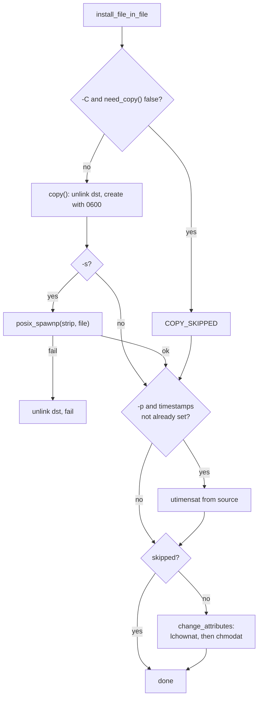

# `install`: copy files and set attributes

Source: `src/install.c` (1114 lines), plus the copy modules,
`src/prog-fprintf.c` and `src/selinux.c` · Tests: `tests/install/` ·
Manual: `info '(coreutils) install invocation'`

`install` copies files and then sets their mode, owner and group, which
makes it useful in `make install` rules. It can also create directories
(`-d`) or create the parent directories of the target (`-D`). The program
is built as `ginstall`, because Automake already has an `install` target.
`src/local.mk` renames it with `transform = s/ginstall/install/`. In the
single-binary build, `src/coreutils.c` maps the name `install` to
`ginstall`.

## Options

The table lists `long_options[]` (`src/install.c:117-138`) and the
short-option string `"bcCsDdg:m:o:pt:TvS:Z"`.

| Option | Variable | Notes |
|---|---|---|
| `-m`, `--mode=MODE` | `mode`, `dir_mode` | The default is `DEFAULT_MODE` (0755). MODE is applied to 0, without the umask: `mode_adjust (0, false, 0, change, NULL)`. |
| `-o`, `--owner=OWNER`, `-g`, `--group=GROUP` | `owner_id`, `group_id` | A name, or a number if the name is not found (`get_ids`). |
| `-d`, `--directory` | `dir_arg` | Treat every operand as a directory to create (`make_dir_parents`). |
| `-D` | `mkdir_and_install` | Create the missing parents of the destination, or of the `-t` directory. |
| `-C`, `--compare` | `copy_only_if_needed` | Do not copy if the destination already matches (see `need_copy`). |
| `-s`, `--strip`, `--strip-program=PROG` | `strip_files`, `strip_program` | Run `strip` on the copy. |
| `-p`, `--preserve-timestamps` | `x.preserve_timestamps` | |
| `-b`, `--backup`, `-S` | `x.backup_type` | |
| `-c` | none | Ignored, for compatibility with old BSD `install`. |
| `-t DIR`, `-T` | | Target directory handling, as in `cp`. |
| `--preserve-context`, `-Z`, `--context[=CTX]` | SELinux | See below. |
| `-v`, `--debug` | `x.verbose`, `x.debug` | |

These combinations are rejected: `-d` with `-s`, `-d` with `-t`, `-C`
with `-s`, and `-t` with `-T`. With `-C`, a mode with set-UID, set-GID or
sticky bits gives a warning and `-C` is ignored.

## Settings passed to `copy()`

`install`'s `cp_option_init()` (`src/install.c:258-301`) sets:

| Field | Value | Why |
|---|---|---|
| `install_mode` | `true` | Changes some messages, for example `omitting directory` without the `-r` hint. |
| `dereference` | `DEREF_ALWAYS` | Install what a symlink points to. |
| `unlink_dest_before_opening` | `true` | Remove the old file first. The new file is a new inode, so a program that is running from the old file, or has it open, is not affected. (The source has no comment on this.) |
| `copy_as_regular` | `true` | So `install /dev/null file` works. A comment says sendmail's install depends on this. |
| `set_mode`, `mode` | `true`, `0600` | Create the copy as owner read and write only, so `strip` can work on it. The final mode is set later. |
| all `preserve_*` | `false` | Except `-p`. |

## Code map

| Function | Location | Role |
|---|---|---|
| `main` | `src/install.c:853` | Options, checks, choose the target, then the `-d` path or the copy path. |
| `install_file_in_dir` | `:814` | Install into a directory. For the first file with `-D`, create the directory first. |
| `install_file_in_file_parents` | `:802` | `-D` with a file destination: `mkancesdirs_safe_wd` and then `install_file_in_file`. |
| `install_file_in_file` | `:729` | `copy_file`, `strip`, timestamps, `change_attributes`. |
| `copy_file` | `:419` | `need_copy` check for `-C`, then `copy()`. |
| `need_copy` | `:172` | `-C`: compare type, size, mode, owner, group, SELinux context and content. |
| `have_same_content` | `:143` | Compare in 4 KiB blocks with `memeq`. |
| `change_attributes` | `:440` | `lchownat` first, then `chmodat`, then the default SELinux context. |
| `strip` | `:494` | `posix_spawnp` the strip program, with `POSIX_SPAWN_USEVFORK` if possible. |
| `process_dir`, `make_ancestor` | `:386`, `:369` | `-d`: `make_dir_parents` with `dir_mode` and the owner and group. |
| `mkancesdirs_safe_wd` | `:762` | Create the parents of a file path, saving and restoring the working directory when needed. |

## How it works

The diagram shows how one file is installed.

### Owner before mode

`change_attributes` changes the owner **before** the mode. A comment at
`src/install.c:443-453` explains why. On some systems `chown` clears the
set-UID and set-GID bits for normal users. On System V a user who gives a
file away may then not be able to `chmod` it. Errors from `chown` are
reported, because `install` promises that the file ends up with the
attributes that were asked for.

### Strip and the umask

`main` saves the umask and then sets it to 0
(`initial_umask = umask (0)`), so files are created with exactly the modes
`install` asks for. `strip()` puts the user's umask back just before it
starts the child, and sets it to 0 again afterwards. A comment explains
that some strip programs create temporary files that other users could
read. A name that starts with `-` is passed as `./-name`. If `strip` fails,
the half-installed file is removed.

### `-C` (compare)

`need_copy` returns `true` (copy needed) as soon as it finds a difference:
a mode with special bits, a file that is not regular, a different size or
mode, a different owner or group (compared with the real UID and GID when
`-o` or `-g` was not given), a different SELinux context (with
`--preserve-context`), or different content. The content check is
`have_same_content`. `tests/install/install-C-immutable.sh` checks that an
unchanged file is not touched at all, so an immutable file does not cause
an error.

### SELinux

By default, after installing, `install` calls its own
`setdefaultfilecon()`. This sets the context to the result of
`selabel_lookup_raw`. `-Z` turns this off and uses the shared
`defaultcon`/`restorecon` code in `src/selinux.c`. A comment notes that
`setdefaultfilecon` throws away the MLS level and user identity of the
file. `--preserve-context` copies the source's context instead.

## Errors and exit status

Each operand is handled separately. The exit status is 1 if any of them
failed. Bad options, a bad mode, or an unknown owner or group are fatal at
once.

## Tests

| File | Covers |
|---|---|
| `tests/install/basic-1.sh` | Basic copies, modes and `-d`. |
| `tests/install/create-leading.sh`, `d-slashdot.sh` | `-D`, and `-d` with `dir/.`. |
| `tests/install/install-C.sh`, `install-C-root.sh`, `install-C-selinux.sh`, `install-C-immutable.sh` | `-C` comparisons. |
| `tests/install/install-Z-selinux.sh` | `-Z` with `-D` and `-d`. |
| `tests/install/strip-program.sh`, `trap.sh` | `--strip-program`, and `-s` when `SIGCHLD` is ignored. |
| `tests/install/stdin.sh` | Installing from standard input. |

## See also

- [cp](cp.md) for the copy engine.
- [mkdir](mkdir.md): `install -d` uses the same `make_dir_parents`.
