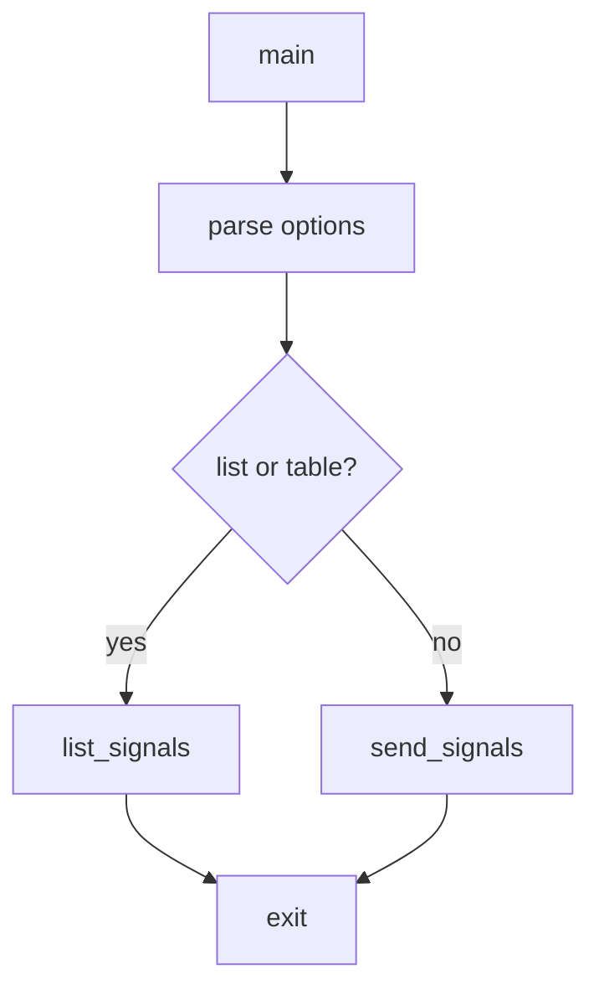

# `kill`: send a signal to a process

Source: `src/kill.c` (310 lines) · Tests: `tests/misc/kill.sh` ·
Manual: `info '(coreutils) kill invocation'`

`kill` sends a signal to processes or process groups. The default signal is
`SIGTERM` (15). Signals can be specified by name (e.g., `HUP`, `TERM`) or
number. With `-l`, it lists signal names or converts between names and numbers.
With `-t`, it prints a table of signal information.

## Options

The table lists `long_options[]` (`src/kill.c:42-50`) and the short-option
string `"0::1::2::3::4::5::6::7::8::9::A::B::C::D::E::F::G::H::I::J::K::M::N::O::P::Q::R::S::T::U::V::W::X::Y::Z::Lln:s:t"`.

|| Option | Variables |
||---|---|
|| `-s SIGNAL`, `--signal=SIGNAL` | Specify signal to send |
|| `-SIGNAL` | Same as `-s SIGNAL` (traditional syntax) |
|| `-l`, `--list` | `list = true`: list signal names |
|| `-t`, `--table` | `table = true`: print signal table |

## Code map

|| Function | Location | Role |
||---|---|---|
|| `main` | `src/kill.c:218` | Option parsing, dispatch to `list_signals` or `send_signals` |
|| `list_signals` | `:114` | List signal names or print table |
|| `send_signals` | `:186` | Send signal to specified PIDs |
|| `print_table_row` | `:101` | Print one row of the signal table |
|| `usage` | `:53` | Help message |

## How it works

### Signal parsing

Signal names and numbers are parsed with `operand2sig` from gnulib
(`src/kill.c:268`). The short option string accepts traditional syntax like
`-9` or `-HUP` (treated as `-s 9` or `-s HUP`).

### Listing signals

With `-l`, `list_signals` prints signal names (`src/kill.c:114-180`). If
arguments are provided, it converts names to numbers or vice versa. With `-t`,
it prints a table with signal numbers, names, and descriptions
(`src/kill.c:119-150`).

### Sending signals

`send_signals` parses each PID as an integer and calls `kill` to send the
signal (`src/kill.c:186-215`). Negative PIDs identify process groups.

## Platform notes

`kill` uses the POSIX `kill` function. Signal availability varies by platform;
`SIG2STR_MAX` defines the maximum signal name length.

## Errors and exit status

- **Invalid signal:** "invalid option -- X" or "X: multiple signals specified"
- **Invalid PID:** "X: invalid process id"
- **Kill failure:** Error from `kill` with errno description

Exit status is 0 on success, 1 on any error.

## Tests

|| File | Covers |
||---|---|
|| `tests/misc/kill.sh` | Signal sending and listing |

## See also

- [timeout](timeout.md) for running commands with time limits
