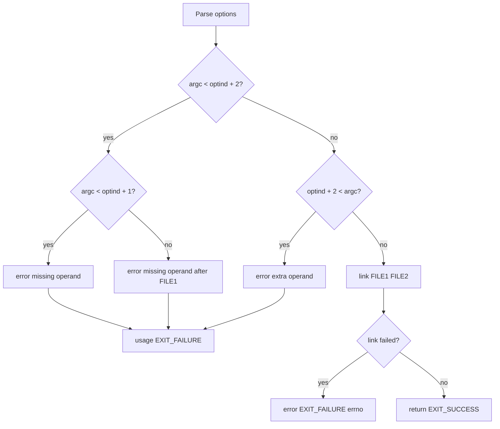

# `link`: create a hard link

Source: `src/link.c` (91 lines) · Tests: `tests/misc/link.sh` ·
Manual: `info '(coreutils) link invocation'`

`link` creates a hard link named FILE2 to an existing FILE1. It simply calls
the system `link` function. This is a low-level interface equivalent to `ln`
without any options.

## Options

No options other than `--help` and `--version`. Uses `parse_gnu_standard_options_only`
(`src/link.c:67-69`).

## Code map

|| Function | Location | Role |
||---|---|---|
|| `main` | `src/link.c:57` | Validate arguments, call `link`. |
|| `usage` | `:36` | Help text. |

## How it works

The diagram shows the simple flow.

`main` validates that exactly two operands are provided (`src/link.c:71-84`),
then calls the system `link` function (`src/link.c:86`). If `link` fails, it
reports an error and exits.

## Platform notes

- The system `link` function creates a hard link, which requires both files to
  be on the same filesystem
- On some systems, `link` may not work across filesystem boundaries or with
  special files

## Errors and exit status

- Missing operand: `error (0, 0, ...)` then `usage (EXIT_FAILURE)`
- Extra operand: `error (0, 0, ...)` then `usage (EXIT_FAILURE)`
- `link` failure: `error (EXIT_FAILURE, errno, ...)`
- Write failure: handled by `atexit (close_stdout)`

## Tests

|| File | Covers |
||---|---|
|| `tests/misc/link.sh` | Basic functionality, error cases. |

## See also

- [ln](ln.md) (create links with more options)
- [unlink](unlink.md) (remove a link)
