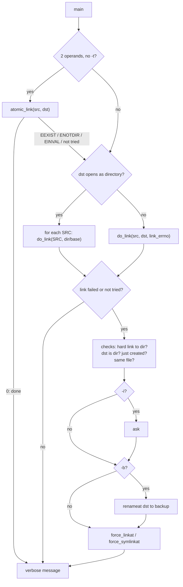

# `ln`: make links between files

Source: `src/ln.c` (713 lines), `src/force-link.c` (184 lines),
`src/relpath.c` · Tests: `tests/ln/` · Manual: `info '(coreutils) ln
invocation'`

`ln` makes hard links (`linkat`) or symbolic links (`symlinkat`). The
interesting part is `-f`. POSIX describes it as "unlink the destination,
then link", but that can lose data. GNU `ln` tries the link first. If the
destination exists, it creates the new link under a temporary name in the
same directory and `rename`s it over the destination. Replacing an existing
file is therefore atomic. This code is in `force-link.c`, and `cp` uses it
too.

## Options

The table lists `long_options[]` (`src/ln.c:91-109`) and the short-option
string `"bdfinrst:vFLPS:T"`.

| Option | Variable | Notes |
|---|---|---|
| `-s`, `--symbolic` | `symbolic_link` | |
| `-f`, `--force` | `remove_existing_files` | Replace the destination atomically. Turns off `-i`. |
| `-i`, `--interactive` | `interactive` | Ask before replacing. Turns off `-f`. |
| `-b`, `--backup`, `-S` | `backup_type` | Rename the old destination to a backup name. |
| `-r`, `--relative` | `relative` | Symlinks only: store a path relative to the link's directory (`convert_abs_rel`). |
| `-L`, `--logical` / `-P`, `--physical` | `logical` | For hard links to a symlink: link the target (`AT_SYMLINK_FOLLOW`) or the symlink itself. The default comes from `LINK_FOLLOWS_SYMLINKS`, which `configure` sets. |
| `-n`, `--no-dereference` | `dereference_dest_dir_symlinks = false` | If DEST is a symlink to a directory, treat it as a file (open with `O_NOFOLLOW`). |
| `-d`, `-F`, `--directory` | `hard_dir_link` | Allow hard links to directories (for root, where the system allows it). |
| `-t DIR`, `-T` | | `-t` checks with `stat` that DIR is a directory. |
| `-v`, `--verbose` | `verbose` | Prints `'dest' -> 'src'` (symlink) or `'dest' => 'src'` (hard link). With a backup, `'backup' ~ ` comes first. |

With one operand, `ln FILE` links FILE into the current directory.
`--relative` without `--symbolic` is an error.

## Code map

| Function | Location | Role |
|---|---|---|
| `main` | `src/ln.c:513` | Options, try `atomic_link` for two operands, decide the target, loop. |
| `atomic_link` | `:160` | One `symlinkat` or `linkat`. Returns -1 ("not tried") for `-r` or when a hard link to a directory needs care. |
| `do_link` | `:178` | All the checks for an existing destination, backups, `force_*linkat`, and messages. |
| `convert_abs_rel` | `:124` | `-r`: canonicalize both paths with `CAN_MISSING`, then `relpath()`. |
| `force_linkat`, `force_symlinkat` | `src/force-link.c:95`, `:152` | Link to a temporary name, then `renameat` over the destination. |
| `samedir_template` | `src/force-link.c:51` | Builds `DIR/CuXXXXXX` for the temporary name. |
| `relpath` | `src/relpath.c:88` | Builds the relative path from the common prefix of two canonical paths. Shared with `realpath --relative-to`. |

## How it works

The diagram shows the path through `main` and `do_link`.



### Atomic replacement

`force_linkat` (`src/force-link.c:95-126`) does this:

```c
if (linkat_errno < 0)
  linkat_errno = (linkat (srcdir, srcname, dstdir, dstname, flags) == 0
                  ? 0 : errno);
if (!force || linkat_errno != EEXIST)
  return linkat_errno;

char buf[smallsize];
char *dsttmp = samedir_template (dstname, buf);
...
if (try_tempname_len (dsttmp, 0, &arg, try_link, x_suffix_len) != 0)
  err = errno;
else
  {
    err = renameat (dstdir, dsttmp, dstdir, dstname) == 0 ? -1 : errno;
    /* Unlink DSTTMP even if renameat succeeded, in case DSTTMP
       and DSTNAME were already the same hard link and renameat
       was a no-op.  */
    unlinkat (dstdir, dsttmp, 0);
  }
```

The return value tells the caller what happened: 0 means linked and the
name was new, -1 means linked by replacing an existing file, and a positive
value is an `errno` value. The temporary name uses the short pattern
`CuXXXXXX` so that it also works on file systems with short names, such as
FAT (comment at `:33-37`).

### Data-loss checks in `do_link`

Before it replaces anything, `do_link` refuses in these cases:

- **The destination is a directory:** `'d': cannot overwrite directory`.
- **The destination was created earlier in this command:** with `-f` and
  several sources, `dest_set` records each new hard link. So
  `ln -f a/x b/x dir` does not replace `dir/x` (just linked to `a/x`) with
  `b/x`. The message is `will not overwrite just-created 'dir/x' with
  'b/x'`.
- **The source and destination are the same directory entry:** removing
  the destination would remove the source too. `ln` checks `psame_inode`
  and then either `st_nlink == 1` or `same_nameat`. The message is `'a' and
  'a' are the same file`.

If the final link fails after a backup was made, `do_link` renames the
backup back (`cannot un-backup` if that fails too).

### Hard links to directories

Unless `-d` is given, `main` calls `priv_set_remove_linkdir()` and sets
`beware_hard_dir_link = !cannot_unlink_dir ()`. On systems where root can
`unlink` a directory, `atomic_link` will not try a hard link at once. It
lets `do_link` `stat` the source first, so that it can report `hard link
not allowed for directory`.

## Errors and exit status

Each operand is handled separately. The exit status is 1 if any link
failed. The hard-link error messages name only the side that caused the
problem: `failed to create hard link to 'src'` for `EMLINK`, and
`failed to create hard link 'dst'` for `EDQUOT`, `EEXIST`, `ENOSPC` and
`EROFS`.

## Tests

| File | Covers |
|---|---|
| `tests/ln/sf-1.sh` | `ln -sf` replacing existing links. |
| `tests/ln/relative.sh` | `--relative`. |
| `tests/ln/hard-to-sym.sh` | `-L` and `-P`. |
| `tests/ln/backup-1.sh`, `hard-backup.sh`, `backup-suffix-traversal.sh` | Backups, `ln --backup F F`, and rejecting a `-S` suffix that contains `/`. |
| `tests/ln/target-1.sh`, `slash-decorated-nonexistent-dest.sh` | `-t` with one file, and `ln -T f missing/`. |
| `tests/ln/non-utf8-src.sh` | Source names that are not valid UTF-8. |
| `tests/ln/misc.sh` | Other cases. |

## See also

- [cp](cp.md): `cp -l` and `cp -s` use `force_linkat` and
  `force_symlinkat`.
- [Shared infrastructure](../overview/shared-infrastructure.md).
