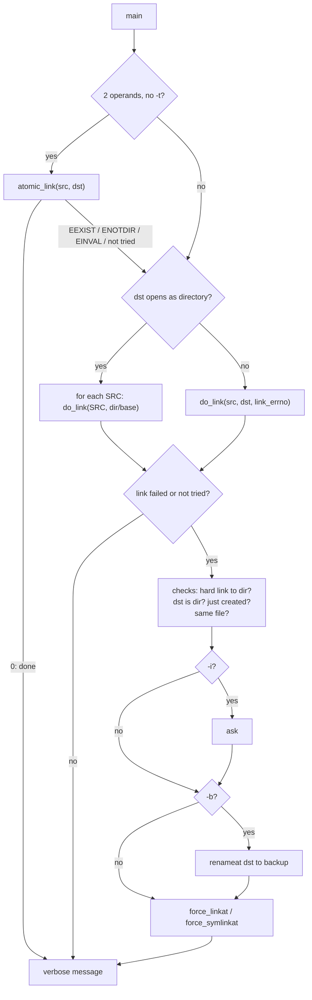

# `ln`: make links between files

Source: `src/ln.c` (713 lines), `src/force-link.c` (184 lines),
`src/relpath.c` · Tests: `tests/ln/` · Manual: `info '(coreutils) ln
invocation'`

`ln` makes hard links (`linkat`) or symbolic links (`symlinkat`). The
interesting part is `-f`. POSIX describes it as "unlink the destination,
then link", but that can lose data. GNU `ln` tries the link first. If the
destination exists, it creates the new link under a temporary name in the
same directory and `rename`s it over the destination. Replacing an existing
file is therefore atomic. This code is in `force-link.c`, and `cp` uses it
too.

## Options

The table lists `long_options[]` (`src/ln.c:91-109`) and the short-option
string `"bdfinrst:vFLPS:T"`.

| Option | Variable | Notes |
|---|---|---|
| `-s`, `--symbolic` | `symbolic_link` | |
| `-f`, `--force` | `remove_existing_files` | Replace the destination atomically. Turns off `-i`. |
| `-i`, `--interactive` | `interactive` | Ask before replacing. Turns off `-f`. |
| `-b`, `--backup`, `-S` | `backup_type` | Rename the old destination to a backup name. |
| `-r`, `--relative` | `relative` | Symlinks only: store a path relative to the link's directory (`convert_abs_rel`). |
| `-L`, `--logical` / `-P`, `--physical` | `logical` | For hard links to a symlink: link the target (`AT_SYMLINK_FOLLOW`) or the symlink itself. The default comes from `LINK_FOLLOWS_SYMLINKS`, which `configure` sets. |
| `-n`, `--no-dereference` | `dereference_dest_dir_symlinks = false` | If DEST is a symlink to a directory, treat it as a file (open with `O_NOFOLLOW`). |
| `-d`, `-F`, `--directory` | `hard_dir_link` | Allow hard links to directories (for root, where the system allows it). |
| `-t DIR`, `-T` | | `-t` checks with `stat` that DIR is a directory. |
| `-v`, `--verbose` | `verbose` | Prints `'dest' -> 'src'` (symlink) or `'dest' => 'src'` (hard link). With a backup, `'backup' ~ ` comes first. |

With one operand, `ln FILE` links FILE into the current directory.
`--relative` without `--symbolic` is an error.

## Code map

| Function | Location | Role |
|---|---|---|
| `main` | `src/ln.c:513` | Options, try `atomic_link` for two operands, decide the target, loop. |
| `atomic_link` | `:160` | One `symlinkat` or `linkat`. Returns -1 ("not tried") for `-r` or when a hard link to a directory needs care. |
| `do_link` | `:178` | All the checks for an existing destination, backups, `force_*linkat`, and messages. |
| `convert_abs_rel` | `:124` | `-r`: canonicalize both paths with `CAN_MISSING`, then `relpath()`. |
| `force_linkat`, `force_symlinkat` | `src/force-link.c:95`, `:152` | Link to a temporary name, then `renameat` over the destination. |
| `samedir_template` | `src/force-link.c:51` | Builds `DIR/CuXXXXXX` for the temporary name. |
| `relpath` | `src/relpath.c:88` | Builds the relative path from the common prefix of two canonical paths. Shared with `realpath --relative-to`. |

## How it works

The diagram shows the path through `main` and `do_link`.



### Atomic replacement

`force_linkat` (`src/force-link.c:95-126`) does this:

```c
if (linkat_errno < 0)
  linkat_errno = (linkat (srcdir, srcname, dstdir, dstname, flags) == 0
                  ? 0 : errno);
if (!force || linkat_errno != EEXIST)
  return linkat_errno;

char buf[smallsize];
char *dsttmp = samedir_template (dstname, buf);
...
if (try_tempname_len (dsttmp, 0, &arg, try_link, x_suffix_len) != 0)
  err = errno;
else
  {
    err = renameat (dstdir, dsttmp, dstdir, dstname) == 0 ? -1 : errno;
    /* Unlink DSTTMP even if renameat succeeded, in case DSTTMP
       and DSTNAME were already the same hard link and renameat
       was a no-op.  */
    unlinkat (dstdir, dsttmp, 0);
  }
```

The return value tells the caller what happened: 0 means linked and the
name was new, -1 means linked by replacing an existing file, and a positive
value is an `errno` value. The temporary name uses the short pattern
`CuXXXXXX` so that it also works on file systems with short names, such as
FAT (comment at `:33-37`).

### Data-loss checks in `do_link`

Before it replaces anything, `do_link` refuses in these cases:

- **The destination is a directory:** `'d': cannot overwrite directory`.
- **The destination was created earlier in this command:** with `-f` and
  several sources, `dest_set` records each new hard link. So
  `ln -f a/x b/x dir` does not replace `dir/x` (just linked to `a/x`) with
  `b/x`. The message is `will not overwrite just-created 'dir/x' with
  'b/x'`.
- **The source and destination are the same directory entry:** removing
  the destination would remove the source too. `ln` checks `psame_inode`
  and then either `st_nlink == 1` or `same_nameat`. The message is `'a' and
  'a' are the same file`.

If the final link fails after a backup was made, `do_link` renames the
backup back (`cannot un-backup` if that fails too).

### Hard links to directories

Unless `-d` is given, `main` calls `priv_set_remove_linkdir()` and sets
`beware_hard_dir_link = !cannot_unlink_dir ()`. On systems where root can
`unlink` a directory, `atomic_link` will not try a hard link at once. It
lets `do_link` `stat` the source first, so that it can report `hard link
not allowed for directory`.

## Errors and exit status

Each operand is handled separately. The exit status is 1 if any link
failed. The hard-link error messages name only the side that caused the
problem: `failed to create hard link to 'src'` for `EMLINK`, and
`failed to create hard link 'dst'` for `EDQUOT`, `EEXIST`, `ENOSPC` and
`EROFS`.

## Tests

| File | Covers |
|---|---|
| `tests/ln/sf-1.sh` | `ln -sf` replacing existing links. |
| `tests/ln/relative.sh` | `--relative`. |
| `tests/ln/hard-to-sym.sh` | `-L` and `-P`. |
| `tests/ln/backup-1.sh`, `hard-backup.sh`, `backup-suffix-traversal.sh` | Backups, `ln --backup F F`, and rejecting a `-S` suffix that contains `/`. |
| `tests/ln/target-1.sh`, `slash-decorated-nonexistent-dest.sh` | `-t` with one file, and `ln -T f missing/`. |
| `tests/ln/non-utf8-src.sh` | Source names that are not valid UTF-8. |
| `tests/ln/misc.sh` | Other cases. |

## See also

- [cp](cp.md): `cp -l` and `cp -s` use `force_linkat` and
  `force_symlinkat`.
- [Shared infrastructure](../overview/shared-infrastructure.md).

## Source code

`src/ln.c:1`

```c
/* 'ln' program to create links between files.
   Copyright (C) 1986-2026 Free Software Foundation, Inc.

   This program is free software: you can redistribute it and/or modify
   it under the terms of the GNU General Public License as published by
   the Free Software Foundation, either version 3 of the License, or
   (at your option) any later version.

   This program is distributed in the hope that it will be useful,
   but WITHOUT ANY WARRANTY; without even the implied warranty of
   MERCHANTABILITY or FITNESS FOR A PARTICULAR PURPOSE.  See the
   GNU General Public License for more details.

   You should have received a copy of the GNU General Public License
   along with this program.  If not, see <https://www.gnu.org/licenses/>.  */

/* Written by Mike Parker and David MacKenzie. */

#include <config.h>
#include <stdio.h>
#include <sys/types.h>
#include <getopt.h>

#include "system.h"
#include "backupfile.h"
#include "fcntl-safer.h"
#include "filenamecat.h"
#include "file-set.h"
#include "force-link.h"
#include "hash.h"
#include "hashcode-file.h"
#include "priv-set.h"
#include "relpath.h"
#include "same.h"
#include "unlinkdir.h"
#include "yesno.h"
#include "canonicalize.h"

/* The official name of this program (e.g., no 'g' prefix).  */
#define PROGRAM_NAME "ln"

#define AUTHORS \
  proper_name ("Mike Parker"), \
  proper_name ("David MacKenzie")

/* FIXME: document */
static enum backup_type backup_type;

/* If true, make symbolic links; otherwise, make hard links.  */
static bool symbolic_link;

/* If true, make symbolic links relative  */
static bool relative;

/* If true, hard links are logical rather than physical.  */
static bool logical = !!LINK_FOLLOWS_SYMLINKS;

/* If true, ask the user before removing existing files.  */
static bool interactive;

/* If true, remove existing files unconditionally.  */
static bool remove_existing_files;

/* If true, list each file as it is moved. */
static bool verbose;

/* If true, allow the superuser to *attempt* to make hard links
   to directories.  However, it appears that this option is not useful
   in practice, since even the superuser is prohibited from hard-linking
   directories on most existing systems (Solaris being an exception).  */
static bool hard_dir_link;

/* If true, watch out for creating or removing hard links to directories.  */
static bool beware_hard_dir_link;

/* If nonzero, and the specified destination is a symbolic link to a
   directory, treat it just as if it were a directory.  Otherwise, the
   command 'ln --force --no-dereference file symlink-to-dir' deletes
   symlink-to-dir before creating the new link.  */
static bool dereference_dest_dir_symlinks = true;

/* This is a set of destination name/inode/dev triples for hard links
   created by ln.  Use this data structure to avoid data loss via a
   sequence of commands like this:
   rm -rf a b c; mkdir a b c; touch a/f b/f; ln -f a/f b/f c && rm -r a b */
static Hash_table *dest_set;

/* Initial size of the dest_set hash table.  */
enum { DEST_INFO_INITIAL_CAPACITY = 61 };

static struct option const long_options[] =
{
  {"backup", optional_argument, NULL, 'b'},
  {"directory", no_argument, NULL, 'F'},
  {"no-dereference", no_argument, NULL, 'n'},
  {"no-target-directory", no_argument, NULL, 'T'},
  {"force", no_argument, NULL, 'f'},
  {"interactive", no_argument, NULL, 'i'},
  {"suffix", required_argument, NULL, 'S'},
  {"target-directory", required_argument, NULL, 't'},
  {"logical", no_argument, NULL, 'L'},
  {"physical", no_argument, NULL, 'P'},
  {"relative", no_argument, NULL, 'r'},
  {"symbolic", no_argument, NULL, 's'},
  {"verbose", no_argument, NULL, 'v'},
  {GETOPT_HELP_OPTION_DECL},
  {GETOPT_VERSION_OPTION_DECL},
  {NULL, 0, NULL, 0}
};

/* Return an errno value for a system call that returned STATUS.
   This is zero if STATUS is zero, and is errno otherwise.  */

static int
errnoize (int status)
{
  return status < 0 ? errno : 0;
}

/* Return FROM represented as relative to the dir of TARGET.
   The result is malloced.  */

static char *
convert_abs_rel (char const *from, char const *target)
{
  /* Get dirname to generate paths relative to.  We don't resolve
     the full TARGET as the last component could be an existing symlink.  */
  char *targetdir = dir_name (target);

  char *realdest = canonicalize_filename_mode (targetdir, CAN_MISSING);
  char *realfrom = canonicalize_filename_mode (from, CAN_MISSING);

  char *relative_from = NULL;
  if (realdest && realfrom)
    {
      /* Write to a PATH_MAX buffer.  */
      relative_from = xmalloc (PATH_MAX);

      if (!relpath (realfrom, realdest, relative_from, PATH_MAX))
        {
          free (relative_from);
          relative_from = NULL;
        }
    }

  free (targetdir);
  free (realdest);
  free (realfrom);

  return relative_from ? relative_from : xstrdup (from);
}

/* Link SOURCE to DESTDIR_FD + DEST_BASE atomically.  DESTDIR_FD is
   the directory containing DEST_BASE.  Return 0 if successful, a
   positive errno value on failure, and -1 if an atomic link cannot be
   done.  This handles the common case where the destination does not
   already exist and -r is not specified.  */

static int
atomic_link (char const *source, int destdir_fd, char const *dest_base)
{
  return (symbolic_link
          ? (relative ? -1
             : errnoize (symlinkat (source, destdir_fd, dest_base)))
          : beware_hard_dir_link ? -1
          : errnoize (linkat (AT_FDCWD, source, destdir_fd, dest_base,
                              logical ? AT_SYMLINK_FOLLOW : 0)));
}

/* Link SOURCE to a directory entry under DESTDIR_FD named DEST_BASE.
   DEST is the full name of the destination, useful for diagnostics.
   LINK_ERRNO is zero if the link has already been made,
   positive if attempting the link failed with errno == LINK_ERRNO,
   -1 if no attempt has been made to create the link.
   Return true if successful.  */

static bool
do_link (char const *source, int destdir_fd, char const *dest_base,
         char const *dest, int link_errno)
{
  struct stat source_stats;
  int source_status = 1;
  char *backup_base = NULL;
  char *rel_source = NULL;
  int nofollow_flag = logical ? 0 : AT_SYMLINK_NOFOLLOW;
  if (link_errno < 0)
    link_errno = atomic_link (source, destdir_fd, dest_base);

  /* Get SOURCE_STATS if later code will need it, if only for sharper
     diagnostics.  */
  if ((link_errno || dest_set) && !symbolic_link)
    {
      source_status = fstatat (AT_FDCWD, source, &source_stats, nofollow_flag);
      if (source_status != 0)
        {
          error (0, errno, _("failed to access %s"), quoteaf (source));
          return false;
        }
    }

  if (link_errno)
    {
      if (!symbolic_link && !hard_dir_link && S_ISDIR (source_stats.st_mode))
        {
          error (0, 0, _("%s: hard link not allowed for directory"),
                 quotef (source));
          return false;
        }

      if (relative)
        source = rel_source = convert_abs_rel (source, dest);

      bool force = (remove_existing_files || interactive
                    || backup_type != no_backups);
      if (force)
        {
          struct stat dest_stats;
          if (fstatat (destdir_fd, dest_base, &dest_stats, AT_SYMLINK_NOFOLLOW)
              != 0)
            {
              if (errno != ENOENT)
                {
                  error (0, errno, _("failed to access %s"), quoteaf (dest));
                  goto fail;
                }
              force = false;
            }
          else if (S_ISDIR (dest_stats.st_mode))
            {
              error (0, 0, _("%s: cannot overwrite directory"), quotef (dest));
              goto fail;
            }
          else if (seen_file (dest_set, dest, &dest_stats))
            {
              /* The current target was created as a hard link to another
                 source file.  */
              error (0, 0,
                     _("will not overwrite just-created %s with %s"),
                     quoteaf_n (0, dest), quoteaf_n (1, source));
              goto fail;
            }
          else
            {
              /* Beware removing DEST if it is the same directory entry as
                 SOURCE, because in that case removing DEST can cause the
                 subsequent link creation either to fail (for hard links), or
                 to replace a non-symlink DEST with a self-loop (for symbolic
                 links) which loses the contents of DEST.  So, when backing
                 up, worry about creating hard links (since the backups cover
                 the symlink case); otherwise, worry about about -f.  */
              if (backup_type != no_backups
                  ? !symbolic_link
                  : remove_existing_files)
                {
                  /* Detect whether removing DEST would also remove SOURCE.
                     If the file has only one link then both are surely the
                     same directory entry.  Otherwise check whether they point
                     to the same name in the same directory.  */
                  if (source_status != 0)
                    source_status = stat (source, &source_stats);
                  if (source_status == 0
                      && psame_inode (&source_stats, &dest_stats)
                      && (source_stats.st_nlink == 1
                          || same_nameat (AT_FDCWD, source,
                                          destdir_fd, dest_base)))
                    {
                      error (0, 0, _("%s and %s are the same file"),
                             quoteaf_n (0, source), quoteaf_n (1, dest));
                      goto fail;
                    }
                }

              if (link_errno < 0 || link_errno == EEXIST)
                {
                  if (interactive)
                    {
                      fprintf (stderr, _("%s: replace %s? "),
                               program_name, quoteaf (dest));
                      if (!yesno ())
                        {
                          free (rel_source);
                          return false;
                        }
                    }

                  if (backup_type != no_backups)
                    {
                      backup_base = find_backup_file_name (destdir_fd,
                                                           dest_base,
                                                           backup_type);
                      if (renameat (destdir_fd, dest_base,
                                    destdir_fd, backup_base)
                          != 0)
                        {
                          int rename_errno = errno;
                          free (backup_base);
                          backup_base = NULL;
                          if (rename_errno != ENOENT)
                            {
                              error (0, rename_errno, _("cannot backup %s"),
                                     quoteaf (dest));
                              goto fail;
                            }
                          force = false;
                        }
                    }
                }
            }
        }

      /* If the attempt to create a link fails and we are removing or
         backing up destinations, unlink the destination and try again.

         On the surface, POSIX states that 'ln -f A B' unlinks B before trying
         to link A to B.  But strictly following this has the counterintuitive
         effect of losing the contents of B if A does not exist.  Fortunately,
         POSIX 2008 clarified that an application is free to fail early if it
         can prove that continuing onward cannot succeed, so we can try to
         link A to B before blindly unlinking B, thus sometimes attempting to
         link a second time during a successful 'ln -f A B'.

         Try to unlink DEST even if we may have backed it up successfully.
         In some unusual cases (when DEST and the backup are hard-links
         that refer to the same file), rename succeeds and DEST remains.
         If we didn't remove DEST in that case, the subsequent symlink or
         link call would fail.  */
      link_errno
        = (symbolic_link
           ? force_symlinkat (source, destdir_fd, dest_base,
                              force, link_errno)
           : force_linkat (AT_FDCWD, source, destdir_fd, dest_base,
                           logical ? AT_SYMLINK_FOLLOW : 0,
                           force, link_errno));
      /* Until now, link_errno < 0 meant the link has not been tried.
         From here on, link_errno < 0 means the link worked but
         required removing the destination first.  */
    }

  if (link_errno <= 0)
    {
      /* Right after creating a hard link, do this: (note dest name and
         source_stats, which are also the just-linked-destinations stats) */
      if (! symbolic_link)
        record_file (dest_set, dest, &source_stats);

      if (verbose)
        {
          char const *quoted_backup = "";
          char const *backup_sep = "";
          if (backup_base)
            {
              char *backup = backup_base;
              void *alloc = NULL;
              ptrdiff_t destdirlen = dest_base - dest;
              if (0 < destdirlen)
                {
                  alloc = xmalloc (destdirlen + strlen (backup_base) + 1);
                  backup = memcpy (alloc, dest, destdirlen);
                  strcpy (backup + destdirlen, backup_base);
                }
              quoted_backup = quoteaf_n (2, backup);
              backup_sep = " ~ ";
              free (alloc);
            }
          printf ("%s%s%s %c> %s\n", quoted_backup, backup_sep,
                  quoteaf_n (0, dest), symbolic_link ? '-' : '=',
                  quoteaf_n (1, source));
        }
    }
  else
    {
      char *dest_quoted = quoteaf_n (0, dest);
      char *source_quoted = quoteaf_n (1, source);

      if (symbolic_link)
        {
          if (link_errno != ENAMETOOLONG && *source)
            error (0, link_errno, _("failed to create symbolic link %s"),
                   dest_quoted);
          else
            error (0, link_errno, _("failed to create symbolic link %s -> %s"),
                   dest_quoted, source_quoted);
        }
      else
        {
          if (link_errno == EMLINK)
            error (0, link_errno, _("failed to create hard link to %s"),
                   source_quoted);
          else if (link_errno == EDQUOT || link_errno == EEXIST
                   || link_errno == ENOSPC || link_errno == EROFS)
            error (0, link_errno, _("failed to create hard link %s"),
                   dest_quoted);
          else
            error (0, link_errno, _("failed to create hard link %s => %s"),
                   dest_quoted, source_quoted);
        }

      if (backup_base)
        {
          if (renameat (destdir_fd, backup_base, destdir_fd, dest_base) != 0)
            error (0, errno, _("cannot un-backup %s"), quoteaf (dest));
        }
    }

  free (backup_base);
  free (rel_source);
  return link_errno <= 0;

fail:
  free (rel_source);
  return false;
}

void
usage (int status)
{
  if (status != EXIT_SUCCESS)
    emit_try_help ();
  else
    {
      printf (_("\
Usage: %s [OPTION]... [-T] TARGET LINK_NAME\n\
  or:  %s [OPTION]... TARGET\n\
  or:  %s [OPTION]... TARGET... DIRECTORY\n\
  or:  %s [OPTION]... -t DIRECTORY TARGET...\n\
"),
              program_name, program_name, program_name, program_name);
      fputs (_("\
In the 1st form, create a link to TARGET with the name LINK_NAME.\n\
In the 2nd form, create a link to TARGET in the current directory.\n\
In the 3rd and 4th forms, create links to each TARGET in DIRECTORY.\n\
Create hard links by default, symbolic links with --symbolic.\n\
By default, each destination (name of new link) should not already exist.\n\
When creating hard links, each TARGET must exist.  Symbolic links\n\
can hold arbitrary text; if later resolved, a relative link is\n\
interpreted in relation to its parent directory.\n\
"), stdout);

      emit_mandatory_arg_note ();

      oputs (_("\
      --backup[=CONTROL]\n\
         make a backup of each existing destination file\n\
"));
      oputs (_("\
  -b\n\
         like --backup but does not accept an argument\n\
"));
      oputs (_("\
  -d, -F, --directory\n\
         allow the superuser to attempt to hard link directories,\n\
         if supported by the system\n\
"));
      oputs (_("\
  -f, --force\n\
         remove existing destination files\n\
"));
      oputs (_("\
  -i, --interactive\n\
         prompt whether to remove destinations\n\
"));
      oputs (_("\
  -L, --logical\n\
         dereference TARGETs that are symbolic links\n\
"));
      oputs (_("\
  -n, --no-dereference\n\
         treat LINK_NAME as a normal file\n\
         if it is a symbolic link to a directory\n\
"));
      oputs (_("\
  -P, --physical\n\
         make hard links directly to symbolic links\n\
"));
      oputs (_("\
  -r, --relative\n\
         with -s, create links relative to link location\n\
"));
      oputs (_("\
  -s, --symbolic\n\
         make symbolic links instead of hard links\n\
"));
      oputs (_("\
  -S, --suffix=SUFFIX\n\
         override the usual backup suffix\n\
"));
      oputs (_("\
  -t, --target-directory=DIRECTORY\n\
         specify the DIRECTORY in which to create the links\n\
"));
      oputs (_("\
  -T, --no-target-directory\n\
         treat LINK_NAME as a normal file always\n\
"));
      oputs (_("\
  -v, --verbose\n\
         print name of each linked file\n\
"));
      oputs (HELP_OPTION_DESCRIPTION);
      oputs (VERSION_OPTION_DESCRIPTION);
      emit_backup_suffix_note ();
      printf (_("\
\n\
Using -s ignores -L and -P.  Otherwise, the last option specified controls\n\
behavior when a TARGET is a symbolic link, defaulting to %s.\n\
"), LINK_FOLLOWS_SYMLINKS ? "-L" : "-P");
      emit_ancillary_info (PROGRAM_NAME);
    }
  exit (status);
}

int
main (int argc, char **argv)
{
  int c;
  bool ok;
  bool make_backups = false;
  char const *backup_suffix = NULL;
  char *version_control_string = NULL;
  char const *target_directory = NULL;
  int destdir_fd;
  bool no_target_directory = false;
  int n_files;
  char **file;
  int link_errno = -1;

  initialize_main (&argc, &argv);
  set_program_name (argv[0]);
  setlocale (LC_ALL, "");
  bindtextdomain (PACKAGE, LOCALEDIR);
  textdomain (PACKAGE);

  atexit (close_stdin);

  while ((c = getopt_long (argc, argv, "bdfinrst:vFLPS:T",
                           long_options, NULL))
         != -1)
    {
      switch (c)
        {
        case 'b':
          make_backups = true;
          if (optarg)
            version_control_string = optarg;
          break;
        case 'd':
        case 'F':
          hard_dir_link = true;
          break;
        case 'f':
          remove_existing_files = true;
          interactive = false;
          break;
        case 'i':
          remove_existing_files = false;
          interactive = true;
          break;
        case 'L':
          logical = true;
          break;
        case 'n':
          dereference_dest_dir_symlinks = false;
          break;
        case 'P':
          logical = false;
          break;
        case 'r':
          relative = true;
          break;
        case 's':
          symbolic_link = true;
          break;
        case 't':
          if (target_directory)
            error (EXIT_FAILURE, 0, _("multiple target directories specified"));
          else
            {
              struct stat st;
              if (stat (optarg, &st) != 0)
                error (EXIT_FAILURE, errno, _("failed to access %s"),
                       quoteaf (optarg));
              if (! S_ISDIR (st.st_mode))
                error (EXIT_FAILURE, 0, _("target %s is not a directory"),
                       quoteaf (optarg));
            }
          target_directory = optarg;
          break;
        case 'T':
          no_target_directory = true;
          break;
        case 'v':
          verbose = true;
          break;
        case 'S':
          make_backups = true;
          backup_suffix = optarg;
          break;
        case_GETOPT_HELP_CHAR;
        case_GETOPT_VERSION_CHAR (PROGRAM_NAME, AUTHORS);
        default:
          usage (EXIT_FAILURE);
          break;
        }
    }

  n_files = argc - optind;
  file = argv + optind;

  if (n_files <= 0)
    {
      error (0, 0, _("missing file operand"));
      usage (EXIT_FAILURE);
    }

  if (relative && !symbolic_link)
    error (EXIT_FAILURE, 0, _("cannot do --relative without --symbolic"));

  if (!hard_dir_link)
    {
      priv_set_remove_linkdir ();
      beware_hard_dir_link = !cannot_unlink_dir ();
    }

  if (no_target_directory)
    {
      if (target_directory)
        error (EXIT_FAILURE, 0,
               _("cannot combine --target-directory "
                 "and --no-target-directory"));
      if (n_files != 2)
        {
          if (n_files < 2)
            error (0, 0,
                   _("missing destination file operand after %s"),
                   quoteaf (file[0]));
          else
            error (0, 0, _("extra operand %s"), quoteaf (file[2]));
          usage (EXIT_FAILURE);
        }
    }
  else if (n_files < 2 && !target_directory)
    {
      target_directory = ".";
      destdir_fd = AT_FDCWD;
    }
  else
    {
      if (n_files == 2 && !target_directory)
        link_errno = atomic_link (file[0], AT_FDCWD, file[1]);
      if (link_errno < 0 || link_errno == EEXIST || link_errno == ENOTDIR
          || link_errno == EINVAL)
        {
          char const *d
            = target_directory ? target_directory : file[n_files - 1];
          int flags = (O_PATHSEARCH | O_DIRECTORY
                       | (dereference_dest_dir_symlinks ? 0 : O_NOFOLLOW));
          destdir_fd = openat_safer (AT_FDCWD, d, flags);
          if (0 <= destdir_fd)
            {
              n_files -= !target_directory;
              target_directory = d;
            }
          else if (! (n_files == 2 && !target_directory))
            error (EXIT_FAILURE, errno, _("target %s"), quoteaf (d));
        }
    }

  backup_type = (make_backups
                 ? xget_version (_("backup type"), version_control_string)
                 : no_backups);
  set_simple_backup_suffix (backup_suffix);


  if (target_directory)
    {
      /* Create the data structure we'll use to record which hard links we
         create.  Used to ensure that ln detects an obscure corner case that
         might result in user data loss.  Create it only if needed.  */
      if (2 <= n_files
          && remove_existing_files
          /* Don't bother trying to protect symlinks, since ln clobbering
             a just-created symlink won't ever lead to real data loss.  */
          && ! symbolic_link
          /* No destination hard link can be clobbered when making
             numbered backups.  */
          && backup_type != numbered_backups)
        {
          dest_set = hash_initialize (DEST_INFO_INITIAL_CAPACITY,
                                      NULL,
                                      triple_hash,
                                      triple_compare,
                                      triple_free);
          if (dest_set == NULL)
            xalloc_die ();
        }

      ok = true;
      for (int i = 0; i < n_files; ++i)
        {
          char *dest_base;
          char *dest = file_name_concat (target_directory,
                                         last_component (file[i]),
                                         &dest_base);
          strip_trailing_slashes (dest_base);
          ok &= do_link (file[i], destdir_fd, dest_base, dest, -1);
          free (dest);
        }
    }
  else
    ok = do_link (file[0], AT_FDCWD, file[1], file[1], link_errno);

  main_exit (ok ? EXIT_SUCCESS : EXIT_FAILURE);
}
```
