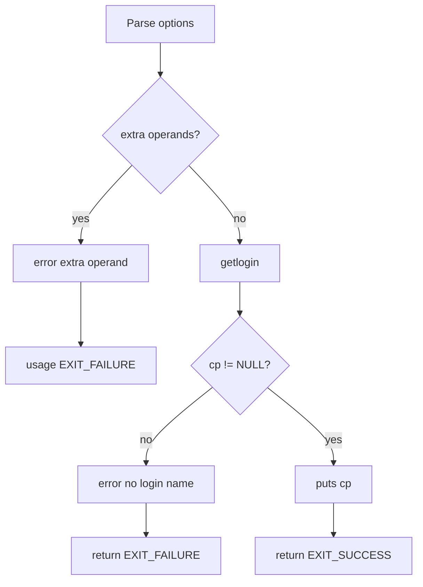

# `logname`: print user's login name

Source: `src/logname.c` (78 lines) · Tests: `tests/misc/logname.sh` ·
Manual: `info '(coreutils) logname invocation'`

`logname` prints the user's login name. It uses the `getlogin` function to
retrieve the name associated with the controlling terminal of the process. POSIX
requires using `getlogin` and prohibits fallback techniques.

## Options

No options other than `--help` and `--version`. Uses `parse_gnu_standard_options_only`
(`src/logname.c:60-62`).

## Code map

|| Function | Location | Role |
||---|---|---|
|| `main` | `src/logname.c:50` | Call `getlogin`, print result. |
|| `usage` | `:30` | Help text. |

## How it works

The diagram shows the simple flow.



`main` calls `getlogin` to get the login name (`src/logname.c:72`). If it
returns NULL, the program reports an error and exits. Otherwise, it prints the
name.

## Platform notes

- `getlogin` may fail if the process has no controlling terminal or if the
  utmp entry is not available
- POSIX prohibits fallback techniques (e.g., using `getpwuid`)

## Errors and exit status

- Extra operand: `error (0, 0, ...)` then `usage (EXIT_FAILURE)`
- No login name: `error (EXIT_FAILURE, 0, ...)`
- Write failure: handled by `atexit (close_stdout)`

## Tests

|| File | Covers |
||---|---|
|| `tests/misc/logname.sh` | Basic functionality, error cases. |

## See also

- [whoami](whoami.md) (print effective user name)
- [id](id.md) (print user and group IDs)

## Source code

`src/logname.c:1`

```c
/* logname -- print user's login name
   Copyright (C) 1990-2026 Free Software Foundation, Inc.

   This program is free software: you can redistribute it and/or modify
   it under the terms of the GNU General Public License as published by
   the Free Software Foundation, either version 3 of the License, or
   (at your option) any later version.

   This program is distributed in the hope that it will be useful,
   but WITHOUT ANY WARRANTY; without even the implied warranty of
   MERCHANTABILITY or FITNESS FOR A PARTICULAR PURPOSE.  See the
   GNU General Public License for more details.

   You should have received a copy of the GNU General Public License
   along with this program.  If not, see <https://www.gnu.org/licenses/>.  */

#include <config.h>
#include <stdio.h>
#include <sys/types.h>

#include "system.h"
#include "long-options.h"
#include "quote.h"

/* The official name of this program (e.g., no 'g' prefix).  */
#define PROGRAM_NAME "logname"

#define AUTHORS proper_name ("David MacKenzie")

void
usage (int status)
{
  if (status != EXIT_SUCCESS)
    emit_try_help ();
  else
    {
      printf (_("Usage: %s [OPTION]\n"), program_name);
      fputs (_("\
Print the user's login name.\n\
\n\
"), stdout);
      oputs (HELP_OPTION_DESCRIPTION);
      oputs (VERSION_OPTION_DESCRIPTION);
      emit_ancillary_info (PROGRAM_NAME);
    }
  exit (status);
}

int
main (int argc, char **argv)
{
  initialize_main (&argc, &argv);
  set_program_name (argv[0]);
  setlocale (LC_ALL, "");
  bindtextdomain (PACKAGE, LOCALEDIR);
  textdomain (PACKAGE);

  atexit (close_stdout);

  parse_gnu_standard_options_only (argc, argv, PROGRAM_NAME, PACKAGE_NAME,
                                   Version, true, usage, AUTHORS,
                                   (char const *) NULL);

  if (optind < argc)
    {
      error (0, 0, _("extra operand %s"), quote (argv[optind]));
      usage (EXIT_FAILURE);
    }

  /* POSIX requires using getlogin (or equivalent code) and prohibits
     using a fallback technique.  */
  char const *cp = getlogin ();
  if (! cp)
    error (EXIT_FAILURE, 0, _("no login name"));

  puts (cp);
  return EXIT_SUCCESS;
}
```
