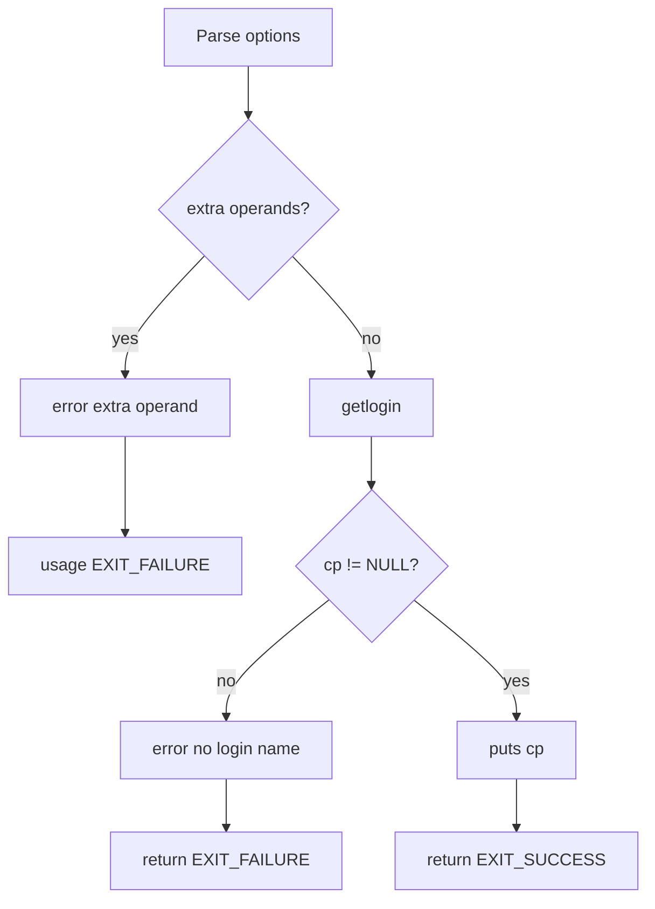

# `logname`: print user's login name

Source: `src/logname.c` (78 lines) · Tests: `tests/misc/logname.sh` ·
Manual: `info '(coreutils) logname invocation'`

`logname` prints the user's login name. It uses the `getlogin` function to
retrieve the name associated with the controlling terminal of the process. POSIX
requires using `getlogin` and prohibits fallback techniques.

## Options

No options other than `--help` and `--version`. Uses `parse_gnu_standard_options_only`
(`src/logname.c:60-62`).

## Code map

|| Function | Location | Role |
||---|---|---|
|| `main` | `src/logname.c:50` | Call `getlogin`, print result. |
|| `usage` | `:30` | Help text. |

## How it works

The diagram shows the simple flow.

`main` calls `getlogin` to get the login name (`src/logname.c:72`). If it
returns NULL, the program reports an error and exits. Otherwise, it prints the
name.

## Platform notes

- `getlogin` may fail if the process has no controlling terminal or if the
  utmp entry is not available
- POSIX prohibits fallback techniques (e.g., using `getpwuid`)

## Errors and exit status

- Extra operand: `error (0, 0, ...)` then `usage (EXIT_FAILURE)`
- No login name: `error (EXIT_FAILURE, 0, ...)`
- Write failure: handled by `atexit (close_stdout)`

## Tests

|| File | Covers |
||---|---|
|| `tests/misc/logname.sh` | Basic functionality, error cases. |

## See also

- [whoami](whoami.md) (print effective user name)
- [id](id.md) (print user and group IDs)
