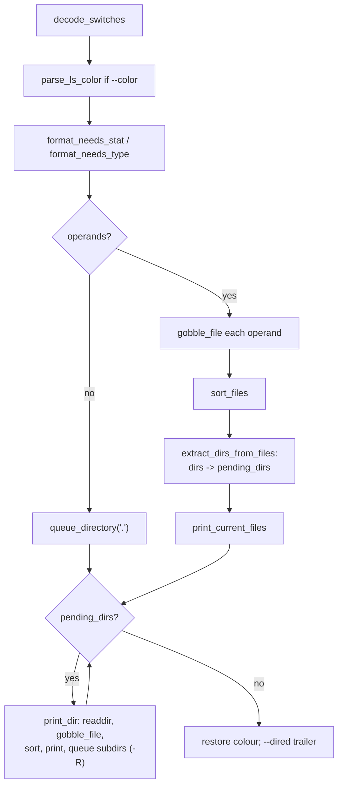

# `ls`, `dir`, `vdir`: list directory contents

Source: `src/ls.c` (5745 lines), plus `src/ls-ls.c`, `src/ls-dir.c` or
`src/ls-vdir.c`, `src/statx.h` · Tests: `tests/ls/` (57 scripts) ·
Manual: `info '(coreutils) ls invocation'`

`ls.c` is the largest source file in coreutils. One source builds three
programs. Each small file sets `ls_mode` (`src/ls.h`) to `LS_LS`,
`LS_MULTI_COL` (`dir`: columns even when not writing to a terminal, and
`escape` quoting) or `LS_LONG_FORMAT` (`vdir`: `-l` format and `escape`
quoting). `ls` itself uses `shell-escape` quoting on a terminal and no
quoting otherwise (`src/ls.c:2347-2355`). The main path is: gather file
information (`gobble_file`), sort it (`sort_files`), print it
(`print_current_files`), then go through the queue of directories to list
(`print_dir`).

## Options in brief

`ls` has more than 60 options (`long_options[]` at `src/ls.c:878`), so
they are grouped here by the variable they set in `decode_switches()`
(`src/ls.c:1911`):

| Variable | Options |
|---|---|
| `format` | `-l`, `-1`, `-C`, `-x`, `-m`, `--format=` |
| `sort_type`, `sort_reverse` | `-t`, `-S`, `-X`, `-v`, `-U`, `-f`, `--sort=`, `-r` |
| `time_type` | `-c`, `-u`, `--time=atime\|ctime\|birth\|mtime` |
| `ignore_mode`, `ignore_patterns`, `hide_patterns` | `-a`, `-A`, `-B`, `--hide=`, `-I`/`--ignore=` |
| `indicator_style` | `-F`/`--classify[=WHEN]`, `-p`, `--file-type`, `--indicator-style=` |
| `print_with_color` | `--color[=WHEN]` (with `LS_COLORS`) |
| quoting | `-b`, `-N`, `-Q`, `-q`, `--quoting-style=`, `--show-control-chars`, `QUOTING_STYLE` |
| `dereference` | `-H`, `-L`, `--dereference-command-line-symlink-to-dir` |
| long format fields | `-g`, `-G`, `-n`, `-o`, `-i`, `-s`, `-h`, `--si`, `-k`, `--block-size=`, `--author`, `-Z`, `--time-style=`, `--full-time` |
| layout | `-w`/`--width=`, `-T`/`--tabsize=`, `--zero`, `--hyperlink[=WHEN]` |
| `recursive`, `immediate_dirs`, `directories_first` | `-R`, `-d`, `--group-directories-first` |
| Emacs | `-D`/`--dired` |

Environment variables read: `LS_BLOCK_SIZE` (and `BLOCK_SIZE`), `COLUMNS`,
`TABSIZE`, `QUOTING_STYLE`, `TIME_STYLE`, `LS_COLORS`, `TZ`.

## Main data structures

| Structure | Purpose |
|---|---|
| `struct fileinfo` | One file: name, `struct stat`, link name and target mode, file type, SELinux context, ACL and capability flags, quoting width. |
| `cwd_file[]`, `cwd_n_used` | The files collected for the current listing. |
| `sorted_file[]` | Pointers into `cwd_file`, in sorted order. |
| `struct pending`, `pending_dirs` | A stack of directories still to list. With `-R`, marker entries (`name == NULL`) show where a directory's listing ends, for loop detection. |
| `active_dir_set` | With `-R`: a hash of (device, inode) for the directories being listed, used to find loops. |
| `column_info[]` | For column layout: one entry for each possible column count, with the width of each column. |

## Code map

| Function | Location | Role |
|---|---|---|
| `main` | `src/ls.c:1651` | Options, colours, defaults, the operands, the loop over `pending_dirs`, the `--dired` trailer. |
| `decode_switches` | `:1911` | All option and environment parsing. |
| `gobble_file` | `:3395` | Add one name to `cwd_file`. `stat` it only if the format needs that. Read ACL, context and capability when asked. Work out the column widths for `-l`. |
| `print_dir` | `:2948` | `opendir`/`readdir` one directory, `gobble_file` each entry, sort, print, queue subdirectories for `-R`. |
| `extract_dirs_from_files` | `:3737` | Move directories out of the file list into `pending_dirs` (operands, or subdirectories with `-R`). |
| `sort_files` | `:4080` | Choose a comparison function from `sort_functions[type][use_strcmp][reverse][dirs_first]` and call `mpsort`. |
| `xstrcoll` | `:3792` | `strcoll`. On error it calls `longjmp (failed_strcoll)`, so the sort is done again with `strcmp`. |
| `print_current_files` | `:4122` | Choose the output format. |
| `print_long_format` | `:4295` | One `-l` line: mode, links, owner, group, size, time, name, link target. |
| `calculate_columns` | `:5370` | Find the largest number of columns that fits in `line_length`. |
| `print_many_per_line`, `print_horizontal`, `print_with_separator` | `:5164`, `:5199`, `:5239` | `-C`, `-x`, `-m`. |
| `quote_name`, `quote_name_buf`, `print_name_with_quoting` | `:4766`, `:4510`, `:4831` | Quoting, colour and hyperlinks for names. |
| `parse_ls_color`, `get_color_indicator`, `print_color_indicator` | `:2715`, `:4982`, `:4964` | `LS_COLORS`. |
| `do_statx`, `calc_req_mask` | `:1206`, `:1166` | `statx` with only the fields needed. |
| `file_failure`, `set_exit_status` | `:2915`, `:2902` | Errors: serious (status 2) or minor (status 1). |

## How it works

The diagram shows the path through `main`.

### Avoiding `stat`

`stat` calls cost the most time in `ls`, so `main` works out what is
needed (`src/ls.c:1725-1732`):

- `format_needs_stat` is true for `-l`, `-s`, `-t`, `-S`, `--hyperlink`
  and `-Z`.
- Otherwise `format_needs_type` is true when only the file type is
  needed (`-R`, `--color`, `-F`, `--group-directories-first`). Then
  `d_type` from `readdir` is often enough, and no `stat` is done.
- With `statx`, `calc_req_mask()` asks only for the fields the output
  uses. For `--time=birth`, `do_statx` stores the birth time in
  `st_mtim`, so the rest of the code can use one field.

`tests/ls/stat-free-color.sh`, `stat-free-symlinks.sh` and
`stat-dtype.sh` check that `ls` does not `stat` when it does not need to.

### Default symlink handling

If no `-H`/`-L` is given, `main` sets `dereference` to
`DEREF_COMMAND_LINE_SYMLINK_TO_DIR`. So `ls link-to-dir` lists the
directory. With `-d`, `-F` or `-l` it is `DEREF_NEVER`
(`src/ls.c:1702-1707`).

### Sorting

`sort_functions` is a 4-D table of comparison functions, chosen by sort
key (and time type for `-t`), by whether to use `strcmp` instead of
`strcoll`, by `-r`, and by `--group-directories-first`
(`src/ls.c:4112-4116`). `mpsort` is gnulib's merge sort on an array of
pointers. If `strcoll` fails with an error during the sort, `xstrcoll`
uses `longjmp` to leave the sort, and it starts again with `strcmp`. A
comment explains that ignoring the error could make the comparison
inconsistent and crash `qsort`.

### Column layout

`calculate_columns()` (`src/ls.c:5370-5415`) tries every possible number
of columns at the same time. `column_info[i]` holds the column widths
for a layout with `i + 1` columns, stored in a triangular array
(`init_column_info`). For each file it updates the width of the column
that file would be in under each layout, and marks a layout invalid as soon
as its total width is more than `line_length`. The answer is the largest
layout still valid. This is O(files × max columns), where max columns is
limited by `line_length / MIN_COLUMN_WIDTH`.

### `-R` loop detection

When `ls -R` enters a directory, it adds the (device, inode) pair to
`active_dir_set` and pushes a marker onto `pending_dirs`. When the marker
comes back, the pair is removed. If a directory being entered is already
in the set, `ls` reports `not listing already-listed directory` and
treats it as a serious error.

### Colour and signals

With `--color`, output may stop in the middle of a colour sequence. `ls`
catches `SIGINT`, `SIGTSTP` and similar signals. It restores the normal
colour before it stops or exits, and then raises the signal again
(`src/ls.c:1823-1847`). TAB characters are not used in coloured output
(`tabsize = 0`), because some terminals mishandle tabs next to colour
codes.

## Errors and exit status

| Status | Constant | When |
|---|---|---|
| 0 | | Success. |
| 1 | `LS_MINOR_PROBLEM` | A file or subdirectory could not be accessed. |
| 2 | `LS_FAILURE` | A command-line operand could not be accessed, a usage error, out of memory, or a directory loop. |

`initialize_exit_failure (LS_FAILURE)` makes the gnulib "x" functions exit
with status 2.

## Tests

The table lists some of the tests.

| File | Covers |
|---|---|
| `tests/ls/ls-misc.pl` | The main table of options and output. |
| `tests/ls/stat-free-*.sh`, `stat-dtype.sh`, `stat-vs-dirent.sh` | No unneeded `stat` calls. |
| `tests/ls/color-*.sh`, `root-rel-symlink-color.sh` | `LS_COLORS` handling. |
| `tests/ls/dired.sh` | `--dired` offsets. |
| `tests/ls/quote-align.sh`, `quoting-utf8.sh`, `symlink-quote.sh` | Quoting and alignment. |
| `tests/ls/infloop.sh`, `symlink-loop.sh`, `recursive.sh` | `-R` loops. |
| `tests/ls/birthtime.sh`, `ls-time.sh`, `time-style-diag.sh`, `abmon-align.sh` | Times and time styles. |
| `tests/ls/hyperlink.sh` | `--hyperlink`. |
| `tests/ls/acl.sh`, `capability.sh`, `selinux.sh` | The `+` and `.` ACL markers, capability colour, `-Z`. |
| `tests/ls/zero-option.sh`, `w-option.sh`, `x-option.sh`, `m-option.sh` | Layout options. |

## See also

- [stat](stat.md): also uses `statx` through `src/statx.h`.
- [du](du.md) for sizes of directory trees.
