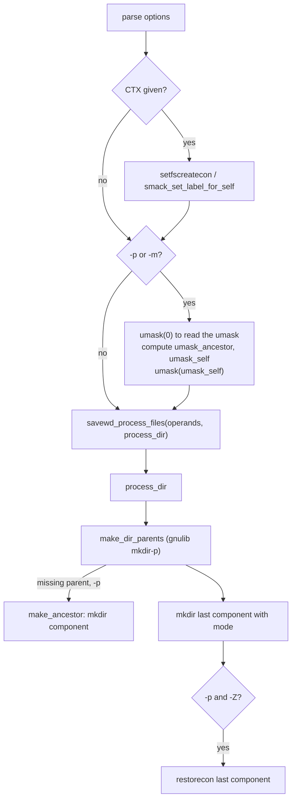

# `mkdir`: make directories

Source: `src/mkdir.c` (319 lines), `src/prog-fprintf.c`, `src/selinux.c` ·
Tests: `tests/mkdir/` · Manual: `info '(coreutils) mkdir invocation'`

`mkdir` itself is short. The hard work is in two gnulib modules:

- `mkdir-p` (`make_dir_parents`) creates a directory and, with `-p`, any
  missing parents. It works one component at a time.
- `savewd` (`savewd_process_files`) saves and restores the working
  directory. `make_dir_parents` may `chdir` into each new parent, so it does
  not have to build very long path names.

`src/mkdir.c` sets up the modes and umasks, the SELinux or SMACK context,
and the `-v` message, and passes them to those modules.

## Options

The table lists `longopts[]` (`src/mkdir.c:39-48`) and the short-option
string `"pm:vZ"`.

| Option | Effect |
|---|---|
| `-p`, `--parents` | `options.make_ancestor_function = make_ancestor`. Make parents as needed. It is not an error if the directory already exists. |
| `-m`, `--mode=MODE` | A symbolic or octal mode, compiled with gnulib `mode_compile` and applied to `a=rwx` with `mode_adjust`. With `-p`, it applies only to the last component. |
| `-v`, `--verbose` | Print `created directory 'X'` for each directory made, including parents. |
| `-Z` | Set the default SELinux context, from `selabel_open (SELABEL_CTX_FILE)`. |
| `--context[=CTX]` | Like `-Z`. With CTX, set the context to CTX with `setfscreatecon` (SELinux) or `smack_set_label_for_self` (SMACK). |

## Code map

| Function | Location | Role |
|---|---|---|
| `main` | `src/mkdir.c:202` | Options, the context, umask arithmetic, then `savewd_process_files`. |
| `process_dir` | `:164` | Called for each operand. Sets the context, calls `make_dir_parents`, and fixes the context of the last component with `-p -Z`. |
| `make_ancestor` | `:135` | Called by `make_dir_parents` for each missing parent with `-p`. Uses `umask_ancestor`. |
| `announce_mkdir` | `:122` | The `-v` message. Uses `prog_fprintf`, which adds the `mkdir: ` prefix. |
| `struct mkdir_options` | `:95` | Settings passed through `void *options` to the callbacks. |

## How it works

The diagram shows the path from `main` to the gnulib modules.



### Modes and umask

Without `-p` and `-m`, `mkdir` creates the directory with mode `0777`. The
process umask takes away bits as usual. With `-p` or `-m`, `main` reads
the umask and works out two values (`src/mkdir.c:292-315`):

```c
mode_t umask_value = umask (0);
options.umask_ancestor = umask_value & ~(S_IWUSR | S_IXUSR);

if (specified_mode)
  {
    struct mode_change *change = mode_compile (specified_mode);
    ...
    options.mode = mode_adjust (S_IRWXUGO, true, umask_value, change,
                                &options.mode_bits);
    options.umask_self = umask_value & ~options.mode;
    ...
  }
```

- **`umask_ancestor`** is the umask with the owner's write and search bits
  removed. Parent directories made by `-p` are therefore always `u+wx`, so
  `mkdir` can create the next component inside them, even with a strict
  umask such as `0700`.
- **`umask_self`** removes from the umask every bit that `-m` asked for.
  So `mkdir -m 777` gives mode 777 even when the umask is 022. If `-m` sets
  bits that `mkdir()` cannot set (set-UID, set-GID or sticky),
  `make_dir_parents` gets them in `mode_bits` and sets them later with
  `chmod`. `tests/mkdir/special-1.sh` checks this.

`make_ancestor` changes the umask only while it calls `mkdir`, and only
when the two values differ. It saves and restores `errno` around the
second `umask` call.

### Return value of `make_ancestor`

`make_ancestor` returns 0 on success when the new directory is readable, 1
when it was made but is not readable (the owner read bit was removed by
the umask), and -1 on failure. `make_dir_parents` uses this to decide
whether it can `chdir` into the new directory or must use path names.

### Security contexts

- With `--context=CTX`, the creation context is set once for the whole
  process, before any directory is made.
- With `-Z` and no `-p`, `process_dir` calls `defaultcon()` (in
  `src/selinux.c`) before `mkdir`, so the directory gets the right label
  when it is created.
- With `-Z -p`, `make_ancestor` sets the default context for each parent.
  A `FIXME` explains that `make_dir_parents` has no hook before it makes
  the last component. So that component is made first and then labelled
  with `restorecon()`.
- Errors in `ignorable_ctx_err()` (for example, the file system does not
  support labels) are ignored.

## Errors and exit status

- Each operand is processed separately. The exit status is 1 if any
  operand failed.
- `invalid mode 'X'` (bad `-m` value) and failure to set the context to
  CTX are fatal at once.
- If `savewd` cannot return to the starting directory, `mkdir` fails at
  once and does not create later relative operands in the wrong place.
  `tests/mkdir/p-3.sh` covers this case.

## Tests

| File | Covers |
|---|---|
| `tests/mkdir/p-1.sh`, `p-2.sh`, `parents.sh` | `-p` with relative and absolute names. |
| `tests/mkdir/p-3.sh` | `savewd` cannot return to the start directory. |
| `tests/mkdir/p-v.sh` | `-pv` messages for each parent. |
| `tests/mkdir/p-slashdot.sh`, `t-slash.sh` | Trailing `/` and `/.`. |
| `tests/mkdir/p-thru-slink.sh` | `-p` through a symlink to a directory. |
| `tests/mkdir/p-acl.sh` | `-p` with default ACLs. |
| `tests/mkdir/perm.sh`, `special-1.sh` | `-m` modes, including set-GID and sticky bits. |
| `tests/mkdir/writable-under-readonly.sh` | `mkdir -p /a/b/c` works when `/a` or `/a/b` exists on a read-only file system. |
| `tests/mkdir/context-optional.sh`, `selinux.sh`, `restorecon.sh` | `-Z` and `--context`. |
| `tests/mkdir/smack-root.sh`, `smack-no-root.sh` | SMACK labels. |

## See also

- [Shared infrastructure](../overview/shared-infrastructure.md) for
  `selinux.c` and `prog-fprintf.c`.
- [install](install.md): `install -d` also uses `make_dir_parents`.
- [chmod](chmod.md) uses the same `mode_compile` and `mode_adjust`.

## Source code

`src/mkdir.c:1`

```c
/* mkdir -- make directories
   Copyright (C) 1990-2026 Free Software Foundation, Inc.

   This program is free software: you can redistribute it and/or modify
   it under the terms of the GNU General Public License as published by
   the Free Software Foundation, either version 3 of the License, or
   (at your option) any later version.

   This program is distributed in the hope that it will be useful,
   but WITHOUT ANY WARRANTY; without even the implied warranty of
   MERCHANTABILITY or FITNESS FOR A PARTICULAR PURPOSE.  See the
   GNU General Public License for more details.

   You should have received a copy of the GNU General Public License
   along with this program.  If not, see <https://www.gnu.org/licenses/>.  */

/* David MacKenzie <djm@ai.mit.edu>  */

#include <config.h>
#include <stdio.h>
#include <getopt.h>
#include <sys/types.h>
#include <selinux/label.h>

#include "system.h"
#include "mkdir-p.h"
#include "modechange.h"
#include "prog-fprintf.h"
#include "quote.h"
#include "savewd.h"
#include "selinux.h"
#include "smack.h"

/* The official name of this program (e.g., no 'g' prefix).  */
#define PROGRAM_NAME "mkdir"

#define AUTHORS proper_name ("David MacKenzie")

static struct option const longopts[] =
{
  {GETOPT_SELINUX_CONTEXT_OPTION_DECL},
  {"mode", required_argument, NULL, 'm'},
  {"parents", no_argument, NULL, 'p'},
  {"verbose", no_argument, NULL, 'v'},
  {GETOPT_HELP_OPTION_DECL},
  {GETOPT_VERSION_OPTION_DECL},
  {NULL, 0, NULL, 0}
};

void
usage (int status)
{
  if (status != EXIT_SUCCESS)
    emit_try_help ();
  else
    {
      printf (_("Usage: %s [OPTION]... DIRECTORY...\n"), program_name);
      fputs (_("\
Create the DIRECTORY(ies), if they do not already exist.\n\
"), stdout);

      emit_mandatory_arg_note ();

      oputs (_("\
  -m, --mode=MODE\n\
         set file mode (as in chmod), not a=rwx - umask\n\
"));
      oputs (_("\
  -p, --parents\n\
         no error if existing, make parent directories as needed,\n\
         with their file modes unaffected by any -m option\n\
"));
      oputs (_("\
  -v, --verbose\n\
         print a message for each created directory\n\
"));
      oputs (_("\
  -Z\n\
         set SELinux security context of each created directory\n\
         to the default type\n\
"));
      oputs (_("\
      --context[=CTX]\n\
         like -Z, or if CTX is specified then set the\n\
         SELinux or SMACK security context to CTX\n\
"));
      oputs (HELP_OPTION_DESCRIPTION);
      oputs (VERSION_OPTION_DESCRIPTION);
      emit_ancillary_info (PROGRAM_NAME);
    }
  exit (status);
}

/* Options passed to subsidiary functions.  */
struct mkdir_options
{
  /* Function to make an ancestor, or NULL if ancestors should not be
     made.  */
  int (*make_ancestor_function) (char const *, char const *, void *);

  /* Umask value for when making an ancestor.  */
  mode_t umask_ancestor;

  /* Umask value for when making the directory itself.  */
  mode_t umask_self;

  /* Mode for directory itself.  */
  mode_t mode;

  /* File mode bits affected by MODE.  */
  mode_t mode_bits;

  /* Set the SELinux File Context.  */
  struct selabel_handle *set_security_context;

  /* If not null, format to use when reporting newly made directories.  */
  char const *created_directory_format;
};

/* Report that directory DIR was made, if OPTIONS requests this.  */
static void
announce_mkdir (char const *dir, void *options)
{
  struct mkdir_options const *o = options;
  if (o->created_directory_format)
    prog_fprintf (stdout, o->created_directory_format, quoteaf (dir));
}

/* Make ancestor directory DIR, whose last component is COMPONENT,
   with options OPTIONS.  Assume the working directory is COMPONENT's
   parent.  Return 0 if successful and the resulting directory is
   readable, 1 if successful but the resulting directory is not
   readable, -1 (setting errno) otherwise.  */
static int
make_ancestor (char const *dir, char const *component, void *options)
{
  struct mkdir_options const *o = options;

  if (o->set_security_context
      && defaultcon (o->set_security_context, component, S_IFDIR) < 0
      && ! ignorable_ctx_err (errno))
    error (0, errno, _("failed to set default creation context for %s"),
           quoteaf (dir));

  if (o->umask_ancestor != o->umask_self)
    umask (o->umask_ancestor);
  int r = mkdir (component, S_IRWXUGO);
  if (o->umask_ancestor != o->umask_self)
    {
      int mkdir_errno = errno;
      umask (o->umask_self);
      errno = mkdir_errno;
    }
  if (r == 0)
    {
      r = (o->umask_ancestor & S_IRUSR) != 0;
      announce_mkdir (dir, options);
    }
  return r;
}

/* Process a command-line file name.  */
static int
process_dir (char *dir, struct savewd *wd, void *options)
{
  struct mkdir_options const *o = options;

  /* If possible set context before DIR created.  */
  if (o->set_security_context)
    {
      if (! o->make_ancestor_function
          && defaultcon (o->set_security_context, dir, S_IFDIR) < 0
          && ! ignorable_ctx_err (errno))
        error (0, errno, _("failed to set default creation context for %s"),
               quoteaf (dir));
    }

  int ret = (make_dir_parents (dir, wd, o->make_ancestor_function, options,
                               o->mode, announce_mkdir,
                               o->mode_bits, (uid_t) -1, (gid_t) -1, true)
             ? EXIT_SUCCESS
             : EXIT_FAILURE);

  /* FIXME: Due to the current structure of make_dir_parents()
     we don't have the facility to call defaultcon() before the
     final component of DIR is created.  So for now, create the
     final component with the context from previous component
     and here we set the context for the final component. */
  if (ret == EXIT_SUCCESS && o->set_security_context
      && o->make_ancestor_function)
    {
      if (! restorecon (o->set_security_context, last_component (dir), false)
          && ! ignorable_ctx_err (errno))
        error (0, errno, _("failed to restore context for %s"),
               quoteaf (dir));
    }

  return ret;
}

int
main (int argc, char **argv)
{
  char const *specified_mode = NULL;
  int optc;
  char const *scontext = NULL;
  struct mkdir_options options;

  options.make_ancestor_function = NULL;
  options.mode = S_IRWXUGO;
  options.mode_bits = 0;
  options.created_directory_format = NULL;
  options.set_security_context = NULL;

  initialize_main (&argc, &argv);
  set_program_name (argv[0]);
  setlocale (LC_ALL, "");
  bindtextdomain (PACKAGE, LOCALEDIR);
  textdomain (PACKAGE);

  atexit (close_stdout);

  while ((optc = getopt_long (argc, argv, "pm:vZ", longopts, NULL)) != -1)
    {
      switch (optc)
        {
        case 'p':
          options.make_ancestor_function = make_ancestor;
          break;
        case 'm':
          specified_mode = optarg;
          break;
        case 'v': /* --verbose  */
          options.created_directory_format = _("created directory %s");
          break;
        case 'Z':
          if (is_smack_enabled ())
            {
              /* We don't yet support -Z to restore context with SMACK.  */
              scontext = optarg;
            }
          else if (is_selinux_enabled () > 0)
            {
              if (optarg)
                scontext = optarg;
              else
                {
                  options.set_security_context = selabel_open (SELABEL_CTX_FILE,
                                                               NULL, 0);
                  if (! options.set_security_context)
                    error (0, errno, _("warning: ignoring --context"));
                }
            }
          else if (optarg)
            {
              error (0, 0,
                     _("warning: ignoring --context; "
                       "it requires an SELinux/SMACK-enabled kernel"));
            }
          break;
        case_GETOPT_HELP_CHAR;
        case_GETOPT_VERSION_CHAR (PROGRAM_NAME, AUTHORS);
        default:
          usage (EXIT_FAILURE);
        }
    }

  if (optind == argc)
    {
      error (0, 0, _("missing operand"));
      usage (EXIT_FAILURE);
    }

  /* FIXME: This assumes mkdir() is done in the same process.
     If that's not always the case we would need to call this
     like we do when options.set_security_context.  */
  if (scontext)
    {
      int ret = 0;
      if (is_smack_enabled ())
        ret = smack_set_label_for_self (scontext);
      else
        ret = setfscreatecon (scontext);

      if (ret < 0)
        error (EXIT_FAILURE, errno,
               _("failed to set default file creation context to %s"),
               quote (scontext));
    }


  if (options.make_ancestor_function || specified_mode)
    {
      mode_t umask_value = umask (0);
      options.umask_ancestor = umask_value & ~(S_IWUSR | S_IXUSR);

      if (specified_mode)
        {
          struct mode_change *change = mode_compile (specified_mode);
          if (!change)
            error (EXIT_FAILURE, 0, _("invalid mode %s"),
                   quote (specified_mode));
          options.mode = mode_adjust (S_IRWXUGO, true, umask_value, change,
                                      &options.mode_bits);
          options.umask_self = umask_value & ~options.mode;
          free (change);
        }
      else
        {
          options.mode = S_IRWXUGO;
          options.umask_self = umask_value;
        }

      umask (options.umask_self);
    }

  return savewd_process_files (argc - optind, argv + optind,
                               process_dir, &options);
}
```
