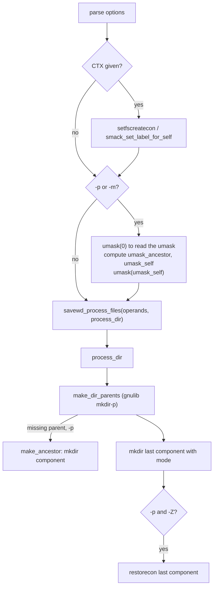

# `mkdir`: make directories

Source: `src/mkdir.c` (319 lines), `src/prog-fprintf.c`, `src/selinux.c` ·
Tests: `tests/mkdir/` · Manual: `info '(coreutils) mkdir invocation'`

`mkdir` itself is short. The hard work is in two gnulib modules:

- `mkdir-p` (`make_dir_parents`) creates a directory and, with `-p`, any
  missing parents. It works one component at a time.
- `savewd` (`savewd_process_files`) saves and restores the working
  directory. `make_dir_parents` may `chdir` into each new parent, so it does
  not have to build very long path names.

`src/mkdir.c` sets up the modes and umasks, the SELinux or SMACK context,
and the `-v` message, and passes them to those modules.

## Options

The table lists `longopts[]` (`src/mkdir.c:39-48`) and the short-option
string `"pm:vZ"`.

| Option | Effect |
|---|---|
| `-p`, `--parents` | `options.make_ancestor_function = make_ancestor`. Make parents as needed. It is not an error if the directory already exists. |
| `-m`, `--mode=MODE` | A symbolic or octal mode, compiled with gnulib `mode_compile` and applied to `a=rwx` with `mode_adjust`. With `-p`, it applies only to the last component. |
| `-v`, `--verbose` | Print `created directory 'X'` for each directory made, including parents. |
| `-Z` | Set the default SELinux context, from `selabel_open (SELABEL_CTX_FILE)`. |
| `--context[=CTX]` | Like `-Z`. With CTX, set the context to CTX with `setfscreatecon` (SELinux) or `smack_set_label_for_self` (SMACK). |

## Code map

| Function | Location | Role |
|---|---|---|
| `main` | `src/mkdir.c:202` | Options, the context, umask arithmetic, then `savewd_process_files`. |
| `process_dir` | `:164` | Called for each operand. Sets the context, calls `make_dir_parents`, and fixes the context of the last component with `-p -Z`. |
| `make_ancestor` | `:135` | Called by `make_dir_parents` for each missing parent with `-p`. Uses `umask_ancestor`. |
| `announce_mkdir` | `:122` | The `-v` message. Uses `prog_fprintf`, which adds the `mkdir: ` prefix. |
| `struct mkdir_options` | `:95` | Settings passed through `void *options` to the callbacks. |

## How it works

The diagram shows the path from `main` to the gnulib modules.



### Modes and umask

Without `-p` and `-m`, `mkdir` creates the directory with mode `0777`. The
process umask takes away bits as usual. With `-p` or `-m`, `main` reads
the umask and works out two values (`src/mkdir.c:292-315`):

```c
mode_t umask_value = umask (0);
options.umask_ancestor = umask_value & ~(S_IWUSR | S_IXUSR);

if (specified_mode)
  {
    struct mode_change *change = mode_compile (specified_mode);
    ...
    options.mode = mode_adjust (S_IRWXUGO, true, umask_value, change,
                                &options.mode_bits);
    options.umask_self = umask_value & ~options.mode;
    ...
  }
```

- **`umask_ancestor`** is the umask with the owner's write and search bits
  removed. Parent directories made by `-p` are therefore always `u+wx`, so
  `mkdir` can create the next component inside them, even with a strict
  umask such as `0700`.
- **`umask_self`** removes from the umask every bit that `-m` asked for.
  So `mkdir -m 777` gives mode 777 even when the umask is 022. If `-m` sets
  bits that `mkdir()` cannot set (set-UID, set-GID or sticky),
  `make_dir_parents` gets them in `mode_bits` and sets them later with
  `chmod`. `tests/mkdir/special-1.sh` checks this.

`make_ancestor` changes the umask only while it calls `mkdir`, and only
when the two values differ. It saves and restores `errno` around the
second `umask` call.

### Return value of `make_ancestor`

`make_ancestor` returns 0 on success when the new directory is readable, 1
when it was made but is not readable (the owner read bit was removed by
the umask), and -1 on failure. `make_dir_parents` uses this to decide
whether it can `chdir` into the new directory or must use path names.

### Security contexts

- With `--context=CTX`, the creation context is set once for the whole
  process, before any directory is made.
- With `-Z` and no `-p`, `process_dir` calls `defaultcon()` (in
  `src/selinux.c`) before `mkdir`, so the directory gets the right label
  when it is created.
- With `-Z -p`, `make_ancestor` sets the default context for each parent.
  A `FIXME` explains that `make_dir_parents` has no hook before it makes
  the last component. So that component is made first and then labelled
  with `restorecon()`.
- Errors in `ignorable_ctx_err()` (for example, the file system does not
  support labels) are ignored.

## Errors and exit status

- Each operand is processed separately. The exit status is 1 if any
  operand failed.
- `invalid mode 'X'` (bad `-m` value) and failure to set the context to
  CTX are fatal at once.
- If `savewd` cannot return to the starting directory, `mkdir` fails at
  once and does not create later relative operands in the wrong place.
  `tests/mkdir/p-3.sh` covers this case.

## Tests

| File | Covers |
|---|---|
| `tests/mkdir/p-1.sh`, `p-2.sh`, `parents.sh` | `-p` with relative and absolute names. |
| `tests/mkdir/p-3.sh` | `savewd` cannot return to the start directory. |
| `tests/mkdir/p-v.sh` | `-pv` messages for each parent. |
| `tests/mkdir/p-slashdot.sh`, `t-slash.sh` | Trailing `/` and `/.`. |
| `tests/mkdir/p-thru-slink.sh` | `-p` through a symlink to a directory. |
| `tests/mkdir/p-acl.sh` | `-p` with default ACLs. |
| `tests/mkdir/perm.sh`, `special-1.sh` | `-m` modes, including set-GID and sticky bits. |
| `tests/mkdir/writable-under-readonly.sh` | `mkdir -p /a/b/c` works when `/a` or `/a/b` exists on a read-only file system. |
| `tests/mkdir/context-optional.sh`, `selinux.sh`, `restorecon.sh` | `-Z` and `--context`. |
| `tests/mkdir/smack-root.sh`, `smack-no-root.sh` | SMACK labels. |

## See also

- [Shared infrastructure](../overview/shared-infrastructure.md) for
  `selinux.c` and `prog-fprintf.c`.
- [install](install.md): `install -d` also uses `make_dir_parents`.
- [chmod](chmod.md) uses the same `mode_compile` and `mode_adjust`.
