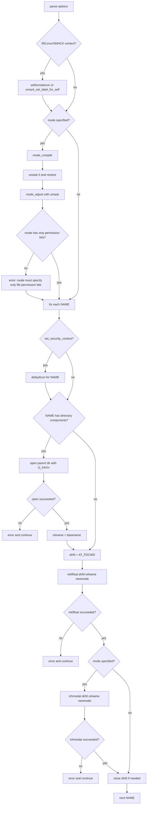

# `mkfifo`: create named pipes (FIFOs)

Source: `src/mkfifo.c` (225 lines) · Tests: `tests/mkfifo/` ·
Manual: `info '(coreutils) mkfifo invocation'`

`mkfifo` creates FIFO special files (named pipes) using `mkfifoat`. It sets
the file mode with `mode_compile` and `mode_adjust`, and can set SELinux or
SMACK security contexts. When a mode is specified with a path containing
directory components, it opens the parent directory with `O_PATH` and uses
`lchmodat` to avoid following symlinks in the path.

## Options

The table lists `longopts[]` (`src/mkfifo.c:37-44`) and the short-option
string `"m:Z"`.

|| Option | Variables |
||---|---|
|| `-m MODE`, `--mode=MODE` | `specified_mode`: file permission mode |
|| `-Z`, `--context[=CTX]` | `scontext` or `set_security_context`: SELinux/SMACK context |

## Code map

|| Function | Location | Role |
||---|---|---|
|| `main` | `src/mkfifo.c:81` | Option parsing, mode calculation, loop over files, `mkfifoat`, `lchmodat` |
|| `usage` | `:47` | Help message |

## How it works



### Mode calculation

When `-m` is given, `main` compiles the mode string with `mode_compile`
(`src/mkfifo.c:158`). It then saves and restores the umask with
`umask(0)`/`umask(umask_value)` to get the current umask value
(`src/mkfifo.c:161-162`). `mode_adjust` applies the mode change to the base
mode `MODE_RW_UGO` (0666) with the umask (`src/mkfifo.c:163`). The result
must contain only permission bits (`S_IRWXUGO`), or `mkfifo` fails
(`src/mkfifo.c:165-167`).

### Security context

The `-Z`/`--context` option sets the default file creation context
(`src/mkfifo.c:103-127`):

- With SMACK enabled, `smack_set_label_for_self` sets the process label.
- With SELinux enabled and no argument, `selabel_open` opens a file context
  mapping, and `defaultcon` looks up the default context for each file.
- With SELinux enabled and an argument, `setfscreatecon` sets the context
  directly.
- If neither SELinux nor SMACK is enabled, the option is ignored with a
  warning.

### Path handling with mode

When a mode is specified and the path contains directory components, `mkfifo`
opens the parent directory with `O_PATHSEARCH | O_DIRECTORY` and creates the
FIFO relative to that descriptor (`src/mkfifo.c:188-206`). This allows using
`lchmodat` instead of `lchmod`, which would follow symlinks in leading path
components. The comment explains this is necessary to handle default ACLs,
which can modify the mode after creation.

## Platform notes

`mkfifo` uses `mkfifoat` and `lchmodat` from gnulib for portability. SELinux
and SMACK support is conditional on `is_selinux_enabled` and
`is_smack_enabled`. `O_PATHSEARCH` is a gnulib portability constant.

## Errors and exit status

- **Missing operand:** "missing operand"
- **Invalid mode:** "invalid mode" (from `mode_compile`)
- **Invalid mode bits:** "mode must specify only file permission bits"
- **Context set failure:** "failed to set default file creation context to CTX"
- **Parent directory open failure:** "cannot create fifo NAME" (when mode specified)
- **`mkfifoat` failure:** "cannot create fifo NAME"
- **`lchmodat` failure:** "cannot set permissions of NAME"

Exit status is 0 on success, 1 if any file fails.

## Tests

|| File | Covers |
||---|---|
|| `tests/mkfifo/basic.sh` | Basic FIFO creation with various modes |

## See also

- [mkdir](mkdir.md) for directory creation with similar mode handling
- [mknod](mknod.md) for creating other special files

## Source code

`src/mkfifo.c:1`

```c
/* mkfifo -- make fifo's (named pipes)
   Copyright (C) 1990-2026 Free Software Foundation, Inc.

   This program is free software: you can redistribute it and/or modify
   it under the terms of the GNU General Public License as published by
   the Free Software Foundation, either version 3 of the License, or
   (at your option) any later version.

   This program is distributed in the hope that it will be useful,
   but WITHOUT ANY WARRANTY; without even the implied warranty of
   MERCHANTABILITY or FITNESS FOR A PARTICULAR PURPOSE.  See the
   GNU General Public License for more details.

   You should have received a copy of the GNU General Public License
   along with this program.  If not, see <https://www.gnu.org/licenses/>.  */

/* David MacKenzie <djm@ai.mit.edu>  */

#include <config.h>
#include <stdio.h>
#include <getopt.h>
#include <sys/types.h>
#include <selinux/label.h>

#include "system.h"
#include "fcntl--.h"
#include "modechange.h"
#include "quote.h"
#include "selinux.h"
#include "smack.h"

/* The official name of this program (e.g., no 'g' prefix).  */
#define PROGRAM_NAME "mkfifo"

#define AUTHORS proper_name ("David MacKenzie")

static struct option const longopts[] =
{
  {GETOPT_SELINUX_CONTEXT_OPTION_DECL},
  {"mode", required_argument, NULL, 'm'},
  {GETOPT_HELP_OPTION_DECL},
  {GETOPT_VERSION_OPTION_DECL},
  {NULL, 0, NULL, 0}
};

void
usage (int status)
{
  if (status != EXIT_SUCCESS)
    emit_try_help ();
  else
    {
      printf (_("Usage: %s [OPTION]... NAME...\n"), program_name);
      fputs (_("\
Create named pipes (FIFOs) with the given NAMEs.\n\
"), stdout);

      emit_mandatory_arg_note ();

      oputs (_("\
  -m, --mode=MODE\n\
         set file permission bits to MODE, not a=rw - umask\n\
"));
      oputs (_("\
  -Z\n\
         set the SELinux security context to default type\n\
"));
      oputs (_("\
      --context[=CTX]\n\
         like -Z, or if CTX is specified then set the\n\
         SELinux or SMACK security context to CTX\n\
"));
      oputs (HELP_OPTION_DESCRIPTION);
      oputs (VERSION_OPTION_DESCRIPTION);
      emit_ancillary_info (PROGRAM_NAME);
    }
  exit (status);
}

int
main (int argc, char **argv)
{
  char const *specified_mode = NULL;
  char const *scontext = NULL;
  struct selabel_handle *set_security_context = NULL;

  initialize_main (&argc, &argv);
  set_program_name (argv[0]);
  setlocale (LC_ALL, "");
  bindtextdomain (PACKAGE, LOCALEDIR);
  textdomain (PACKAGE);

  atexit (close_stdout);

  int optc;
  while ((optc = getopt_long (argc, argv, "m:Z", longopts, NULL)) != -1)
    {
      switch (optc)
        {
        case 'm':
          specified_mode = optarg;
          break;
        case 'Z':
          if (is_smack_enabled ())
            {
              /* We don't yet support -Z to restore context with SMACK.  */
              scontext = optarg;
            }
          else if (is_selinux_enabled () > 0)
            {
              if (optarg)
                scontext = optarg;
              else
                {
                  set_security_context = selabel_open (SELABEL_CTX_FILE,
                                                       NULL, 0);
                  if (! set_security_context)
                    error (0, errno, _("warning: ignoring --context"));
                }
            }
          else if (optarg)
            {
              error (0, 0,
                     _("warning: ignoring --context; "
                       "it requires an SELinux/SMACK-enabled kernel"));
            }
          break;
        case_GETOPT_HELP_CHAR;
        case_GETOPT_VERSION_CHAR (PROGRAM_NAME, AUTHORS);
        default:
          usage (EXIT_FAILURE);
        }
    }

  if (optind == argc)
    {
      error (0, 0, _("missing operand"));
      usage (EXIT_FAILURE);
    }

  if (scontext)
    {
      int ret = 0;
      if (is_smack_enabled ())
        ret = smack_set_label_for_self (scontext);
      else
        ret = setfscreatecon (scontext);

      if (ret < 0)
        error (EXIT_FAILURE, errno,
               _("failed to set default file creation context to %s"),
               quote (scontext));
    }

  mode_t newmode = MODE_RW_UGO;
  if (specified_mode)
    {
      struct mode_change *change = mode_compile (specified_mode);
      if (!change)
        error (EXIT_FAILURE, 0, _("invalid mode"));
      mode_t umask_value = umask (0);
      umask (umask_value);
      newmode = mode_adjust (newmode, false, umask_value, change, NULL);
      free (change);
      if (newmode & ~S_IRWXUGO)
        error (EXIT_FAILURE, 0,
               _("mode must specify only file permission bits"));
    }

  int exit_status = EXIT_SUCCESS;
  for (; optind < argc; ++optind)
    {
      char const *const name = argv[optind];

      if (set_security_context)
        defaultcon (set_security_context, name, S_IFIFO);

      int dirfd = AT_FDCWD;
      char const *relname = name;
      char const *base;

      /* When a mode is specified, open a file descriptor to the parent
         and create the FIFO relative to that.  This allows us to call
         lchmodat instead of lchmod, which would follow leading path
         components in NAME.  The lchmodat call is necessary to set
         the mode in the presence of default ACLs, where we may have
         mode different than the one the user specified without it.  */
      if (specified_mode && (base = last_component (name)) != name && *base)
        {
          char *dir = dir_name (name);

          dirfd = open (dir, O_PATHSEARCH | O_DIRECTORY);
          free (dir);

          /* We lie about the error here, since the reason for opening the
             parent is not intuitive, and a mkfifo(3) call would most likely
             fail for the same reason.  */
          if (dirfd < 0)
            {
              error (0, errno, _("cannot create fifo %s"), quoteaf (name));
              exit_status = EXIT_FAILURE;
              continue;
            }

          relname = base;
        }

      if (mkfifoat (dirfd, relname, newmode) < 0)
        {
          error (0, errno, _("cannot create fifo %s"), quoteaf (name));
          exit_status = EXIT_FAILURE;
        }
      else if (specified_mode && lchmodat (dirfd, relname, newmode) < 0)
        {
          error (0, errno, _("cannot set permissions of %s"),
                 quoteaf (name));
          exit_status = EXIT_FAILURE;
        }

      if (dirfd != AT_FDCWD)
        close (dirfd);
    }

  return exit_status;
}
```
