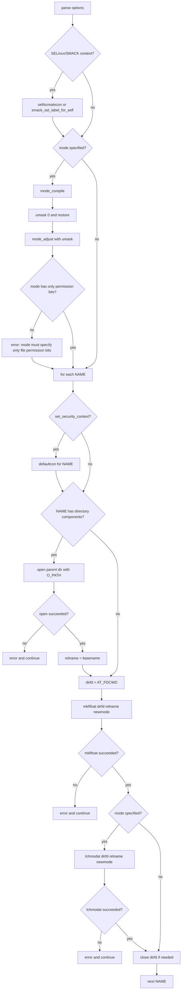

# `mkfifo`: create named pipes (FIFOs)

Source: `src/mkfifo.c` (225 lines) · Tests: `tests/mkfifo/` ·
Manual: `info '(coreutils) mkfifo invocation'`

`mkfifo` creates FIFO special files (named pipes) using `mkfifoat`. It sets
the file mode with `mode_compile` and `mode_adjust`, and can set SELinux or
SMACK security contexts. When a mode is specified with a path containing
directory components, it opens the parent directory with `O_PATH` and uses
`lchmodat` to avoid following symlinks in the path.

## Options

The table lists `longopts[]` (`src/mkfifo.c:37-44`) and the short-option
string `"m:Z"`.

|| Option | Variables |
||---|---|
|| `-m MODE`, `--mode=MODE` | `specified_mode`: file permission mode |
|| `-Z`, `--context[=CTX]` | `scontext` or `set_security_context`: SELinux/SMACK context |

## Code map

|| Function | Location | Role |
||---|---|---|
|| `main` | `src/mkfifo.c:81` | Option parsing, mode calculation, loop over files, `mkfifoat`, `lchmodat` |
|| `usage` | `:47` | Help message |

## How it works

### Mode calculation

When `-m` is given, `main` compiles the mode string with `mode_compile`
(`src/mkfifo.c:158`). It then saves and restores the umask with
`umask(0)`/`umask(umask_value)` to get the current umask value
(`src/mkfifo.c:161-162`). `mode_adjust` applies the mode change to the base
mode `MODE_RW_UGO` (0666) with the umask (`src/mkfifo.c:163`). The result
must contain only permission bits (`S_IRWXUGO`), or `mkfifo` fails
(`src/mkfifo.c:165-167`).

### Security context

The `-Z`/`--context` option sets the default file creation context
(`src/mkfifo.c:103-127`):

- With SMACK enabled, `smack_set_label_for_self` sets the process label.
- With SELinux enabled and no argument, `selabel_open` opens a file context
  mapping, and `defaultcon` looks up the default context for each file.
- With SELinux enabled and an argument, `setfscreatecon` sets the context
  directly.
- If neither SELinux nor SMACK is enabled, the option is ignored with a
  warning.

### Path handling with mode

When a mode is specified and the path contains directory components, `mkfifo`
opens the parent directory with `O_PATHSEARCH | O_DIRECTORY` and creates the
FIFO relative to that descriptor (`src/mkfifo.c:188-206`). This allows using
`lchmodat` instead of `lchmod`, which would follow symlinks in leading path
components. The comment explains this is necessary to handle default ACLs,
which can modify the mode after creation.

## Platform notes

`mkfifo` uses `mkfifoat` and `lchmodat` from gnulib for portability. SELinux
and SMACK support is conditional on `is_selinux_enabled` and
`is_smack_enabled`. `O_PATHSEARCH` is a gnulib portability constant.

## Errors and exit status

- **Missing operand:** "missing operand"
- **Invalid mode:** "invalid mode" (from `mode_compile`)
- **Invalid mode bits:** "mode must specify only file permission bits"
- **Context set failure:** "failed to set default file creation context to CTX"
- **Parent directory open failure:** "cannot create fifo NAME" (when mode specified)
- **`mkfifoat` failure:** "cannot create fifo NAME"
- **`lchmodat` failure:** "cannot set permissions of NAME"

Exit status is 0 on success, 1 if any file fails.

## Tests

|| File | Covers |
||---|---|
|| `tests/mkfifo/basic.sh` | Basic FIFO creation with various modes |

## See also

- [mkdir](mkdir.md) for directory creation with similar mode handling
- [mknod](mknod.md) for creating other special files
