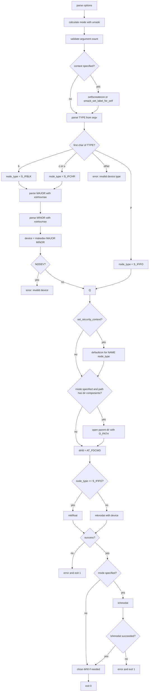

# `mknod`: create special files

Source: `src/mknod.c` (317 lines) · Tests: (none) ·
Manual: `info '(coreutils) mknod invocation'`

`mknod` creates block special files, character special files, or FIFOs using
`mknodat` or `mkfifoat`. It parses major and minor device numbers with
`xstrtoumax` (allowing decimal, octal, or hexadecimal), and combines them with
`makedev`. Like `mkfifo`, it uses `O_PATH` and `lchmodat` when a mode is
specified to avoid following symlinks in the path.

## Options

The table lists `longopts[]` (`src/mknod.c:38-45`) and the short-option
string `"m:Z"`.

|| Option | Variables |
||---|---|
|| `-m MODE`, `--mode=MODE` | `specified_mode`: file permission mode |
|| `-Z`, `--context[=CTX]` | `scontext` or `set_security_context`: SELinux/SMACK context |

## Code map

|| Function | Location | Role |
||---|---|---|
|| `main` | `src/mknod.c:97` | Option parsing, mode calculation, argument validation, device number parsing, `mknodat`/`mkfifoat`, `lchmodat` |
|| `usage` | `:48` | Help message |

## How it works



### Argument validation

`main` validates the argument count based on the device type
(`src/mknod.c:169-193`):

- **FIFO (`TYPE` starting with `p`):** Exactly 2 arguments (NAME, TYPE).
- **Block or character device:** Exactly 4 arguments (NAME, TYPE, MAJOR, MINOR).

The check looks at the first character of TYPE: if it's `p`, expect 2
operands; otherwise, expect 4. Extra or missing operands produce specific
error messages: "Special files require major and minor device numbers" or
"Fifos do not have major and minor device numbers".

### Device number parsing

For block and character devices, `main` parses MAJOR and MINOR with
`xstrtoumax` (`src/mknod.c:237-247`). The base is 0, which allows decimal,
octal (leading 0), or hexadecimal (leading 0x or 0X). The parsed values must
fit in `major_t` and `minor_t`. `makedev` combines them into a `dev_t`
(`src/mknod.c:249`). If `NODEV` is defined and the result equals `NODEV`,
`mknod` fails with "invalid device".

### Type determination

Only the first character of TYPE is checked (`src/mknod.c:214`), allowing
mnemonic usage like `mknod /dev/rst0 character 18 0`. The cases are:

- `b`: Block special file (`S_IFBLK`)
- `c` or `u`: Character special file (`S_IFCHR`)
- `p`: FIFO (`S_IFIFO`)

Platforms without `S_IFBLK` or `S_IFCHR` produce an error at compile time or
runtime.

### Mode and path handling

The mode calculation and path handling are identical to `mkfifo`
(`src/mkfifo.c:155-164`). When a mode is specified, the parent directory is
opened with `O_PATHSEARCH | O_DIRECTORY` and the file is created with
`mknodat`/`mkfifoat`, then the mode is set with `lchmodat` to avoid following
symlinks (`src/mknod.c:282-311`).

## Platform notes

`mknod` uses `mknodat`, `mkfifoat`, and `lchmodat` from gnulib. `S_IFBLK`,
`S_IFCHR`, and `NODEV` are conditionally defined. SELinux and SMACK support
is conditional on `is_selinux_enabled` and `is_smack_enabled`. Creating
device files typically requires root privileges.

## Errors and exit status

- **Missing operand:** "missing operand"
- **Extra operand:** "extra operand OPERAND"
- **Invalid mode:** "invalid mode" (from `mode_compile`)
- **Invalid mode bits:** "mode must specify only file permission bits"
- **Block special files not supported:** Platform lacks `S_IFBLK`
- **Character special files not supported:** Platform lacks `S_IFCHR`
- **Invalid major/minor:** "invalid major/minor device number NUMBER"
- **Invalid device:** "invalid device MAJOR MINOR" (when `NODEV` check fails)
- **Invalid device type:** "invalid device type TYPE"
- **Context set failure:** "failed to set default file creation context to CTX"
- **`mknodat`/`mkfifoat` failure:** Error message from `quotef(NAME)`
- **`lchmodat` failure:** "cannot set permissions of NAME"

Exit status is 0 on success, 1 on failure.

## Tests

No dedicated test files exist for `mknod`. Creating device files typically
requires root privileges and varies significantly across platforms.

## See also

- [mkfifo](mkfifo.md) for FIFO creation with similar mode handling
- [chmod](chmod.md) for mode syntax

## Source code

`src/mknod.c:1`

```c
/* mknod -- make special files
   Copyright (C) 1990-2026 Free Software Foundation, Inc.

   This program is free software: you can redistribute it and/or modify
   it under the terms of the GNU General Public License as published by
   the Free Software Foundation, either version 3 of the License, or
   (at your option) any later version.

   This program is distributed in the hope that it will be useful,
   but WITHOUT ANY WARRANTY; without even the implied warranty of
   MERCHANTABILITY or FITNESS FOR A PARTICULAR PURPOSE.  See the
   GNU General Public License for more details.

   You should have received a copy of the GNU General Public License
   along with this program.  If not, see <https://www.gnu.org/licenses/>.  */

/* Written by David MacKenzie <djm@ai.mit.edu>  */

#include <config.h>
#include <stdio.h>
#include <getopt.h>
#include <sys/types.h>
#include <selinux/label.h>

#include "system.h"
#include "fcntl--.h"
#include "modechange.h"
#include "quote.h"
#include "selinux.h"
#include "smack.h"
#include "xstrtol.h"

/* The official name of this program (e.g., no 'g' prefix).  */
#define PROGRAM_NAME "mknod"

#define AUTHORS proper_name ("David MacKenzie")

static struct option const longopts[] =
{
  {GETOPT_SELINUX_CONTEXT_OPTION_DECL},
  {"mode", required_argument, NULL, 'm'},
  {GETOPT_HELP_OPTION_DECL},
  {GETOPT_VERSION_OPTION_DECL},
  {NULL, 0, NULL, 0}
};

void
usage (int status)
{
  if (status != EXIT_SUCCESS)
    emit_try_help ();
  else
    {
      printf (_("Usage: %s [OPTION]... NAME TYPE [MAJOR MINOR]\n"),
              program_name);
      fputs (_("\
Create the special file NAME of the given TYPE.\n\
"), stdout);

      emit_mandatory_arg_note ();

      oputs (_("\
  -m, --mode=MODE\n\
         set file permission bits to MODE, not a=rw - umask\n\
"));
      oputs (_("\
  -Z\n\
         set the SELinux security context to default type\n\
"));
      oputs (_("\
      --context[=CTX]\n\
         like -Z, or if CTX is specified then set the\n\
         SELinux or SMACK security context to CTX\n\
"));
      oputs (HELP_OPTION_DESCRIPTION);
      oputs (VERSION_OPTION_DESCRIPTION);
      fputs (_("\
\n\
Both MAJOR and MINOR must be specified when TYPE is b, c, or u, and they\n\
must be omitted when TYPE is p.  If MAJOR or MINOR begins with 0x or 0X,\n\
it is interpreted as hexadecimal; otherwise, if it begins with 0, as octal;\n\
otherwise, as decimal.  TYPE may be:\n\
"), stdout);
      fputs (_("\
\n\
  b      create a block (buffered) special file\n\
  c, u   create a character (unbuffered) special file\n\
  p      create a FIFO\n\
"), stdout);
      printf (USAGE_BUILTIN_WARNING, PROGRAM_NAME);
      emit_ancillary_info (PROGRAM_NAME);
    }
  exit (status);
}

int
main (int argc, char **argv)
{
  char const *specified_mode = NULL;
  char const *scontext = NULL;
  struct selabel_handle *set_security_context = NULL;

  initialize_main (&argc, &argv);
  set_program_name (argv[0]);
  setlocale (LC_ALL, "");
  bindtextdomain (PACKAGE, LOCALEDIR);
  textdomain (PACKAGE);

  atexit (close_stdout);

  int optc;
  while ((optc = getopt_long (argc, argv, "m:Z", longopts, NULL)) != -1)
    {
      switch (optc)
        {
        case 'm':
          specified_mode = optarg;
          break;
        case 'Z':
          if (is_smack_enabled ())
            {
              /* We don't yet support -Z to restore context with SMACK.  */
              scontext = optarg;
            }
          else if (is_selinux_enabled () > 0)
            {
              if (optarg)
                scontext = optarg;
              else
                {
                  set_security_context = selabel_open (SELABEL_CTX_FILE,
                                                       NULL, 0);
                  if (! set_security_context)
                    error (0, errno, _("warning: ignoring --context"));
                }
            }
          else if (optarg)
            {
              error (0, 0,
                     _("warning: ignoring --context; "
                       "it requires an SELinux/SMACK-enabled kernel"));
            }
          break;
        case_GETOPT_HELP_CHAR;
        case_GETOPT_VERSION_CHAR (PROGRAM_NAME, AUTHORS);
        default:
          usage (EXIT_FAILURE);
        }
    }

  mode_t newmode = MODE_RW_UGO;
  if (specified_mode)
    {
      struct mode_change *change = mode_compile (specified_mode);
      if (!change)
        error (EXIT_FAILURE, 0, _("invalid mode"));
      mode_t umask_value = umask (0);
      umask (umask_value);
      newmode = mode_adjust (newmode, false, umask_value, change, NULL);
      free (change);
      if (newmode & ~S_IRWXUGO)
        error (EXIT_FAILURE, 0,
               _("mode must specify only file permission bits"));
    }

  /* If the number of arguments is 0 or 1,
     or (if it's 2 or more and the second one starts with 'p'), then there
     must be exactly two operands.  Otherwise, there must be four.  */
  int expected_operands = (argc <= optind
                           || (optind + 1 < argc && argv[optind + 1][0] == 'p')
                           ? 2 : 4);

  if (argc - optind < expected_operands)
    {
      if (argc <= optind)
        error (0, 0, _("missing operand"));
      else
        error (0, 0, _("missing operand after %s"), quote (argv[argc - 1]));
      if (expected_operands == 4 && argc - optind == 2)
        fprintf (stderr, "%s\n",
                 _("Special files require major and minor device numbers."));
      usage (EXIT_FAILURE);
    }

  if (expected_operands < argc - optind)
    {
      error (0, 0, _("extra operand %s"),
             quote (argv[optind + expected_operands]));
      if (expected_operands == 2 && argc - optind == 4)
        fprintf (stderr, "%s\n",
                 _("Fifos do not have major and minor device numbers."));
      usage (EXIT_FAILURE);
    }

  if (scontext)
    {
      int ret = 0;
      if (is_smack_enabled ())
        ret = smack_set_label_for_self (scontext);
      else
        ret = setfscreatecon (scontext);

      if (ret < 0)
        error (EXIT_FAILURE, errno,
               _("failed to set default file creation context to %s"),
               quote (scontext));
    }

  /* Only check the first character, to allow mnemonic usage like
     'mknod /dev/rst0 character 18 0'. */

  mode_t node_type;
  dev_t device;
  switch (argv[optind + 1][0])
    {
    case 'b':			/* 'block' or 'buffered' */
#ifndef S_IFBLK
      error (EXIT_FAILURE, 0, _("block special files not supported"));
#else
      node_type = S_IFBLK;
#endif
      goto block_or_character;

    case 'c':			/* 'character' */
    case 'u':			/* 'unbuffered' */
#ifndef S_IFCHR
      error (EXIT_FAILURE, 0, _("character special files not supported"));
#else
      node_type = S_IFCHR;
#endif
      goto block_or_character;

    block_or_character:
      {
        char const *s_major = argv[optind + 2];
        uintmax_t i_major;
        if (xstrtoumax (s_major, NULL, 0, &i_major, "") != LONGINT_OK
            || i_major != (major_t) i_major)
          error (EXIT_FAILURE, 0,
                 _("invalid major device number %s"), quote (s_major));

        char const *s_minor = argv[optind + 3];
        uintmax_t i_minor;
        if (xstrtoumax (s_minor, NULL, 0, &i_minor, "") != LONGINT_OK
            || i_minor != (minor_t) i_minor)
          error (EXIT_FAILURE, 0,
                 _("invalid minor device number %s"), quote (s_minor));

        device = makedev (i_major, i_minor);
#ifdef NODEV
        if (device == NODEV)
          error (EXIT_FAILURE, 0, _("invalid device %s %s"),
                 s_major, s_minor);
#endif
      }
      break;

    case 'p':			/* 'pipe' */
      node_type = S_IFIFO;
      break;

    default:
      error (0, 0, _("invalid device type %s"), quote (argv[optind + 1]));
      usage (EXIT_FAILURE);
    }

  char const *const name = argv[optind];

  if (set_security_context)
    defaultcon (set_security_context, name, node_type);

  int dirfd = AT_FDCWD;
  char const *relname = name;
  char const *base;

  /* When a mode is specified, open a file descriptor to the parent
     and create the special file relative to that.  This allows us to
     call lchmodat instead of lchmod, which would follow leading path
     components in NAME.  The lchmodat call is necessary to set
     the mode in the presence of default ACLs, where we may have
     mode different than the one the user specified without it.  */
  if (specified_mode && (base = last_component (name)) != name && *base)
    {
      char *dir = dir_name (name);

      dirfd = open (dir, O_PATHSEARCH | O_DIRECTORY);
      free (dir);

      /* We lie about the error here, since the reason for opening the
         parent is not intuitive, and a mkfifo(3) or mknodat(2) call
         would most likely fail for the same reason.  */
      if (dirfd < 0)
        error (EXIT_FAILURE, errno, "%s", quotef (name));

      relname = base;
    }

  bool ok = true;
  if ((node_type == S_IFIFO
       ? mkfifoat (dirfd, relname, newmode)
       : mknodat (dirfd, relname, newmode | node_type, device)) < 0)
    {
      error (0, errno, "%s", quotef (name));
      ok = false;
    }
  else if (specified_mode && lchmodat (dirfd, relname, newmode) < 0)
    {
      error (EXIT_FAILURE, errno, _("cannot set permissions of %s"),
             quoteaf (name));
      ok = false;
    }

  if (dirfd != AT_FDCWD)
    close (dirfd);

  return ok ? EXIT_SUCCESS : EXIT_FAILURE;
}
```
