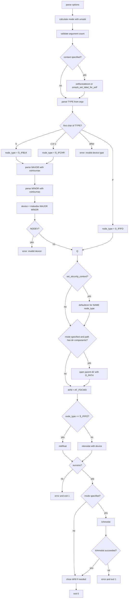

# `mknod`: create special files

Source: `src/mknod.c` (317 lines) · Tests: (none) ·
Manual: `info '(coreutils) mknod invocation'`

`mknod` creates block special files, character special files, or FIFOs using
`mknodat` or `mkfifoat`. It parses major and minor device numbers with
`xstrtoumax` (allowing decimal, octal, or hexadecimal), and combines them with
`makedev`. Like `mkfifo`, it uses `O_PATH` and `lchmodat` when a mode is
specified to avoid following symlinks in the path.

## Options

The table lists `longopts[]` (`src/mknod.c:38-45`) and the short-option
string `"m:Z"`.

|| Option | Variables |
||---|---|
|| `-m MODE`, `--mode=MODE` | `specified_mode`: file permission mode |
|| `-Z`, `--context[=CTX]` | `scontext` or `set_security_context`: SELinux/SMACK context |

## Code map

|| Function | Location | Role |
||---|---|---|
|| `main` | `src/mknod.c:97` | Option parsing, mode calculation, argument validation, device number parsing, `mknodat`/`mkfifoat`, `lchmodat` |
|| `usage` | `:48` | Help message |

## How it works

### Argument validation

`main` validates the argument count based on the device type
(`src/mknod.c:169-193`):

- **FIFO (`TYPE` starting with `p`):** Exactly 2 arguments (NAME, TYPE).
- **Block or character device:** Exactly 4 arguments (NAME, TYPE, MAJOR, MINOR).

The check looks at the first character of TYPE: if it's `p`, expect 2
operands; otherwise, expect 4. Extra or missing operands produce specific
error messages: "Special files require major and minor device numbers" or
"Fifos do not have major and minor device numbers".

### Device number parsing

For block and character devices, `main` parses MAJOR and MINOR with
`xstrtoumax` (`src/mknod.c:237-247`). The base is 0, which allows decimal,
octal (leading 0), or hexadecimal (leading 0x or 0X). The parsed values must
fit in `major_t` and `minor_t`. `makedev` combines them into a `dev_t`
(`src/mknod.c:249`). If `NODEV` is defined and the result equals `NODEV`,
`mknod` fails with "invalid device".

### Type determination

Only the first character of TYPE is checked (`src/mknod.c:214`), allowing
mnemonic usage like `mknod /dev/rst0 character 18 0`. The cases are:

- `b`: Block special file (`S_IFBLK`)
- `c` or `u`: Character special file (`S_IFCHR`)
- `p`: FIFO (`S_IFIFO`)

Platforms without `S_IFBLK` or `S_IFCHR` produce an error at compile time or
runtime.

### Mode and path handling

The mode calculation and path handling are identical to `mkfifo`
(`src/mkfifo.c:155-164`). When a mode is specified, the parent directory is
opened with `O_PATHSEARCH | O_DIRECTORY` and the file is created with
`mknodat`/`mkfifoat`, then the mode is set with `lchmodat` to avoid following
symlinks (`src/mknod.c:282-311`).

## Platform notes

`mknod` uses `mknodat`, `mkfifoat`, and `lchmodat` from gnulib. `S_IFBLK`,
`S_IFCHR`, and `NODEV` are conditionally defined. SELinux and SMACK support
is conditional on `is_selinux_enabled` and `is_smack_enabled`. Creating
device files typically requires root privileges.

## Errors and exit status

- **Missing operand:** "missing operand"
- **Extra operand:** "extra operand OPERAND"
- **Invalid mode:** "invalid mode" (from `mode_compile`)
- **Invalid mode bits:** "mode must specify only file permission bits"
- **Block special files not supported:** Platform lacks `S_IFBLK`
- **Character special files not supported:** Platform lacks `S_IFCHR`
- **Invalid major/minor:** "invalid major/minor device number NUMBER"
- **Invalid device:** "invalid device MAJOR MINOR" (when `NODEV` check fails)
- **Invalid device type:** "invalid device type TYPE"
- **Context set failure:** "failed to set default file creation context to CTX"
- **`mknodat`/`mkfifoat` failure:** Error message from `quotef(NAME)`
- **`lchmodat` failure:** "cannot set permissions of NAME"

Exit status is 0 on success, 1 on failure.

## Tests

No dedicated test files exist for `mknod`. Creating device files typically
requires root privileges and varies significantly across platforms.

## See also

- [mkfifo](mkfifo.md) for FIFO creation with similar mode handling
- [chmod](chmod.md) for mode syntax
